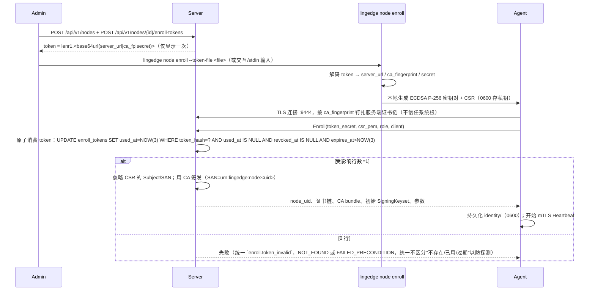
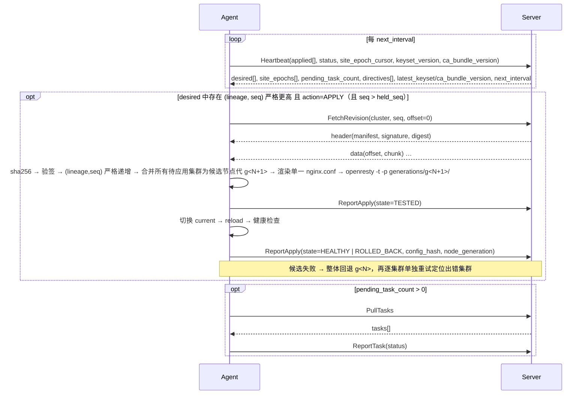
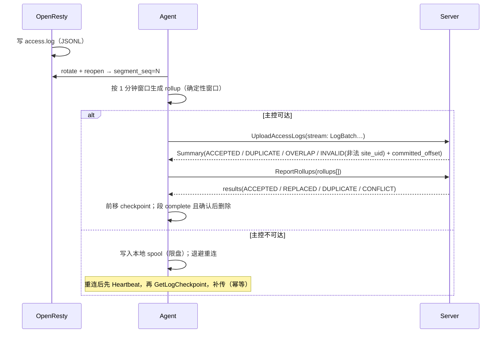
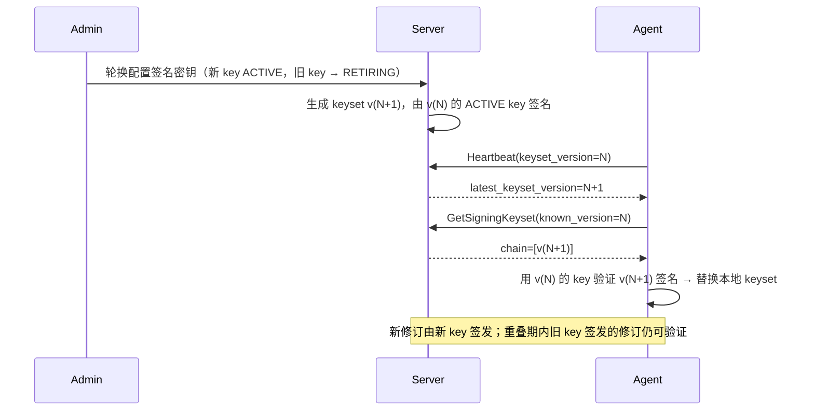
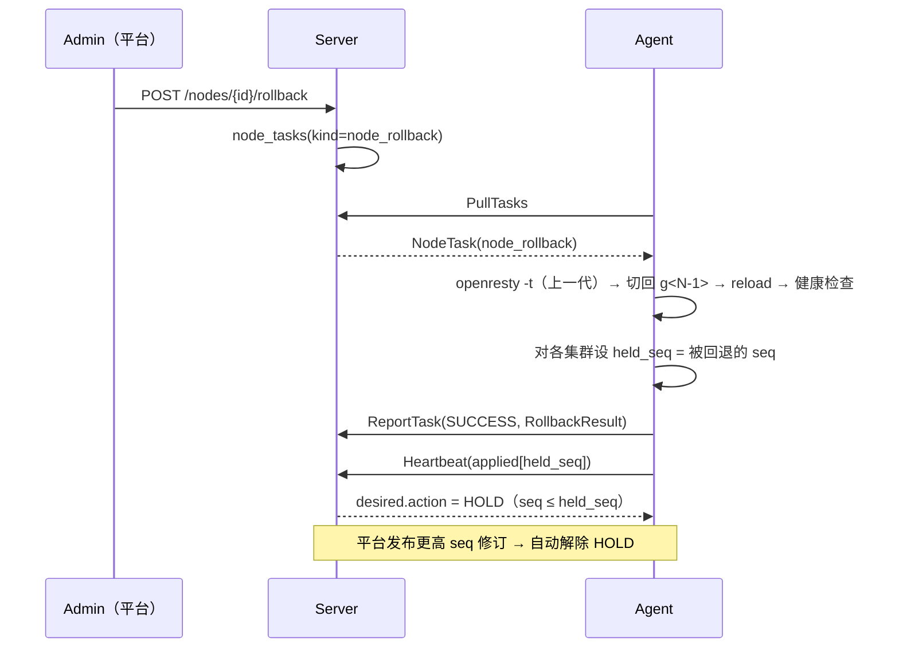
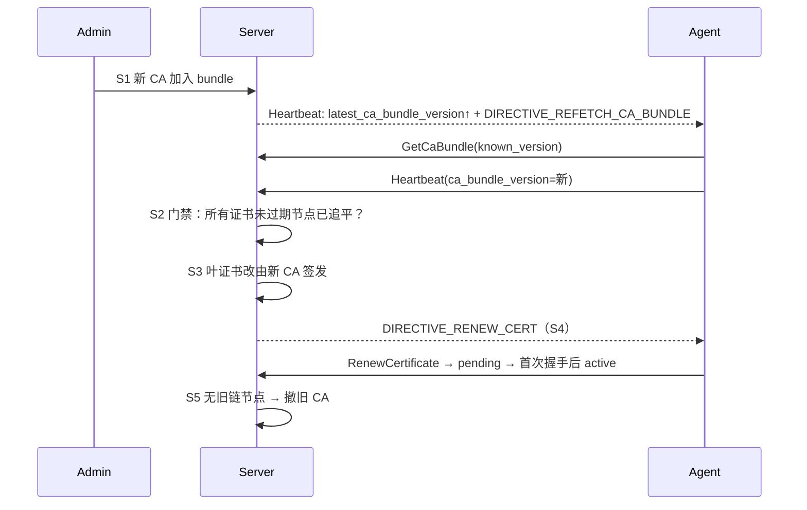

# LingEdge Node 协议

> 本文说明 `proto/lingedge/node/v1/*.proto` 的语义与不变量。proto 文件是线格式的唯一来源；本文是行为规格。冲突时，线格式以 proto 为准，行为以 ADR 与本文为准。
> 基线 §19：Node Agent 内部通信使用**独立协议与权限体系**，与面向用户的 REST API 分离（FR-27）。

## 1. 总览

- **传输**：gRPC over TLS 1.3，Protobuf（proto3，包 `lingedge.node.v1`）。
- **方向**：**节点主动发起**；Server 从不连接节点，节点不开放任何控制面入站端口（架构 §3）。
- **两个监听**：

| 监听 | 地址 | TLS | 服务 | 备注 |
|---|---|---|---|---|
| Enroll | `:9444` | 仅服务端证书（不要求客户端证书） | `EnrollService` | 仅当存在未过期注册 Token 时监听；按源 IP 与 Token 限速；可由防火墙收紧 |
| Control | `:9443` | **mTLS（严格要求客户端证书）** | `NodeControlService`、`RevisionService`、`TaskService`、`TelemetryService` | 任何无有效证书的连接在握手阶段被拒 |

- **服务与阶段**：

| 服务 | RPC | 阶段 |
|---|---|---|
| EnrollService | Enroll | M1 |
| NodeControlService | Heartbeat、RenewCertificate、GetCaBundle | M1 |
| RevisionService | FetchRevision（服务端流）、FetchCertificate、ReportApply、GetSigningKeyset | M1 |
| TaskService | PullTasks、ReportTask（任务：cache_purge_url/site、node_upgrade、node_rollback、cert_reload、debug_request） | M1；cache_prefetch、cache_purge_prefix 为 P2 |
| TelemetryService | UploadAccessLogs（客户端流）、GetLogCheckpoint、ReportRollups、ReportOriginHealth、ReportEvents | M1 |

- **没有**：执行命令、下发任意文件、任意 URL 抓取类消息。`Directive` 与 `NodeTask.payload` 均为封闭枚举/oneof（NFR-14、FR-35）。

## 2. 身份与授权

### 2.1 证书与角色

节点证书由 Server 管理的**私有 CA**（ECDSA P-256）签发，叶证书：
- Subject CN = `<role>:<uid>`（仅展示），**SAN = `URI:urn:lingedge:<role>:<uid>`**（授权依据）。
- `role ∈ node | dns | reporter | scheduler | worker`（proto `Role`）；`uid` 为节点/服务实例的 ULID。
- KeyUsage = digitalSignature；ExtKeyUsage = clientAuth；有效期默认 **90 天**（ADR-003，可配置）。
- **Server 叶证书**（:9443/:9444 出示，ADR-003）：同一私有 CA 签发，ExtKeyUsage = serverAuth，SAN = `server_url` 主机名/IP + 系统设置 `grpc.tls.san_extra`；私钥存 `signing_keys(purpose='grpc_server')`，进程热重载，90 天、2/3 周期由 Scheduler 任务 `server.cert_rotate` 自动轮换（**早于** CA 轮换）。
- 私有 CA 根证书默认有效期 10 年（可配 5–10 年）；`lingedge doctor` 在剩余 <1 年时告警。
- 私钥在节点本地生成（`lingedge node enroll`），永不上传。

### 2.2 拦截器授权（Server 端）

每个 `:9443` RPC 经统一拦截器：
1. TLS 握手已验证证书链到私有 CA。
2. 从 SAN 解析 `(role, uid)`；拒绝缺失/多个/格式非法的 SAN。
3. **吊销与状态检查**：查询 `node_certificates` 中该证书序列号与节点状态：`status=revoked`（或 `node.status=disabled`）→ `UNAUTHENTICATED`；`active`、`pending`（续期新证书，首次握手成功即转 `active`）、`superseded` 且在 `grace_until` 内被接受。吊销表在内存缓存并由 Redis pub/sub 失效（Redis 不可用时退化为短 TTL 轮询 MySQL，ADR-025）。
4. **角色→服务白名单**：M1 仅 `node` 角色可调用本文全部服务；其它角色调用返回 `PERMISSION_DENIED`。
5. **资源归属校验**：请求体中的 `node_uid` 必须等于证书主体；`cluster_uid`/`certificate_uid`/`task_uid`/`site_uid` 必须归属该节点所在集群（见 §6、§7、§9）。**不归属时一律返回 `NOT_FOUND`**，不泄漏存在性。
6. 把 `(role, uid)` 与 `x-request-id` 注入 context，供审计与日志使用。

### 2.3 与 REST 的隔离（FR-27）

- REST（:8080，经 Nginx）不监听 gRPC；gRPC 端口不提供 HTTP/REST。
- 用户 Token / 会话 Cookie 无法通过 mTLS 握手；节点证书无法通过 REST 的会话/Token 认证（REST 不识别客户端证书）。
- 租户永远没有节点管理权限（NFR-14）：节点相关 REST 端点要求平台权限 `node:*`。

## 3. Enroll 流程（FR-52）

**Token 格式 `lenr1.<payload>`**
- 前缀 `lenr1` 为版本标识；`payload = base64url(server_url "|" ca_fingerprint "|" secret)`，`ca_fingerprint` **定义为私有 CA 根证书 DER 的 SHA-256**（hex，冒号可省略）；:9444 出示的 Server 叶证书由该 CA 签发，Agent 校验链根指纹匹配即可。
- `secret` ≥ 32 字节密码学随机；Server **仅存 `SHA-256(secret)`**；明文仅在创建时展示一次；日志、审计、进程列表中必须脱敏（Tools 通过交互输入、`--token-file` 或 stdin 读取，避免命令行暴露，tools-design §14）；API 返回的 `enroll_command` 与 UI 示例使用 `--token-file`，不把令牌放 `--token` 命令行。
- **一次性**，TTL 默认 24 小时（可配，最小 1 小时）；绑定到具体 `node_uid` 与 `role`（`enroll_tokens.role`，M1 仅 `node`）；可选绑定"预期源 IP/CIDR"（`[ASSUMPTION]`，M1 实现为可选字段）。
- **CA 指纹钉扎**：Agent 不使用系统信任库，仅信任"链到指纹匹配的根"的服务端证书，防止 enroll 阶段被中间人冒充（TOFU 由带外传递的 Token 提供锚点）。
- 重放已用 Token → 拒绝（FR-52 验收：重放已用/过期 Token 一律返回同一错误 `enroll.token_invalid`）。

**节流**：Enroll 失败按源 IP 与 Token 前缀节流；:9444 仅在存在有效 Token 时监听，所有 Token 消耗/过期后自动关闭监听。

## 4. 证书续期、过期与 CA 轮换（F-2）

- 剩余有效期 ≤ 1/3（90 天证书约第 60 天）时，Agent 调用 `RenewCertificate`，**生成新密钥**与新 CSR，用**当前有效证书**经 :9443 认证。**两阶段**：
  1. Server 签发新证书，台账 `node_certificates.status='pending'`，旧证书保持 `active`；
  2. Agent 原子落盘新身份并用新证书重建连接；Server 拦截器在**新证书首次成功握手**时将其置 `active`、旧证书置 `superseded`（`superseded_at`，`grace_until = min(旧 not_after, superseded_at+7d)`，宽限内仍被接受；吊销可立即切断）。
  - 响应丢失 / Agent 在落盘前崩溃 → 旧证书继续可用，下次心跳重试续期；不会出现"旧证书已失效而新证书未落盘"的失联窗口。
- `HeartbeatResponse.directives` 可含 `DIRECTIVE_RENEW_CERT` 强制续期（如 CA 轮换 S4）。
- **证书已过期 ⇒ 无法再通过 mTLS 握手**（也无法调用 RenewCertificate）。节点的**数据面不受影响**（继续服务，ADR-020），但与主控的连接只能通过**重新 enroll**恢复：Admin 新建 enroll Token → `lingedge node enroll --force-reenroll`（沿用原 `node_uid`，旧身份备份、旧证书序列号登记为已替换）。
- Heartbeat 的 `certificate_not_after` 使 Server 能在到期前告警；`lingedge doctor` 对节点证书"剩余有效期 < 1/6（约 15 天，说明 1/3 处的自动续期已失败）"告警——**不在正常续期窗口（1/3）内告警**。
- **CA 轮换（分阶段，Server 强制门禁；M1 文档化、人工驱动，ADR-003）**：
  - S1：新 CA 加入 bundle（`signing_keys(mtls_ca, status=pending)`），经 `GetCaBundle` / `DIRECTIVE_REFETCH_CA_BUNDLE` / `latest_ca_bundle_version` 下发，bundle 同时含新旧根。
  - S2：等待所有**证书未过期**的节点上报 `Heartbeat.ca_bundle_version ≥ 新版本`（Server 记入 `nodes.ca_bundle_version`）；`doctor` 对未追平节点告警。
  - S3：Server 叶证书与新签发节点证书改由新 CA 签发（此时所有在线节点已信任新 CA）。
  - S4：节点经 `DIRECTIVE_RENEW_CERT` 续期换成新 CA 签发的证书。
  - S5：无节点证书再链至旧 CA 后撤旧 CA。
  - 离线节点在其证书过期前未追平 → 按上述 F-2 须重新 enroll；不使用"同时出示双链"。

## 5. Heartbeat 语义与节奏

- **请求**：`node_uid`、`ClientInfo`、`NodeStatus`、`applied[]`（每个所属集群一项，含 `applied_lineage`、`node_generation`、`held_seq`）、`keyset_version`、`site_epoch_cursor`、`certificate_not_after`、`ca_bundle_version`、`heartbeat_seq`（按 `boot_id` 单调）。
- **响应**：`desired[]`（每集群一项，含 `ACTION_APPLY | ACTION_HOLD`）、`site_epochs[]`（含 `lineage`）增量与 `next_site_epoch_cursor`、`pending_task_count`、`latest_keyset_version`、`latest_ca_bundle_version`、`directives[]`、`next_interval`、`server_time`、`min_agent_version`。
- **间隔**：由 `next_interval` 控制，默认值与离线判定窗口**待基线测试后确定**（FR-53、OQ-7）；Agent 在网络失败时使用**指数退避 + 抖动**重连，上限可配；节点离线判定由 Server 的 Scheduler 任务基于 `last_heartbeat_at` 与配置窗口完成。
- **幂等**：Heartbeat 无副作用以外的写入仅更新节点状态与 `node_cluster_state`；重复/乱序以 `(boot_id, heartbeat_seq)` 丢弃旧包。
- **epoch 增量**：Server 为每个 `site_uid` 维护单调 `cache_epoch`；响应带自游标之后的变更。游标失效或首次连接 → `site_epoch_full_resync=true`，返回全量。Agent 按 `(lineage, epoch)` 取 `max(本地, 下发)` 并持久化到 `state.json`（ADR-007、ADR-002 §12）。epoch 为站点级单值，M1 无"按集群整站失效"。
- **枚举映射（proto ↔ DB/OpenAPI，事实源 = DB/OpenAPI）**：

| 概念 | proto | DB / OpenAPI |
|---|---|---|
| `NodeStatus.OpenRestyState` | `RUNNING` / `RELOADING` / `STOPPED` / `CONFIG_ERROR` / `UNSPECIFIED` | `nodes.openresty_state`、`node_heartbeats.openresty_state`：`running` / `running`（瞬时） / `stopped` / `failed` / `unknown` |
| 逐节点缓存任务 | `TaskStatus`：`RUNNING` / `SUCCESS` / `FAILED` / `SKIPPED` / `EXPIRED`（投递层 `node_tasks.status`：`pending/leased/running/success/failed/skipped/expired/canceled`） | `cache_task_nodes.status`（业务回执）：`sent` / `success` / `failed` / `skipped_offline` / `expired`（尚未投递=`pending`） |
| 应用状态 | `ApplyState`（`PENDING…ROLLED_BACK`） | `deployment_targets.state` 小写同名，另有 Server 侧 `notified`、`waiting_offline`、`skipped`、`expired`；逐步历史在 `deployment_target_steps` |
- **时钟**：`server_time` 与本地偏差超阈值 → Agent 上报 `CLOCK_SKEW` 事件；签名校验**不依赖时间**，因此不会因偏差拒绝配置（R-4）。
- **协议主版本**：`protocol_major` 双向声明；主版本不一致 → Server 以 `FAILED_PRECONDITION` + `ErrorDetail(code="protocol.unsupported")` 拒绝。

## 6. desired / applied 模型与灰度

- **applied（节点事实）**：节点上报，Server 写入 `node_cluster_state(node_id, cluster_id, applied_lineage, applied_seq, applied_revision_id, state, held_seq, …)` —— "逐节点逐集群实际生效版本"的权威记录（FR-56）。
- **desired（Server 意图）**：节点看到的 `desired` = 其 `deployment_targets`（活动部署且批次已轮到）所对应修订；无活动目标时 = 集群 `clusters.confirmed_revision_id`（最近一次全量确认健康的修订，亦是离线节点上线后的追平目标）。**灰度 = 只对批次内节点暴露新 `desired`**；其它节点继续看到旧 `desired`（或 `ACTION_HOLD`），其生效版本不变（FR-56 灰度 AC）。灰度策略（strategy/batch_size/max_failures/failure_policy）仅由平台在 `clusters.settings_json.rollout` 设定，租户 API 不再接受这些参数（BLK-02）。
- **集群级串行**：同一集群同一时刻至多一个活动部署（`pending/running/paused`），其余发布请求进入 `publish_queue` 排队；修订在出队时才构建，copy-forward 基线 = `confirmed_revision_id`，因此失败/暂停中的修订不会被其它站点"捎带"，毒块天然隔离（ADR-002 发布编排）。
- **回滚**：回滚是**新修订**（`rollback_of` 指向旧修订），`seq` 仍单调递增，因此节点的"(lineage, seq) 严格大于本地值"规则始终成立，同时防止重放旧修订。**节点级回滚**（`node_rollback` 任务，§9）是另一回事：切回本地上一节点代、**不产生新修订**，并对各受影响集群设置 `held_seq`，使 `desired.seq ≤ held_seq` 时返回 `ACTION_HOLD`，防止立即被重新应用；平台发布更高 seq 修订时自动解除。
- **多集群与节点代**：节点的有效配置 = 其所属各集群 `desired` 修订的并集，由 Agent 合并渲染为**单一节点代 `g<N>`**（单一 `nginx.conf`、单一 `current`，§7）；每集群仍独立上报 `AppliedState`/`ReportApply` 与状态机；Server 在入群/绑定时已校验主机名、端口、站点级可信代理、`node_global` 参数无冲突（架构反馈 F-3，ADR-020）。
- **状态机**（`ApplyState`）：`PENDING → DOWNLOADED → VERIFIED → TESTED → APPLIED → HEALTHY`，终态之一 `FAILED`（任一步失败，节点保持/恢复上一有效代）或 `ROLLED_BACK`（已应用但健康检查失败后回退）。`NOTIFIED` 为 Server 侧状态（desired 已暴露给该节点）。Server 侧另有：`waiting_offline`（下发时节点离线/不可达；不阻塞批次推进、不计失败比例）、`skipped`（维护节点，不计入 M）、`expired`（超过 `catch_up_ttl_s` 仍未追平）。
- **离线节点追平回写**：`waiting_offline` 目标对应的节点上线后，其 `desired` = `confirmed_revision_id`；应用成功（`HEALTHY`）后 Server 把该目标回写为 `healthy` 并更新部署汇总（即使部署此前已因其余目标完成而结束）；目标超过 `deployment_targets.deadline_at`（`rollout.target_timeout_s`）未完成 → `failed(timeout)`。
- **批次推进**（Server 侧）：批次内全部"应参与"节点 `HEALTHY` 且无超阈值失败 → 放行下一批；失败比例超阈值 → 暂停并告警（阈值待配置，默认值待基线测试）。暂停/恢复/取消/重试（`POST /deployments/{id}/retry`）为平台独占操作。

## 7. FetchRevision 流程与校验顺序

`RevisionService.FetchRevision`（服务端流）。Server 仅响应节点 `desired` 中声明的 `(cluster, lineage, seq)`；其它请求 `NOT_FOUND`。

**节点本地布局（权威见 ADR-020 §2，此处仅列与校验相关部分）**：节点代目录 `/var/lib/lingedge-node/generations/g<N>/{generation.json,conf/nginx.conf,conf/sites/*.conf,data/…}`；单一 `current -> generations/g<N>`；可写路径（`cache/`、`runtime/`、pid、日志）一律绝对路径且不在代目录内。**统一 `-p/-c`**：预检 `openresty -t -p /var/lib/lingedge-node/generations/g<N>/ -c conf/nginx.conf`；生产（含 systemd `ExecStartPre/ExecStart`）`-p /var/lib/lingedge-node/current/ -c conf/nginx.conf`。两种前缀内容相同、仅字符串不同，故 `-t` 通过等价于生产可启动。

**节点校验与应用顺序（任何一步失败即停止并 ReportApply(FAILED)，保持当前代继续服务）**：

1. **下载**：先收 `header`（含 `manifest_json`、`RevisionSignature`、`bundle_size`、`bundle_digest`），再按 `RevisionData.offset` 连续收 `data`。中断后以 `offset` 续传（header 每次重发，须与上次一致，否则丢弃重来）。
2. **sha256**：对完整 bundle 字节流计算，与 `header.bundle_digest` 比对。
3. **签名验证**：用本地 `SigningKeyset` 中状态为 `ACTIVE/RETIRING` 的 `key_id` 公钥验证 `Ed25519(sig, "LINGEDGE-REVISION-V1\n" + manifest_json)`；`REVOKED` 或未知 key → 失败；**不检查过期时间**（R-4）。
4. **manifest 一致性**：`manifest.cluster_uid/lineage/seq` 与请求一致；bundle 内每个块的 sha256 与 manifest `blocks[{key,sha256,size}]` 一致（`key ∈ global|site:<uid>|l4`，无并列 `global{…}`）；无多余/缺失条目；解包路径防穿越（拒绝 `..`、绝对路径、符号链接）。
5. **(lineage, seq) 单调**：`(lineage, seq)` 必须**字典序严格大于**本地该集群已应用的 `(applied_lineage, applied_seq)`（不是"不小于"）；否则拒绝（防重放/回退；回滚已是新 seq）。数据库恢复后 Server 提升 `lineage`，使较低 seq 的新修订仍可被接受（ADR-002 §12）。**节点级回滚的 `held_seq`**：`seq ≤ held_seq` 的 desired 不应用（`ACTION_HOLD`）。
6. **候选节点代**：把本次要应用的所有集群更新（Agent 将同一时刻所有待应用的集群 desired 合并为一次候选）与其余集群当前内容合并，解包渲染到新代目录 `generations/g<N+1>/`（不触碰 `current`）。
7. **渲染**：用随 Agent 发行的 `edge/templates` 与类型化白名单渲染器生成**单一** `nginx.conf`/站点片段与数据文件（ADR-004）；节点全局参数取自所属集群 `node_global` 键（须逐键相等，否则渲染失败 `render.invalid_value`）；同主机名跨集群重复 → 渲染失败；任一值校验失败 → 失败。
8. **证书准备**：对 manifest 引用的 `certificate_uid`（修订不含证书版本/指纹，节点取当前活动版本），必要时 `FetchCertificate`（版本变化才取），0600 原子落盘。
9. **`openresty -t -p <新代前缀> -c conf/nginx.conf`** 通过（在 Agent 单元环境内执行；Agent 单元不设 `MemoryDenyWriteExecute`，ADR-024）。
10. **应用**：原子切换 `current` 符号链接 → 向 OpenResty master 发送 reload（HUP，按名重新打开 `current`，不中断存量连接）。
11. **健康检查**：本地探测（Unix socket 控制接口回显 `config_hash` 与规则引擎加载状态；可选对已配置站点的合成请求）。失败 → 切回上一代并 reload，状态记 `ROLLED_BACK`。
12. **失败隔离（多集群）**：候选代失败时整体回退 `g<N>`，随后**逐集群单独重试**以定位出错集群；`ReportApply` 仅对出错集群报 `FAILED`/`ROLLED_BACK`，其余集群成功者正常上报 `HEALTHY`。
13. **ReportApply**：逐步上报状态（可多次，终态必报；幂等键 `(deployment_target_uid, state, attempt)` ↔ `deployment_target_steps` 的 `UNIQUE(deployment_target_id, attempt, state)`），成功后更新 `state.json`（`current_gen`、`clusters{uid→{lineage,seq,held_seq}}`）并清理超出保留代数的旧代（默认保留最近 3 代，≥2，ADR-020）。

渲染/测试/应用 全程在本地完成，**与主控是否在线无关**（只有下载与上报需要连接）。

## 8. 签名公钥集与链式轮换

- **三个独立信任域**（ADR-012）：发行清单签名 / 配置修订签名 / 节点 mTLS CA。本协议只涉及后两者；**发行签名公钥不经此协议下发**（内置于 Tools）。
- **初始信任**：`EnrollResponse.signing_keyset`（`previous_version=0`，无 `signature`），通过 enroll 阶段的 TLS+CA 钉扎建立信任起点。
- **轮换**：新 `SigningKeyset`（`version = N+1`）由 `version=N` 中仍为 `ACTIVE/RETIRING` 的 key 签名（`signed_by_key_id`、`signature`，输入 `"LINGEDGE-KEYSET-V1\n"+canonical_json(version,keys,issued_at,previous_version)`）。节点验证链后替换本地 keyset。
- **canonical_json 的字段编码**（CC-10 澄清，实现：`pkg/signing`，Server/Agent/Tools 共用）：对象键按字典序、无空白、UTF-8、不转义 HTML、整数不带小数点；顶层键 `issued_at`（UTC RFC 3339，纳秒部分去掉尾随 0，如 `2026-11-21T08:00:00Z`）、`keys`、`previous_version`、`version`；`keys[]` 每项键 `algorithm`（`ed25519`）、`key_id`（`^[A-Za-z0-9_-]{1,32}$`）、`not_before`（同 `issued_at` 格式，未给出为 `null`）、`public_key`（32 字节原始公钥的标准 base64，带填充）、`status`（proto 枚举名 `ACTIVE|RETIRING|REVOKED`）；数组按 `key_id` 升序排列（签发方保证，验证方按收到的顺序重算）。**不含** `signed_by_key_id` 与 `signature`。
- **链验证规则**（`pkg/signing.VerifyKeysetLink/VerifyChain`）：新版本必须严格 `= 旧版本+1` 且 `previous_version = 旧版本`（小于等于已信任版本 = 回滚，拒绝；跳版本 = 断链，拒绝）；`signed_by_key_id` 必须是**上一版**中 `ACTIVE/RETIRING` 的 key（`REVOKED`/未知拒绝）；签名对 `"LINGEDGE-KEYSET-V1\n"` ‖ canonical body 成立（任何内容被改 = 失败）；上一版中保留下来的 key 其算法与公钥不得改变，`REVOKED` 不得恢复；每一版至少有一把 `ACTIVE` key；任一级失败则整条链作废，调用方不得部分采用。信任起点（`previous_version=0`、无签名）经 enroll 的 TLS+CA 钉扎获得（`pkg/signing.VerifyRoot` 只做结构校验）。
- **指纹口径**：配置签名公钥 = SHA-256(原始 32 字节公钥) 小写十六进制；证书（CA、Server 叶证书）= SHA-256(证书 DER) 小写十六进制（CA 的即 enroll Token 的 `ca_fp`）。
- **重叠期**：新 key 先以 `ACTIVE` 加入、旧 key 降为 `RETIRING`（仍可验证）；确认全部节点已升级到新 keyset 后，旧 key 才置 `REVOKED`。重叠期内新旧签发的修订均可被节点验证（FR-26）。
- **紧急吊销**：key 泄露时发布新 keyset 将其置 `REVOKED`；节点拒绝其签发的任何**未应用**修订；已应用的修订不受影响（运维应立即发布新修订）。
- 节点通过 `HeartbeatResponse.latest_keyset_version` 或 `DIRECTIVE_REFETCH_KEYSET` 触发 `GetSigningKeyset(known_version)`；响应为 `known_version` 之后的完整链，节点**逐级验证**。
- **不设会使离线节点停服的过期机制**：节点离线较久后重连，仍可用链式 keyset 追平。若离线期间发生了"旧 key 已被吊销且链断裂"的极端情形，需重新 enroll。

## 9. 任务（TaskService）

- **队列载体**：所有逐节点任务统一落在 `node_tasks`（`uid`、`node_id`、`kind`、`payload_json`、`attempt`、`lease_until`、`deadline_at`、`status`…）；`NodeTask.task_uid` = `node_tasks.uid`。`PullTasks` 只返回 `node_id = 证书主体` 且 `status ∈ (pending, leased 且租约过期)` 的行；`cache_task_nodes` 仅是缓存任务的业务回执视图（经 `node_task_id` 关联），不再作为投递依据。
- **拉取**：`PullTasks(max_tasks, supported_types, wait)`，支持长轮询。Heartbeat 的 `pending_task_count > 0` 提示 Agent 立即拉取。
- **租约**：每个 `NodeTask` 带 `lease_until` 与 `deadline`。Agent 在 `deadline` 前完成并 `ReportTask`；租约到期未回执，Server 视为失败并按 `attempt` 重投（最大尝试数配置化）。
- **幂等**：以 `task_uid` 去重；Agent 对已成功的 `task_uid` 再次收到时直接回执 `SUCCESS`。所有任务实现必须幂等（缓存失效 = 取 `(lineage, 标记版本)` 的 `max`，天然幂等）。
- **回执**：`ReportTask(task_uid, attempt, status, error, result)`；`RUNNING` 可用于长任务进度；终态 `SUCCESS/FAILED/SKIPPED/EXPIRED`（映射见 §5 枚举映射表）。
- **离线补执行**：离线期间累积的任务在重连后经 `PullTasks` 补发；对 `deadline` 已过的任务，Server 标记 `EXPIRED`，但**整站/URL 失效类任务的效果通过 `site_epochs`（Heartbeat）也会补齐**，因此失效不因离线丢失（ADR-007）。`cache_task_nodes` 逐节点记录回执，任务可见每节点结果。
- **任务类型**（封闭）：
  - `cache_purge_url`：`(site_uid, host, path_and_query, marker_version, marker_ttl, lineage)` → 节点把该 URL 的 `url_ver` 标记置 `max(local, marker_version)`（比较键 `(lineage, marker_version)`），经共享字典 `safe_set` 写入（不会 LRU 静默淘汰他人标记）；共享字典写入失败或该站点标记数超配额则升级为整站 epoch：回执 `escalated_to_site_epoch=true` 并带新 `escalated_epoch`，Server 据此权威上调该站点 `cache_epoch`（ADR-007）。
  - `cache_purge_site`：`(site_uid, epoch, lineage)` → 置站点 epoch（同时经 Heartbeat 下发）。
  - `cache_purge_prefix`（P2，PoC 通过前不下发）、`cache_prefetch`（P2）。
  - `node_upgrade`：`component ∈ {node, openresty}`。Agent 下载并验证到 `staging/<component>-<version>/{manifest.json,manifest.json.sig,package.tar.gz}`，写 `upgrade.request`——**仅** `{"schema":1,"component","version","task_uid"}`，不含任何路径或文件清单；由 systemd `.path` 触发 root 侧 Tools 受限入口，root 侧以 `O_NOFOLLOW`/dirfd 固定推导文件名、再次验签并切换（ADR-024）；**Agent 的校验不被信任**。结果由 root 侧写入 **root 属主目录** `/var/lib/lingedge-node-upgrade/<task_uid>.result.json`（0644，`O_EXCL|O_NOFOLLOW`），Agent 只读并经 `ReportTask` 上报；root 进程从不向 Agent 属主目录写文件。`download_url` 的 host 必须在本地允许的发行源内。
  - `node_rollback`：`(target_generation, reason)` → 节点级回滚到本地上一节点代（不产生新修订），经 `openresty -t` 与健康检查，成功后对受影响集群设置 `held_seq` 并回执 `RollbackResult`；Server 对 `desired.seq ≤ held_seq` 返回 `ACTION_HOLD`，平台发布更高 seq 修订时自动解除。
  - `cert_reload`：触发 `FetchCertificate`（取当前活动版本）与热加载。
  - `debug_request`：真实 IP 调试（FR-73）。Agent 经本机 ctl socket 的封闭操作 `debug_simulate` 调用与请求路径**同一批纯函数**（`realip.resolve` + `origin_headers.build`），`simulated_peer_ip` 仅为函数入参；**不向 OpenResty 发起请求、不开回环调试源站、请求路径无调试分支**，返回 `DebugResult`（识别到的 IP、命中的可信代理规则、计算得到的出站头，Cookie/Authorization 脱敏）。入站可信代理判定在 Lua 引擎内完成（不使用 nginx realip 模块），因此函数模拟与线上请求逻辑一致；请求头名称/数量/长度受白名单限制。该任务由租户 API `debugRealIp`（Task 类型 `realip.debug`）触发，节点由服务端按站点所属集群选取，租户不可指定。
- **绝不存在**：`exec`、`shell`、`write_file`、`http_get(url)`、`reload(any)` 等通用原语。

## 10. 日志上传（UploadAccessLogs）

对应 ADR-008、FR-114。

- **客户端流**：一个流内连续发送若干 `LogBatch`，流结束后返回 `UploadLogsSummary(results[])`。Agent 限制单流批次数/字节（默认待基线测试），缩小失败后的重传范围。
- **去重键**：`(node_uid[来自证书], segment_seq, start_offset, end_offset)`。
  - 完全相同键 → `DUPLICATE`（视为成功，Agent 可前移本地 checkpoint）。
  - 与已提交范围**部分重叠** → `REJECTED_OVERLAP` 并返回 `committed_offset`，Agent 据此重新切批。
  - 严格模式（默认关闭）下与已提交偏移之间有空洞 → `REJECTED_GAP`。
  - 哈希/行数/大小校验失败，或任一行 `site_uid` 格式非法 → `REJECTED_INVALID`（内容有误，勿原样重发）。
- **批边界**：必须落在 JSONL 行边界；`uncompressed_size = end_offset - start_offset`；`content_digest` 为未压缩字节的 sha256；压缩默认 `zstd`。
- **断点续传**：Agent 本地 checkpoint 为 `(segment_seq, committed_offset)`；状态丢失时先 `GetLogCheckpoint(segment_seq)` 恢复。
- **段轮转**：Agent 触发 nginx rotate（重命名 + `reopen`）并分配 `segment_seq`；段读完后最后一批 `segment_complete=true`，服务端确认后 Agent 才可删除段文件。
- **Server 写前强校验（不信任节点自报字段，BLK/IMP-08）**：
  1. 每行 `site_uid` 必须匹配 ULID 正则 `^[0-9A-HJKMNP-TV-Z]{26}$`，否则整批 `REJECTED_INVALID`；
  2. 合法 ULID 但**不属于该节点所在集群当前绑定的站点**（站点刚解绑/已删除等合法情形，或被攻破节点伪造他租户站点）→ 这些行归入 `_unattributed/<node_uid>/` 分片（`site_id=0`、仅平台可见，不进入任何租户日志与 rollup 计量），并产生 `LOG_SITE_MISMATCH` 事件；
  3. 最终落盘路径 `filepath.Rel(logRoot, realpath)` 断言位于日志根内，禁止穿越。
- **Server 落盘与 chunk 拆分**：按 **(批次, 站点, 日期)** 拆分 chunk（跨 UTC 零点的批次拆成两行），追加写 `${data}/logs/access/<site_uid>/<YYYYMMDD>/<node_uid>-<seq>.jsonl.zst`（每个 chunk 一个 zstd 帧，`access_log_chunks.file_offset/stored_length` 记录位置）；`access_log_chunks` 仅存 chunk 元数据（不存请求行），唯一键 `(node_id, segment_seq, start_offset, end_offset, site_id, log_date)`；`sha256` = 该 chunk **未压缩 JSONL 字节**的哈希（不是整个分片文件）。
- **离线与限盘**：主控不可达时写入本地 spool（受 `log_spool` 限额）；超限丢弃最旧段并上报 `LOG_SPOOL_OVERFLOW`（含丢弃范围），**不写满系统盘**。

## 11. Rollup 幂等（ReportRollups）

对应 ADR-008/010、FR-108/113。

- **确定性窗口 id**：`(site_uid, window_start, window_seconds)`，`window_start` 必须对齐 `window_seconds` 整数倍（M1 固定 60 秒）。Agent 只在窗口结束且对应日志已 flush 后才上报（"finalized"）。
- **幂等键**：`(node_uid[证书], site_uid, window_start, window_seconds)`；`site_uid` 为空 = 节点级汇总。数据库承载：`rollup_windows`（`UNIQUE(node_id, site_id, window_start, window_seconds)`，存 `generation` 与 `content_sha256`；`site_id=0` = 节点级）。
- **更正与同代冲突（全链路统一语义）**：窗口迟到日志导致数值变化时发送更高 `generation`：
  - `generation` 更大 → `REPLACED`（替换 `metric_rollups` 行，计量以最高 generation 为准，usage 重算 upsert）；
  - 相同 `generation` 且 `content_sha256` 一致 → `DUPLICATE`；内容不同 → `CONFLICT`，**保留首次并记事件，不静默覆盖**（DB 与 proto 同一语义，不再有 `report_seq` 的 `>=` 覆盖）。
- **溯源**：`sources[]` 指向窗口所依据的日志段范围，便于对账。
- **全整数**：`RollupMetrics` 仅含整数计数；金额不在节点侧计算（AD-10）。直方图桶上界序列由 `latency_bounds_version` 固定（版本 1 的序列见 proto 注释，`[ASSUMPTION]`，实现前依基线测试调整）。
- **proto 字段 → DB `metric_rollups.metric`（事实源 = DB）**：

| proto `RollupMetrics` | DB metric（agg） |
|---|---|
| `requests` / `bytes_out` / `bytes_in` | `requests` / `bytes_out` / `bytes_in`（sum） |
| `status_1xx … status_5xx` | `status_1xx … status_5xx`（sum） |
| `cache_hit/miss/expired/stale/bypass/revalidated/updating/none` | `cache_hit … cache_none`（sum） |
| `origin_requests` / `origin_bytes_in` | `origin_requests` / `origin_bytes`（sum） |
| `origin_latency_ms_sum` / `origin_latency_count` | `origin_latency_ms_sum` / `origin_latency_count`（sum） |
| `ttfb_ms_sum`（v1 新增，25） | `ttfb_ms_sum`（sum；平均值 = 该值 / `requests`） |
| `rule_hits{rule_uid→n}` | `rule_hits`，`dim_type='rule'`（sum） |
| `websocket_upgrades` | `websocket_upgrades`（sum） |
| `request_time_buckets[]` + `latency_bounds_version` | `req_time_bucket`，`dim_sub='<bounds_version>:<idx>'`（sum） |
| `bandwidth_peak_bps`（v1 新增，26；窗口内 1 秒分桶峰值） | `bandwidth_peak_bps`（**max**，下采样取 max） |

  无生产者的 DB 旧指标 `conn_active_max` 已删除（连接数走 Heartbeat `active_connections`）。`usage_records` 只取 **300 秒**粒度，由已闭合 1m `site_node` 窗口的最新 generation 派生。
- **基数保护**：`rule_hits` 的键数受限，超限窗口被拒收并产生 `ROLLUP_CARDINALITY_DROP` 事件。

## 12. 源站健康与事件

- `ReportOriginHealth`：Agent 主动健康检查（经 SSRF 守卫解析，解析结果落在禁止地址段 → `FAILURE_REASON_SSRF_BLOCKED`）。Server 写 `origin_health`；**P3 前不用于调度**，M1 仅展示与源站故障告警输入。
- `ReportEvents`：`event_uid`（ULID）去重（DB：`node_events.event_uid` 唯一）；事件类型枚举见 `NodeEventType`；事件进入 `node_events` 并可触发告警（P2）。

## 13. 错误码与 gRPC status 映射

`ErrorDetail.code` 为稳定点分小写字符串，经 gRPC status details 携带。

| 场景 | gRPC status | 示例 `code` |
|---|---|---|
| 无/无效证书、已吊销、证书过期 | `UNAUTHENTICATED` | `auth.certificate_invalid`、`auth.certificate_revoked` |
| 角色不允许调用该服务 | `PERMISSION_DENIED` | `auth.role_forbidden` |
| 资源不存在**或不归属该节点** | `NOT_FOUND` | `resource.not_found` |
| 请求参数非法（越界、格式） | `INVALID_ARGUMENT` | `validation.failed` |
| Enroll Token 无效/已用/过期（统一，Tools 映射为同一提示，不暴露原因） | `NOT_FOUND`（或 `FAILED_PRECONDITION`，不区分原因） | `enroll.token_invalid` |
| 协议主版本不兼容 | `FAILED_PRECONDITION` | `protocol.unsupported` |
| 修订 (lineage, seq) 非严格递增（节点自检，仅用于 ReportApply 错误详情） | — | `revision.seq_not_monotonic` |
| 节点级回滚后 desired.seq ≤ held_seq（Server 返回 HOLD，非错误） | — | `revision.held` |
| CA bundle 版本落后导致 Server 叶证书无法验证（S2 门禁未满足） | `UNAVAILABLE` | `tls.ca_bundle_stale` |
| 修订签名/哈希校验失败（同上） | — | `revision.signature_invalid`、`revision.digest_mismatch` |
| 渲染值非法 / nginx 测试失败 / 健康检查失败（ReportApply） | — | `render.invalid_value`、`nginx.test_failed`、`health.check_failed` |
| 限流 | `RESOURCE_EXHAUSTED` | `rate_limit.exceeded`（含 retry 提示） |
| 服务端暂不可用（含维护） | `UNAVAILABLE` | `server.unavailable` |
| 超时 | `DEADLINE_EXCEEDED` | — |
| 日志批冲突/非法 site_uid | OK + `LogBatchResult.status` | 见 §10 |

客户端对 `UNAVAILABLE/DEADLINE_EXCEEDED/RESOURCE_EXHAUSTED` 使用指数退避重试；对 `UNAUTHENTICATED` 触发证书检查/重新 enroll 流程提示；对 `INVALID_ARGUMENT` 不重试。

## 14. 版本演进与兼容（D-11）

- 包名 `lingedge.node.v1`。**v1 内只做向后兼容变更**：新增字段/消息/RPC/枚举值；不得改变字段号/类型/语义，不得复用已删除字段号。
- 删除或废弃字段：保留 `reserved <号>;` 与 `reserved "<名>";`，并在本文记录。
- 枚举：新增值必须使接收方对未知值有安全默认（`*_UNSPECIFIED` 视为忽略/保守处理）。
- 破坏性变更 → 新包 `lingedge.node.v2`（服务端并行提供 v1/v2 一个发行周期），`protocol_major` 协商。
- **CI 破坏检测**：对 `proto/` 运行 `buf breaking`（或等价的 descriptor-set 比对；工具选型实现时核对），与最近一个契约冻结标签比较；变更须走 ADR（D-11、ADR-017）。
- 能力协商：`ClientInfo.capabilities` 声明可选能力（如 `rev.block_dedup`）；未知能力两端均忽略。
- **2026-11-16 修订新增（均为向后兼容新增，未改动/复用既有字段号，无 `reserved`）**：
  - `common.proto`：`RevisionRef.lineage=5`。
  - `control.proto`：`AppliedState.applied_lineage=9 / node_generation=10 / held_seq=11`；`HeartbeatRequest.ca_bundle_version=9`；`HeartbeatResponse.latest_ca_bundle_version=12`；`SiteEpoch.lineage=3`；`Directive.DIRECTIVE_REFETCH_CA_BUNDLE=7`；新 RPC `NodeControlService.GetCaBundle`（`GetCaBundleRequest/Response`）。
  - `enroll.proto`：`EnrollResponse.ca_bundle_version=7`。
  - `revision.proto`：`ReportApplyRequest.now_serving_lineage=12 / node_generation=13 / held_seq=14`；注释修正（manifest `blocks[{key,sha256,size}]`+`lineage`、无并列 `global{…}`；`FetchCertificate` 取当前活动版本）。
  - `task.proto`：`NodeTask.payload` 增 `NodeRollback node_rollback=17`（`NodeRollback`、`RollbackResult`）；`CachePurgeUrl.lineage=6`、`CachePurgeSite.lineage=3`、`CachePurgePrefix.lineage=6`；`CacheTaskResult.applied_lineage=5 / escalated_epoch=6`；`UpgradeResult.result_status=3`；`ReportTaskRequest.result` 增 `RollbackResult rollback=23`；注释：`NodeTask.task_uid = node_tasks.uid`、`NodeUpgrade.component ∈ {node, openresty}`、`DebugRequest` 经 ctl 纯函数模拟。
  - `telemetry.proto`：`RollupMetrics.ttfb_ms_sum=25 / bandwidth_peak_bps=26`；`NodeEventType.NODE_EVENT_TYPE_NODE_ROLLED_BACK=13`；注释：generation/CONFLICT 与 `rollup_windows`、`site_uid` 写前校验。
  - 比较规则变更（语义，非线格式）：节点接受修订的条件由"`seq` 大于等于/小于"的多种说法统一为 **`(lineage, seq)` 字典序严格大于**；旧 Agent 不发送 lineage（视为 1），与新 Server 在 lineage=1 时行为一致。
- Agent 与 Server 的**版本偏差策略**：Server 至少兼容前一个 minor 的 Agent；`min_agent_version` 仅用于告警，不强制断连（避免离线升级窗口内失联）。

## 15. 限流与安全

- **消息大小**：`:9443` 默认 `MaxRecvMsgSize`/`MaxSendMsgSize` 限制（建议 4 MiB 量级，实现时核对）；大对象只走流式（`FetchRevision`、`UploadAccessLogs`）并设单块上限（`max_chunk_bytes` 受服务端上限约束）。
- **超时**：所有 unary RPC 必须带 deadline；流式 RPC 使用空闲超时与总时长上限；keepalive 参数两端对齐（防僵尸连接）。
- **限流**：按节点身份（`node_uid`）令牌桶 + 全局；Enroll 另按源 IP/Token 前缀。限流计数使用进程内+Redis 混合，Redis 不可用时退化为进程内（ADR-025）。
- **重放防护**：mTLS 保证通道机密与完整；写操作靠**业务幂等键**（`task_uid+attempt`、日志去重键、rollup 键、`event_uid`、`ReportApply` 的 `(deployment_target_uid,state,attempt)`，各有唯一列承载：`node_tasks.uid`、`access_log_chunks` 唯一键、`rollup_windows`、`node_events.event_uid`、`deployment_target_steps`）；`(lineage, seq)` 严格递增防修订重放；Enroll Token 一次性。**不**依赖请求时间戳。
- **特权升级路径**：`NodeUpgrade` 的 Agent 校验不被信任；root 侧重新验证且结果文件写 root 属主目录（§9、ADR-024）。
- **敏感数据**：`FetchCertificate` 响应含私钥，仅经 mTLS；Server 审计每次取用；拦截器与访问日志对 `private_key_pem`、`token_secret` 字段做脱敏；Agent 不得将其写入普通日志（NFR-12/13）。
- **最小权限**：节点只能读写自己的资源；Server 不返回其他节点/租户的任何数据；错误信息统一为 `NOT_FOUND` 避免枚举。
- **SSRF**：`NodeUpgrade.download_url`、`CachePrefetch`、源站健康检查的出站请求在节点侧经 `pkg/ssrf` 守卫（连接时校验解析结果；允许清单 `ssrf.allow_cidrs` 随修订 `global` 块下发）。`debug_request` 不发起任何出站/回环请求。

## 16. 时序图

### 16.1 心跳与配置拉取

### 16.2 日志与 rollup 上报（含离线补传）

### 16.3 签名密钥链式轮换

### 16.4 节点级回滚与 held_seq

### 16.5 CA 轮换（分阶段）

## 17. 预留：DNS / Reporter / 独立 Scheduler·Worker（P3）

- 认证体系沿用：同一私有 CA，证书 SAN `urn:lingedge:{dns|reporter|scheduler|worker}:<uid>`，同一 `:9443` mTLS 监听，拦截器按角色白名单分流。
- **DNS（`lingedge.dns.v1`，P3）**：`DnsControlService`：拉取 Zone/记录全量与增量（游标，类似 site epoch）、上报应答统计与健康；Zone 变更版本化，多 DNS 节点一致性由版本号 + 回执确认。
- **Reporter（`lingedge.reporter.v1`，P3）**：拉取探测任务（目标/类型/频率，SSRF 守卫）、上报 `probe_results`（含失败原因分类、区域标签）；探测任务为白名单类型（HTTP/HTTPS/TCP/TLS/DNS）。
- 独立 Scheduler/Worker 直接连接 MySQL（同一信任域内部部署），**不经本协议**；其对 Server 的 gRPC 使用仅限心跳与锁租约（P3 设计，ADR-019）。
- 以上 proto 在对应阶段前不落盘；预留包名与端口不变更。

## 18. 未决 / 实现时核对

1. `go_package` 模块路径 `github.com/wuekevin/lingedge`（`[ASSUMPTION]`）：与实际 `go.mod` 对齐。
2. Heartbeat 默认间隔、离线判定窗口、单流日志批次上限、`max_chunk_bytes` 默认值、消息大小上限：**待基线测试后确定**（NFR-30、OQ-7）。
3. Enroll Token 的"预期源 IP/CIDR 绑定"在 M1 是否启用（默认可选）。
4. 证书有效期 90 天与续期阈值 1/3 为 ADR-003 默认，可由用户推翻；节点长期离线的运营影响见架构反馈 F-2。
5. `buf breaking` 或等价工具选型；protobuf/gRPC 库版本固定见 `docs/architecture/dev-environment.md`（实现时核对）。
6. `FetchRevision.have_blocks` 块级去重在 M1 是否实现（默认忽略该字段，仅保留位）。
7. 吊销检查的缓存与失效（Redis pub/sub + 短 TTL）实现细节，及 Redis 不可用时的上限陈旧时间。
8. 直方图桶边界（`latency_bounds_version=1`）为 `[ASSUMPTION]`，基线测试后可出 version 2。
9. DNS/Reporter proto 在 P3 前不落盘；独立 Scheduler/Worker 与 Server 的交互形态在 ADR-019 实现时确认。
10. `ClientInfo.capabilities` 的标签表与 Agent 版本能力矩阵在 Agent 实现阶段补充。
11. 本地 `go` 与 `protoc`：`libprotoc 36.1` 已验证 proto 语法编译通过（2026-11-16 修订后复验：6 个文件 `protoc -I proto --include_imports` 通过，无字段号冲突；仅描述符集，未生成 Go 代码）；`protoc-gen-go`/`protoc-gen-go-grpc` 版本实现时核对。
12. 节点代合并渲染的"候选失败后逐集群重试"的最大重试次数与退避（Agent 实现时定）；`node_global` 键清单以 ADR-020 为准。
13. `debug_simulate` ctl 操作与请求路径共用纯函数的单元/Lua（busted）测试需 OpenResty 环境（标「等待环境验证」）；入站可信代理判定迁入 Lua 后的性能由 PoC-4 基线确认。
14. CA 轮换 S1–S5 在 M1 为文档化、人工驱动；自动化与 `GetCaBundle` 的限流策略后续补充。

## 修订记录 2026-11-16

依据 `docs/bmad/review-architecture.md` 与 `review-architecture-internal.md`：§2/§3/§4（Server 叶证书、两阶段续期、CA 轮换分阶段、`--force-reenroll`、`enroll.token_invalid`、doctor 阈值 <1/6）；§5（Heartbeat 新字段、枚举映射表）；§6/§7（节点代、统一 `-p/-c`、集群级串行与 confirmed 基线、`waiting_offline` 追平回写、`(lineage, seq)` 严格递增、`node_rollback`/`held_seq`、多集群候选代与失败隔离、证书取当前活动版本）；§9（`node_tasks`、`NodeRollback`、升级请求仅 component+version+task_uid、root 属主结果目录、debug 纯函数模拟）；§10（`site_uid` 强校验、`_unattributed`、(批次,站点,日期) 拆分、`sha256` 含义）；§11（`rollup_windows`、同代 CONFLICT、metric 对应表）；§13–§16、§18。涉及评审项：BLK-04/05/06/07、IMP-03/05/06/07/08/09/11、MIN-04/10、H4–H8/H10、M13/M14/L23/L24。

