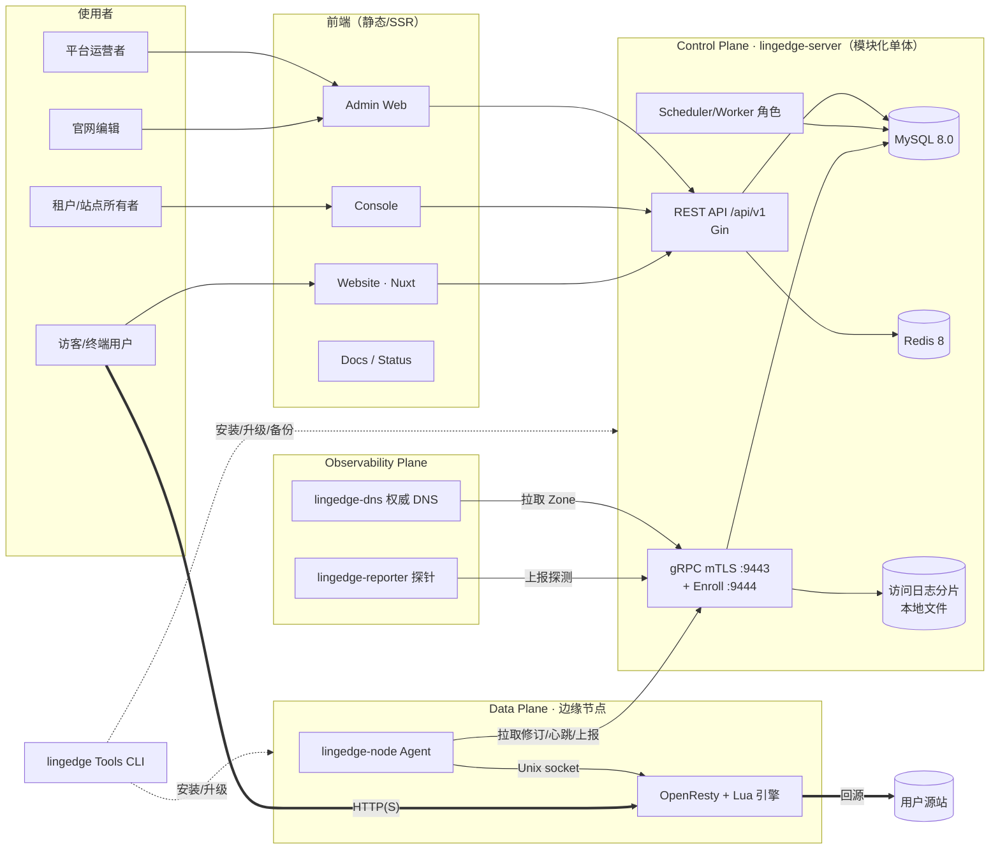
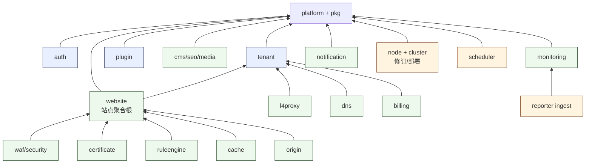
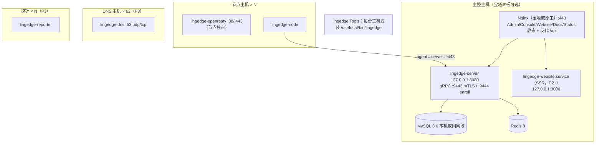
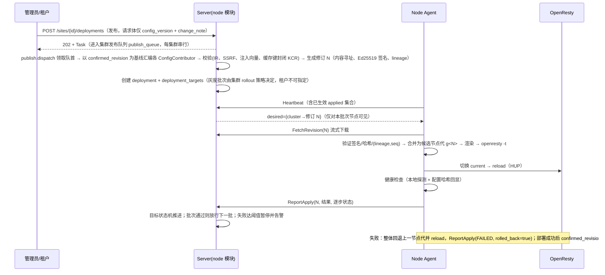
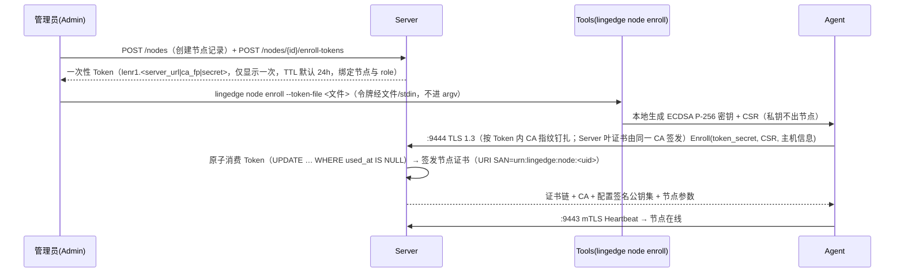

# LingEdge（凌界云）架构规格

> 权威顺序：基线 > PRD > 本文。本文是 **架构脊柱（architecture spine）** 与全部架构类产物的总入口：只固定"若两个独立构建的单元各自实现，可能产生不兼容"的不变量；其余结构性内容标为 **seed**（冷启动时成立，代码出现后以代码为准）。决策的权衡与替代方案见 `adr/`。
> 非交互产出：凡标 `[ASSUMPTION]` 者可被用户推翻，影响范围写在对应 ADR 的「可被推翻处」。

## 0. 文档地图

| 产物（基线 §26） | 位置 |
|---|---|
| 系统架构（本文） | `docs/architecture/architecture.md` |
| ADR 集（ADR-001 … ADR-025） | `docs/architecture/adr/README.md`（索引）+ `adr/ADR-0xx-*.md` |
| 数据库 ERD 与表设计 | `docs/database/README.md`（总览/ERD/约定）+ `docs/database/*.md`（按模块） |
| OpenAPI 3.1 草案 | `docs/api/openapi.yaml`（入口 `docs/api/README.md`） |
| Node gRPC 协议 | `proto/lingedge/node/v1/*.proto` + `docs/api/node-protocol.md` |
| Tools 技术设计 | `docs/architecture/tools-design.md` |
| 官网与 CMS 设计 | `docs/architecture/website-cms-design.md` |
| 安全风险清单与威胁模型 | `docs/security/threat-model.md` |
| 开发环境与技术栈版本固定表 | `docs/architecture/dev-environment.md` |
| UX（另一代理，不在此） | `docs/ux/` |
| 架构评审（修订输入） | `docs/bmad/review-architecture.md`（外部对抗式）、`docs/bmad/review-architecture-internal.md`（内部一致性） |
| **架构修订日志**（评审条目 → 处理结果 → 改动文件） | `docs/bmad/architecture-revision-log.md` |
| 基线 §26 第 11 项：Epic / Story | **由 `docs/bmad/` 下游产出**（`docs/bmad/epics.md`，BMAD 流程，不在本架构集内） |
| 基线 §26 第 12 项：开发依赖关系 | **由 `docs/bmad/` 下游产出**（`docs/bmad/dependency-map.md`） |
| 基线 §26 第 14 项：测试与验收标准 | **由 `docs/bmad/` 下游产出**（`docs/bmad/traceability.md` 等；本架构集只给出各 ADR 的「验证」与 threat-model §9 的门禁，不重复编写验收用例） |
| 基线 §20 的 `docs/operations`（运维 Runbook，含 threat-model §11 事件响应、备份恢复演练、CA/密钥轮换） | **待产出**（实现阶段补充；当前为空，threat-model §11 已给出设计层步骤） |
| DDL 规则实测与 M1 迁移骨架 | `docs/database/verification/`（MySQL 8.0.46 实测，`docs/database/README.md` §9） |

## 1. 范式（Paradigm）

**「三层分离的模块化单体 + 拉取式声明配置分发」**

1. **三层分离**（基线 §3.1）：Control Plane（Server）/ Data Plane（Node = Go Agent + OpenResty）/ Observability Plane（日志、rollup、探测、告警、计量）。三层之间只经**显式接口协议**通信：REST（用户/管理）、gRPC+mTLS（Node/DNS/Reporter ↔ Server）、本地 Unix socket（Agent ↔ OpenResty）。
2. **模块化单体**（ADR-001）：Server 是一个 Go 进程、一个代码库、一个数据库；业务按 Domain Module 切分，模块内 MVC + Service + Repository，模块间只经 `Service` 接口与进程内事件。Scheduler/Worker 是 Server 内的**角色**，同一份代码亦可独立二进制部署（ADR-019）。
3. **拉取式声明配置分发**（ADR-002/003/020）：Server 产出**不可变、已签名的配置修订（Config Revision）**；节点（Agent）**主动拉取**、验证、本地渲染、`nginx -t`、灰度应用、健康检查，失败回退本地上一有效代；**主控离线时节点按本地已生效配置继续服务**。Server 永远不向节点推送文件或命令。
4. **数据驱动的边缘引擎**（ADR-004/005）：OpenResty 的 `nginx.conf` 由**随 Agent 版本发布的固定模板 + 极小的结构化渲染面**生成；全部用户规则编译为**数据（JSON IR）**，由固定的 Lua 解释器执行。**用户可控值永远不是 nginx 指令文本**——这是「禁止拼接生成 Nginx 指令」在架构层的落点。

## 2. 不变量（Invariants）索引

每条 `AD` 的 Binds / Prevents / Rule 在对应 ADR 中；此处只给一句话规则，作为所有开发单元的共同契约。

| ID | 规则（一句话） | ADR |
|---|---|---|
| AD-1 | Server 为模块化单体；模块只经 `Service` 接口/事件互访；依赖方向单向（§5.3）；Node/DNS/Reporter 二进制不得 import Server 业务模块 | 001 |
| AD-2 | 配置修订不可变、内容寻址、Ed25519 签名；回滚=用旧内容生成**新**修订；节点实际生效版本逐节点持久记录；**集群内发布串行、copy-forward 基线=已确认修订**；备份恢复经 `lineage` 提升使 seq 仍可前进 | 002 |
| AD-3 | Node↔Server 仅 gRPC+mTLS，节点主动发起；身份=私有 CA 签发的证书；注册仅一次性 Token + CA 指纹钉扎 | 003 |
| AD-4 | `nginx.conf` 只由固定模板渲染，渲染面为白名单类型化值；用户规则一律作为数据，不进指令文本 | 004 |
| AD-5 | 所有规则共用一张表、一套条件/动作 IR、固定 13 阶段；缓存默认遵循 RFC 9111 保守语义，**影响源站响应的规则维度必须 ⊆ 缓存键维度（KCR），否则发布失败或强制 bypass**，防跨用户泄漏 | 005 |
| AD-6 | 出站真实 IP Header 由 Lua 以验证后 IP 强制覆盖；入站仅信任显式可信代理 CIDR | 006 |
| AD-7 | 缓存失效 = 缓存键中的版本标记（站点 epoch / URL 版本 / 前缀版本 PoC），禁止扫描删除缓存目录 | 007 |
| AD-8 | 访问日志：节点 JSONL → Agent 断点续传 → Server 分片文件；MySQL 只存 chunk 元数据与 rollup；写读走 LogSink/LogQuery | 008 |
| AD-9 | 租户隔离在 Repository 层强制：每个查询经 `Scope` 注入 `tenant_id`；越权对外表现为 404；**租户 API 的请求/响应不得含 node/cluster 内部标识（R-T1）** | 009 |
| AD-10 | 金额与计量一律整数最小单位；原始计量以幂等键唯一；账单可由原始记录重算 | 010 |
| AD-11 | 敏感值信封加密（DEK/KEK）；主密钥经 `KeyProvider` 提供，不入库不入日志 | 011 |
| AD-12 | 发行清单与包 Ed25519+SHA256 双重校验；信任根内置于 Tools；三个信任域独立 | 012 |
| AD-13 | Migration 三级分类并强制标注；升级前备份；不可逆迁移不承诺二进制回退 | 013 |
| AD-14 | Admin / Console 为两个独立 Vite 工程与构建产物，仅共享无权限逻辑的 `shared` 包 | 014 |
| AD-15 | 官网 MVP 为 SSG 静态；P2 起 Nuxt SSR（Node.js 由 systemd 托管，显式声明依赖） | 015 |
| AD-16 | Migration 工具 = goose v3（嵌入式、SQL 为主），文件头强制 `lingedge:class` 标注 | 016 |
| AD-17 | API 约定：OpenAPI-first、统一错误体、分页、Request ID、异步 Task、契约破坏检测 | 017 |
| AD-18 | 认证：会话（不透明令牌，按 realm 隔离）+ API Token + TOTP；RBAC 权限串 `resource:action` | 018 |
| AD-19 | Scheduler/Worker 为 Server 内角色；任务持久化于 MySQL，租约+围栏令牌保证不重复执行 | 019 |
| AD-20 | 节点自治：本地持久化最近 N 代配置与证书；与主控的连接断开不影响数据面 | 020 |
| AD-21 | 调度摘除/恢复必须多源联合判定 + 迟滞（P3 预案） | 021 |
| AD-22 | 边缘限流本地优先，Redis 永不在请求路径上（P4 预案） | 022 |
| AD-23 | 测试替身只存在于 `_test.go`/`//go:build lingedge_testdouble`，生产构建 CI 检查不可达 | 023 |
| AD-24 | Node 全部进程非 root；特权操作仅经 systemd 单元与 Tools 的受限入口 | 024 |
| AD-25 | Redis 不是唯一真相源；丢失 Redis 只降级不丢数据 | 025 |

## 3. 系统上下文



三条边界规则：
- **数据面不依赖控制面在线**：没有任何请求路径上的 Server/Redis/MySQL 调用（AD-20、AD-22）。
- **节点只拉不收**：节点不开放任何控制面入站端口；Server 无法在节点上直接执行任意动作（NFR-14、FR-35）。
- **租户永不直达节点**：租户只通过站点/规则等抽象影响节点配置，节点管理类接口仅平台管理员可达（AD-9、AD-18）。

## 4. 组件与二进制

| 模块（基线 §1.2） | 二进制 / 产物 | 运行形态 | 阶段 |
|---|---|---|---|
| Tools | `cmd/lingedge`（Cobra + Bubble Tea） | 一次性 CLI（root 安装/升级，普通用户查询） | M1 |
| Server | `cmd/lingedge-server`（`--roles=api,grpc,scheduler,worker`） | systemd 服务，用户 `lingedge` | M1 |
| Admin | `frontend/admin` 静态产物 | 由 Nginx 托管 | M1 |
| Console | `frontend/console` 静态产物 | 由 Nginx 托管 | P5 |
| Website | `frontend/website`：SSG 静态（M1）/ Nuxt SSR Node 服务（P2+） | Nginx 或 systemd(node) | M1/P2 |
| Node | `cmd/lingedge-node`（Agent）+ 独立 OpenResty | 两个 systemd 服务，用户 `lingedge-node` | M1 |
| DNS | `cmd/lingedge-dns` | systemd，UDP/TCP 53 | P3 |
| Scheduler | 内置 Server 角色；独立 `cmd/lingedge-scheduler` | 同 AD-19 | M1 内置 / P3 独立 |
| Worker | 内置 Server 角色；独立 `cmd/lingedge-worker` | 同 AD-19 | M1 内置 / P3 独立 |
| Reporter | `cmd/lingedge-reporter`（Linux amd64/arm64、Windows amd64） | systemd / Windows 服务 | P3 |
| Docs | `docs-site/` 静态 | Nginx | P5 |
| Status | `status-site/` 静态/轻量 | Nginx + `public` 接口 | P5 |

M1 = PRD 的 MVP；P2…P6 同 PRD §10。

## 5. Server 内部架构

### 5.1 分层（模块内）

```
HTTP/gRPC 入口（handler / controller，Gin / grpc）   ← "C"：解析、鉴权上下文、参数校验、DTO 转换
        │
Service（用例编排、事务边界、领域规则、审计与事件发布）  ← 唯一事务/业务规则所在
        │
Repository（sqlx，所有 SQL；所有查询经 Scope 注入 tenant_id）  ← 唯一允许访问 *sqlx.DB/Tx 的层
        │
MySQL
```

- Handler 只依赖本模块 Service 接口；Service 依赖本模块 Repository 接口与**其他模块的 Service 接口（经 `ports`）**；Repository 不依赖 Service。
- 事务边界在 Service 方法；跨模块调用共享同一 `context` 中的事务（`platform/db.TxFromContext`），不得跨模块直接开新事务写同一聚合。
- 领域对象（Domain）为纯 Go 结构体与领域规则，不依赖 gin/sqlx。

### 5.2 目录（seed，基线 §20 为准；Go 模块路径 `[ASSUMPTION]` `github.com/wuekevin/lingedge`，初始化前由用户确认）

```
cmd/{lingedge,lingedge-server,lingedge-node,lingedge-dns,lingedge-scheduler,lingedge-reporter,lingedge-worker}/
internal/
  platform/   # config、logger(zap)、db(sqlx/tx/scope)、httpx(中间件)、grpcx、task 运行时、lock、keyprovider、eventbus、audit、errors、clock
  auth/ tenant/                                  # L1 身份与租户
  website/ origin/ cache/ ruleengine/ certificate/ waf/ security/ l4proxy/ dns/ billing/ cms/ seo/ media/ monitoring/ notification/ plugin/   # L2 领域
  node/ cluster/ scheduler/ reporter/            # L3 编排（node 含 config revision / deployment）
  tools/{cli,tui,installer,manifest,resolver,downloader,registry,updater,rollback,backup,doctor,service,baota,security}/
pkg/            # 可被所有二进制共享的无业务库：签名/校验、canonical JSON、host/header 校验、ssrf guard、edgeconfig IR 类型
proto/lingedge/{node,dns,reporter}/v1/
frontend/{website,admin,console,shared}/
edge/{templates,lua,tests}/     # OpenResty 模板与 Lua 引擎（随 lingedge-node 发行包）
migrations/ manifests/ configs/ deploy/{baota,systemd,nginx,openresty,install}/ scripts/ tests/
```

每个业务模块：**根包 `internal/<mod>`（仅 `api.go`，导出 Service 接口与 DTO）**，实现位于 `internal/<mod>/internal/{handler,service,repository,domain}`——由 Go `internal` 规则在包粒度强制，其他模块只能 import 根包（以 ADR-001 §3 为准；“`api.go` 是唯一可被 import 的文件”因 Go 以包为粒度而作废）。

### 5.3 模块依赖方向（可由 depguard / go-arch-lint 强制，ADR-001）



规则：
1. 箭头 = 允许的编译期依赖（且只能依赖对方根包 `internal/<mod>`）。**图中没有的边一律禁止**；L2 之间互不依赖，除指向 `website`（站点聚合根）做"站点是否存在且属于当前租户"的校验。**文档化的必需跨模块调用（node→certificate/website/origin/monitoring/cache、cache→node、monitoring→website、ruleengine→origin/cache、cms→billing）一律经 `platform/ports` 接口**（清单与实现方/调用方见 ADR-001 §5 ports 表）：调用方只依赖 `platform/ports`，实现在 `cmd/lingedge-server` 装配层注入，因此图中只增加“所有模块 → `platform/ports`”一条允许的边，不存在临时豁免。
2. **`node` 模块不得 import 任何 L2 业务模块。** 配置汇编通过依赖倒置：`pkg/edgeconfig` 定义 `ConfigContributor` 接口与 IR 类型；`website/origin/cache/ruleengine/certificate/waf/l4proxy` 在 `cmd/lingedge-server` 的装配层把各自 contributor 注册进 `node` 的修订构建器。
3. **需要被多个模块消费的事件**（如 `site.published`、`node.offline`）经 `platform/eventbus`；需要可靠投递的事件用 MySQL outbox（`event_outbox` 表，M1 内存总线 + outbox 仅用于 notification/billing）。
4. `cmd/lingedge-node|dns|reporter` 只依赖 `pkg/`、`proto/` 与 `edge/`，**不得 import `internal/*` 的 Server 业务包**。
5. `internal/tools` 与 Server 无编译依赖；二者仅通过**发行清单、安装状态文件、Server 的 `migrate`/`healthz`/`install-status` 子命令与 HTTP 接口**协作。

### 5.4 运行角色与启动

`lingedge-server --roles=api,grpc,scheduler,worker`（默认全开）。`api`=REST+静态资源回退；`grpc`=Node mTLS :9443 与 Enroll :9444；`scheduler`=周期任务触发（租约，见 ADR-019）；`worker`=消费 `tasks` 表。独立部署 `lingedge-scheduler`/`lingedge-worker` 只是装配不同的 `roles`。安装向导（setup mode）仅在无 `install.lock` 时启动，见 tools-design §13。

## 6. Node 内部架构

```
lingedge-node (Go Agent，用户 lingedge-node，无特权)
 ├─ enroll/identity   私钥本地生成；证书与 CA、签名公钥集持久化于 /var/lib/lingedge-node/identity
 ├─ control client    gRPC mTLS：Heartbeat / FetchRevision / ReportApply / PullTasks / ReportTask / Renew / UploadLogs / ReportRollups
 ├─ revision manager  下载→校验签名→(lineage,seq)严格递增→解包→合并为候选节点代→按模板渲染→openresty -t→灰度应用→健康检查→确认/回退（节点代目录 generations/g<N>/）
 ├─ renderer          edge/templates（嵌入二进制）+ 类型化白名单渲染器（ADR-004）
 ├─ runtime plane     经 Unix socket 向 OpenResty 推送运行期数据：站点 epoch、URL 失效标记、源站解析结果与健康状态（ADR-004/007）
 ├─ health/origin     源站主动健康检查（经 SSRF 守卫解析）→ 共享字典 + 上报 origin_health
 ├─ log shipper       分段 JSONL → 断点续传；产出 1 分钟 rollup（ADR-008）
 └─ upgrade stager    下载并验证升级包到 staging，写仅含 component+version+task_uid 的请求文件；root 侧由 systemd .path 触发 Tools 受限入口，结果写 root 属主目录（ADR-024）
openresty（独立发行目录 /opt/lingedge/openresty，用户 lingedge-node，AmbientCapabilities=CAP_NET_BIND_SERVICE）
 ├─ 一个进程、一份渲染产物：`nginx.conf` 与 `conf/sites/*.conf`、`data/*.json` 位于**节点代**目录 `generations/g<N>/`（只读），可写路径（cache、temp、pid、日志）一律绝对路径
 └─ lua：固定引擎 `/opt/lingedge/node/current/edge/lua/le/*`（engine、conditions、actions、cache、realip、balancer、log、ctl；随 Agent 发行包签名，`lua_package_path` 写绝对路径）
```

**节点代（node generation）**：节点只有一个 OpenResty 进程，故渲染/回退/切换以 `g<N>` 为单位——`g<N>` = `{cluster_uid → (lineage, seq, sha256)}` 集合（各集群 `desired` 修订的并集）。Agent 把待应用的所有集群更新合并成一次候选代，渲染→`openresty -t`→切换 `current`→reload→健康检查；失败整体回退再逐集群重试（ADR-002 §10、ADR-020 §4b）。`ReportApply` 仍按集群上报。

**本地目录与状态（权威表见 ADR-020 §2，此处仅列要点）**：`/var/lib/lingedge-node/{identity/, generations/g<N>/, current -> generations/g<N>, state.json, certs/<certificate_uid>/, cache/, runtime/, staging/, logs-spool/}`；`/var/log/lingedge-node/access/`；`/run/lingedge-node/{openresty.pid, openresty-ctl.sock, agent.sock}`。**统一 `-p/-c`**：预检 `openresty -t -p …/generations/g<N>/ -c conf/nginx.conf`，生产（systemd）`-p …/current/ -c conf/nginx.conf`，两者仅前缀字符串不同、内容相同。

## 7. 部署拓扑（宝塔 + systemd，无 Docker）



- **Admin / Console / 官网必须使用互不相同的主机名**（Cookie 为 host-only，Tools 在 Nginx 片段生成时校验；租户数据面域名与控制面域名亦不同注册域，MIN-07/IMP-17）。
- 单机可把 Server + Admin + Website + Node 装在同一台（PRD FR-5）；此时 Node 独占 80/443 与主控 Nginx 冲突 → Tools 在端口冲突步骤停止并给选项（FR-7、R-10）。常规做法：**主控与节点分机**，或主控 Nginx 监听 8443/自定义端口。
- `lingedge-server` 不直接面向公网 HTTP；gRPC 9443/9444 直接暴露（TCP，非 HTTP 反代，保留端到端 mTLS）。
- 目录规范（Tools 统一）：`/opt/lingedge/<component>/releases/<version>/` + `current` 符号链接；配置 `/etc/lingedge/<component>/`；数据 `/var/lib/lingedge/<component>/`；日志 `/var/log/lingedge/`；安装状态 `/var/lib/lingedge/tools/state.json`。

端口表：

| 组件 | 端口 | 绑定 | 说明 |
|---|---|---|---|
| Server REST | 8080 | 127.0.0.1 | 由 Nginx 反代 |
| Server gRPC mTLS | 9443 | 0.0.0.0 | 节点/DNS/Reporter；严格要求客户端证书 |
| Server gRPC Enroll | 9444 | 0.0.0.0 | 仅 TLS；仅在存在未过期注册 Token 时监听；限速 |
| Server metrics | 9180 | 127.0.0.1 | Prometheus 文本（避开 node_exporter 常用的 9100） |
| Node OpenResty | 80/443 | 0.0.0.0 | 数据面；UDP 443 不监听（D-7） |
| Node 本地控制 | Unix socket | 文件 | Agent→OpenResty；不开 TCP |
| Website SSR | 3000 | 127.0.0.1 | 仅 P2+ |
| DNS | 53/udp+tcp | 指定 IP | 不自动停用占用者（D-9） |

## 8. 关键流程

### 8.1 配置发布（FR-55/56）



### 8.2 节点注册（FR-52）



### 8.3 主控离线（FR-57）

节点持续使用 `current` 代与本地证书；日志/rollup 写入本地 spool（限盘）；Agent 指数退避重连；重连后先 `Heartbeat` 补报 applied 集合，再补传日志与 rollup（幂等去重）。节点重启时若主控仍离线：OpenResty 的 systemd 单元的 `ExecStartPre` 即执行 `openresty -t -p …/current/ -c conf/nginx.conf`，按本地 `current` 节点代启动，不依赖 Agent 进程在线。

## 9. 跨文档契约（Contracts）

> 所有产物（数据库、OpenAPI、proto、Tools、前端）必须一致遵守。冲突时以本节为准，修改须走 ADR。

### 9.1 标识、时间、金额

- 实体主键：`id BIGINT UNSIGNED AUTO_INCREMENT`（内部、外键用）；对外资源另有 `uid CHAR(26)`（ULID，唯一索引；API 与 gRPC 一律用 `uid`）。高频内部表（心跳、rollup、usage、访问日志 chunk）仅有 bigint 主键。
- 时间：`DATETIME(3)`，一律 UTC；API 为 RFC 3339（`2026-11-16T12:00:00.000Z`）。
- 金额：`BIGINT` 整数最小货币单位 + `currency CHAR(3)`；API 为 `{ "amount_minor": 12345, "currency": "CNY" }`；**数据库、代码、API 中无任何金额浮点**。流量字节 `BIGINT UNSIGNED`。
- 字符集 `utf8mb4`，排序规则 `utf8mb4_0900_ai_ci`（主机名/邮箱：**应用层小写化 + 唯一索引 + `CHECK (BINARY col = BINARY LOWER(col))`**，与 database README §2.2 一致；原“生成列小写”的说法作废）。
- **MySQL 最低版本 ≥ 8.0.16**（CHECK 自该版本起才强制执行）；DDL 规则（生成列 VIRTUAL、被 CHECK 引用的 FK 列不得 SET NULL、分区表无 FK、迁移按依赖排序）已在 8.0.46 实测，见 database README §9。
- MySQL 约束：**TEXT/JSON/BLOB 列不得带 DEFAULT 字面量**（应用层赋值）；不用 `ENUM`（用 `VARCHAR(32)` + CHECK 约束，便于 expand-contract 加枚举值）。
- 租户范围表必含 `tenant_id BIGINT UNSIGNED NOT NULL`；平台级表无该列。

### 9.2 API 约定（ADR-017，细节见 `docs/api/openapi.yaml`）

- 前缀 `/api/v1`；JSON；`X-Request-ID`（请求可带，缺失由服务端生成 ULID，响应必返回，并写入日志/审计/Task）。
- **统一错误体**：`{"error":{"code":"site.domain_conflict","message":"…","message_key":"errors.site.domain_conflict","details":[{"field":"domains[0]","reason":"…"}],"request_id":"…"}}`；`code` 为稳定的小写点分字符串（通用：`auth.unauthenticated`、`auth.forbidden`、`auth.reauth_required`(403)、`validation.failed`、`resource.not_found`、`resource.conflict`、`rate_limit.exceeded`、`internal.error`、`feature.disabled`、`config.validation_failed`、`task.failed`、`resource.precondition_failed`(412)、`idempotency.key_reuse`(422，唯一不走 400 的例外，ADR-017)）；跨租户访问一律 `404 resource.not_found`（不泄漏存在性）。
- **分页**：列表 `?page=1&page_size=20`（默认 20，最大 200），返回 `{items,page,page_size,total}`；大体量集合（审计、访问日志、事件）用游标 `?cursor=&limit=`，返回 `{items,next_cursor}`。排序 `?sort=-created_at`。
- **异步 Task**：耗时操作返回 `202 Accepted` + `Task{uid,type,status,progress,result,error,request_id,created_at,…}`，`Location: /api/v1/tasks/{uid}`；`status ∈ pending|running|success|partial|failed|canceled`；任务类型为**白名单枚举，事实源是 `docs/api/openapi.yaml` 的 `TaskType`**（本文及 ADR/DB 文档不再另列清单，避免漂移），**不存在"执行任意命令"的任务类型**。
- **幂等**：创建类 POST 支持 `Idempotency-Key` 头（Server 保存 24h）。
- **租户上下文**：Console 主体 = 其所属租户；Admin 主体代租户操作时必须带 `X-Tenant-ID: <tenant uid>`，并须同时具备 `tenant:impersonate` 与路由权限串（审计同时记录操作者与目标租户）。平台级资源（nodes、clusters、system、users 全局视图、站点↔集群绑定、部署详情等）不接受租户主体。**租户 API 的请求/响应不得含 node/cluster 内部标识（R-T1，ADR-009 §5）；租户发布不接受任何灰度/节点/集群参数。**
- **再认证**：声明 `x-reauth` 的高危操作要求再认证窗口内的 `POST /auth/reauth`（ADR-018 §12）。
- **权限串**：`resource:action`（如 `site:read`、`site:write`、`config:publish`、`node:manage`、`tenant:manage`）；角色 `scope ∈ platform|tenant`。
- **认证方案**：Admin/Console 为各自独立的 Cookie 会话（`le_admin_sid` / `le_console_sid`，HttpOnly，Secure，SameSite=Lax，写操作需 `X-CSRF-Token`），机器调用为 `Authorization: Bearer le_<8位前缀>_<随机>` API Token。

### 9.3 配置修订（ADR-002，与 proto、数据库一致）

- **范围 = 集群（cluster）**：一个 `config_revisions` 行 = 某集群某序号的完整快照；`seq` 为集群内单调递增整数。内容按站点分块（`config_blocks`，sha256 内容寻址、zstd），修订以"站点块清单"组成（`config_revision_blocks`）；证书私钥**不入修订**，节点经 `FetchCertificate` RPC 单独取得。
- 签名：`Ed25519(key_id, "LINGEDGE-REVISION-V1\n" + canonical_json(manifest))`；`manifest` 含 `schema_version, cluster_uid, lineage, seq, parent_seq, created_at, blocks[{key, sha256, size}]`，`key ∈ global|site:<uid>|l4`（**没有并列的 `global{…}`**）。**签名不带过期时间**（R-4）。块内容存 MySQL（`config_blocks.content`）。证书**不入修订**：修订只引用 `certificate_uid`，节点取当前活动版本，回滚不回退证书（ADR-002 §5）。
- 回滚 = 以旧修订的块清单**生成新修订**（`rollback_of` 指向旧修订），`seq` 仍单调递增；节点**只接受 `(lineage, seq)` 字典序严格大于已应用值的修订**（防重放；DB 恢复后 `lineage` 由 `lingedge-server lineage bump` 提升，使 seq 低于节点已应用值的新修订仍可被接受，ADR-002 §12）。
- 节点多集群：节点有效配置 = 其所属各集群当前 `desired` 修订的并集，由 Agent 合并渲染为**节点代 `g<N>`**（单进程单配置，回退以节点代为单位，ADR-020 §2）；Server 在节点入群/站点绑定/修改集群设置时校验"同一节点上主机名不跨集群冲突"且各集群 `node_global` 键逐键相等（FR-59 的限制，见反馈 F-3）。
- **发布编排**：每集群同一时刻至多一个活动部署，其余进入 `publish_queue` 串行；copy-forward 基线 = `clusters.confirmed_revision_id`（最近一次全量确认健康的修订），部署成功才前移（ADR-002 §13）。
- 节点实际生效版本：`node_cluster_state(node_id, cluster_id, applied_lineage, applied_seq, applied_revision_id, …)` 逐节点逐集群持久记录；`deployment_targets`（含 `uid`）记录每次部署的逐步状态，`deployment_target_steps` 承载 ReportApply 幂等；逐节点任务队列 `node_tasks` 承载 `PullTasks` 租约/回执。

### 9.4 Task / 任务租约（ADR-019）

`tasks` 表是 Worker 队列与审计载体：`status`、`run_after`、`lease_owner`、`lease_until`、`fence`（每次领取自增），消费者 `SELECT … FOR UPDATE SKIP LOCKED` 领取并写回时校验 `fence`。周期任务（rollup 聚合、证书续期检查、保留期清理、心跳超时判定）由 `job_locks` 租约选主触发，**每个任务实现必须幂等**。

### 9.5 gRPC（ADR-003，见 `docs/api/node-protocol.md`）

包 `lingedge.node.v1`；服务：`EnrollService`（:9444）、`NodeControlService`（Heartbeat、RenewCertificate、GetCaBundle）、`RevisionService`、`TaskService`、`TelemetryService`（:9443，mTLS，TLS 1.3）。Server 自身叶证书由同一私有 CA 签发（`signing_keys.purpose='grpc_server'`，ADR-003 §3）。证书 SAN `URI:urn:lingedge:<role>:<uid>`（role ∈ node|dns|reporter|scheduler|worker）；每个 RPC 由拦截器从证书解析主体并校验"该资源属于该主体"。

### 9.6 命名

- Header 保留名清单：ADR-006；平台自用 Header 前缀 `X-LingEdge-`、`Ling-Internal-` 保留，租户不可用。
- 阶段名（固定 13 个，ADR-005）：`real_ip`、`access_control`、`waf_cc`、`redirect`、`rewrite`、`cache_rule`、`cache_lookup`、`origin_rule`、`origin_headers`、`upstream_response`、`cache_write`、`response_headers`、`respond`。
- 规则类型（枚举，`site_rules.rule_type`）：`redirect`、`url_rewrite`、`origin_rule`、`request_header`、`origin_request_header`、`response_header`、`cache_rule`、`access_control`、`page_rule`、`error_page`、`hotlink`、`rate_limit`。

## 10. 阶段与模块落点

| 阶段 | 交付的架构部件 |
|---|---|
| M1（MVP） | Tools 全部子命令（`install dns` 返回「尚未发布」）；Server（auth/tenant/website/origin/cache/ruleengine/certificate 手动/node/cluster/monitoring 子集/audit/task/内置 scheduler+worker）；Admin 基础；Website SSG；Node（Agent+OpenResty：签名修订、灰度、回滚、真实 IP、缓存 URL/整站失效、访问日志管线、rollup） |
| P2 | CMS（SSR）、ACME HTTP-01、预热、目录/通配符失效 PoC、通知与告警、保留期任务、页面规则 |
| P3 | DNS 服务、Reporter、调度防抖、DNS-01、统计报表、Scheduler/Worker 独立二进制、GeoIP/ASN 条件 |
| P4 | WAF/CC/Bot（Lua 引擎 `waf_cc` 阶段）、四层代理（OpenResty stream + 独立 L4 修订块类型）、防盗链/限速规则 |
| P5 | Console、billing、订单/支付插件、代理商、工单、插件体系、Docs、Status |
| P6 | L2 缓存、DNSSEC、HTTP/3、边缘计算（独立验证后） |

## 11. NFR 落点速查

| NFR | 架构机制 |
|---|---|
| NFR-1 | ADR-023：`//go:build lingedge_testdouble` + CI 检查；测试替身包路径 `internal/**/testdouble`、`tests/` |
| NFR-4/8 | ADR-009 Scope；路由注册表 + CI 检查每条路由声明 `auth/perm/tenant` 元数据 |
| NFR-5 | ADR-004/005：模板固定 + 数据驱动 + 注入向量测试 |
| NFR-10 | `pkg/ssrf`：连接时解析校验（`net.Dialer.Control` 钩子），Server 侧与 Agent 侧共用 |
| NFR-12/13 | ADR-011 信封加密；日志脱敏中间件与 zap `Redact` 字段类型 |
| NFR-14 | ADR-003/024：租户 API 与节点 gRPC 分端口分证书体系 |
| NFR-15 | ADR-012；`go.sum`/lockfile 固定；SBOM 由 `go version -m` + npm lock 生成（实现时选工具） |
| NFR-20 | ADR-002 回滚即新修订；`rule_versions` 不可变 |
| NFR-21 | Request ID 贯穿 REST→Task→gRPC 元数据 `x-request-id` |
| NFR-23 | ADR-013/016 |
| NFR-30 | 测量方法沿用 PRD §7.6；`tests/performance` 脚本，结果如实记录 |

## 12. 技术风险与 PoC 清单（须在对应阶段前验证，未验证不得宣称）

| # | 风险 | 验证方式 | 失败时的回退 | 阶段 |
|---|---|---|---|---|
| PoC-1 | 缓存 TTL 由 Lua 决定但 nginx `proxy_cache_valid` 为静态——采用"按 (TTL 档位×上游变体) 的命名 location + `ngx.exec`" | 在真实 OpenResty 上验证命中/TTL/Range/锁行为；**显式通过条件（IMP-03）**：`ngx.var.le_*` 状态跨 exec 保留、`access_by_lua` 不重复执行（`le_engine_done`）、日志仅一行且含 rule_hits/cache_policy_hit | 改为内部回环 server 添加 `X-Accel-Expires`（双跳），并评估延迟与日志去重 | M1 |
| PoC-2 | `balancer_by_lua` + Agent 经 Unix socket 注入源站解析/健康状态的稳定性与性能 | 压测 + 故障注入 | 回退为 Agent 渲染 `upstream` IP 字面量并以"仅 upstream 变更"的快速 reload | M1 |
| PoC-3 | 缓存键含 URL 版本标记：共享字典容量（`safe_set`、站点配额）、重启/reload 后重注入、满载时升级为站点 epoch、**shm 容量变化时 reload 是否新建 zone** | 压测 + 重启/reload 测试 | 仅提供整站失效 | M1（URL）/ P2（前缀） |
| PoC-4 | Lua 规则解释器的单请求开销与规则数量上限 | wrk/h2load 基线（NFR-30） | 规则编译为静态 `map`/`if` 仅限热点类型 | M1 |
| PoC-5 | RE2 子集 + EDA 歧义检测 + PCRE 执行的语义一致性与 ReDoS 防护 | 差分测试语料；**恶意输入下的 p99 与跨租户影响**；PCRE JIT 与解释执行下 `lua_regex_match_limit` 的生效差异 | 仅允许 `starts_with/ends_with/contains` 与受限 `regex` | M1 |
| PoC-6 | 访问日志按站点切分的断点续传与去重正确性 | 故障注入（断网/kill/轮转） | — | M1 |
| PoC-7 | HTTP/3 / L2 缓存 / DNSSEC | 独立技术验证 | 不提供 | P6 |
| PoC-8 | 目录/通配符失效（前缀版本链 vs 缓存键索引） | PRD FR-79 判据 | 不开放入口 | P2 |

## 13. 开放项（需用户确认；均不阻塞 M1 架构，但影响实现起点）

| # | 项 | 默认（本文采用） | 影响 |
|---|---|---|---|
| Q-1 | Go 模块路径 | `github.com/wuekevin/lingedge` `[ASSUMPTION]` | `go.mod`、proto `go_package` |
| Q-2 | 节点证书有效期 | 90 天，2/3 周期续期（F-2） | ADR-003、doctor 告警 |
| Q-3 | 官方发行下载源与发行签名私钥保管人 | 配置项 `release.base_url`；私钥离线 | ADR-012、Tools |
| Q-4 | 日志/rollup/审计保留期默认值 | 待用户确认（OQ-7、OQ-10） | database README §7 |
| Q-5 | 舍入方向与计量口径（P5） | 向上取整、`bytes_sent` `[ASSUMPTION]` | ADR-010 |
| Q-6 | 域名所有权校验策略（F-1） | 自用模式"管理员豁免"，商业模式必须校验 | 站点模块、P5 |
| Q-7 | OpenResty Linux 包来源（官方仓库 / 自行构建） | 实现时核对 | Tools、验收环境 |
| Q-8 | 媒体管线是否接受 cgo（WebP/AVIF 重编码）；不接受则永久只支持 PNG/JPEG/GIF | P2 先 PNG/JPEG/GIF（Go 标准库） | website-cms-design §12 |
| Q-9 | 再认证窗口 `auth.reauth_window_s`、各类 rollout/超时默认值 | 300 秒 `[ASSUMPTION]`、其余待基线测试 | ADR-018 §12、ADR-002 §13 |
| Q-10 | 商业模式（P5）租户是否可选“线路/区域套餐”（以不暴露集群身份的 `placement_profile` 表达） | M1/自用模式：平台指定 `placement.default_cluster_uids`，租户不选 | ADR-009 §5 可被推翻处 |

## 14. 对 PRD 的反馈

> 这些决策使 PRD 的部分 FR 需要澄清/补充；不影响基线。编号 F-n，建议在下一次 PRD 更新时吸收。

- **F-1 域名所有权校验缺失（安全，建议新增 FR）**：FR-48 只要求"全局唯一"。若无所有权校验（DNS TXT / HTTP 文件 / 管理员豁免），租户可抢占他人域名（CDN 域名接管）。架构按 `site_domains.verification_status` 预留；M1 自用模式默认"管理员豁免"，商业模式（P5）必须启用。需 PRD 明确。
- **F-2 节点证书过期与"主控离线继续服务"（FR-57 / R-4）**：节点 mTLS 证书有效期 90 天（Agent 在 2/3 周期自动续期，ADR-003）。节点**数据面**不受影响，但离线超过证书有效期后 Agent 无法重连主控，需要**重新 enroll**。PRD 的 R-4 只提到配置签名与 TLS 证书，未涉及 mTLS 身份证书。建议补充"节点离线 > 证书有效期需重新注册"的已知限制与 doctor 告警。
- **F-3 一节点多集群（FR-59）**：架构接受，但加了约束：同一节点上主机名不得在其所属多个集群间冲突，各集群的节点级全局参数（`node_global`：缓存 zone、shm 容量、监听端口、PROXY protocol 等）须逐键相等，站点级可信代理不得冲突（入群、站点绑定、修改集群设置时校验；渲染以节点代为单位，ADR-020）。
- **F-4 缓存 URL 精确刷新的语义（FR-78 / D-6）**：URL 刷新以"缓存键版本标记使旧对象不可命中"实现，旧对象不会立即物理删除、磁盘占用随 LRU/inactive 淘汰回收。满足"刷新后下一次请求回源"，但"立即释放磁盘"不成立。
- **F-5 官网首页真实数据与 SSG（FR-41 / D-8）**：纯静态预渲染无法在构建后更新数值。架构采用：**发行产物（进入签名清单的 `variants.static`）一律不嵌入构建时快照**——静态 HTML 的数据模块为"暂无数据/示意"占位，浏览器端从 `GET /api/v1/public/stats` 读取真实值覆盖（快照会把 CI 所连 Server 的数字分发到所有部署，违反 FR-41；快照仅限运营者自建时显式开启）。对"禁用 JS 的爬虫"只会看到占位，不影响 SEO 正文。
- **F-6 正则方言（FR-65）**：规则 `regex` 限定为 **RE2 兼容子集**（无回溯引用/环视），Server 以 Go `regexp/syntax` 校验，节点以 PCRE（`ngx.re`）带匹配上限执行。不提供完整 PCRE。
- **F-7 主密钥与备份（NFR-12 / FR-10）**：无外部 KMS 的前提下，主密钥由 `KeyProvider`（默认：root 只读文件，经 systemd credential 注入）提供。备份**必须**包含主密钥的独立备份流程（与数据库备份分开保管），否则恢复后凭据与私钥不可解密。FR-10 需增补该要求。
- **F-8 Web 安装向导抢占风险（FR-11）**：向导在 `install.lock` 出现前对网络可达；架构要求 Tools 生成一次性 setup token 并仅在终端显示，向导所有写接口需该 token（默认仅绑定 127.0.0.1，需远程访问时 Tools 明确提示）。PRD 需认可此交互。
- **F-9 Agent 远程升级的特权路径（FR-60 / FR-12）**：Agent 非 root，升级由 systemd `.path` 触发 root 侧 `lingedge` 受限入口完成并重新校验签名；请求文件只含 `component+version+task_uid`，staging 经 dirfd/`O_NOFOLLOW` 读取，结果文件由 root 写入 root 属主目录（ADR-024 §7）。因此"Admin 触发节点升级"要求节点上已安装 Tools（与"取代 Updater"一致）。
- **F-10 日志查询能力边界（FR-114 / D-5）**：文件分片 + chunk 元数据支持"站点/时间范围/状态码/IP"过滤但为顺序扫描；高基数与全文检索不在 M1 承诺范围，延迟目标待基线（与 OQ-10 一致）。
- **F-11 Redis 的角色（基线 §2.1、§13.2）**：Redis 8 为必选依赖，但仅用于限流/缓存/唤醒，**非唯一真相源**（ADR-025）。其不可用时 Server 降级而非停服；PRD 如需"Redis 不可用时 Server 的行为"应写入 NFR。

### 14.1 其他文档中的 PRD 反馈（汇总索引）

- Tools 相关 **T-1…T-4**（Windows 与 `lingedge`、MySQL/Redis 安装责任、官方发行源、退出码公开契约）：[tools-design.md §22](tools-design.md)。
- 官网相关 **W-1…W-3**（含 FR-41 在 SSG 下改为"构建时快照 + 浏览器端覆盖"、自用模式 `/pricing` 返回 404 严于 D-3）：[website-cms-design.md §17](website-cms-design.md)。
- 校验错误统一 400 与 `idempotency.key_reuse`(422) 例外：[ADR-017](adr/ADR-017-api-conventions.md)。
- 威胁模型中的新增风险（域名接管、Server 失陷爆炸半径等）：[threat-model.md](../security/threat-model.md)。

## 15. 修订记录 2026-11-16

依据 `docs/bmad/review-architecture.md`（阻断 7 / 重要 22 / 次要 14）与 `review-architecture-internal.md`（高 10 / 中 9 / 低 5）修订；逐条处理见 [`docs/bmad/architecture-revision-log.md`](../bmad/architecture-revision-log.md)。本文变更：§0 文档地图登记 §26 第 11/12/14 项由 `docs/bmad/` 下游产出与评审/修订日志；§2 AD-2/AD-5/AD-9；§3 图；§5.2/§5.3（模块根包与 `platform/ports`）；§6 节点代与目录；§7 端口 9180 与独立主机名；§8 发布队列与 enroll 令牌用法；§9.1（小写口径、MySQL ≥8.0.16）、§9.2（任务白名单事实源、reauth、R-T1）、§9.3（manifest、lineage、发布编排）、§9.5；§12 PoC 通过条件；§13 新增 Q-8/Q-9/Q-10；§14 F-3/F-5/F-9。
