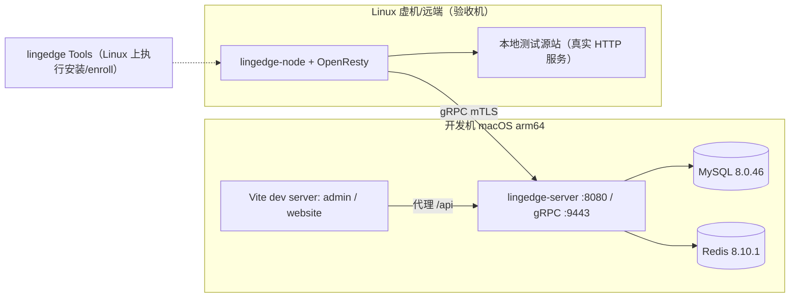

# 开发环境与技术栈版本固定表

> 总入口：[`architecture.md`](architecture.md)。ADR 索引：[`adr/README.md`](adr/README.md)。
> **版本纪律**：本文只写**能够确认**的版本。"2026-11-16 查询值"来自当天对 Go 模块代理与 npm registry 的查询（即当时的最新稳定版），**不等于已采用**；落地时必须在真实 `go.mod`/`pnpm-lock.yaml` 中固定，并以"实现时核对"为准。不确定者一律写"实现时核对"，不虚构版本号。

## 1. 技术栈版本固定表

### 1.1 运行时与基础设施

| 组件 | 基线要求 | 本机已确认 | 2026-11-16 查询的最新稳定版 | 固定策略 / 备注 |
|---|---|---|---|---|
| Go | Go（基线 §2.1） | go1.27.1 darwin/arm64 | — | `go.mod` 写 `go` 与 `toolchain` 行，固定到本机已确认的 1.27.1 起（实现时核对 Linux 目标可用）；CI 与验收机同一 toolchain |
| MySQL | MySQL 8.0 | mysqld 8.0.46（Homebrew `mysql@8.0`）；本机 `mysql` 客户端不在 PATH，见 §2 | — | **最低支持版本 ≥ 8.0.16**（CHECK 约束自 8.0.16 起才强制执行，设计依赖它；`lingedge-server migrate` 与安装向导均校验 `VERSION()`）；生产在宝塔/原生 Linux 上的小版本 **实现时核对**；迁移测试须同时覆盖 **8.0.16（最低）** 与**当前 8.0.x**（本机已有 8.0.46，已做 DDL 实测，结果见 `docs/database/README.md`「DDL 实测」；8.0.16 需在 CI/验收机另行安装验证，未验证前标「等待环境验证」） |
| Redis | Redis 8 | redis-server 8.10.1；redis-cli 8.10.1 | — | 目标 Redis 8.x；Linux 验收机来源与小版本实现时核对 |
| OpenResty | OpenResty | **本机无** | 上游仓库 tag `v1.31.8.1`（GitHub tags 查询） | 固定版本**待核对**：Linux amd64/arm64 官方仓库/二进制包的可用性、与 Lua 第三方库及所选模块的兼容性均实现时核对；作为随 Node 发行包一部分按清单签名分发（ADR-012） |
| Nginx（辅助） | Nginx（基线 §2.4、第二部署方式） | nginx 1.31.8（Homebrew） | — | 仅用于本机静态站托管/反代试验；**不能替代 OpenResty 做 Node 测试**（无 Lua） |
| protoc | Protobuf | libprotoc 36.1 | — | 实现时核对是否改用 `buf`（见 §1.4） |
| Linux 发行版 | Linux AMD64/ARM64（§2.7） | — | — | 见 §6「验收环境建议」（D-14 为 [ASSUMPTION]） |
| 宝塔面板 | 第一部署方式 | — | — | 版本实现时核对（OQ-1） |

### 1.2 Go 依赖

> 格式：模块 ｜ 用途 ｜ 2026-11-16 查询的最新稳定版 ｜ 备注。基线固定了技术栈族，**具体版本在 `go.mod` 中固定，未列版本者实现时核对**。

| 模块 | 用途 | 查询版本 | 备注 |
|---|---|---|---|
| github.com/gin-gonic/gin | HTTP 框架 | v1.12.0 | 基线固定 |
| github.com/jmoiron/sqlx | SQL 访问（唯一 DB 访问层） | v1.4.0 | 基线固定；最近发布于 2024-04，维护活跃度实现时评估 |
| github.com/go-sql-driver/mysql | MySQL 驱动 | v1.10.1 | |
| github.com/redis/go-redis/v9 | Redis 客户端 | v9.23.0 | |
| go.uber.org/zap | 日志 | v1.28.0 | 基线固定 |
| google.golang.org/grpc | gRPC | v1.85.0 | 基线固定 |
| google.golang.org/protobuf | Protobuf 运行时 | v1.36.12 | 与 `protoc-gen-go`/`protoc-gen-go-grpc` 版本需配套，实现时核对 |
| github.com/miekg/dns | 权威 DNS（P3） | v1.1.73 | 基线固定 |
| github.com/spf13/cobra | CLI | v1.10.2 | 基线固定 |
| github.com/charmbracelet/bubbletea | TUI | v1.3.10 | 基线允许"或等效"；v2 线的状态实现时核对 |
| github.com/pressly/goose/v3 | Migration（ADR-016） | v3.30.1 | |
| github.com/go-acme/lego/v4 | ACME（P2） | v4.35.2 | 参考 Certimate 设计理念，不复制代码 |
| github.com/prometheus/client_golang | Server 指标 | v1.25.0 | |
| github.com/pquerna/otp | TOTP | v1.5.0 | ADR-018 |
| golang.org/x/crypto | argon2id 等 | v0.59.0 | ADR-011/018 |
| github.com/getkin/kin-openapi | OpenAPI 契约校验 | v0.153.0 | ADR-017 |
| github.com/oapi-codegen/oapi-codegen/v2 | OpenAPI 代码生成（可选） | v2.8.2 | ADR-017；是否采用实现时核对 |
| github.com/stretchr/testify | 测试断言 | v1.12.1 | |
| github.com/testcontainers/testcontainers-go | **不采用**（无 Docker，NFR-7） | v0.45.0 | 仅记录：集成测试依赖本机/验收机的真实 MySQL/Redis，不使用容器 |
| github.com/oschwald/geoip2-golang | GeoIP（P3） | v1.13.0 | 数据源与授权待定（OQ-5） |
| github.com/oklog/ulid/v2 | ULID（`uid`） | v2.1.2 | |
| github.com/go-playground/validator/v10 | 参数校验 | v10.30.6 | |
| github.com/klauspost/compress | zstd（日志/块压缩） | v1.20.4 | |
| github.com/golang-jwt/jwt/v5 | — | v5.3.1 | **不采用**：会话为不透明令牌（ADR-018） |
| github.com/golang-migrate/migrate/v4 | — | v4.20.1 | **不采用**：采用 goose（ADR-016） |

### 1.3 前端依赖

| 包 | 用途 | 查询版本（npm） | 备注 |
|---|---|---|---|
| Node.js | 前端构建 / 官网 SSR 运行时 | 本机 v26.8.2；npm 11.19.1 | 官网 SSR（P2+）的生产 Node 版本区间**实现时核对**，并由 Tools 声明与检测（FR-14） |
| pnpm | 工作区包管理 | 12.21.0 | ADR-014；**固定使用 `packageManager` 字段**，实现时核对与 Node 26 的兼容 |
| vue | 基线固定 Vue 3 | 3.5.45 | |
| @arco-design/web-vue | Arco Design | 2.59.0 | 基线固定 |
| arco-design-pro-vue | Admin/Console 脚手架模板 | 2.7.3 | 模板自带的 Vite/TS/依赖版本与下行各项的兼容性**实现时核对**，不得盲目升级 |
| vite | 构建 | 8.3.8 | **与 Arco Pro 模板及插件兼容性待核对** |
| typescript | 语言 | 7.0.2 | **与 vue-tsc、Nuxt 3、Arco 类型兼容性待核对**；固定值以兼容性验证结果为准 |
| pinia | 状态 | 4.1.0 | 基线固定；与 Vue/Nuxt 3 兼容性实现时核对 |
| vue-router | 路由 | 5.5.1 | 同上；Nuxt 自带路由，不重复引入 |
| vue-i18n | 国际化 | 11.4.20 | 基线固定 |
| echarts | 图表 | 6.1.0 | 基线固定 |
| **nuxt** | 官网 | **固定在 3.x 线**：npm tag `3x` 显示 **3.21.11**；`latest` 为 4.6.4（**不采用**，基线要求 Nuxt 3） | 在 lockfile 固定精确版本；升级到 4.x 须走 ADR |
| tailwindcss | 官网样式 | 4.3.5 | 与 Nuxt 3 模块 `@nuxtjs/tailwindcss` 等集成方式实现时核对（Tailwind 4 的接入路径与 3 不同） |
| @nuxt/content | 备选（CMS 非必须） | 3.16.2 | CMS 内容来自 Server `public/cms` 接口，通常不需要，实现时评估 |
| vitest | 单元/组件测试 | 5.1.0 | 实现时核对与 Vite 版本匹配 |
| @playwright/test | E2E | 1.65.1 | 浏览器二进制下载来源实现时核对 |

### 1.4 工具链（均标"实现时核对安装"）

| 工具 | 用途 | 本机状态 | 备注 |
|---|---|---|---|
| golangci-lint | Go 静态检查（含 depguard、forbidigo） | 未全局安装；Makefile 以 `go run github.com/golangci/golangci-lint/v2/cmd/golangci-lint@v2.15.0` 固定版本调用（2026-11-16 在本机 go1.27.1 上实测可编译运行，`make lint` 通过） | Story 1.2 已落地；升级版本须单独变更并跑完整门禁 |
| depguard / go-arch-lint | 模块依赖方向强制（ADR-001） | 选用 **depguard**（内置于 golangci-lint v2.15.0，无需另装）；go-arch-lint 未采用 | 规则由 `scripts/gates/spec.go` 经 `make gen-lint` 机械生成到 `.golangci.yml`（Story 1.2） |
| goose | Migration CLI / 库 | 未安装 | 以库形式嵌入，CLI 仅开发用 |
| buf | proto lint / breaking（ADR-017） | 未安装 | 备选：`protoc` + 自写兼容检查；实现时核对 |
| oapi-codegen / openapi-typescript | OpenAPI 代码/类型生成 | 未安装 | 实现时核对 |
| OpenResty `resty` CLI / busted | Lua 引擎测试 | 未安装 | 实现时核对 |
| 依赖/漏洞扫描、SBOM 工具 | 供应链门禁（NFR-15） | 漏洞扫描：govulncheck 经 `go run golang.org/x/vuln/cmd/govulncheck@v1.9.0` 调用（`make vuln`，本机实测可运行）；SBOM / 许可证扫描：**实现时选型** | `make vuln` 需访问 vuln.go.dev，未纳入 `make security`；完整供应链门禁属 Story 1.34 |

## 2. 本机环境清单与缺口

| 项 | 状态 | 影响 / 处理 |
|---|---|---|
| 平台 | macOS（Darwin 25.6.0，arm64） | **不是目标运行平台**。Server 可在 macOS 上开发与运行；Node（Agent+OpenResty）、Tools 的 systemd/宝塔逻辑**必须在 Linux 上验证** |
| Go 1.27.1 | 已安装 | 可编译 Server/Agent/Tools 的纯 Go 部分与跨平台交叉编译（`GOOS=linux`） |
| Node v26.8.2 / npm 11.19.1 | 已安装 | 可构建前端；pnpm 未确认，实现时安装 |
| MySQL 8.0.46 | `mysqld` 在 `/opt/homebrew/opt/mysql@8.0/bin/`，`mysql` 客户端不在 PATH | 可用于 Server 集成/迁移测试。启动可用 `brew services start mysql@8.0`；连接用 `/opt/homebrew/opt/mysql@8.0/bin/mysql -u<用户> -p`。**本文不启动、不修改本机服务**；测试库用独立库名（如 `lingedge_test`）与独立账号，避免触碰本机其它项目；做 DDL 实测应使用**临时 datadir + 非默认端口**的独立 `mysqld`，测试后关闭并清理，不得影响他人数据 |
| Redis 8.10.1 | 已安装 | `brew services start redis` 或 `redis-server <conf>`；测试使用独立端口/数据库编号；同上不在本文中真的启动 |
| nginx 1.31.8（Homebrew） | 已安装，无 Lua | 仅作静态/反代用，**不满足 Node 测试需求** |
| protoc libprotoc 36.1 | 已安装 | 可生成 Go 代码；插件 `protoc-gen-go(-grpc)` 实现时安装 |
| **OpenResty** | **缺失** | 关键缺口：见 §6。macOS 上编译/安装 OpenResty 不作为必需路径（且与 Linux 行为差异大） |
| Docker | 不使用 | 基线禁止作为必选组件（NFR-7） |
| 宝塔面板、systemd | 本机不可用 | 仅在 Linux 验收机验证 |
| Linux 验收机 / ARM64 节点 / Windows（Reporter） | 本机不具备 | 环境清单待用户确认（OQ-1）；缺失时相关 Story 标"等待环境验证" |

## 3. 仓库初始化约定

> 仓库目前无代码。以下为初始化约定（基线 §20 目录为准）。

- **Go 模块**：单一根 `go.mod`；模块路径为 `[ASSUMPTION]` `github.com/wuekevin/lingedge`（与既有 GitHub 账号习惯一致，**由用户在初始化前确认**；不使用 `go.work`，因为仅一个 Go 模块；`proto/` 生成物提交入库）。
- **前端**：`frontend/` 下 **pnpm workspace**（`admin`、`console`、`website`、`shared`，ADR-014）；`packageManager` 字段固定 pnpm 版本；`.npmrc` 关闭未经审核的生命周期脚本（实现时核对具体配置）。
- **Makefile 目标**（均为占位约定，实现时落地）：

| 目标 | 作用 |
|---|---|
| `make build` | 构建全部 Go 二进制（`cmd/*`），多平台交叉编译（linux/amd64、linux/arm64；Reporter 另 windows/amd64）；生产构建**不得**带 `lingedge_testdouble` 标签 |
| `make test` | Go 单元测试 + 前端单元测试 |
| `make race` | Go `-race` 测试 |
| `make lint` | golangci-lint（含 depguard/依赖方向）、前端 lint（禁用 `v-html` 规则）、`sh -c` 拼接检查 |
| `make migrate` | 本地执行 goose 迁移（`migrate plan/up/status`）；迁移测试 `make migrate-test`（升/降级路径与 `lingedge:class` 标注检查，**并含 DDL 预检门禁**，见 §5） |
| `make proto` | 生成 gRPC/Protobuf 代码；`make proto-check` 破坏性变更检测 |
| `make openapi-check` | 校验 `docs/api/openapi.yaml`、路由与契约一致性、破坏性变更检测（D-11）。**路径约束**：路径段内不得含 `:`——Gin v1.12.0 已实测 `POST /sites/:siteId/rules:validate` 被解析为静态 `rules` + 通配参数，`/sites/S1/rulesXXX` 也会命中该 handler（IMP-21），故契约使用 `/rule-validations`、`/certificate-parses`；CI 增“OpenAPI 路径模板无 `:`”检查 |
| `make frontend` | 构建 admin/console/website；`console` 产物不含 admin 路由的检查 |
| `make e2e` | Playwright E2E（需运行环境，见 §6） |
| `make edge-test` | 渲染器 golden、注入向量、`nginx -t`（若有 OpenResty）、Lua 引擎测试 |
| `make security` | 注入/SSRF/路径穿越向量集、日志脱敏扫描、固定密码扫描、依赖扫描 |
| `make release` | 产出签名清单与发行包（签名私钥离线，不在 CI 机上；仅"待签名"产物，ADR-012） |

- **配置**：开发用配置位于 `configs/`（**不含任何默认密码**，NFR-6）；本地凭据经环境变量或未入库的 `*.local.yaml`。

## 4. 依赖锁定策略

1. Go：`go.sum` 入库；`go.mod` 固定 `go` 与 `toolchain`；启用校验和数据库（不设 `GONOSUMDB`/`GOFLAGS=-insecure`）；不使用 `replace` 指向本地路径（除临时调试，不入库）。
2. 前端：`pnpm-lock.yaml` 入库；依赖版本写精确值（禁止 `^`/`latest`/`*` 的浮动范围，由 CI 检查）；`pnpm install --frozen-lockfile`。
3. 发行包内第三方二进制（OpenResty、Lua 库）：版本、来源 URL、SHA256 记录在 `manifests/` 并随发行清单签名（ADR-012）。
4. 升级依赖必须单独变更、附变更理由，并运行完整门禁；Nuxt 跨主版本须 ADR。
5. SBOM 与漏洞扫描工具实现时选型，结果纳入 CI（NFR-15）。

## 5. 门禁清单

**本地提交前**：`make lint`、`make test`、受影响模块的 `make race`。
**CI（合并门禁）**：构建（Go 多平台 + 前端）、`make lint`、`make test`、`make race`、迁移测试（**DDL 预检门禁**：① 空库在最低支持版本 8.0.16 与当前 8.0.x 上全量 `up`；② 生成列×FK 规则检查（STORED 生成列的基列 FK 不得为 CASCADE/SET NULL/SET DEFAULT，唯一性生成列默认 VIRTUAL）；③ CHECK×FK 规则检查（CHECK 所引用列若是 FK 列，只许 RESTRICT/NO ACTION/ON DELETE CASCADE，禁止 SET NULL 与 ON UPDATE CASCADE）；④ 迁移排序检查（无前向 FK 引用，循环 FK 仅以 `ALTER TABLE ADD CONSTRAINT` 追加；分区表不得作为 FK 父/子）；⑤ 迁移账号权限探针（`SET_USER_ID`/`log_bin_trust_function_creators` 场景）；以及升降级路径、`lingedge:class` 标注）、`make proto-check`、`make openapi-check`、依赖方向检查、路由元数据检查（auth/perm/tenant）、安全向量集（威胁模型 §9 G-1..G-12）、**生产构建不得引用测试替身**（ADR-023，NFR-1）、翻译键缺失检查（NFR-29）、依赖锁定检查。
**验收门禁**（在真实环境，非 CI）：Story DoD（基线 §25）、第 27 章闭环验收、性能基线（NFR-30）。

## 6. Node 集成测试对 OpenResty 的依赖与"等待环境验证"策略

**事实**：本机无 OpenResty，且 macOS 非数据面目标平台。Node 的价值很大一部分在 OpenResty（Lua 引擎、缓存、真实 IP、`nginx -t`）。因此测试**分层**，每层明确所需环境与"不能运行时如何标记"。

| 层 | 内容 | 需要的环境 | 本机（macOS）能否运行 | 不能运行时的标记 |
|---|---|---|---|---|
| L1 Go 单元 | 渲染器类型校验器、配置汇编、修订签名/验证、Agent 状态机、规则校验、Scope | Go | 能 | 不适用 |
| L2 渲染器 golden | 给定修订 → 渲染 `nginx.conf`/站点片段/数据 JSON，与 golden 文件逐字节比对；注入向量断言"被拒或无害转义"（G-1 的静态部分） | Go | 能 | 不适用 |
| L3 `nginx -t` 配置测试 | 渲染产物经真实 `openresty -t -p <prefix>` | **OpenResty**（Linux） | **不能**（macOS 的 Homebrew nginx 无 Lua 模块，`-t` 会因 `*_by_lua` 指令失败，**不得把它的结果当作通过**） | 该 Story 标 **「等待环境验证」**；Linux 验收机/CI 才能关闭 |
| L4 Lua 引擎测试 | 条件/动作/阶段顺序/规范化的单元测试（`resty`/busted，实现时核对） | OpenResty `resty` CLI（Linux） | 不能 | 同上 |
| L5 真实 OpenResty 集成 | Agent+OpenResty：签名修订应用、灰度、回滚、真实 IP、缓存（HIT/Range/锁）、WebSocket/SSE、主控离线继续服务、失效（PoC-1/2/3） | Linux + OpenResty + 本地源站 + 真实 Server（可在 macOS 上运行） | 不能（Node 侧在 Linux） | 同上 |
| L6 多机端到端 | 闭环 A、C、D、E、J（含 enroll、升级回滚、宝塔冲突） | ≥2 台 Linux（含宝塔机、ARM64 节点） | 不能 | 同上；闭环整体不得标"通过" |
| L7 性能基线 | wrk/h2load/k6（候选），NFR-30 方法 | 参考硬件的 Linux 节点+源站 | 不能 | 基线未产出前，NFR-30 相关 Story「等待环境验证」；**不得写入估算数值** |

规则：
1. **不得用 macOS 的 Homebrew nginx 或 Mock 冒充 OpenResty 通过 L3–L7**（NFR-1、基线 §1.3）。L1/L2 的"通过"仅代表 Go 侧逻辑正确，不能据此声称配置可被 OpenResty 加载。
2. Story 的 DoD（基线 §25）"集成测试通过""运行验证完成"依赖 L3–L6 时，若环境缺失，状态必须为 **「等待环境验证」**，并在记录中写明缺什么环境、已完成哪些层；**禁止写成已完成**（NFR-3、NFR-28）。
3. 每个"等待环境验证"项在测试记录模板中保留：环境缺口、预期验证步骤、验证人/日期留空待填。
4. 为尽早暴露问题，建议第一批 Linux 验收机在 Epic 3 早期（PoC-1/2/3）即就位；若验收环境迟迟不到位，应在汇报中明确风险，而不是降低 DoD。

### 验收环境建议（D-14，`[ASSUMPTION]`，待 OQ-1 确认）
- Linux AMD64：Debian/Ubuntu LTS 与 RHEL 系各一台；至少一台含宝塔面板（Nginx 占用 80/443 的冲突场景）；一台 ARM64 节点；MySQL 8.0 / Redis 8 为本机或同网段；Reporter 的 Windows AMD64 机（P3）。具体发行版与版本由用户确认。
- **OpenResty 安装（Linux 验收机）**：优先官方软件仓库/官方提供的包（`openresty.org` 的 Linux 包说明为准，**实现时核对**对应发行版、架构与版本可用性）；在 `lingedge install node` 的流程里，OpenResty 作为发行包内的独立运行环境（ADR-004/024），避免与宝塔 Nginx 冲突。验收机上手工安装仅用于 PoC 阶段的早期验证。
- 在验收机上跑 L3–L6 后，把环境、步骤、实际结果、未通过项如实记录（基线 §23）。

## 7. 测试数据与 fixture 隔离规则（NFR-1）

1. 测试替身（模拟源站、模拟 Server、假 Agent、假 DNS 上游等）只允许位于：`_test.go` 文件、`tests/` 目录、`internal/**/testdouble/` 包，且带 `//go:build lingedge_testdouble`（ADR-023）。
2. 生产构建（`make build`、`make release`）不带该标签；CI 做**反向检查**：产物依赖图中不得出现 testdouble 包，且产物中检索不到固定假数据（样例节点名、示例流量数字等）。
3. Fixture 数据（SQL、JSON、证书）仅放 `tests/fixtures/`，不被生产代码 `embed`；示例证书/密钥明确标注"仅测试"，不复用于任何运行环境。
4. 前端：Mock Service Worker 或 stub 仅用于组件测试，位于 `*.test.ts`/`tests/`；Admin/Console 的生产构建禁止包含 mock 入口（构建时检查环境变量与 bundle 内容）。
5. **验收类证据**（基线 §27 闭环、AC 表）只接受真实组件产生的结果；用替身得到的"通过"不得计入 SM-1（SM-C1）。
6. 测试用密码/Token 在测试代码内生成随机值，不写入固定默认口令（NFR-6，G-6 扫描）。

## 8. 本地开发拓扑

- Server + MySQL + Redis 在 macOS；Node 与 Tools 的系统集成在 Linux 虚机/远端（网络可达 Server 的 9443/9444）。本地端口：REST 8080、Server metrics **9180**（避开常见的 node_exporter 9100）。
- Agent 的 Go 逻辑可在 macOS 上以"不启动 OpenResty"的方式做 L1/L2 开发；一旦涉及 OpenResty/systemd，转到 Linux。
- 与本机其它项目隔离：不得修改本机其它项目的目录与服务；本地端口避免与已有服务冲突（启动前自查）。

## 9. 本地启动步骤草案（**待实现**，命令为约定而非已验证）

1. 〔待实现〕准备数据库：用独立账号创建 `lingedge_dev` 库（本机 `mysql@8.0`；不使用 root 长期连接）。
2. 〔待实现〕`make migrate`：执行 `lingedge-server migrate plan` 查看待执行迁移及其分类，再 `up`。
3. 〔待实现〕`cp configs/server.example.yaml configs/server.local.yaml`，填入本地 MySQL/Redis 连接；主密钥通过开发用 `KeyProvider`（file，权限 0400，**仅开发用，勿入库**）。
4. 〔待实现〕`go run ./cmd/lingedge-server --roles=api,grpc,scheduler,worker`；首次启动进入 setup mode，终端打印一次性 setup token（对应 F-8），经向导创建管理员（无默认密码）。
5. 〔待实现〕`pnpm -C frontend dev`（admin / website）。
6. 〔待实现〕在 Linux 验收机：`lingedge install node` → Admin 创建节点并生成注册 Token → `lingedge node enroll --token …` → Admin 看到节点在线。
7. 每步完成后如实记录环境与结果；未实现的步骤保持"待实现"标注。

## 10. 开发规范

- **代码风格**：Go 使用 `gofmt`/`goimports` 与 golangci-lint 配置；包内遵循 handler/service/repository/domain 分层与依赖方向（architecture §5）；错误以统一错误码返回（architecture §9.2）；日志用 Zap 结构化字段并脱敏。前端使用 ESLint + Prettier，TypeScript 严格模式；文案走 i18n 键，不硬编码（NFR-29）。
- **提交规范**：Conventional Commits（`feat|fix|docs|refactor|test|chore(scope): …`）；一次提交一件事；涉及契约（`openapi.yaml`、`proto/`、`migrations/`）的变更单独标注并走 ADR/变更说明（D-11）。**本项目提交署名按各代理的归属规则处理，不在本文规定。**
- **分支**：`main` 保持可运行；功能分支 `feat/<epic>-<story>-<slug>`；契约冻结后变更经评审；不向 `main` 直推破坏性迁移。
- **品牌**：所有产物统一为 LingEdge（凌界云），不出现其它产品名残留（NFR-29）。
- **DoD**：以基线 §25 为准——需求明确、代码完成、编译通过、数据库迁移完成、API 可调用、前端功能可用、权限正确、单元测试通过、集成测试通过、关键异常测试通过、文档更新、运行验证完成。**环境缺失时标「等待环境验证」，不得写成已完成（NFR-3）。**
- **测试记录**：每次测试记录环境、步骤、实际结果、性能基线、未通过项、已知问题；**禁止虚构测试结果**（NFR-28）。
- **并行开发**：官网与基础平台仅在 OpenAPI/proto/Migration 契约冻结并打标签后并行（D-11、基线 §26）。

## 修订记录 2026-11-16

- **M12 / IMP-19**：MySQL 最低支持版本定为 **≥ 8.0.16**（CHECK 约束强制执行的起点）；迁移测试覆盖 8.0.16 与当前 8.0.x；§1.1 MySQL 行、门禁清单同步；`make migrate-test` 增 **DDL 预检门禁**（生成列×FK、CHECK×FK、迁移排序、分区表无 FK、迁移账号权限探针），原因：评审 BLK-01/H1/H2 与本机 8.0.46 实测（见 `docs/database/README.md`「DDL 实测」）。
- **IMP-21**：`make openapi-check` 增“路径无 `:`”检查，并记录 Gin v1.12.0 实测结果。
- **L23 / L24 / NFR-29**：§1.1 “见 §4.3”改 §1.4；删除文中外部项目名（§2、§8 改“本机其它项目”）；§8 增 Server metrics 端口 9180。
- 本机 DDL 实测的要求：使用临时 datadir 与非默认端口的独立 `mysqld`，测试后关闭并清理，不得影响他人数据（§2 MySQL 行）。
