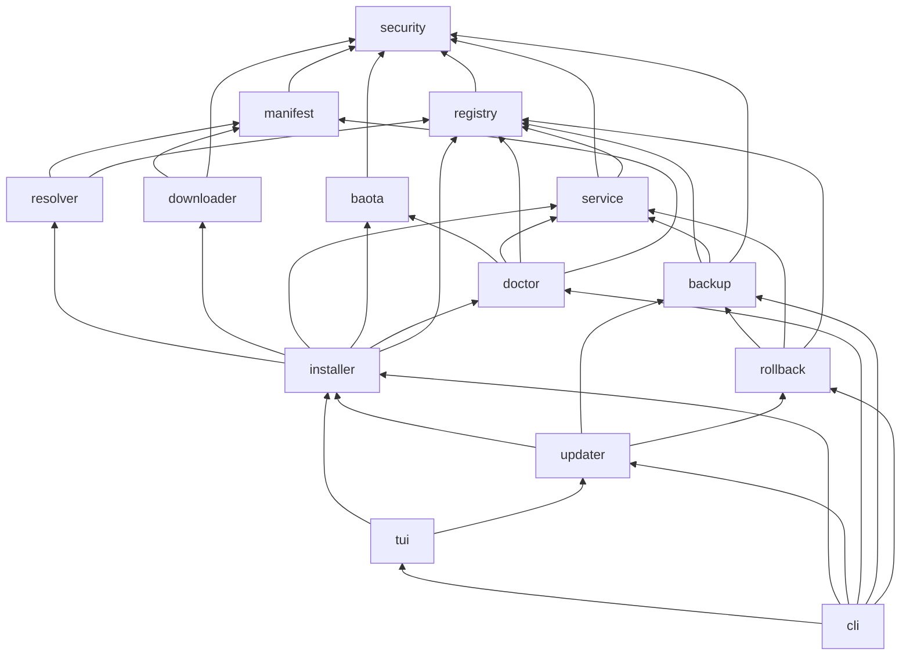
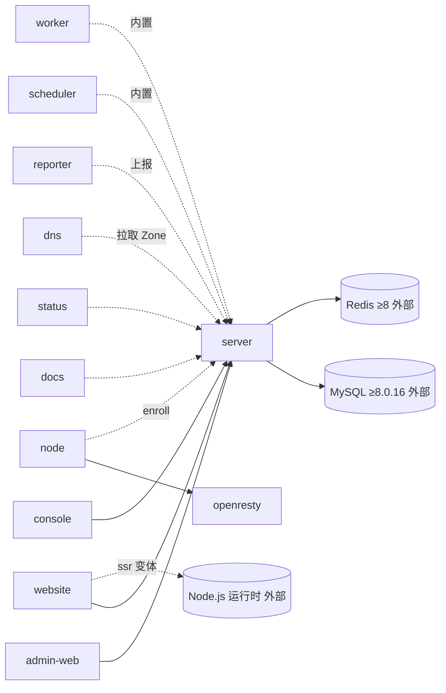
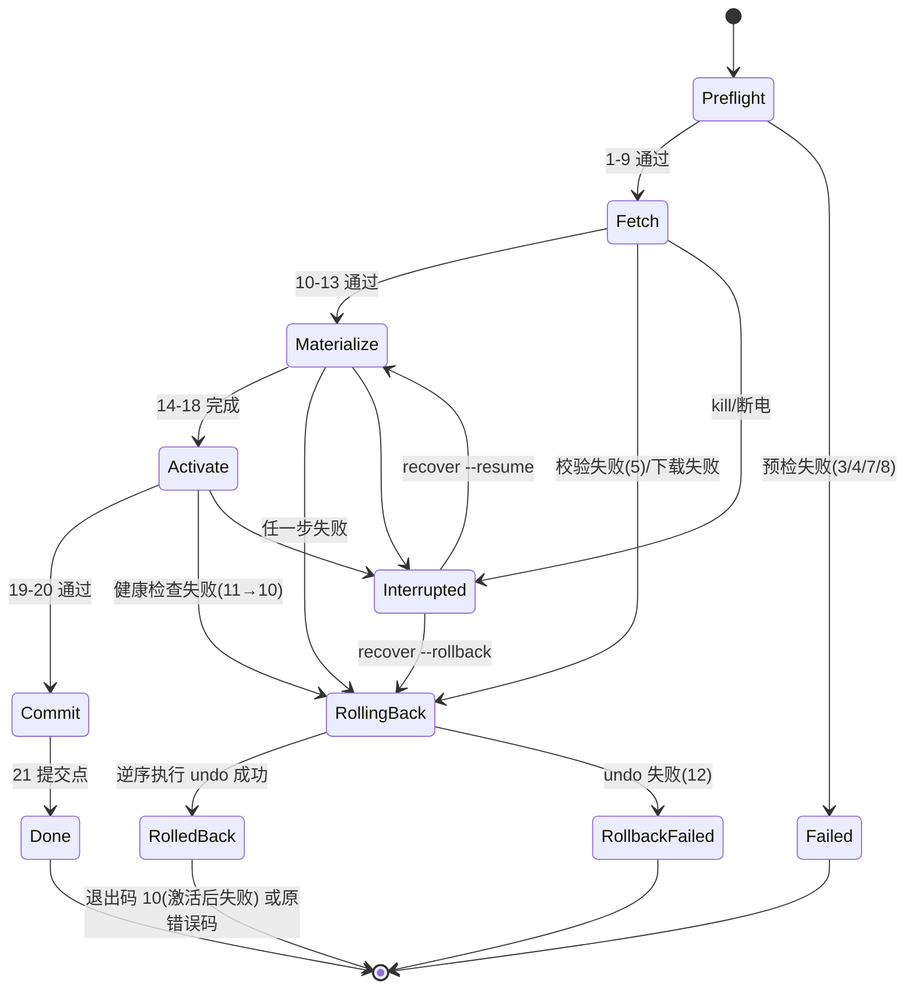

# LingEdge Tools 技术设计

> 本文是 `lingedge`（LingEdge Tools）的实现级设计。凡「数值」（内存/磁盘最低要求、超时窗口、保留份数等）由发行清单（manifest）或配置给出，本文只给出**默认机制**，不虚构门槛；需要基线测试的值标「待基线测试后确定」。
> 凡与现网 Linux/宝塔环境相关、本机（macOS）无法验证的细节，标「实现时在验收机核对」，对应 Story 标「等待环境验证」（NFR-3、ADR-023）。

## 1. 定位与边界

**是什么**：单一静态 Go 二进制 `lingedge`（入口 `cmd/lingedge/`），平台全部组件的**安装、升级、回滚、备份、诊断、服务管理、节点注册**入口（基线 §4.1）。同时提供交互 TUI 与可脚本化的非交互 CLI。

**不做什么**：

| 不做 | 理由 / 替代 |
|---|---|
| 不存在独立 `lingedge-updater` 程序或构建目标（FR-1） | 升级由 `lingedge update …` 完成；Node 的远程升级走 systemd `.path` 触发**同一个** `lingedge` 的受限入口（§15.3、ADR-024） |
| 不提供任意 Shell/命令执行（FR-35） | 所有外部命令（`systemctl`、`useradd`、`mysqldump`、`openresty -t` …）由 Go 以**参数数组**调用，白名单固定（§17.2） |
| 不安装 MySQL / Redis `[ASSUMPTION]` | 基线 §4.5 只要求「检测」；Tools 检测并引导用户使用宝塔/系统已有或自备实例；Server 向导负责连接与初始化。可被推翻：若要代装，需新增 `deps` 组件与包管理器适配，影响 §10、§12 |
| 不修改宝塔面板自身配置与站点（FR-7） | 只识别；Nginx 站点片段只生成到 `/etc/lingedge/nginx/`，由用户确认 include（§11.3） |
| 不依赖 Docker/Compose/K8s（NFR-7） | — |
| 不自动停用占用端口的服务（D-9） | 报告冲突并给出选项 |
| 不静默覆盖已有网站/数据库/证书/Nginx 配置（FR-6） | 所有写入走「创建专属路径 + 已存在即停」策略；已存在文件写 `.new` 并提示 |
| Windows 上的 Tools `[ASSUMPTION]` | Tools 以 Linux（systemd）为目标。Reporter 的 Windows AMD64 版自带 `lingedge-reporter service install|uninstall`（P3 设计），不经过 `lingedge` — 见文末反馈 T-1 |

**权限模型**：只读命令（`version`、`list`、`status`、`config validate`、`doctor` 的无特权部分）可由普通用户运行；`install/update/rollback/uninstall/service start|stop|restart/backup/node enroll` 需要 root（Tools 不自提权，检测到非 root 时输出 `sudo lingedge …` 提示并以退出码 3 退出）。

## 2. 包结构与依赖方向

```
cmd/lingedge/main.go          # 仅 wiring：构造依赖、运行 cli.Root
internal/tools/
  security/    # 叶子：安全解压 pathsafe、safeexec（参数数组执行）、redact（日志脱敏）、权限检查、随机数
  manifest/    # 清单与密钥：schema、keys.json（go:embed）、Ed25519 验签、sequence/valid_until、吊销、semver 约束类型
  registry/    # 本机安装状态：state.json 读写、journal（事务日志）、锁（flock）、目录布局常量
  downloader/  # HTTPS 下载（TLS 校验、禁止降级重定向、大小上限、断点续传、代理）、离线 bundle 读取
  resolver/    # 纯函数：依赖/版本/资源/端口求解，输出 Plan
  baota/       # 宝塔与已有 Nginx/MySQL/Redis/PHP/WAF/防火墙 的只读探测
  service/     # systemd unit 渲染与安装、systemctl 封装、运行用户创建、目录/权限创建
  backup/      # 备份与恢复（配置、DB dump、数据目录、清单、加密）
  rollback/    # 回滚策略执行（按迁移分级选择路径）
  installer/   # 22 步安装编排 + journal 驱动的恢复
  updater/     # 升级编排（含 --apply-staged 受限入口）
  doctor/      # 检查项注册表与执行
  tui/         # Bubble Tea 视图（菜单、多选、计划确认、进度、不可逆确认）
  cli/         # Cobra 命令树、输出（人类/JSON）、退出码映射
```

依赖规则（可由 depguard 强制）：



- **Story 1.43 的落地口径（偏离上图，已修正）**：升级事务（13 步）与 22 步安装共用取包/journal/撤销/服务控制，因此编排落在 `installer`（与 `uninstall` 同处）；`updater` 只含不依赖事务机制的部分（`update check` 的清单比对、`update self` 的原子替换），`rollback` 含决策表与回滚路径执行器（切换 `current`、`migrate down`、恢复备份、保留策略），新增叶子包 `dbmigrate`（`lingedge-server migrate` 的调用封装）。依赖方向变为：`installer → rollback、updater、dbmigrate、backup`；`rollback → backup、dbmigrate、registry`；`updater → manifest、registry`；`cli → installer、updater`。详见 §17.7。
- `security` 是叶子，**所有**子进程调用、归档解压、日志输出必须经它；CI 禁止在其他包里 `os/exec` 直接使用或调用 `sh -c`、`bash -c`。
- `tui` 与 `cli` 只是消费者；业务包通过 `installer.Event` 通道输出进度（步骤开始/完成/警告），不依赖 UI。
- Tools **不 import** `internal/` 下任何 Server 业务模块（architecture §5.3 规则 5）；与 Server 的协作仅通过：发行清单、`state.json`、`lingedge-server migrate|healthz|setup` 子命令、本机 HTTP `/healthz`。

## 3. 命令树

全局标志（所有命令）：`--json`（§6）、`--yes/-y`（对所有「可确认」提示回答是；**不**含不可逆迁移，见下）、`--non-interactive`（禁止任何提示与 TUI；需要确认而未提供对应显式标志则以退出码 9/3 失败）、`--dry-run`（只做预检与计划，不写任何持久状态；输出 Plan，退出码 0 或预检失败码）、`--log-level debug|info|warn|error`、`--log-file`（默认 `/var/log/lingedge/tools.log`，0640）、`--no-color`、`--config /etc/lingedge/tools/tools.yaml`。

无 TTY 或 `TERM=dumb` 时自动等价于 `--non-interactive`，并在首行输出一次提示。

```
lingedge                              # 交互菜单（§7）；非 TTY 时打印 help 并退出码 0
lingedge --help | -h
lingedge version [--check [--channel stable|beta]]   # Tools 与各已装组件版本；--check 同时联网比对清单（Story 1.43：= update check 的只读部分，结果在 data.check）
lingedge list [--available]           # 已装组件（版本/状态/端口/目录/用户）；--available 列出清单中可装版本
lingedge status                       # 汇总：每个已装组件的 systemd 状态 + 健康探测结果

lingedge install <component> [flags]  # component: server|admin-web|console|website|node|dns|reporter|docs|status
                                      #           scheduler|worker → 退出码 8（已内置于 Server，D-16）
    --version <semver>                #   默认：通道内满足约束的最高稳定版
    --channel stable|beta             #   默认 stable
    --offline <bundle.tar>            #   从离线可信发行包安装（同样验签，§9.4）
    --allow-expired-manifest          #   仅与 --offline 联用：放行已过 valid_until 的清单（气隙环境；告警；sequence/签名/吊销仍生效，§9.2）
    --set key=value (可重复)          #   组件初始配置项（经 schema 校验，非任意文本注入）；换端口：--set port.<组件>.<tcp|udp>.<原端口>=<新端口>[@<绑定地址>]（§12.4）
    --mode static|ssr                 #   仅 website（变体）
    --skip-start                      #   仅物化，不启动（调试）
    --setup-listen <addr>             #   仅 server：向导监听地址，默认 127.0.0.1:8080（§13）
lingedge install                      # 无组件名 + TTY → 进入多选安装界面（§7.2）

lingedge update check [--channel …]   # 获取签名清单，列出可升级组件与迁移级别预告
lingedge update <component>           # 例：update node、update server
lingedge update --all
lingedge update self                  # 升级 lingedge 自身（原子替换 /usr/local/bin/lingedge，保留 .prev）
    通用标志：--version、--offline <bundle>、--allow-expired-manifest（仅与 --offline 联用）、--accept-irreversible（§17.3）、--no-backup（仅非 server 组件且需 --yes）、--plan-only（等价 --dry-run）、--no-rollback
    （Story 1.43 追加）--db-host/--db-port/--db-socket/--db-name/--db-user/--db-tls、--mysql-bin-dir、--passphrase-file（升级前备份的口令文件，给出则加密备份；缺省取环境变量 LINGEDGE_BACKUP_PASSPHRASE_FILE，都没有则不加密）；
    update self 的标志：--version、--channel、--offline、--allow-expired-manifest
lingedge update node --apply-staged
                                      # 【内部入口】仅 root；供 lingedge-node-upgrade.service 调用（§15.3），固定读取 staging 目录中的 upgrade.request

lingedge service status [--all|<component>]
lingedge service start|stop|restart <component>
lingedge logs <component> [-f] [--since <dur>] [-n <lines>]   # 封装 journalctl（参数数组），输出经脱敏过滤

lingedge doctor [--all|<component>] [--strict] [--fix-perms]
lingedge config validate [<component>] [--file <path>]
lingedge config show <component>      # 脱敏输出（密码/Token/私钥路径内容不展示）
lingedge config edit <component>      # 编辑副本 → 校验 → 原子替换（保留 .bak）→ 可选重启

lingedge node enroll [--token-file <f> | 交互输入 | stdin] [--token <t>（不推荐：进 ps/shell 历史）] [--server <url>] [--force-reenroll]

lingedge backup create [--component server|node] [--output <dir>] [--encrypt] [--passphrase-file <f>] [--include-logs]
                       [--include-master-key | --include-migrate-credential | --include-identity]（三者都必须同时 --encrypt）
                       [--db-host/--db-port/--db-socket/--db-name/--db-user/--db-tls] [--mysql-bin-dir <dir>]
lingedge backup list [--dir <dir>] | verify <file> [--passphrase-file <f>]
lingedge backup restore <file> [--component …] [--replace --confirm-name <hostname>] [--master-key-file <f> | --use-backup-master-key]
                        [--passphrase-file <f>] [--db-…] [--mysql-bin-dir <dir>]

lingedge rollback <component> [--to <version>] [--from-backup <file> --confirm-name <hostname>] [--passphrase-file <f>] [--db-…] [--mysql-bin-dir <dir>]
lingedge uninstall <component> [--purge --confirm-name <hostname>]

lingedge recover [--resume|--rollback]   # 处理被中断的事务（§12.3）；非交互且未给标志 → 退出码 9
```

要点：
- `install dns` 在 MVP 清单中 `status: unreleased` → 退出码 7，输出「组件尚未发布」，**不**伪造成功（FR-3）。
- `uninstall` 默认保留 `/etc/lingedge/<c>`、`/var/lib/lingedge/<c>` 与备份；`--purge` 需交互输入主机名，或 `--yes --confirm-name <hostname>`（FR-9「不默认删除用户数据」）。
- `rollback node` 默认回到上一 release；若上一次升级含不可逆迁移（Node 无 DB 迁移，此项仅对 server 有意义）要求 `--from-backup`（§17.4）。
- `config edit` 不是基线必须项，作为菜单「7 配置管理」的落点。

## 4. 退出码

退出码为公开契约（FR-4），随 Docs（P5，FR-120）发布，同时由 `lingedge --help exit-codes` 输出；变更须走 ADR。

| 码 | 常量 | 含义 | 典型场景 |
|---|---|---|---|
| 0 | `OK` | 成功（含 `--dry-run` 计划成功、`doctor` 无失败项） | — |
| 1 | `GENERAL` | 通用/未分类失败 | 未预期错误；详见日志 |
| 2 | `USAGE` | 参数/用法错误 | 未知标志、非法 `--set`、组件名错误 |
| 3 | `PRECONDITION` | 前置条件/预检失败 | 非 root、内存/磁盘不足、OS/架构不支持、依赖缺失、`doctor` 存在失败项 |
| 4 | `PORT_CONFLICT` | 端口冲突 | 80/443/53/9443 被占用（§10.4） |
| 5 | `VERIFY_FAILED` | 校验/签名失败 | 清单验签失败、SHA256 不符、包内签名失败、sequence 回退、清单过期 |
| 6 | `LOCKED` | 任务锁被占用 | 同目标已有安装/升级任务 |
| 7 | `NOT_RELEASED` | 组件尚未发布 | `install dns`（MVP） |
| 8 | `BUILTIN` | 组件已内置于 Server | `install scheduler|worker`（D-16） |
| 9 | `CONFIRM_REQUIRED` | 需要显式确认但处于非交互 | 含不可逆迁移而未传 `--accept-irreversible`；`--purge` 未带 `--confirm-name` |
| 10 | `ROLLED_BACK` | 升级/安装失败，**已自动回滚**且服务恢复 | 健康检查失败后回滚成功 |
| 11 | `HEALTH_FAILED` | 健康检查失败（且**未**回滚或无需回滚） | `service status`/`status` 发现组件不健康；安装后检查失败且 `--no-rollback` |
| 12 | `ROLLBACK_FAILED` | 回滚本身失败，需人工恢复 | journal 保留，输出恢复指引 |
| 13 | `INTERRUPTED` | 存在未完成事务，需要 `recover` | 新命令启动时发现未完成 journal |
| 14 | `NOT_INSTALLED` | 目标组件未安装 | `service start node` 而未装 |
| 130 | `SIGINT` | 用户中断（SIGINT），已按 journal 处理 | Ctrl-C |

约定：10 与 12 互斥；10 表示**状态已恢复为操作前**，脚本可据此继续；人类输出同时给出原因与下一步。

## 5. 输出与日志

- 人类输出写 stdout（结果）与 stderr（进度/警告）；`--json` 时 stdout **仅**输出一个 JSON 对象（§6），进度改走 stderr 的 NDJSON（`--progress=json`，默认在 `--json` 下开启，可 `--progress=none` 关闭）。
- 日志：详细日志写 `--log-file`（JSON Lines，`ts/level/run_id/step/msg/fields`）；**所有**字段经 `security/redact`：Token（`lenr1.`、`le_*_` 前缀）、`password`/`secret`/`key` 命名字段、PEM 块、DSN 中的口令 一律替换为 `***`（NFR-12、FR-9）。参数中的敏感值不回显（如 `--token` 在日志中记为 `--token ***`）。

## 6. JSON 输出 Schema（统一 envelope）

```json
{
  "schema": "lingedge.cli/v1",
  "ok": false,
  "command": "install node",
  "run_id": "01JD5Y3C8Q5G7M0V1N2P3R4S5T",
  "exit_code": 4,
  "exit_name": "PORT_CONFLICT",
  "started_at": "2026-11-16T12:00:00.000Z",
  "duration_ms": 1830,
  "dry_run": false,
  "data": { },
  "warnings": [ { "code": "baota.detected", "message": "检测到宝塔面板 …" } ],
  "errors": [
    {
      "code": "port.conflict",
      "message": "TCP 443 已被进程 nginx(pid 812) 占用",
      "step": 4,
      "hint": "停止占用者、换用主控 Nginx 的其它端口，或把本机仅作为非节点使用",
      "details": { "port": 443, "proto": "tcp", "holder": { "pid": 812, "name": "nginx", "owner": "宝塔?" } }
    }
  ]
}
```

规则：`ok == (exit_code == 0)`；`errors[].code` 为稳定小写点分字符串（与 Docs 退出码表一并公布）；`data` 随命令不同，每个命令的 `data` 有独立 JSON Schema（`internal/tools/cli/schema/*.json`，CI 校验示例输出）。示例：

- `list` → `data.components[]: {name, version, state, unit, run_user, ports[], release_dir, config_dir, data_dir, installed_at, prev_version?}`
- `install --dry-run` → `data.plan: {components[], versions{}, steps[], ports[], units[], files_to_create[], migrations{class,count}, resources{}}`
- `update check` → `data.updates[]: {component, current, available, min_upgrade_from_ok, migrations{classes[], has_irreversible}, notes_url}`
- `doctor` → `data.checks[]: {id, category, level: pass|warn|fail|skip, message, hint}`

## 7. 交互菜单与 TUI

### 7.1 主菜单（FR-2，编号与基线 §4.3 一致）

```
LingEdge Tools  v<version>
 1  安装组件        → 多选安装界面（§7.2）
 2  查看已安装组件  → = lingedge list
 3  升级组件        → 先 update check，再选择组件，展示 Plan 并确认
 4  服务管理        → 选择组件 → status/start/stop/restart
 5  节点注册        → 引导 lingedge node enroll
 6  系统诊断        → lingedge doctor --all（可钻取单项）
 7  配置管理        → show / validate / edit
 8  备份恢复        → create / list / verify / restore
 9  查看运行日志    → 选择组件 → logs（可跟随）
10  卸载组件        → 选择组件 → 确认（默认保留数据；--purge 另起确认页）
11  查看版本        → = lingedge version --check
 0  退出
```

非 TTY 下菜单不可用，输出 help（FR-2「终端无 TUI 能力时给出非交互替代提示」）。

### 7.2 多选安装界面

Bubble Tea 复选框列表：`Server / Admin Web / Console / Website / Node / DNS / Reporter / Docs / Status`。

- 空格切换，回车进入「计划确认」页。选择即时调用 `resolver` 的**只读预估**：自动勾选并标注依赖（如 Admin Web 依赖 Server 的存在于本机或已配置的远端）、显示互斥/端口冲突红字、资源合计。
- 未发布组件（清单 `status: unreleased`）显示灰色「尚未发布」且不可选；`scheduler`/`worker` 不出现在列表。
- 「计划确认」页展示 Plan（版本、端口、目录、用户、systemd 单元、将创建/将不覆盖的文件、迁移级别），确认后进入进度页（22 步，实时来自 `installer.Event`）。失败页展示原因、已回滚内容、日志位置。
- 不可逆迁移确认页（升级）：红色全屏警告，列出「备份点之后的数据会丢失、不能简单回退二进制」，要求**键入固定短语 `confirm-irreversible`** 才继续；非交互对应 `--accept-irreversible`（§17.3）。

## 8. 目录布局与原子切换

| 用途 | 路径 | 属主/权限 |
|---|---|---|
| Tools 二进制 | `/usr/local/bin/lingedge`（升级时保留 `lingedge.prev`） | root 0755 |
| 组件 release | `/opt/lingedge/<component>/releases/<version>/` | root:root 0755（二进制只读） |
| 当前版本 | `/opt/lingedge/<component>/current` → `releases/<version>`（符号链接） | root |
| OpenResty 发行 | `/opt/lingedge/openresty/releases/<ver>/`、`current` | root |
| 配置 | `/etc/lingedge/<component>/` | root:`<run-user>` 0750；文件 0640；`master.key` root 0400 |
| 数据 | `/var/lib/lingedge/<component>/`（Node 为 `/var/lib/lingedge-node/`，**目录总表以 ADR-020 §2 为权威**：`identity/ certs/ generations/g<N>/ current state.json cache/ runtime/ staging/ logs-spool/`） | `<run-user>` 0750 |
| 日志 | `/var/log/lingedge/`（Node 访问日志 `/var/log/lingedge-node/access/`） | `<run-user>` 0750 |
| Tools 状态 | `/var/lib/lingedge/tools/{state.json,journal/,locks/,lock,staging/,trust/,backups-index.json}` | root：目录本身 **0711**（只授予「穿越」权限，不可列目录）、`state.json` **0644**（普通用户 `list/status` 可读，不含密钥）、`journal/ locks/ lock staging/ trust/` 均 **0700/0600**（实现见 `registry.Layout.Ensure`；原文「目录 0700 + state.json 0644」自相矛盾，0700 的目录会挡住普通用户读 state.json） |
| 节点升级结果目录 | `/var/lib/lingedge-node-upgrade/`（Tools 安装 node 时创建；`<task_uid>.result.json` 由 root 升级单元写入） | root:root 0755；文件 root:root 0644（Agent 只读，§15.3） |
| 公开媒体目录（P2，官网 CMS 媒体，MIN-08） | `/var/lib/lingedge/media/`（Nginx `location /media/` 的 `alias`；上传暂存仍在私有的 `/var/lib/lingedge/server/` 下） | 目录 0755、文件 0644，属主 `lingedge`；父目录 `/var/lib/lingedge` 为 root 0755，使 Nginx 运行用户可读 |
| 备份默认目录 | `/var/backups/lingedge/` | root 0700 |
| Nginx 片段 | `/etc/lingedge/nginx/<component>.conf` | root 0644 |
| systemd | `/etc/systemd/system/lingedge-*.service|.path` | root 0644 |

运行用户：`lingedge`（server/scheduler/worker）、`lingedge-node`（node+openresty）、`lingedge-dns`、`lingedge-web`（website SSR）、`lingedge-reporter`；均为 `--system --no-create-home --shell /usr/sbin/nologin`。

**原子切换算法**（所有组件）：
1. 新版本解压到 `releases/<v>.partial/`，校验完成后 `rename` 为 `releases/<v>/`（同文件系统内原子）。
2. 创建临时链接 `current.new -> releases/<v>`，`rename(current.new, current)`（`rename(2)` 覆盖符号链接是原子的）。
3. `fsync` 目录；失败则保留旧 `current`。
4. 保留最近 `retain_releases`（默认 2，不少于 2）个 release；更早的在升级**成功确认后**才清理，永不清理 `current` 与 `prev`。

## 9. 清单与签名格式

信任模型见 ADR-012 与 PRD D-12：**发行清单信任域独立于配置签名与节点 mTLS CA**。

### 9.1 公钥集 `keys.json`（内置于 Tools，`go:embed`）

```json
{
  "schema_version": 1,
  "keys": [
    { "key_id": "rel-2026-a", "alg": "ed25519", "public_key": "AQIDBAUGBwgJCgsMDQ4PEBESExQVFhcYGRobHB0eHyA=",
      "not_before": "2026-11-01T00:00:00Z", "not_after": "2028-11-01T00:00:00Z", "status": "active" },
    { "key_id": "rel-2025-z", "alg": "ed25519", "public_key": "ICEiIyQlJicoKSorLC0uLzAxMjM0NTY3ODk6Ozw9Pj8=", "status": "retired" }
  ],
  "revoked_key_ids": [ "rel-2024-x" ]
}
```

- 多公钥并存支持轮换：`active` 与 `retired` 在重叠期内都可验证**已有**包；`revoked` 一律拒绝。新增公钥通过**新版 Tools 发行**（Tools 自身用旧 active key 签名）更新；另可在清单内携带 `key_rotation` 段（新公钥 + 由旧 active key 签名的背书），验证通过后落盘到 `/var/lib/lingedge/tools/trust/keys.d/`。私钥离线保管，不在发布流水线可达的机器上。
- **`key_rotation` 段格式（Story 1.27，CF-6）**：清单顶层可选字段 `"key_rotation": {"keys":[<新公钥条目，格式同上，status 必须为 active>], "endorsements":[{"key_id":"<新公钥>","endorsed_by":"<旧 active key_id>","sig":"<base64>"}]}`。背书签名输入 = `"LINGEDGE-KEYROT-V1\n"` ‖ `key_id\nalg\npublic_key\nnot_before\nnot_after\nstatus\n`（缺省字段为空串；覆盖新公钥全部语义字段，背书后无法改有效期/状态）。**只有清单本身验签通过后**才处理该段；背书者必须是当前可信集中**未吊销、active、generated_at 在其有效期内**的旧公钥；新 key_id 不得与已有公钥同名异钥、不得在吊销集内；任一条背书不成立则**整份清单被拒绝**（退出码 5）。落盘发生在整条校验链成功之后（`Verifier.Commit`）：`keys.d/<key_id>.json`（格式同 keys.json，文件 0600、目录 0700，原子写）；落盘前后重放同一清单幂等。`keys.d/` 内文件也可携带 `revoked_key_ids` 追加吊销；`keys.d` 中与内置公钥同名异钥、符号链接、group/other 可写的文件一律使加载失败（失败关闭）。
- **公钥有效期窗口**以清单的 `generated_at`（包签名则为其所属清单的 `generated_at`）判定，而非「现在」：旧清单/离线 bundle 不因公钥后来到期而无法验证，且一把公钥签不出生成时间在其窗口之外的清单；公钥泄露的补救是吊销，不靠时钟。窗口为 `[not_before, not_after)`。
- 具体 Ed25519 实现：Go 标准库 `crypto/ed25519`（无第三方依赖）。

### 9.2 清单 `manifest.json` 与 `manifest.json.sig`

`manifest.json.sig`（JSON，非二进制）：`{"key_id":"rel-2026-a","alg":"ed25519","sig":"<base64>"}`。签名对象为 `"LINGEDGE-MANIFEST-V1\n" || manifest.json 原始字节`（域分隔；对**文件字节**签名，免去规范化歧义）。

`manifest.json`（下例的版本号、哈希、URL、公钥均为**虚构的合法示例**，不是真实发行数据；示例满足本节全部 schema 规则，并由测试 `TestToolsDesignExamplesPassSchema` 逐次校验，文档改动若使示例不合法则测试失败）：

```json
{
  "schema_version": 1,
  "channel": "stable",
  "sequence": 42,
  "generated_at": "2026-11-16T00:00:00Z",
  "valid_until": "2027-02-14T00:00:00Z",
  "revoked_versions": [ { "component": "node", "version": "0.0.9", "reason": "示例：已知缺陷" } ],
  "components": {
    "server": {
      "status": "available",
      "description": "LingEdge 中央主控",
      "versions": [
        {
          "version": "0.1.0",
          "released_at": "2026-11-15T00:00:00Z",
          "min_upgrade_from": "0.1.0",
          "notes_url": "https://releases.example.invalid/notes/server-0.1.0",
          "requires": {
            "system": { "os": ["linux"], "arch": ["amd64", "arm64"], "min_memory_mb": 1024, "min_disk_mb": 2048 },
            "external": { "mysql": ">=8.0.16 <9", "redis": ">=8" },
            "components": { },
            "runtime": { }
          },
          "conflicts": [ ],
          "ports": [
            { "proto": "tcp", "port": 8080, "bind": "127.0.0.1", "purpose": "rest" },
            { "proto": "tcp", "port": 9443, "bind": "0.0.0.0", "purpose": "grpc-mtls" },
            { "proto": "tcp", "port": 9444, "bind": "0.0.0.0", "purpose": "grpc-enroll", "conditional": true },
            { "proto": "tcp", "port": 9180, "bind": "127.0.0.1", "purpose": "metrics" }
          ],
          "migrations": {
            "schema_from": "0000", "schema_to": "0007",
            "classes": ["reversible", "expand"], "irreversible_count": 0, "backup_required": true
          },
          "config_schema_version": 1,
          "variants": {
            "default": {
              "artifacts": {
                "linux-amd64": { "url": "https://releases.example.invalid/server/0.1.0/lingedge-server-0.1.0-linux-amd64.tar.gz",
                                 "sha256": "1111111111111111111111111111111111111111111111111111111111111111", "size": 41943040 },
                "linux-arm64": { "url": "https://releases.example.invalid/server/0.1.0/lingedge-server-0.1.0-linux-arm64.tar.gz",
                                 "sha256": "2222222222222222222222222222222222222222222222222222222222222222", "size": 39845888 }
              }
            }
          }
        }
      ]
    },
    "website": {
      "status": "available",
      "versions": [ { "version": "0.1.0",
        "variants": {
          "static": { "artifacts": { "any": { "url": "https://releases.example.invalid/website/0.1.0/lingedge-website-static-0.1.0.tar.gz", "sha256": "3333333333333333333333333333333333333333333333333333333333333333", "size": 8388608 } }, "requires": { "runtime": {} } },
          "ssr":    { "artifacts": { "any": { "url": "https://releases.example.invalid/website/0.1.0/lingedge-website-ssr-0.1.0.tar.gz", "sha256": "4444444444444444444444444444444444444444444444444444444444444444", "size": 16777216 } }, "requires": { "runtime": { "node": ">=20 <23" } } }
        } } ]
    },
    "node":      { "status": "available", "versions": [ { "version": "0.1.0", "requires": { "components": { "openresty": ">=1 <2" } },
                    "variants": { "default": { "artifacts": { "linux-amd64": { "url": "https://releases.example.invalid/node/0.1.0/lingedge-node-0.1.0-linux-amd64.tar.gz", "sha256": "5555555555555555555555555555555555555555555555555555555555555555", "size": 33554432 } } } } } ] },
    "openresty": { "status": "available", "internal": true,  "versions": [ ] },
    "dns":       { "status": "unreleased" },
    "scheduler": { "status": "builtin", "builtin_in": "server" },
    "worker":    { "status": "builtin", "builtin_in": "server" },
    "tools":     { "status": "available", "versions": [ ] }
  }
}
```

要点：
- **schema 规则（CF-6）**：`schema_version` 目前只能是 1；`channel ∈ stable|beta`；`sequence` 为 ≥1 的整数；`valid_until` 必须晚于 `generated_at`；`revoked_versions` 与 `components` 必填（`revoked_versions` 缺失即拒绝，防止「静默没有吊销」）；每个 `available` 组件的每个版本条目必须有 `variants`，每个 variant 至少一个 `artifacts`（平台键 `linux-amd64|linux-arm64|any`），`url` 为不含凭据的 https、`sha256` 为 64 位小写十六进制、`size ∈ [1, 8GiB]`（上例的哈希、大小与域名 `releases.example.invalid` 是虚构取值，真实清单填真实发行数据）。重复 JSON 键、超过 24 层嵌套、超过 8 MiB 一律拒绝。
- **未知必需字段拒绝、未知可选字段忽略**：对象（顶层、component、version 条目、variant、artifact）可带 `"critical": ["<字段名>", …]`——producer 把「接收方必须理解」的字段名列入其中；解析方只要不认识其中任一名字即拒绝整份清单（升级 Tools 后重试）；未列入 `critical` 的未知字段被忽略。
- 版本约束为本节「semver 范围语法子集」（见 §10），在 schema 校验时即解析，非法约束拒绝整份清单。
- `status ∈ available | unreleased | builtin`；`unreleased` → 退出码 7，`builtin` → 退出码 8。
- `sha256` 与签名覆盖关系：清单签名已覆盖所有 `sha256`；因此校验链为「清单验签 → 包 SHA256 → 包内逐文件 SHA256SUMS（及其签名）」。
- `size` 用于下载上限（超出即中止）。`min_*` 数值由发行方填写，Tools 不内置。
- `migrations` 为**预告**；以新二进制的 `lingedge-server migrate plan --json` 实际结果为准，二者冲突取更严格级别（§17.2）。
- **sequence**：清单的单调递增整数。Tools 在 `/var/lib/lingedge/tools/trust/state` 记录**每个通道**已见最大 sequence（JSON：`{"schema_version":1,"max_sequence":{"stable":42,"beta":7}}`，0600，原子写；stable 与 beta 是各自独立的序列，互不阻断）；新清单 `sequence < 该通道已见` 视为回滚攻击，退出码 5。相等允许（幂等重取）。`trust/state` 损坏/权限过宽/被替换为符号链接时**失败关闭**（退出码 3），绝不当作「从未见过任何清单」（否则删改该文件即可旁路回滚防护）。清单 `channel` 必须等于请求的 `--channel`，否则退出码 5。
- **valid_until**：清单过期时间（冻结攻击防护）。过期默认拒绝并提示（`now >= valid_until` 即过期）；`--offline` 包可经 `--allow-expired-manifest` 显式放行并告警（气隙环境）；`--allow-expired-manifest` 不带 `--offline` 是用法错误（退出码 2），在线路径永不放行过期清单；放行过期不放行回滚——sequence、签名、吊销检查仍生效。**注意：该过期仅作用于 Tools 的安装/升级决策，与节点配置签名（无过期，R-4）无关。**
- 版本吊销 `revoked_versions`：命中则拒绝安装/作为升级目标，已装则 `doctor` 告警。

**构建策略（Story 1.27，NFR-1）**：内置公钥集由发行流水线在构建前注入 `internal/tools/manifest/builtin/keys.json`（`go:embed`，不入库）。`gates release-keys`（`make security` 内；`make build` 前置；`RELEASE=1` 的 `make build` 带 `-require`；`make release` 本体属 Story 1.34，须经它）：keys.json **含测试公钥**（与 `scripts/gates/data/test-release-pubkeys.txt` 指纹相同）、key_id 带 test/golden/demo 字样、含私钥/种子字段、`builtin/` 下有其他文件、或没有 active 公钥 → 任何构建失败；keys.json **缺失** → 发行构建失败，开发构建放行（产物内置零公钥，运行期对任何清单以 `no_builtin_keys` 失败关闭，退出码 5）。测试公钥/私钥只允许在 `tests/`、`_test.go`、`testdata/` 与 `lingedge_testdouble` 标签内；G-11 testdouble 门禁同时把这些测试公钥（base64/hex）当作固定假数据扫描生产源码与产物。真实公钥待发行签名人确认（UD-3）。

### 9.3 包格式

`.tar.gz`（标准库 `compress/gzip` + `archive/tar`，避免额外依赖）：

```
META/package.json        { component, version, variant, platform, built_at, config_schema_version, files_count, unpacked_size }
META/SHA256SUMS          每个 payload 文件一行 "<hex>  <relpath>"
META/SHA256SUMS.sig      {"key_id":…, "alg":"ed25519", "sig":…}；签名对象 "LINGEDGE-PKG-V1\n<component>\n<version>\n<platform>\n" || SHA256SUMS 字节
payload/…                实际文件（二进制、模板、迁移、默认配置模板、前端静态产物…）
```

**格式规则（Story 1.28 落定，CF-6 的 schema 文件不变；下列是对既有字段的语义澄清，发行流水线 1.34 按此产出）**：
- `META/` 的三个文件必须出现在归档**前部**（先于任何 `payload/` 条目）：下载器在解压前只扫描归档开头取出它们（§9.5 第 6 步），不为找 META 而解压整个包；META 出现在 payload 之后即拒绝。
- `SHA256SUMS` 只列 `payload/` 下的文件（不列 META 自身）；`files_count` = `payload/` 下普通文件数（必须等于 `SHA256SUMS` 行数，`SHA256SUMS` 已被签名）；`unpacked_size` = `payload/` 下全部文件内容字节之和（解压后必须相等）。二者同时作为解压限额的来源（条目上限 = 2×files_count+16，总量上限 = unpacked_size + META 三个文件大小），仍受 SafeExtract 绝对上限收紧。
- 归档内只允许普通文件与目录（§18.1）；`META/package.json` 无「可执行文件」字段，包内权限位被忽略，需要 0755 的路径由安装器（Story 1.33）按组件约定提供。

### 9.4 离线 bundle（`--offline <bundle.tar>`）

外层 tar 包含：`manifest.json`、`manifest.json.sig`、以及清单引用的若干包文件（文件名 = URL 末段）。布局：

```
offline-bundle/
  manifest.json
  manifest.json.sig
  packages/<artifact-filename>…
```

验证流程与在线完全一致（9.5），仅「下载」替换为「从 bundle 读取」；同样做 sequence/valid_until/吊销检查。bundle 本身不被信任，只信任其中经签名链验证的内容。

实现要点（Story 1.28，`internal/tools/downloader/bundle.go`）：
- **路径**：`--offline` 的路径先 `Lstat`（末级为符号链接一律拒绝），再 `EvalSymlinks` 取 realpath，必须是普通文件（目录/设备/FIFO/套接字拒绝）；随后以 `O_NOFOLLOW|O_NONBLOCK` 打开并对打开后的句柄 `fstat` 复核与校验时是同一个普通文件。路径中间的目录符号链接（如 `/var`→`/private/var`）是正常的。文件不存在是用法错误（退出码 2），其余一律退出码 5。
- **索引**：bundle 先被受限地顺序扫描建立索引（`security.IndexTar`：仅普通文件/目录，拒绝链接/设备/稀疏文件，名称经 `CleanEntryName`，重复/仅大小写不同拒绝，条目数 ≤4096，整个流不得超过文件实际大小），条目只能是 `manifest.json`、`manifest.json.sig`、`packages/<文件名>`（整体可带单一前缀目录 `offline-bundle/`），其他任何条目拒绝；条目顺序任意；清单未引用的包被忽略（不读取）。
- **取包**：`packages/<URL 末段文件名>` 的条目大小必须等于清单 `size`，复制到 staging 时流式 SHA256 必须等于清单 `sha256`，之后与在线路径走同一段代码（§9.5 第 6、7 步）。离线路径不构造任何网络客户端。

### 9.5 校验顺序（安装与升级共用，任一步失败即退出码 5）

1. 读取内置 `keys.json` 与 `trust/keys.d/`，构建可信公钥集（排除 `revoked_key_ids`）。
2. 取得 `manifest.json` 与 `.sig`；用 `key_id` 选公钥，对 `"LINGEDGE-MANIFEST-V1\n"+bytes` 验签。
3. 解析并校验 schema（未知必需字段拒绝，未知可选字段忽略）；检查 `sequence`、`valid_until`、`channel`。
4. 选版本（§10），检查 `revoked_versions`。
5. 下载/读取包到 `staging/<tx>/`，流式计算 SHA256 与长度，与清单比对。
6. 解压前读取 `META/SHA256SUMS(.sig)`，验证其签名；解压时逐文件边写边校验 SHA256（§18.1 的安全解压）。
7. 校验 `META/package.json` 的 component/version/platform 与清单一致。

校验顺序的代码落点：步骤 1–4 在 `internal/tools/manifest`（`LoadTrust` → `Verifier.Verify` → `Manifest.CheckTarget`），步骤 6 的包内签名在 `Verifier.VerifyPackageSums`，步骤 7 在 `PackageMeta.Matches`；步骤 5 与解压（`security.SafeExtract`）属 downloader（Story 1.28，入口 `downloader.Acquire`：校验链全部成功后才调用 `Verifier.Commit` 推进 sequence/落盘轮换公钥；任一步失败整个 `staging/<tx>` 删除、信任库不变）。失败映射：验证失败一律退出码 5，本地信任库损坏退出码 3，参数不合法退出码 2（`cli.VerifyError`）；下载器自身的失败经 `cli.DownloadError`：重定向到非 HTTPS、服务器证书不被信任、声明/实际大小超过清单 `size` 或截断、外层 SHA256 不符、包解压/逐文件校验失败、离线 bundle 非法一律退出码 5；纯传输失败（DNS/连接/超时/空闲超时/HTTP 状态，重试耗尽）退出码 1（网络问题而非校验问题，脚本可据此区分「重试」与「告警」）；bundle 文件不存在、清单中没有所请求的版本/变体/平台为退出码 2；组件 `unreleased`/`builtin` 为 7/8。

**签名对象一览（唯一规范，ADR-012 引用本节）**：清单 = 对 `manifest.json` **文件原始字节**（不做 canonical JSON）加域前缀签名；吊销 = 内置/`trust/keys.d/` 的 `keys.json.revoked_key_ids` ∪ 清单 `revoked_versions`（清单内**不含** `revoked_key_ids`）；包 = `.tar.gz`；包内签名对象见 §9.3；`key_rotation` 背书对象见 §9.1（域前缀 `LINGEDGE-KEYROT-V1\n`，与 Server 的 `LINGEDGE-REVISION-V1`/`LINGEDGE-KEYSET-V1` 互不相同）。机器可读 schema 与 CF-6 冻结记录：`internal/tools/manifest/schema/*.json`、`docs/bmad/contract-changes/CF-6.md`。

### 9.6 示例向量（**仅测试，非发行密钥**；供 `manifest`/`downloader` 包的 golden 测试，放入 `internal/tools/manifest/testdata/vectors.json`）

测试种子 `seed = SHA-256("LingEdge golden test vector seed v1 - TEST ONLY")`（32 字节，hex `cd8dc2235741957912a9f476a2b5b9bb9d75ae02bde212b9d8089a92fb895749`）；Ed25519 确定性签名。以下数值已用 Ruby OpenSSL 与 Go `crypto/ed25519` 两种实现各自**实际计算并验签通过**（篡改 1 字节则验签失败）。

| 项 | 值 |
|---|---|
| 公钥（base64，32 字节） | `P3pE/lvUPOLOFWJtF/1sxj4LU923fmJQU9Utz1K5ghc=` |
| 公钥（hex） | `3f7a44fe5bd43ce2ce15626d17fd6cc63e0b53ddb77e625053d52dcf52b98217` |
| `manifest.json` 文件字节（UTF-8，末尾含一个 `\n`） | `{"schema_version":1,"channel":"stable","sequence":1,"generated_at":"2026-01-01T00:00:00Z","valid_until":"2026-04-01T00:00:00Z","revoked_versions":[],"components":{}}` + `\n` |
| `manifest.json` 的 SHA-256 | `a231c5e64c6b3d757cd9ed6ada65eb3997c7afe7726f6910ea9352ed7c014c52` |
| 清单签名输入 | `"LINGEDGE-MANIFEST-V1\n"` ‖ 上行文件字节 |
| `manifest.json.sig` 的 `sig`（base64，64 字节） | `L5VbA6b3kohy34+RRMyB0adDM+SpIMKWU9g6k75onjjlLLv7XKUpq6JJg6h5G8PKaIQrH8S9aFnAjGCh9RKYDQ==` |
| 包内 `META/SHA256SUMS` 字节 | `5891b5b522d5df086d0ff0b110fbd9d21bb4fc7163af34d08286a2e846f6be03  payload/hello.txt` + `\n`（`payload/hello.txt` 内容为 `hello\n`） |
| 包签名输入 | `"LINGEDGE-PKG-V1\nnode\n0.1.0\nlinux-amd64\n"` ‖ `SHA256SUMS` 字节 |
| `META/SHA256SUMS.sig` 的 `sig`（base64） | `YLlLdkS0mzZ4zZYLbph1d34DZ/CjhSEr1CSslVVc5PRjIwHBaJHJwYfsORDZq+X2EKkGCIHGquM08a9sn/VqAA==` |

Story 1.27 已按本节落盘 `internal/tools/manifest/testdata/vectors.json`（key_id 取 `golden-test-1`），并由 `golden_test.go` 经生产验签路径与 Go 复算双重断言（逐字节翻转清单/签名/SHA256SUMS 均失败）；本机系统 Ruby 2.6/LibreSSL 不支持 Ed25519；Story 1.34 已用支持 Ed25519 的 Ruby（Homebrew Ruby 4.0 + OpenSSL 3.6）在本机**真实**复验：Ruby OpenSSL 与 Go `crypto/ed25519` 对上表清单/包签名均验签通过、篡改一位均失败、两者对同一种子的确定性签名逐字节相同，且离线签名工具 `scripts/release-sign` 的独立实现复算出与上表完全相同的签名（`scripts/release-sign/crosscheck_test.go`）。

测试断言：验签通过；任一输入字节翻转 → 失败；`key_id` 不在公钥集或在 `revoked_key_ids` → 失败；`sequence` 小于本地已见值 → 退出码 5。该种子私钥**只允许出现在测试代码与本文**，生产构建扫描不得出现该种子/公钥（G-6/ADR-023 的固定数据检查）。

## 10. 依赖解析

### 10.1 组件依赖图



- 实线 = 安装时硬依赖/就绪检查；虚线 = 运行时依赖（可在远端，不要求同机）。`admin-web/console/website/docs/status` 是静态/SSR 前端，对 Server 是**配置层**依赖（API 基址），安装时可指向远端 Server URL，不要求同机。
- `openresty` 是 `node` 的**内部组件**（独立版本，随 node 自动解析安装到 `/opt/lingedge/openresty`，对用户不可见于安装列表）。
- MySQL/Redis/Node.js 为**外部依赖**：只检测，不安装。

### 10.2 版本约束

semver 范围语法子集：`>=a.b.c <x.y.z`、`^`、`~`、`=`、空格即 AND、`||` 即 OR（解析库实现时选定，需标明版本）。`requires.components` 约束同机已装或本次一并安装的组件；跨机约束（如 node 与 server 的兼容）通过 `requires.peer`（`server: ">=0.1 <0.2"`）声明，在 `node enroll` 时由 Server 返回其版本做比对并警告。`min_upgrade_from` 限制可直接升级的起点（跨度过大须逐级升级，`update` 自动给出升级路径）。

### 10.3 求解算法（`resolver`，纯函数，可单元测试）

输入：`want[]`（用户选择，含可选固定版本）、`installed`（state.json）、`manifest`、`system`（OS/arch/内存/磁盘/已占端口/已探测外部依赖）。

1. **规范化**：`scheduler/worker` → 返回 `BuiltinError(8)`；`status: unreleased` → `NotReleased(7)`；加入内部依赖闭包（node→openresty）。
2. **候选版本**：对每个组件取通道内未吊销版本，按 semver 降序；用户 `--version` 则唯一候选。
3. **约束传播（回溯，规模极小）**：按依赖拓扑序逐组件取最高满足所有 `requires.components` 与已装版本约束的候选；无解 → `PRECONDITION(3)` 并列出冲突链。已装组件默认不被动升级（除非约束要求，此时把它加入 Plan 并标「被动升级」，需确认）。
4. **系统检查**：`os/arch ∈ requires.system`；`min_memory_mb`、`min_disk_mb` 对**合计**需求判断（磁盘按目标挂载点分别统计）。
5. **外部依赖**：对 `requires.external` 做存在性探测（宝塔/系统 MySQL/Redis/Node.js 版本，§11）；版本不满足 → 预检失败（3）；探测不到 → 对 server 允许继续（向导里配置远端实例），对 website ssr 则失败。
6. **端口矩阵**：汇总 Plan 内各组件 `ports`，检测：(a) 组件之间冲突；(b) 与本机监听冲突（§10.4）。
7. **冲突声明**：`conflicts[]`（如两个组件都要独占 80/443）。
8. 输出 `Plan{components[], order[], steps[], ports[], units[], files[], warnings[], blockers[]}`；`blockers` 非空 → 不执行（`--dry-run` 同样展示）。

### 10.4 端口矩阵与冲突检测

| 组件 | 端口 | 绑定 | 独占 | 说明 |
|---|---|---|---|---|
| server | 8080/tcp、9180/tcp | 127.0.0.1 | 是 | REST（由 Nginx 反代）、metrics |
| server | 9443/tcp、9444/tcp | 0.0.0.0 | 是 | 9444 仅有未过期注册 Token 时才监听，但安装时仍预留检测 |
| node | 80/tcp、443/tcp | 0.0.0.0 | 是（R-10） | 与宝塔/系统 Nginx 冲突即停止 |
| website(ssr) | 3000/tcp | 127.0.0.1 | 是 | — |
| dns | 53/udp、53/tcp | 指定 IP | 是（D-9） | systemd-resolved(127.0.0.53)、named 等 |
| admin-web/console/docs/status/website(static) | 无监听端口 | — | — | 需要 Web 服务器（Nginx）托管，Tools 只产出站点片段（§11.3） |

检测方法：优先 `ss -H -lntup` 解析（参数数组调用）；回退 `/proc/net/{tcp,tcp6,udp,udp6}` + `/proc/<pid>/fd` 映射。对每个端口区分「同地址冲突」与「通配冲突」（占用者绑定 0.0.0.0 vs 我方 127.0.0.1 也冲突）。冲突时退出码 4，输出占用进程名/pid/属主与选项（换端口 `--set`、释放、取消），**不自动停用**。

实现（Story 1.31，`internal/tools/probe`）：`ParseSS` 解析 `ss -H -lntup`（IPv4/IPv6/`*` 通配、`127.0.0.53%lo` 接口后缀、`users:(("nginx",pid=…,fd=…),…)` 多进程取 pid 最小者为主占用者、无权限时无 users 列 → `Hidden`）；回退 `ParseProcNet`（地址按主机字节序解码，IPv6 为四个主机序 32 位字，端口大端十六进制，TCP 状态 `0A`、UDP 状态 `07` 且远端全零）+ `/proc/<pid>/fd` 的 `socket:[inode]` 映射；两条路径都用 `/proc/<pid>/status` 与 `/etc/passwd` 补属主、用 `/proc/<pid>/cgroup` 补 systemd 单元（`resolver.Listener.Unit`）。同地址/通配语义直接复用 resolver 的 `AddrConflict`（同一套规则，不另造）。**两条路径都不可用时 `Result.ListenersKnown=false`，调用方不得把空监听列表当作「无冲突」**（`probe.Assess` 对每个想要的端口返回「无法检测」冲突）。

### 10.5 实现（Story 1.30，`internal/tools/resolver`）

`resolver.Resolve(Input) *Plan` 是纯函数（无 IO/时钟/随机，`TestPackageIsPure` 扫描源码 import 守住），失败不返回 error 而写入 `Plan.Blockers`（`--dry-run` 同样展示），`Plan.Err()` 得到 `*resolver.Error`，`cli.ResolveError` 映射退出码：用法 2、NOT_RELEASED 7、BUILTIN 8（`scheduler|worker`，即使清单里没有这个名字也是 BUILTIN）、固定版本命中 `revoked_versions` 5（与 `manifest.CheckTarget`/`VerifyError` 一致）、无解/成环/违反 `min_upgrade_from`/系统/资源 3、端口冲突 4、被动升级未确认 9；多个阻断并存时取优先级最高者的退出码，全部阻断与完整 Plan 放进 `errors[].details`。

**求解细则（相对 §10.3 的落地决定）**

- 在场集合 = 用户选择 ∪ 已装组件 ∪ 内部组件闭包（`requires.components` 指向 `internal: true` 的组件自动加入）。已装组件**始终参与约束**：已装 website 要求 `server <0.2` 时，升级 server 到 0.2 会把 website 标为「被动升级」（需确认）；website 无更新版本时 server 回退保持。
- `requires.components` 指向**非内部、本机没有也不一并安装**的组件：按远端部署处理，只给警告 `dependency.remote_assumed`（§10.1：前端对 Server 是配置层依赖）。指向清单里根本没有的组件则无解（不会装了 node 却没有 openresty）。
- `requires.peer`：目标组件在场（本次安装或已装）时**强制**并参与回溯；不在场只警告 `peer.compare_at_enroll`（enroll 时由对端返回版本比对）。
- 候选顺序：全新/用户选择的组件取通道内最高稳定版（预发布仅在固定版本时可选，吊销版本不可选，已装版本不降级）；已装且非用户选择的组件先试「保持」，不满足才被动升级到满足约束的最高版本。回溯是完备的（`TestPropertyRandomGraphs` 与独立暴力枚举对照 4000 个随机图，另有 fuzz）；规模上限 20 万步，超出报 `resolve.search_limit`。
- `min_upgrade_from`：不固定版本时选可直达的最高版本并警告 `upgrade.stepwise`（含完整逐级路径）；固定到不可直达的版本 → 退出码 3，`details.upgrade_path` 给出路径。降级 → 退出码 3（请用 `rollback`）。
- 外部依赖（`requires.external`/`requires.runtime`）作为**候选过滤**：探测到但版本不满足 → 该候选被拒（可回退到更老版本，全部被拒则无解 3）；探测不到：`server` 的 mysql/redis 允许继续（警告 `external.remote_assumed`），其他（含 website ssr 的 `runtime.node`）一律拒绝。探测到的版本串只取数字前缀补全为 x.y.z（`8.0.36-0ubuntu0.22.04.1`→`8.0.36`、`v20.11.0`→`20.11.0`），否则发行版后缀会被 SemVer 当预发布而使 `>=8.0.16` 不通过。`requires.runtime` 的键 `node` 映射到探测键 `nodejs`。
- 资源：内存 = 本次 install/upgrade 组件的 `min_memory_mb`（variant 与 version 取较大者）之和，对比 `System.MemoryAvailableMB`；未探测到（0）而需要内存 → 阻断。磁盘按**目标路径的最长前缀挂载点**分别累加：组件的 `min_disk_mb` 记在 `<opt>/<组件>` 所在挂载点，包大小（向上取整 MiB）记在 staging 所在挂载点；只读或未覆盖的挂载点阻断。
- 端口：取清单 `ports`（`bind` 缺省按 `0.0.0.0` 通配，最保守；条件端口 9444 也预留；website 的端口只在 `ssr` 变体生效，见 `profile.go`）。冲突语义：`0.0.0.0` 对任意 IPv4（含 `127.0.0.1`）冲突；`::` 在 Linux 双栈下对任意地址冲突；`0.0.0.0` 对 IPv6 具体地址（`::1`）不冲突；具体地址仅完全相同才冲突；IPv4 映射地址按 IPv4；协议与端口须相同（`tcp6/udp6` 归一）。检测 (a) 组件之间（含已装且不动的组件）、(b) 与本机监听（保持不动的组件不查；已装组件自己的监听——`Unit` 等于其 state 记录的 unit，或进程名为 `lingedge-<组件>`——不算冲突）。`PortOverrides`（`--set` 换端口）在矩阵之前应用。
- 输出：`Plan.Components` 按 `order` 排列（依赖在前，同层字典序，Kahn；成环给出环路径，退出码 3）。`steps` 是高层步骤（download/extract/prepare/configure/units/activate/start/health/record），与 §12.1 的 22 步映射由 1.33 完成；`units`/`files` 来自 `profile.go` 的部署画像（运行用户、systemd 单元、配置/密钥/Nginx 片段及其权限与策略 `create_if_absent|managed`，release/current/数据目录）。

**`System` 输入契约（Story 1.31 的产出结构，`resolver.System`，JSON 键即下表第一列）**

| 字段 | 含义 | 1.31 的来源 |
|---|---|---|
| `os`、`arch` | `linux`；`amd64`/`arm64` | `runtime.GOOS/GOARCH` |
| `memory_total_mb`、`memory_available_mb` | MiB；资源判定用 available | `/proc/meminfo` 的 `MemTotal`/`MemAvailable` |
| `disks[]`：`mount`、`fs_type`、`total_mb`、`free_mb`、`read_only` | 各挂载点可用空间（`f_bavail×f_frsize`） | `/proc/self/mountinfo` + `statfs` |
| `listeners[]`：`proto`(tcp\|udp，tcp6/udp6 也接受)、`addr`（IP 字面量，含通配 `0.0.0.0`/`::`）、`port`、`pid`、`process`、`user`、`unit` | 本机监听及占用者 | `ss -H -lntup`，回退 `/proc/net/*` + `/proc/<pid>/fd`；`unit` 取自 cgroup |
| `deps{mysql,redis,nodejs}`：`detected`、`version`（原始串）、`source`、`flavor` | 外部依赖/运行时探测 | §11 |
| `baota`：`detected`、`confidence`、`version`、`panel_port`、`nginx_path` | 宝塔探测（只用于提示与处置建议；存在不阻止安装） | §11 |

`installed` 取 `registry.State`；`InstalledVariants`（可选）由 1.33 在知道已装变体时提供（state.json schema v1 不含变体，缺失时多变体且无 default 的被动升级候选被拒绝并提示显式选择）。

## 11. 宝塔与已有环境检测（只读，FR-7）

以下路径为宝塔常见默认布局，**实现时在真实宝塔机器上核对并以探测结果为准**（标志不唯一时综合判定，输出置信度与证据）：

| 项 | 探测 | 证据 |
|---|---|---|
| 宝塔面板 | 目录 `/www/server/panel` 存在；可执行 `bt` 或 `/etc/init.d/bt`；面板端口文件 `/www/server/panel/data/port.pl`；版本取自面板目录内版本信息（实现时核对来源文件） | 任两项满足 → `baota.detected` |
| Nginx | `/www/server/nginx/sbin/nginx`、`/www/server/nginx/conf/nginx.conf`；站点配置目录 `/www/server/panel/vhost/nginx/`；另检测系统 Nginx（`which nginx`、`/etc/nginx`） | 版本 `nginx -v`（参数数组）；占用 80/443 的进程 |
| OpenResty（既有） | `/usr/local/openresty`、`which openresty` | 仅提示；Node **不复用**，使用独立前缀（FR-58） |
| MySQL | `/www/server/mysql`、`/www/server/data`；系统 `mysqld`；`ss` 监听 3306/socket | 仅识别，凭据由向导获得；不读取宝塔存储的 root 密码 |
| Redis | `/www/server/redis`、系统 `redis-server`；6379 | 同上 |
| PHP | `/www/server/php/<ver>` | **仅识别并记录**，不做任何处理 |
| 站点配置 | 宝塔站点 vhost 目录内 `server_name`/`listen`（只读解析，用于预警同名域名/端口冲突） | 不写入 |
| 防火墙/WAF | 宝塔防火墙（系统 firewalld/ufw/iptables 状态读取）、Nginx 防火墙插件目录（如 `/www/server/btwaf`，实现时核对）、`/www/server/panel/plugin/` 列表 | 提示端口放行需求（9443/9444/80/443），**不修改规则** |
| 系统服务 | `systemctl list-units --type=service`（参数数组）；识别 `named`、`systemd-resolved`、`mysqld`、`redis` 等 | — |

结果记录到 `state.json.host.baota`，供 `doctor` 与 Plan 引用。**宝塔存在不阻止安装**；只有真实冲突（端口/路径/同名）才阻止（FR-7）。

### 11.4 实现（Story 1.31：`internal/tools/baota`、`internal/tools/probe`）

**包分工**：`baota` 是叶子包（只依赖 `security`），对一个文件系统视图（`baota.FS`，默认 `OSFS{Root:"/"}`，测试用夹具根）做**只读**探测并产出 `baota.Report`；`probe` 在其上加进程类采集（`ss`、`systemctl`、版本命令）、`/proc`、内存/磁盘、MySQL/Redis/Node.js 探测，产出 `probe.Result`，其中 `Result.System` **就是** `resolver.System`（1.30 定义的输入契约，字段不增不改）。`registry` 依赖 `baota`（`state.json` 持有 `Report`），所以 `baota` 不依赖 `resolver`/`registry`（避免环）。

| 入口 | 用途 |
|---|---|
| `probe.Collect(ctx, probe.Options) (Result, error)` | 一次完整只读采集；单项失败转为 `Result.Warnings`，不使整体失败 |
| `Result.System` | 直接喂给 `resolver.Input.System` |
| `Result.Baota` | `baota.Report`；写入 `state.json` 用 `registry.(*Registry).RecordHostBaota(ctx, rep)`（经既有 `UpdateState`：全局锁、校验、`WriteFileAtomic`） |
| `Result.Sockets` | 每个监听的全部占用进程、是否 `Hidden`（doctor 复用） |
| `Result.ListenersKnown` / `ListenersSource` | `ss` / `proc` / `none`；`none` = 端口冲突无法检测 |
| `Result.Deps` | 每个 MySQL/Redis 端点的 `DepStatus`（可达、版本、是否需认证；不含凭据） |
| `probe.Assess(res, fs, probe.Intent)` | 把「宝塔/既有环境」与「我方打算占用的端口/路径/站点名」比对，返回**真实冲突**（`port`/`path`/`name`），宝塔存在本身不产生冲突 |
| `baota.Probe(ctx, baota.Options)` / `baota.ParseVhost` | 只读识别 / nginx 配置只读解析（doctor 单独用） |

**宝塔判定**：三类证据——面板目录 `/www/server/panel`、`bt` 命令（`/usr/bin/bt`、`/usr/local/bin/bt` 或 `/etc/init.d/bt`）、面板端口文件 `data/port.pl`（内容须是 1–65535 的整数）；**任两类**成立才 `detected`（三类 `high`，两类 `medium`），只有一类仅在 `evidence` 列出并在 `notes` 说明「不判定」。版本取自 `class/common.py` 的 `version = '…'`（备选 `config/version.pl`），`version_source` 如实记录来源，取不到时为空并在 `notes` 说明。`panel_port` 仅在 detected 时输出。**面板版本来源与各 `version.pl` 文件是按宝塔常见布局给出，待 ENV-BT 真机核对。**

**既有环境识别（仅识别）**：Nginx/OpenResty（宝塔 `/www/server/nginx` 与系统 `/usr/sbin/nginx`、`/usr/local/openresty`；`Kind` 以 `nginx -v` 输出为准——宝塔的 Nginx 可能是 OpenResty）、MySQL/MariaDB/Redis（宝塔 `/www/server/mysql|redis` 与系统二进制；版本取 `mysqld --version`/`redis-server --version`，无法执行时取 `version.pl`）、PHP（`/www/server/php/<NN>` → `N.N`，只记录）、站点 vhost（宝塔 `panel/vhost/nginx/*.conf`、系统 `conf.d/*.conf` 与 `sites-enabled/*`；`server_name`/`listen`（含 `ssl`、`default_server`、IPv6、`unix:`、多 listen）/ssl_certificate 有无；注释、引号、嵌套块、畸形配置不 panic，畸形文件标 `malformed`；`sites-enabled` 的符号链接只在目标位于 `/etc/nginx/` 下时读取）、防火墙（`/etc/ufw/ufw.conf`、`firewalld.conf`，活跃状态由 `systemctl list-units` 补全）、WAF/插件目录（`btwaf`、`panel/plugin/*`）、系统服务（`named`/`bind9`/`systemd-resolved`/`dnsmasq`/`nginx`/`mysqld`/`redis`/防火墙等，按 `systemctl list-units --type=service --all --no-legend --no-pager --plain` 解析）。

**MySQL/Redis 探测（T-2、UD-18：不代装）**：免凭据时 MySQL 只读取服务器握手包（版本 + 可达，**不发送任何认证数据**；注意握手后不认证即断开会计入服务器的 `Aborted_connects`/`max_connect_errors`，所以每次 `Collect` 每个端点只探一次）、Redis 只发 `PING`（`+PONG` 可达；`-NOAUTH` 可达但需口令）与无口令时的 `INFO server`。调用方（Server 向导）提供 `Creds` 时才认证：MySQL 经 safeexec 执行 `mysql` 客户端，**只执行 `SELECT VERSION()`**、口令经环境变量 `MYSQL_PWD`（不进 argv）；Redis 发 `AUTH` 与 `INFO server`，且**口令只发往环回地址**（对非环回端点拒绝发送）。Redis 命令在发送前受只读表约束（`PING`/`AUTH`/`INFO server`），MySQL argv 受「恰为该形状」校验。不可达只产生 `dep.mysql.unreachable|absent`、`dep.redis.unreachable|absent|auth_required` 警告并引导到 Server 向导；凭据只存在于 `Creds`，不进 `Result`、日志或 `state.json`，错误经脱敏并显式剔除口令。

**vhost `include` 受控跟随（Story 1.31b）**：宝塔/系统 nginx 的 server 块多经 `include …/vhost/nginx/*.conf;`、`include conf.d/*.conf;` 及 server 内的 `include enable-php-74.conf;`、rewrite/ssl 片段组织。`baota.Includer` 只读跟随，规则：① 白名单根 `DefaultIncludeRoots`（`/www/server/nginx/conf`、`/www/server/panel/vhost`、`/usr/local/openresty/nginx/conf`、`/etc/nginx`、`/usr/local/etc/nginx`、`/opt/homebrew/etc/nginx`；`baota.Options.Include.Roots` 可替换，`/` 无效），白名单外的 include 记 warning 不读；② 相对路径相对 **nginx 前缀**（主配置所在目录，与 nginx 的 conf_prefix 一致）而非包含者目录；③ glob 支持任意路径段的 `* ? […]`（不支持 `**`，`*` 不匹配前导点），字面前缀必须在白名单根内，单个 glob 最多 256 个匹配，列目录前先确认目录的真实路径仍在白名单内；④ 防环以「当前 include 链」为已访问集合（宝塔每个站点都 include 同一 `enable-php-NN.conf`，重复 include 不算环；同一文件只读一次并缓存）；⑤ 符号链接**逐级**解析（含目录级），每一跳的目标与最终文件都必须在白名单根内，只读普通文件（FIFO/设备/目录拒绝）；⑥ 不读 `readGuard` 禁止的文件（检查 include 路径与解析后的真实路径两处）；⑦ 上限：不同文件 512、累计 8 MiB、嵌套深度 16、展开后指令节点 50 万、warning 24 条（其余折叠计数）；超限停止展开并记 warning，永不 panic；含变量的 include 不求值直接忽略。`Probe` 对每个 vhost 目录文件与每个 Nginx 主配置（`WebServer.Conf`）展开 include，按「真实文件 + server_name + listen」去重（目录扫描与 include 跟随看到同一站点只记一次）；`Site.File` 是 server 块实际所在文件；include 的 warning 进入 `Report.Notes`（**没有新增 `Report`/`state.json` 字段，schema 仍为 2**）。

**MySQL/Redis 的 unix socket 端点（Story 1.31b）**：`probe.Endpoint` 追加 `type`（`tcp`缺省｜`unix`）与 `socket` 两个 `omitempty` 字段——TCP 端点的 JSON 与字面量写法不变，旧 JSON 仍解析为 TCP；`resolver.System` 不变（`Dep.Source` 为 `unix /path`）。声明的 socket（`Options.MySQL/Redis` 里的 `UnixEndpoint`，或非 nil 的 `MySQLSockets/RedisSockets`）一定探测；`MySQLSockets/RedisSockets` 为 nil 且所有 TCP 端点都不可达时，自动探测默认位置（MySQL：`/tmp/mysql.sock`、`/var/lib/mysql/mysql.sock`、`/www/server/mysql/mysql.sock`、`/run/mysqld/mysqld.sock`、`/var/run/mysqld/mysqld.sock`；Redis：`/var/run/redis/redis.sock` 等 6 处）与 `/proc/net/unix` 里**监听中**且文件名像 MySQL/Redis socket 的路径，且仅探测「存在且是 socket」的候选（不存在的静默跳过）。检查用 `Lstat`：必须是 socket；符号链接（`/tmp/mysql.sock → 真实 socket`）解析一次，解析结果也必须是 socket，不会跟随到非 socket。路径限定 `[A-Za-z0-9._+@/-]`、规范绝对路径、不超过 sun_path。免凭据：MySQL 读握手包、Redis `PING`（与 TCP 相同）；认证：MySQL 经 safeexec 执行 `mysql --no-defaults --protocol=socket --socket=<path> -u <user> … -e "SELECT VERSION()"`（只读 argv 表追加这一种形状，口令仍经 `MYSQL_PWD`），Redis `AUTH`+`INFO server`。**凭据只发给属主受信的 socket**（属主为 root、当前用户或 `mysql`/`mariadb`/`redis` 账号；否则 MySQL/Redis 均拒绝发送并给出说明——防止他人在 `/tmp` 伪造 socket 截获口令）。**配置文件里声明的 socket 路径不从 `my.cnf`/`redis.conf` 读取**（readGuard 禁止读取这类可能含口令的文件）：由调用方（Server 向导）提供，或经候选位置与 `/proc/net/unix` 发现。

**Node.js 非固定目录识别（Story 1.31b）**：`probe.FindNodeInstalls` 只读枚举 `~/.nvm/versions/node/<v>`、`~/.fnm/node-versions/<v>/installation`（及 `~/.local/share/fnm`、`~/Library/Application Support/fnm`）、`~/.volta/tools/image/node/<v>`、`~/.asdf/installs/nodejs/<v>`、`~/n/n/versions/node/<v>`、`/usr/local/n/versions/node/<v>`、`/www/server/nodejs/<v>`（宝塔 Node 项目管理器）。**不执行这些路径下的任何二进制**：版本取目录名，并以安装前缀下的 `include/node/node_version.h`（官方发行包自带）交叉校验，不一致以头文件为准（`version_source` 如实标注）；版本目录必须是真实目录（不跟随符号链接），`bin/node` 必须是普通可执行文件且 group/other 不可写（与 safeexec 同标准）；每个根最多 64 个。主目录：`NodeHomes` 显式指定，否则 `/root`、`/home/*`（≤64）与当前用户主目录。`Collect`：PATH/固定目录里的 `node`（经 safeexec）**优先**——那才是实际会被执行的，`Dep.Source="node"`；没有时取非固定目录安装中版本最高者（`Dep.Source` 为其 `bin/node` 绝对路径，`Flavor=nodejs`）并给出 `dep.nodejs.not_in_path` 警告（启动 website 时须使用该绝对路径）；全部安装列在 `Result.NodeInstalls`（追加字段）。

**只读与安全**：进程创建只经 `safeexec`（本包 Runner 白名单 `ss systemctl nginx openresty mysqld mariadbd mysql redis-server node`，固定目录解析，不读调用方 PATH），再加一道**只读 argv 表**（例如 `systemctl` 只允许 `list-units …` 这一个形状，`stop/restart/daemon-reload` 在 safeexec 之前就被拒绝）。文件读取经 `readGuard`：**不读取宝塔存储的 MySQL root 密码**（面板 SQLite `default.db`、`default.pl`、`mysql_root*`、`redis.conf`、`my.cnf`、`*.db|*.pem|*.key` 及名称含 `password|passwd|secret|credential|root_pass` 的文件一律拒绝），`OSFS` 不跟随符号链接；整棵探测过程不写任何文件。

**`state.json` schema 版本 2**：新增可选顶层 `host`（`host.baota` = `baota.Report`）。版本规则「只增不改」：`schema_version` 升为 2；**版本 1 的文件仍可读取**（内存升级为 2，下次落盘写成 2；版本 1 的文件里出现 `host` 视为损坏）；更高版本仍失败关闭且不改写。已发布的 1.29 程序读到版本 2 会失败关闭（`state.unsupported_schema`，退出码 3）——这是该规则的预期后果，发行时应让 Tools 自身一并升级。`Report` 写入前先 `Scrub`（遮蔽形似密钥的字符串，如恰好形似令牌的站点名）再 `Validate`（路径规范、枚举、数量上限、泄漏检查）。

**平台**：采集器按 `//go:build linux` 隔离（`/proc/meminfo`、`/proc/self/mountinfo` + `statfs`、`/proc` 默认根）；darwin 仅开发机（总内存 `sysctl hw.memsize`、可用内存记 0、`getfsstat` 磁盘、监听不可用 → `ListenersKnown=false`）；其他平台明确报「不支持」。`linux/amd64`、`linux/arm64` 交叉编译通过。真实 Linux 上的 `ss`/`/proc`/`statfs`/`systemctl` 与真实宝塔面板的复验见 `tests/fixtures/hostprobe/README.md`（ENV-LNX/ENV-BT，Story 1.45）。

### 11.1 Node 的独立 OpenResty

Node 一律使用 `/opt/lingedge/openresty`（二进制）与 `/var/lib/lingedge-node/current/`（`-p` 前缀，指向当前节点代 `generations/g<N>/`，见 ADR-020 §2）；不使用 `/www/server/nginx` 的任何二进制、配置、日志、pid。`lingedge list`/`doctor` 输出：端口、配置目录、pid 文件、进程归属（FR-58）。

### 11.2 与宝塔同机的 80/443

Node 独占 80/443（R-10）。若宝塔 Nginx 占用：预检在步骤 4/5 停止（退出码 4），列出 (a) 迁移宝塔站点端口、(b) 节点与面板分机、(c) 取消；Tools 不修改宝塔站点。

### 11.3 静态前端的 Nginx 片段

`admin-web/console/website(static)/docs/status` 安装时：
1. 解压到 `/opt/lingedge/<c>/releases/<v>/public/`。
2. 生成 `/etc/lingedge/nginx/<c>.conf`（`server` 块或可 include 的 `location` 集合，变量均来自校验后的 Plan：域名、根目录、API 上游），**不写入**任何既有 Nginx 配置。
3. 原生 Nginx（非宝塔）且存在 `conf.d` include 约定时，**询问**是否创建 `/etc/nginx/conf.d/lingedge-<c>.conf` 软链并 `nginx -t && reload`（reload 前先 `nginx -t`，失败则撤销软链）；宝塔环境一律只打印「请在面板中新建站点并 include 该文件 / 将 `root` 指向 current/public」指引。

**独立主机名（IMP-17，强制）**：Admin、Console、官网必须使用**互不相同的主机名**（如 `admin.example.com` / `console.example.com` / `www.example.com`）。Tools 在 Plan 阶段校验：多个前端的 `--set host=` 取值相同 → 退出码 2 并说明（不提供绕过开关）；会话 Cookie 一律 **host-only**（不设 `Domain` 属性），realm 名称亦不同（ADR-018）；租户数据面自定义域名与控制面主机名不得处于同一可注册域（部署规范，threat-model §5.7）。因此官网公网域不存在 Admin 会话。

**安全头继承规则**：nginx 中只要某个 `location` 内出现任何一条 `add_header`，就**不再继承**上级（`server`/`http`）的 `add_header`。故生成片段时，把全部安全头集中在 `/etc/lingedge/nginx/<c>-security-headers.conf`（每条带 `always`），并在**每一个**含 `add_header` 的 `location` 内显式 `include` 该文件；`server` 级不再依赖继承。CI 对生成片段做静态检查：含 `add_header` 的 `location` 必须同时含该 `include`。

**官网 `/api/` 反代范围**：官网片段只放行 `location ^~ /api/v1/public/ { proxy_pass http://127.0.0.1:8080; … }`；其余 `location ^~ /api/ { return 404; }`，使 `/api/v1/admin/*`、`/api/v1/auth/*`、`/api/v1/public/setup/*` 不在官网公网域可达。反代时 `proxy_set_header X-Forwarded-For $remote_addr`（覆盖，不信任访客值）。SSR 变体另加 `location ^~ /_lingedge/ { return 404; }`（revalidate 仅由 Server 经 `127.0.0.1:3000` 直连，MIN-08）。

**官网 revalidate 共享密钥（SSR，MIN-08/M17）**：`lingedge install website --mode ssr` 由 Tools 生成 32 字节随机密钥 `website.revalidate_secret`：写入 `/etc/lingedge/website/revalidate.secret`（root:lingedge-web 0440）；同时交付 Server——本机 Server 经 `lingedge-server config set-secret website.revalidate_secret --from-file …`（密文入 `system_settings.value_enc`，ADR-011）；远端 Server 由运营者在 Admin「官网设置」粘贴。Tools 不把该密钥写入 `state.json` 或日志。

**实现（Story 1.40，`internal/tools/installer/{staticspec,nginxsite,nginxlint,staticplan,nginxctl}.go`）**

- **同一框架复用于五个前端**：`staticSpec{name}` + `staticProfiles`（SPA 回落、`/api/` 反代范围、不可变缓存前缀）。`admin-web`/`console`：SPA（`try_files $uri /index.html`）、`/api/` 整体同源反代到 `--set api-upstream`（缺省 `http://127.0.0.1:8080`）；`website`：非 SPA、只放行 `/api/v1/public/`，**`/api/v1/public/setup`（及其子路径）显式 404**（它属于 `/api/v1/public/` 前缀之内，不堵上则向导接口会经官网公网域可达）、其余 `/api/` 404、`/_nuxt/` immutable；`docs`/`status`：纯静态，`/api/` 一律 404。**website 只安装 `static` 变体**：`--mode ssr` 在单元模板检查处以 `install.component_spec_missing` 明确失败（SSR 的单元模板、Node.js 依赖与 revalidate 密钥属 Story 2.14）；`runtime-config.js`、自用模式的 `/pricing` 404、公开媒体目录属 Story 2.5。
- **包布局**：`payload/public/**`（站点根；发行流水线随附确定性的预压缩 `.gz`，配合 `gzip_static`）+ `payload/share/lingedge-sbom.cdx.json`，平台 `any`。**落地前**由 `ValidatePayload` 校验（有 `public/index.html`、顶层只有 `public/` 与 `share/`），不合格 → 第 14 步失败并回滚，不写任何 release 内容。解压到 `/opt/lingedge/<c>/releases/<v>/`，`current` 原子切换（沿用第 14 步）；静态前端没有运行用户、数据目录与单元，`state.json` 记 `installed`。`Health`（第 20 步）校验 `current → releases/<v>` 且 `public/index.html` 非空。
- **`--set` 键（均先过严格字符集校验，输出规范形式，原始字符串从不拼进配置）**：`host`（**必填**；小写 RFC 1123 主机名，拒绝通配符/IP/端口/路径/空白）、`api-upstream`（`http(s)://主机[:端口]`，无路径/用户信息）、`api-ca`（https 上游必填：Tools 不假定各发行版的 CA 路径，也不会不校验证书就代理到 https 上游）、`tls-cert`/`tls-key`（成对；有则启用 `ssl_protocols TLSv1.3`、HSTS，HTTP 端口 301 到 HTTPS）、`http-port`/`https-port`（缺省 80/443）、`ipv6`（缺省 yes）、`nginx-link`（yes|no）。**不存在放宽独立主机名的键**（`allow-*` 之类会被当作未知键以退出码 2 拒绝）。注意：`api-upstream` 的主机名在 nginx 载入配置时解析，无法解析则 `nginx -t` 失败（建议用 IP 或确保可解析）。
- **独立主机名（AC5）**：Plan 阶段最先（只读、无需网络）读取 `/etc/lingedge/nginx/<c>.conf` 首行的机器可读标记 `# lingedge-site: component=<c> host=<h>`，本次 `host` 与任一**已安装**的其他静态前端相同（不区分大小写）→ 退出码 2（`KindSettings`），点名占用者，无绕过开关；读不了已装前端的片段 → 失败关闭（退出码 3），不当作无冲突。docs/status 一并纳入（同一主机名下 Cookie、安全头与 `/api/` 范围无法分开）。会话 Cookie host-only 与 realm 各异是 Server/前端侧的既有事实（ADR-018），片段不改写 Cookie 的 `Domain`（静态检查强制，见下）。「控制面与租户自定义域名不得同一可注册域」是部署规范（threat-model §5.7），Tools 没有公共后缀表，不做校验，只在文档声明。
- **同域名站点/同名 conf（AC3）**：宿主机探测到的任何其他 server 块声明了同一 `server_name` → 冲突 `site`；`/etc/lingedge/nginx/<c>.conf` 或 conf.d 同名项已存在且内容不同 → 冲突 `file`（沿用第 18 步的「不覆盖、`.new`」机制）。非交互且无 `--yes` → 退出码 9 且零改动；确认后只生成片段，**同域名站点存在时不创建 conf.d 软链**。
- **conf.d 软链（AC2）**：仅「非宝塔 + 系统 Nginx 的主配置在 `/etc/nginx` 且 include 了 `conf.d/*.conf`」时可选；**询问**（交互），或 `--set nginx-link=yes`（非交互显式启用；`--yes` 只用于确认冲突，**不会**隐式创建软链/reload；非交互默认不创建）。第 19 步：先记 journal undo → 创建软链 → `nginx -t` → `nginx -s reload`（经只允许 `nginx`/`openresty` 的独立 safeexec Runner，`service.NewWebServerRunner`，不放宽 `safeexec.DefaultAllowed` 与 service 的白名单）；`-t` 或 reload 失败 → 立即撤销软链并告警（带 nginx 自己的输出），静态文件与片段已就位，安装仍完成；同名项已存在（含计划之后才出现）→ 绝不覆盖。事务回滚（如第 20 步失败）按 undo 摘除软链并再 reload 一次。宝塔环境一律只打印指引（FR-7）；宝塔/不支持时给 `nginx-link=yes` → 退出码 2。
- **片段与安全头**：`/etc/lingedge/nginx/<c>.conf`（server 块）与 `<c>-security-headers.conf`（每条 `always`：nosniff、X-Frame-Options、Referrer-Policy、Permissions-Policy、COOP、CSP；TLS 时加 HSTS）。**每个含 `add_header` 的 location 显式 `include` 头文件，server 级不出现 `add_header`**。`LintNginxSnippet`/`LintSecurityHeaders` 做静态检查（含：不得 `proxy_cookie_domain` 改写、不得自行下发 `Set-Cookie`），渲染器自检不通过则不写出；CI 入口 `tests/security/nginxsnippet`（随 `make security`）对 5 组件 × 设置组合与 golden 检查，并带变异负向样本。
- **站点根缓存策略**：SPA 入口 `no-store`；哈希资源 `public, max-age=31536000, immutable`（`try_files $uri =404`，缺失不回落入口页）；非 SPA 页面 `no-cache`；点文件（`/.well-known/` 除外）404。CSP 与 Admin 的 E2E 服务一致（`default-src 'none'`，样式 `'unsafe-inline'` 仅因 Arco）。
- **未做/属他处**：`uninstall`（Story 1.41 已交付，见 §17.6：静态前端没有数据目录，只摘除软链并删除 release 树）；升级前端（1.43）；真实宝塔面板与真实 Linux 发行版 Nginx 的 `-t`/reload/HTTPS 验证（ENV-LNX/ENV-BT，1.45）。本机用真实 nginx（`tests/release/frontend_test.go`）验证片段被 `nginx -t` 接受并以 HTTP/HTTPS 提供预期响应。

## 12. 安装状态机与事务日志（journal）

### 12.1 22 步映射（基线 §4.5）

阶段：**预检 P（1–9，只读）→ 取包 F（10–13，写 staging）→ 物化 M（14–18，写系统）→ 激活 A（19–20）→ 提交 C（21–22）**。

| # | 步骤 | 阶段 | 副作用 | 失败/中断时的恢复 | 可回滚 |
|---|---|---|---|---|---|
| 1 | OS 检测 | P | 无 | 直接退出（3） | — |
| 2 | CPU 架构 | P | 无 | 同上 | — |
| 3 | 内存/磁盘 | P | 无 | 同上 | — |
| 4 | 端口冲突 | P | 无 | 退出码 4，给出选项 | — |
| 5 | 宝塔环境 | P | 无（只读探测） | 仅警告或与 4/6 合并阻断 | — |
| 6 | Nginx/OpenResty | P | 无 | 冲突则阻断 | — |
| 7 | MySQL/Redis | P | 无（只连通性探测，不写） | server：不可达仅警告（向导配置）；其余按 requires | — |
| 8 | 组件依赖分析 | P | 无 | 无解 → 3 | — |
| 9 | 版本选择 | P | 无 | 无候选 → 3/7/8 | — |
| 10 | 下载签名版本清单 | F | 写 `staging/<tx>/manifest*` | 删除 staging | 是 |
| 11 | 验证清单签名 | F | 更新 `trust/state` 的 sequence（**验签成功后才写**） | 验签失败 → 5，删除 staging | 是（sequence 不回退，因为清单本身已被验证） |
| 12 | 下载组件包 | F | 写 `staging/<tx>/pkg` | 断点续传；失败删除 | 是 |
| 13 | 校验 SHA256 与签名 | F | 无 | 失败 → 5，删除 staging | 是 |
| 14 | 安全解压 | M | 创建 `releases/<v>.partial` → `releases/<v>` | 删除本事务创建的 release 目录 | 是 |
| 15 | 创建运行用户 | M | `useradd`（若不存在） | 仅当用户**由本事务创建**且其拥有的文件为空时 `userdel`；否则保留并记录 | 是（有条件） |
| 16 | 创建配置/数据/日志目录 | M | `mkdir`+权限 | 删除**本事务创建且为空**的目录；非空保留 | 是（有条件） |
| 17 | 安装 systemd Unit | M | 写 unit 文件、`daemon-reload`；`enable` | `disable`、删除本事务创建的 unit、`daemon-reload` | 是 |
| 18 | 初始化配置 | M | 生成配置文件；server：生成 `master.key`（若不存在）、`setup-token` 哈希 | 删除本事务创建的文件；**已存在配置绝不覆盖**（写 `.new` 并警告，停在 18 前要求确认）；`master.key` 若本事务创建且未被使用则删除 | 是（有条件） |
| 19 | 启动服务 | A | `systemctl start` | `stop`；保留日志 | 是 |
| 20 | 健康检查 | A | 探测 `/healthz`、端口、`openresty -t` 等，超时窗口由配置给出（默认值待基线测试后确定） | 失败 → 依次撤销 19→14（回滚到预检后状态），退出码 10；不可恢复 → 12 | 是 |
| 21 | 保存安装状态 | C | **提交点**：原子写 `state.json`（写临时文件+`fsync`+`rename`） | 提交前崩溃视为未完成，由 journal 回滚/续跑 | — |
| 22 | 输出访问/管理信息 | C | 无（server 打印向导地址与 setup token **一次**） | — | — |

### 12.2 状态机



### 12.3 事务日志与恢复

- 每次 `install/update/rollback/uninstall/restore` 开启事务 `tx`（ULID）：`/var/lib/lingedge/tools/journal/<tx>.jsonl`，追加写、每条 `fsync`。
- 每步先写 `{"op":"begin","step":17,"undo":{…}}`（`undo` 记录**足以撤销**的信息：创建的路径、是否本事务创建、被替换文件的备份位置与哈希），完成后写 `{"op":"done","step":17}`。**先记 undo 再动手**，保证崩溃后也知道该撤销什么。
- 每步幂等：重复执行同一步（已存在且内容一致）视为完成；已存在但内容不同 → 冲突（不覆盖）。
- 启动任何写命令前扫描 `journal/`：存在未 `commit/abort` 的事务 → 退出码 13，提示 `lingedge recover`。`recover --resume` 从第一个非 `done` 步续跑（仅当尚未进入激活阶段且包仍在 staging 并通过重新校验）；`recover --rollback`（默认建议）按 journal 逆序执行 undo。事务结束写 `commit` 或 `abort` 并归档到 `journal/archive/`。
- 退出前（正常或 SIGINT/SIGTERM）捕获信号：完成当前原子步骤后进入回滚或保留为 Interrupted，**不在半步中退出**；`kill -9`/断电依靠 journal 恢复。
- 日志只记路径/哈希/步骤，不记口令/Token（经 redact）。

**实现（Story 1.29，`internal/tools/registry`）**
- 记录格式 `{"v":1,"seq":N,"ts":…,"op":open|begin|done|undone|commit|abort,…}`，一行一条、`seq` 从 1 严格连续。除上文四种 op 外增加两种：`open`（第一行，事务头：tx/command/run_id/components/pid/host）与 `undone`（恢复时记录某步已被撤销，使恢复本身可被中断并续做）。`undo` 是对象 `{"actions":[{action,path,created,backup,sha256,prev,extra}]}`，`action` 的取值由各步骤的实现者定义；写入前校验字段不含密钥（脱敏后须不变，否则拒绝写入），`sha256` 须为 64 位小写十六进制。
- 写入：单次 `write`（O_APPEND）+ `fsync`，创建时另 `fsync` 目录；`Begin` 返回即表示含 undo 的 begin 记录已持久化，调用方此后才可动手。一次写入失败后该 Journal 不再接受追加（磁盘尾部可能撕裂）。
- 次序约束（写入端与读取端共用同一个状态机）：同一时刻至多一步在途；`done` 须对应在途的 `begin`；已 `done` 的步不可重新 `begin`，在途步可重新 `begin`（`recover --resume` 的幂等重做）；有在途步时不可 `commit`；`commit/abort` 之后不再有记录。
- 读取的容错：**只有最后一行**允许是坏的（kill -9/断电造成的撕裂尾行），忽略并置 `TornTail`；中间任何一行坏掉（JSON 非法、未知字段、seq 不连续、违反次序）= `journal_corrupt`，不静默跳过。`v` 高于所知 → `journal_unsupported`。`recover` 续写前截掉撕裂行。
- 回滚计划 `UndoPlan`：每个已 `begin` 且未 `undone` 的步骤（**含在途步**——它可能执行了一半），按首次 `begin` 的逆序；`ResumeFrom` 为第一个非 `done` 的步。
- 「存在未完成事务」的判定：journal 未 `commit/abort` **且没有存活的持有者**。持有者是否存活由 journal 文件自身的 `flock` 判定（活着的事务持有它到 `commit/abort/Close`，被杀的由内核释放），而不是 pid；因此「另一个组件上正在进行的合法事务」不会被误判成 13。空文件（创建后、写入 `open` 前被杀）与中间损坏的文件同样算未完成，由 `recover` 处理（空事务可 `DiscardEmpty`）。
- 归档：`commit/abort` 后可 `Archive`（rename 到 `journal/archive/`，不覆盖同名归档）；中间被杀则 `ArchiveFinished` 补做。

### 12.4 实现（Story 1.33：`internal/tools/installer`）

**依赖与分层**：`cli → installer → {registry, downloader+manifest, resolver, probe, service, security}`；`installer` 不 import 任何 Server 包。组件特有知识经 `ComponentSpec` 注入（`Executables`/`ValidateSettings`/`InitConfig`/`Start`/`Health`，见 `installer/component.go`）；**生产构建的 `installer.ProductionSpecs()` 只登记已交付的组件（Story 1.33 时为空；Story 1.35 起 `server`；Story 1.40 起追加静态前端 `admin-web/console/docs/status/website`；Epic 3 node 等 Story 交付后追加）**，未登记的组件 `install` 以 `install.component_spec_missing`（退出码 1）明确失败，**不存在占位实现**。假组件只在 `_test.go` 与 `tests/toolsworld`（G-11）；`tests/security/toolsbinary` 对编译出的 `lingedge` 做 `go tool nm` 与字符串扫描，证明二进制不含它们（带负向样本），并断言 `ProductionSpecs()` 恰为已交付的那几个（`admin-web,console,docs,server,status,website`）。

**一次安装的流程**（`Installer.Install`）：
1. `cli` 的写命令入口 `registry.Begin`（组件锁 + journal 扫描，6/13）；`--dry-run` 不取锁、不开 journal。
2. **预检 1–9（`Plan`，只读）**：`probe.Collect` → `resolver.System`；读取并验证清单（在线 `<release.base_url>/<channel>/manifest.json(.sig)`，或 `--offline` bundle；只 `Verify` 不提交）→ `resolver.Resolve`。阻断按 `Kind/Code` 归到 1–9 步（os/arch → 1/2，资源 → 3，端口 → 4，外部依赖 → 7，依赖/成环/升级路径/用法 → 8，未发布/内置/吊销/版本 → 9）；只有「被动升级需确认」的阻断时，确认（交互 y / `--yes`）后以 `AcceptPassiveUpgrade` 重新求解。随后：组件规格齐备、systemd 版本（决定 LoadCredential 或降级，ADR-027）、渲染全部将创建的文件（单元、server 内建三件套、规格的 `InitConfig`）并与磁盘比对 → **冲突**（既有内容不同的配置/单元/站点、既有目录权限宽于规格或属主不符、`ListenersKnown=false`）。冲突在交互时询问，非交互无 `--yes` → 9（端口无法验证 → 4）；确认后既有内容原样保留、新内容写 `.new`。**安装流程不执行已装组件的升级**（含被动升级）：计划含 `upgrade` 即 `precondition.upgrade_required`（3），指向 `lingedge update`（1.43：备份、迁移决策、健康回滚）。
3. `task.Extend`（依赖闭包追加组件锁，非阻塞，被占用 → 6）→ `OpenTx`。journal 里补记 1–9（无副作用，undo 为空；第 1 步的 undo 携带请求 JSON，供 `recover --resume`）。
4. **取包 10–13**：对计划里每个组件 `downloader.Acquire`（`DeferCommit`，`TxID = <tx>-<组件>`，`Params.Executable` 来自规格，`OnStage` 把四个阶段映射成 journal 的 10–13 步；多个组件时步骤号只前进不后退，其 staging 由这些步骤的 undo 覆盖）。取包后核对包的 SHA256 与预检所选一致，不一致（清单在两者之间变了）以 `manifest.KindPackage`（5）中止。
5. **物化 14–18、激活 19–20** 包在 `Acquired.Finish` 里（嵌套）：全部成功后才提交 sequence/`key_rotation`，失败则 Discard，信任库不变。14：校验过的复制（逐文件重算 SHA256，对照已验签的 `SHA256SUMS`）→ `releases/<v>.partial` → rename → `current` 链接（目标 release 已存在且不一致 → 不覆盖，3）；15：`service.Provisioner`；16：`service.Ensurer`；17：单元（不覆盖，`.new`）→ `daemon-reload` → `enable`；18：配置（`O_EXCL`、先 chown 后写、从不覆盖；server：`server.yaml`、`master.key`（32B CSPRNG，格式见 docs/operations/secrets.md §2，已存在沿用）、`setup-token.hash`）；19：`ComponentSpec.Start`；20：`ComponentSpec.Health` 在 `install.health_timeout`（缺省 60s，[ASSUMPTION]，见 §21）内按 `install.health_interval` 重试。
6. **提交 21–22**：21 在**一次**原子写里落盘 `state.json`（组件记录 + `host.baota`，即 `RecordHostBaota` 的语义）——这是提交点；22 输出访问信息（server：向导地址、**只显示一次**的 setup token、主密钥短指纹与「与数据库备份分开保管」提示，F-7；`--setup-listen` 非回环时告警）。最后 `Commit` + `Archive`，清理 staging。提交点之后的任何 journal 故障（21 done、22、commit）**不回滚**已提交的安装：journal 保持未完成，`recover --resume` 只补写收尾记录。

**先写 undo 再动手**：每步的 `Created` 在动手前由只读检查决定（`Provisioner.Exists`、`Ensurer.Plan`、`Lstat`、`IsEnabled/IsActive`），`journal.Begin`（fsync）之后才执行副作用；预判与实际不符（用户在期间被创建/删除）时重写 undo（在途步骤可重新 begin）。一步内的 undo 动作**按记录顺序**执行，由记录者排成「先依赖者」顺序（先 disable 再删单元、先删 release 再删空目录、后装的组件先撤）。installer 自己的撤销动作（`remove_staging`/`remove_release`/`unlink_current`/`remove_opt_dir`/`state_forget`）与 service 的动作由同一个 `Undoer` 执行，且不盲信 journal：路径形状白名单、只处理 `Created=true`、类型检查、幂等（目标已不存在即完成）。受管目录之外被创建的祖先（真实系统上 `/etc`、`/var/lib`、`/var/log` 总已存在）回滚时保留。

**失败与退出码**：任一步失败 → 逆序撤销（每撤销一步记 `undone`，撤销本身幂等，被中断后可续做）→ `abort` 并归档。预检失败 3/4/7/8（无任何副作用，不开 journal）；取包/校验失败 5（回滚后原错误码，传输失败 1）；物化失败为原错误码（回滚后）；**激活后（19–21）失败 10**（状态已恢复）；`--no-rollback` 的健康失败 11（保留现场，状态记 `failed`）；**撤销失败或 journal 无法收尾 12**（journal 保留，`recover --rollback` 重试）；SIGINT：物化步骤（14–18）与提交点（21）是原子的——收到信号后**完成当前步骤**，在步骤之间回滚，退出码 130（回滚本身用 `context.WithoutCancel`，不被打断）。10 与 12 互斥。

**`recover`**（`Installer.Recover`）：对每个已死亡且未结束的事务——空 journal 直接丢弃；中间行损坏 → 保留并要求人工；`--rollback`（默认建议）按 `UndoPlan` 逆序撤销、`abort`、归档；`--resume`：最大已开始步骤 ≤ 18 → 先撤销在途步骤（重做时 `Created` 重新判定），用 journal 里的请求（含已求解的 `Pinned`；安装时已确认的冲突记为 `Accepted`，续跑不再询问）重新预检，重新取包并**完整重验**（不信任遗留的 staging 包），从在途步骤续跑；已进入激活阶段（19–20）或提交点未完成 → 拒绝（`recover.not_possible`，3），只能回滚；已进入提交阶段且 `state.json` 已记录本事务 → 只补写收尾记录。无标志：交互时询问（回滚为推荐），非交互 → 9。

**事件**：`installer.Event`（`phase/step_start/step_done/step_skipped/step_failed/warning/rollback_step/info`）经 `Deps.Events` 非阻塞投递（满/关闭/panic 都被吞掉并计数），UI 无法影响安装结果；`cli` 把它渲染成 stderr 的文本行或 NDJSON（`--json`，`--progress=none` 关闭）。事件与日志从不含 setup token、master.key 内容或口令（测试以明文扫描断言）。

**tools.yaml**（`--config`，缺省 `/etc/lingedge/tools/tools.yaml`；`installer.LoadToolsConfig`）：`release.base_url`（发行源，UD-3 无缺省；清单在 `<base_url>/<channel>/manifest.json`，包 URL 来自清单）、`release.ca_file`、`release.proxy`（缺省遵循 `HTTPS_PROXY`）、`release.resume_dir`（缺省 `<状态目录>/downloads`，0700；`--dry-run` 不启用）、`install.health_timeout`/`install.health_interval`。只严格校验这两节（未知键/类型错误/非 https/相对路径一律拒绝）。**Story 1.42 起 `tools.yaml` 的全部顶层节（另有 `log`、`backup`、`doctor`）都被严格校验，未知顶层节同样拒绝，完整 schema 见 §19.1。**

**`--set`**（`installer.ParseSet`，有 fuzz）：`port.<组件>.<tcp|udp>.<原端口>=<新端口>[@<绑定地址>]` → `resolver.PortOverride`；其余键为组件初始配置项（`ComponentSpec.ValidateSettings`；server 内建 `env`、`trusted-proxies`）。键 `^[a-z][a-z0-9_.-]{0,127}$`，重复键、控制字符、超长值、≤64 项；错误只回显键，不回显取值。

**数据输出**：`install` 的 `data`（`cli/schema/data.install.schema.json`，追加式，dry-run 与真实安装同形）= `{component, dry_run, outcome(planned|installed|already_installed), tx?, plan（resolver.Plan 原样）, preflight[1–9 结论], step_map（resolver 步骤 → 22 步）, conflicts[], components[], access[], credential_mode?, listeners_known}`；`recover` 的 `data` 见 `data.recover.schema.json`。退出码表、envelope schema **未改**，新增的错误码（`install.*`、`recover.not_possible`、`port.unverified`、`usage.invalid_config`）均映射到既有退出码（见 `cli/installerr.go` 头注释）。

**对前序包的追加式改动**：`downloader.Params.OnStage`（四阶段回调，nil = 无）；`registry.Task.Extend`（依赖闭包追加组件锁）；`service.Provisioner.Exists`、`service.Ensurer.Plan/PlanUndo`（只读预演）、`service.IsManagedPath`。

## 13. Server 安装向导（FR-11、F-8）

Tools 负责**物化与准备**，Web 向导负责**业务初始化**，边界如下：

**Tools（步骤 14–22）**：解压、创建 `lingedge` 用户与目录、生成 `server.yaml`（监听、数据目录；**不含**口令）、在**步骤 18** 生成 `/etc/lingedge/server/master.key`（唯一生成者是 Tools，向导不生成；32 字节 `crypto/rand`，base64，root:root 0400，已存在绝不覆盖；打印其**短指纹**并强提醒与数据库备份**分开保管**，F-7、ADR-011）、生成 setup token、安装/启动服务（setup mode）、健康检查、`state.json`。

**setup mode 与 setup token**：
- 无 `install.lock`（`/var/lib/lingedge/server/install.lock`，且无 `system_installations` 完成记录）时，Server 以 setup mode 启动：**仅**提供 `/setup` 向导 UI（`go:embed` 的轻量 SPA，不依赖 Admin Web）与 `/api/v1/public/setup/*` 接口，其余 API 返回 503。
  **实现（Story 1.37）**：向导 UI 是 `frontend/setup`（Vue 3 + TS）的生产构建，入库于 `internal/platform/setup/webdist` 并经 `//go:embed all:webdist` 嵌入（`make setup-web` 生成，`make verify-build` 比对漂移/缺失；缺失时 setup mode 拒绝启动）；`GET /setup`、`/setup/assets/*` 带严格 CSP 与 `no-store`；`install.lock` 之后 `/setup`、`/setup/*` 与全部 `/public/setup/*` 一样永久 `410 setup.already_installed`（MIN-04）。设计与安全约定见 `frontend/README.md`「安装向导」。
- Tools 生成 256 位随机 setup token，仅在终端**显示一次**，哈希（SHA-256）写入 `/etc/lingedge/server/setup-token.hash`（lingedge:lingedge 0600）。向导所有写接口要求请求头 `X-Setup-Token`；失败节流（Redis 不可用时本地计数）。**实现（Story 1.24）**：生成与哈希文件创建用共享原语 `pkg/setuptoken`（`Generate`/`Hash`/`WriteHashFile`，Tools 步骤 18 附近调用，Story 1.35 已接线；Server 只读取并校验，`complete` 后删除——无权删除 root 属主目录里的文件时清空内容使其失效）；`status` 也要求 token；哈希路径可经 `secrets.setup_token_hash_file` 覆盖（CC-12）。
- 向导默认只监听 `127.0.0.1:8080`；远程访问需 SSH 隧道，或用户显式 `--setup-listen 0.0.0.0:8080`（Tools 打印风险提示，且 token 必须通过 TLS 前置反代传输的建议）。防止「安装完成前被他人抢先初始化」。

**向导步骤（基线 §21.1）**：
1. **环境检查**：Server 版本、系统时间、数据目录可写、`master.key` 可读（不展示内容）。
2. **MySQL 配置**：host/port（或 Unix socket 路径，二者互斥，CC-13；套接字无需 TLS）/库名/账号/口令；可选「用临时管理员凭据创建专用库与**三类**专用账号」——管理员凭据**仅在内存使用，不落盘不入日志**（两种模式：建账号模式/预建账号模式，§13.1）；在宝塔 MySQL 上同样只创建 `lingedge_*` 专用库与账号，不触碰其他库。
   - **版本预检**：`VERSION()` 必须 **≥ 8.0.16**（CHECK 约束自此版本起才强制执行；设计依赖 CHECK，低于此版本拒绝并说明）；另校验 `utf8mb4`、`sql_mode`。
   - **三类账号**（database README §5）：`lingedge_app`（运行期 DML；对 `audit_logs`、`wallet_entries` 仅 `INSERT, SELECT`）；`lingedge_maint`（仅对分区表的表级 `SELECT, ALTER, DROP`，由迁移 SQL 授权，供 Worker 维护分区；不能 DROP 其它表）；`lingedge_migrate`（`ALL ON <db>.* WITH GRANT OPTION` + 全局 `SET_USER_ID`，仅 `migrate`/Tools 使用，不在常规请求路径持有）。**口令落点（AA-7，ADR-026，见下文 §13.1）**：`lingedge_migrate` 向导期只存内存、用后清零、绝不持久化；运行/升级期口令存 `/etc/lingedge/server/migrate.yaml`（root:root 0400，仅 root 运行的 `lingedge-server migrate` 读取，由 root 侧命令 `migrate credential init` 写入，不进入 `server.yaml`，运行用户 `lingedge` 不可读）；`lingedge_app`/`lingedge_maint`（及 Redis）口令经信封加密存 `lingedge` 属主 0600 的 `runtime-credentials.json`。
   - **触发器权限预检**（宝塔 MySQL 常开 binlog）：读取 `@@log_bin` 与 `@@log_bin_trust_function_creators`；若 `log_bin=1` 且 trust=0，用 `lingedge_migrate` 在目标库建/删一个探针触发器；失败（ERROR 1419，已在 MySQL 8.0.46 实测）→ 阻断并给出两种处置：由管理员 `GRANT SET_USER_ID ON *.* TO lingedge_migrate`（推荐），或在 `my.cnf` 设置 `log_bin_trust_function_creators=1`；向导不自行修改 MySQL 全局变量。
   - **目标库必须为空，否则拒绝**（不静默覆盖，FR-6）。
3. **Redis 配置**：地址/口令/DB；`INFO server` 校验主版本 ≥8；不使用 `FLUSHDB`。
4. **数据库初始化**：嵌入式 goose 执行迁移（**进程内**调用与 `lingedge-server migrate up` 同一 runner，使用内存中的 migrate 凭据，按 ADR-016，显示每个迁移的级别；结束即关闭 migrate 池并清零口令，ADR-026 §2）。
5. **创建管理员**：用户名/邮箱/口令由安装者**当场设定**（强度校验；无任何默认口令，NFR-6）；可选立即绑定 TOTP。
6. **系统基础配置**：站点名称、公开 URL、运行模式 `self_hosted`（默认）/`commercial`（D-3）、时区。
7. **内部身份与密钥初始化**：用 `master.key` 作 KEK 生成并加密保存：私有 CA（ECDSA P-256，**有效期默认 10 年**，可配 5–10 年；`doctor` 剩余 <1 年告警）、配置签名 Ed25519 密钥（`signing_keys`）、**Server gRPC 叶证书**（M13：由该私有 CA 签发，`ExtKeyUsage=serverAuth`，SAN = `server_url` 的主机名/IP + 设置项 `grpc.tls.san_extra`，有效期 90 天，私钥信封加密存 `signing_keys(purpose='grpc_server')`，进程热重载，由 Scheduler 任务 `server.cert_rotate` 在 2/3 周期自动轮换，且早于 CA 轮换，ADR-003）；初始化 `system_settings(deploy.lineage)=1`（ADR-002）；记录各信任根公钥指纹与 enroll Token 所用的 `ca_fp`（CA 根证书 DER 的 SHA-256）。**实现（Story 1.23）**：向导/`setup` 调用 Service 函数 `signingkeys.Service.Initialize(ctx, InitOptions{ServerURL, CAValidityYears})`（只用 `lingedge_app`，幂等、并发安全，与审计同一事务）；`doctor` 的 CA 剩余有效期检查使用纯函数 `pkg/signing.CheckCAExpiry(notAfter, now)`（剩余 < 1 年 = warn，已过期 = fail/expired；Tools 离线读取 CA 证书的 `NotAfter` 即可调用，Server 侧为 `signingkeys.Service.CAStatus`）。（预览令牌为不透明随机令牌，库存哈希，不再需要派生密钥。）
8. **完成**：事务提交 → 写 `system_installations` 与 `install.lock`（**最后**写，且之后 setup 接口永久返回 410，setup token 哈希删除）→ 提示进入 Admin。若迁移口令由向导自动生成，`complete` 响应**一次性**返回（`one_time_secrets.migrate_password`）并给出预填的 `sudo lingedge-server migrate credential init …` 命令；响应写出后服务端清零（§13.1）。

向导任一步中断可从 DB 中的 `system_installations.state` 续做（各步幂等）；在 `install.lock` 之前 Server 不接受业务流量。可选无头路径：`lingedge-server setup --from-file <0600 的 YAML>`（供自动化；**读入后由 setup 进程自行清零并删除该文件**，§13.1）。

**实现（Story 1.35：Tools 侧 Server 安装）**：
- `installer.ProductionSpecs()` 登记 `server`（`serverspec.go`）：`Executables=payload/bin/lingedge-server`；`Start` = `systemctl start lingedge-server.service`；`Health` = 对 REST 监听发真实 `GET /healthz`（setup mode 即存活探针，200；`/healthz/ready` 在向导完成前必然 503，故不用）。`InitConfig` 不返回文件——`server.yaml`/`master.key`/`setup-token.hash` 由 installer 内建生成；`ValidateSettings` 只放行内建键 `env`、`trusted-proxies`，**不开放任何数据库/Redis/口令类键**（Tools 不接触口令，AC2/AC6）。
- **监听随计划端口**：`server.yaml` 的 `http/grpc/enroll/metrics.listen` 取自计划端口（`--set port.server.tcp.<端口>=<新端口>[@<绑定>]` 换端口后，server.yaml、健康检查地址与向导地址一致）；`--setup-listen` 与换后的 REST 端口矛盾 → 退出码 2；`metrics` 绑定非回环在 Tools 一侧即拒绝（与 Server 规则一致）。
- **访问信息（步骤 22）**：向导地址；默认回环时给 `ssh -L` 隧道提示；`--setup-listen` 非回环时给风险提示（预检警告 + 访问信息，含「token 经明文 HTTP 传输」）；主密钥短指纹（新建或沿用已有文件的指纹）与**醒目的「必须与数据库备份分开保管」**（`kind=master_key_warning`）；token 仅此一次（`one_time:true`）。
- **`lingedge config setup-token --reset`**（root，写命令，持 server 组件锁，需确认）：生成新 256 位 token，同目录临时文件 → chown 为运行用户 → fsync → rename 原子替换 `setup-token.hash`（0600）；旧 token 立即失效（Server 每次校验重读文件，无需重启）。server 未安装 → 3；`install.lock` 已存在（向导已完成）→ 3，不重新打开向导。不带 `--reset` → 2（token 磁盘上只有哈希，无法找回）。 **哈希文件位置（Story 1.37b）**：跟随 `server.yaml` 的 `secrets.setup_token_hash_file`（管理员可改写；缺省/空键 → `/etc/lingedge/server/setup-token.hash`），结果的 `hash_file` 反映实际路径；`server.yaml` 无法读取/解析、或该键不是规范化绝对路径 → 失败关闭（3，不猜测、不改动任何文件），避免把新令牌写到 Server 不读的位置而旧令牌继续有效。
- **`lingedge list`** 对 server 追加 `setup`（`phase`: `wizard_pending`/`initialized`/`unknown` + `install_lock`）：只读检查 `<data_dir>/install.lock`；data schema 追加式。
- **JSON 交付 token**：43 字符的 base64url token 满足 `pkg/redact` 的「裸 base64 密钥」启发式，会在 `--json` 的 envelope 里被遮蔽为 `***`（Story 1.33 遗留缺陷，1.35 联调发现）；`cli` 的 envelope 对**唯一交付通道**（`data.access[]` 中 `kind=setup_token` 且 `one_time=true` 的 `value`）做窄口还原，其余位置同形态字符串仍被遮蔽。`Access` 的 JSON 键由 `secret` 改为 `one_time`（脱敏按键名会把 `secret` 键的值换成 `***`，破坏 schema）。
- **ExecStart 路径**：单元模板由 `…/current/lingedge-server` 改为 `…/current/bin/lingedge-server`，与发行流水线的包布局（`payload/bin/lingedge-server` → `releases/<v>/bin/…` → `current/bin/…`）一致（联调发现：旧路径真实启动会 ENOENT）。`node` 的同类路径（`current/lingedge-node`）待 Epic 3 交付 node 包时一并按包布局核对。

### 13.1 数据库凭据交接与生命周期（AA-7，ADR-026，UD-31）

| 凭据 | 载体与路径 | 属主/权限 | 写 | 读 | 生命周期 / 轮换 |
|---|---|---|---|---|---|
| 临时 DB 管理员口令 | 仅内存 | — | 安装者（表单/`--from-file`） | setup mode Server | 建库建账号后立即清零；续做需重新提供 |
| `lingedge_migrate` 口令（向导期） | 仅内存 | — | 安装者提供，或向导生成 | setup mode Server（预检 + 步骤 4） | 步骤结束/`complete` 响应后清零；**绝不持久化** |
| `lingedge_migrate` 口令（运行/升级期） | `/etc/lingedge/server/migrate.yaml`（`host/port\|socket/database/user/password/tls`） | root:root **0400** | **root 侧** `lingedge-server migrate credential init\|reset` | root 运行的 `lingedge-server migrate`（升级 §17.3 步骤 7/9、联调、手工） | 长期；`credential reset --admin-user` 轮换；备份默认排除 |
| `lingedge_app`/`lingedge_maint`、DB 连接目标、Redis 地址与口令 | `<data_dir>/secrets/runtime-credentials.json`（口令字段 secretbox 五段密文，AAD=`runtime_credentials\|<路径>\|<账号>`） | `lingedge:lingedge` 0600（目录 0700） | 向导（原子写）；轮换由 root 侧命令写后 `chown` | Server 启动时（`lingedge`）；**root 侧 migrate 不读此文件** | 长期；`lingedge-server db credential rotate --role app\|maint`（`RETAIN CURRENT PASSWORD` → 重写 → 重启 → `DISCARD OLD PASSWORD`）；随 KEK 轮换重包装 |

要点：
- **为何不是 root:lingedge 0440**：向导以 `lingedge` 运行，无权创建 root 属主文件；机密性由信封加密（KEK = `master.key`，仍由 Tools 步骤 18 生成、`LoadCredential` 注入）保证，而非文件属主。
- **migrate 凭据来源优先级**（`lingedge-server migrate`）：`LINGEDGE_MIGRATE_DB_PASSWORD` ＞ `LINGEDGE_MIGRATE_DB_PASSWORD_FILE` ＞ `migrate.yaml` ＞ 交互输入（仅 TTY，无回显；非 TTY 退出码 3）。连接目标只取显式参数、`migrate.yaml`、root 属主 `server.yaml`，**不取** `runtime-credentials.json`（防 `lingedge` 被攻陷后套取口令）。Tools 向直接子进程以环境变量传递交互得到的口令，不进 `state.json`/journal/日志/systemd `Environment=`。
- **中断续做**：口令不落盘 ⇒ 续做时重新提供；app/maint 若已写入 `runtime-credentials.json` 则读回；migrate 口令未知则重新输入或用临时管理员 `ALTER USER` 重置（`migrate.yaml` 已存在时提示随后 `credential init --force`）。
- **`--from-file`**（0600、调用者属主，否则退出码 3）：可含 `database.{host,port,name,tls}`、`database.admin.{user,password}`、`database.migrate.password`、`database.app/maint.password`、`redis.*`、管理员初始口令、站点配置，口令字段可用 `*_file` 间接引用；**首次成功解析后**进程清零并 0 覆盖 `unlink`，失败则醒目警告且结果带 `from_file_residual=true`；自动生成的 migrate 口令只在结果输出一次，**不落盘**（不提供写 root 文件的选项）。
- **完成后清理**：内存口令清零、setup token 哈希删除、`--from-file` 文件已删；仅留 `runtime-credentials.json`（密文）与（操作者执行后的）`migrate.yaml`。向导完成页提示删除临时管理员账号。
- **宝塔（ENV-BT）**：推荐建账号模式（向导内存使用宝塔 MySQL 管理员口令一次）；面板预建账号常缺 `GRANT OPTION`/`SET_USER_ID`，由既有预检阻断并给指引（具体默认权限与 socket 可访问性待 ENV-BT 验证）。**Unix socket（CC-13，Story 1.37）**：向导 `socket` 字段把套接字路径写入运行期凭据文件（`database.socket`，与 host/port 互斥），Server/迁移窗口/`migrate credential`/`db credential rotate` 统一支持；本机已用真实 mysqld 套接字验证，`lingedge` 用户对面板 MySQL 套接字文件的访问权限仍待 ENV-BT。初始化步骤的响应追加 `migrations`（逐个迁移的版本/名称/分类/耗时，CC-13），供向导前端逐条展示。
- **脱敏**：口令不得出现在日志、错误、访问日志/请求体、审计（只记「账号已创建」「口令已自动生成：是/否」）、`system_installations.state`、`state.json`、命令行；非回环监听且非 TLS 时携带口令的接口拒绝 `400 setup.insecure_transport`；完整规则与测试见 ADR-026 §10。

## 14. 节点注册 `lingedge node enroll`（FR-12、FR-52）

```
lingedge node enroll
  ① 读取令牌：--token-file / 交互隐藏输入 / stdin / --token（警告：会出现在 shell 历史与 ps，不推荐；Admin 与 `enroll_command` 展示的示例一律使用 --token-file 形式）
  ② 解析 lenr1.<base64url(server_url|ca_fp|secret)> → 显示 Server URL 与 CA 指纹（短形式）供目视核对；--yes 跳过确认
  ③ 通过 stdin 把令牌交给 /opt/lingedge/node/current/lingedge-node enroll（令牌不进 argv）
  ④ Agent：本地生成 ECDSA P-256 密钥+CSR（私钥写 /var/lib/lingedge-node/identity，0600，不出节点）
          → 9444 TLS（按令牌内 CA 指纹钉扎）Enroll → 落盘证书链、CA、配置签名公钥集
  ⑤ Tools：确保 lingedge-node 已启动；等待 Agent 经 agent.sock 报告首次 Heartbeat 成功（超时窗口默认值待基线测试后确定）
  ⑥ 输出：node uid、所属集群（空）、状态在线；提示去 Admin 绑定集群并发布配置
```

- 已有身份且未带 `--force-reenroll` → 退出码 3；`--force-reenroll` 在旧身份**备份**后生成新身份（用于证书过期的节点，F-2）。
- 令牌无效/已用/过期统一由 Server 拒绝为 `enroll.token_invalid`（gRPC `NOT_FOUND` 或 `FAILED_PRECONDITION`，不区分原因以防探测）；Tools 同样只报 `enroll.token_invalid`，退出码 5，**不**输出“已使用/已过期”的区分。
- 不要求 Server 可经节点本机 HTTP 访问：只需 9444/9443 TCP 可达（`doctor` 检测）。

## 15. systemd Unit 模板

模板由 `service` 包用 `text/template` 渲染，**所有变量均由 Tools 内部生成并经 `security.ValidateUnitValue`（仅允许 `[A-Za-z0-9_./:@-]`，路径须绝对且无 `..`/空白/换行/`%`）**，不接受用户自由文本；渲染后以 `systemd-analyze verify`（实现时核对可用性）校验。`<run-user>`、`<cur>` 等为渲染变量。

### 15.1 lingedge-server.service

```ini
[Unit]
Description=LingEdge Server (central control plane)
Documentation=https://<docs-host>/
After=network-online.target
Wants=network-online.target

[Service]
Type=notify
NotifyAccess=main
User=lingedge
Group=lingedge
ExecStart=/opt/lingedge/server/current/bin/lingedge-server --config /etc/lingedge/server/server.yaml --roles=api,grpc,scheduler,worker
# 主密钥经 systemd credentials 注入，进程内通过 $CREDENTIALS_DIRECTORY/master.key 读取，文件本身仅 root 可读
LoadCredential=master.key:/etc/lingedge/server/master.key
Restart=on-failure
RestartSec=3s
TimeoutStopSec=30s
LimitNOFILE=65536
# 禁止 core dump，防止主密钥/私钥明文落盘（ADR-011 §9）
LimitCORE=0

NoNewPrivileges=yes
ProtectSystem=strict
ProtectHome=yes
PrivateTmp=yes
PrivateDevices=yes
ProtectKernelTunables=yes
ProtectKernelModules=yes
ProtectControlGroups=yes
RestrictAddressFamilies=AF_INET AF_INET6 AF_UNIX
RestrictNamespaces=yes
RestrictRealtime=yes
LockPersonality=yes
MemoryDenyWriteExecute=yes
CapabilityBoundingSet=
SystemCallArchitectures=native
ReadWritePaths=/var/lib/lingedge/server /var/log/lingedge

[Install]
WantedBy=multi-user.target
```

**主密钥交付的两个变体（ADR-027，Story 1.32）**：上面是 systemd ≥ 247 的默认变体（`LoadCredential=`，`master.key` 为 `root:root 0400`）。systemd 235–246（RHEL 8、Ubuntu 20.04 等）不支持 `LoadCredential=`，`service` 包渲染**降级变体**：不含 `LoadCredential=` 行，其余逐键相同；`master.key` 改为 `root:<运行组> 0440`，`server.yaml` 的 `secrets.master_key_file` 填其绝对路径。`< 235` 不在支持范围。

（`Type=notify` 需要 Server 实现 `sd_notify READY=1`，仅写 `NOTIFY_SOCKET`，无外部依赖；LimitNOFILE 数值「待基线测试后确定」。`lingedge-scheduler`/`lingedge-worker` 独立单元 P3 起同构，仅 `ExecStart` 与 `--roles` 不同。）

### 15.2 lingedge-node.service 与 lingedge-openresty

```ini
# lingedge-node.service —— Go Agent
[Unit]
Description=LingEdge Node Agent
After=network-online.target
Wants=network-online.target

[Service]
User=lingedge-node
Group=lingedge-node
ExecStart=/opt/lingedge/node/current/lingedge-node --config /etc/lingedge/node/node.yaml
Restart=always
RestartSec=2s
RuntimeDirectory=lingedge-node
RuntimeDirectoryPreserve=yes
LimitNOFILE=65536
NoNewPrivileges=yes
ProtectSystem=strict
ProtectHome=yes
PrivateTmp=yes
PrivateDevices=yes
ProtectKernelTunables=yes
ProtectKernelModules=yes
ProtectControlGroups=yes
# AF_NETLINK：Go net.Interfaces() 枚举本机地址（上报 reported_ips/出口 IP）需要
RestrictAddressFamilies=AF_INET AF_INET6 AF_UNIX AF_NETLINK
RestrictNamespaces=yes
LockPersonality=yes
# 注意：Agent 单元同样**不设** MemoryDenyWriteExecute —— MDWE 是 seccomp 过滤，会被 Agent 的子进程 `openresty -t` 继承，
# 使 LuaJIT/PCRE-JIT 无法分配可执行内存而误报失败，或使“测试通过”所验证的运行模式（无 JIT）异于生产（有 JIT）（IMP-20，ADR-024 §3）
CapabilityBoundingSet=
# /var/lib/lingedge-node 已含 cache/、runtime/、staging/、generations/（目录总表见 ADR-020 §2）
ReadWritePaths=/var/lib/lingedge-node /var/log/lingedge-node /run/lingedge-node

[Install]
WantedBy=multi-user.target
```

```ini
# lingedge-openresty.service —— 独立 OpenResty，非 root，直接绑定 80/443
[Unit]
Description=LingEdge OpenResty (data plane)
After=network-online.target
# 崩溃循环不触发 systemd 的启动频率限制（FR-62）；StartLimitIntervalSec 属于 [Unit]（置于 [Service] 会被忽略，Story 1.32 更正）
StartLimitIntervalSec=0

[Service]
Type=simple
User=lingedge-node
Group=lingedge-node
# 配置来自 Agent 渲染的"当前代"；ExecStartPre 先 -t：配置不合法则拒绝启动（不依赖 Agent 在线，AD-20）
# -p/-c 统一（BLK-04）：前缀 = current/（符号链接 → generations/g<N>/），-c 为相对前缀的 conf/nginx.conf；
# ExecStartPre 与 ExecStart 同一份参数。Agent 预检用同一 -c，仅前缀换为 generations/g<N>/，两者内容相同（ADR-020 §3）
ExecStartPre=/opt/lingedge/openresty/current/bin/openresty -t -p /var/lib/lingedge-node/current/ -c conf/nginx.conf
ExecStart=/opt/lingedge/openresty/current/bin/openresty -g "daemon off;" -p /var/lib/lingedge-node/current/ -c conf/nginx.conf
ExecReload=/bin/kill -HUP $MAINPID
Restart=always
RestartSec=2s
RuntimeDirectory=lingedge-node
RuntimeDirectoryPreserve=yes
LimitNOFILE=262144
AmbientCapabilities=CAP_NET_BIND_SERVICE
CapabilityBoundingSet=CAP_NET_BIND_SERVICE

NoNewPrivileges=yes
ProtectSystem=strict
ProtectHome=yes
PrivateTmp=yes
PrivateDevices=yes
ProtectKernelTunables=yes
ProtectKernelModules=yes
ProtectControlGroups=yes
RestrictAddressFamilies=AF_INET AF_INET6 AF_UNIX
RestrictNamespaces=yes
LockPersonality=yes
# 注意：不设 MemoryDenyWriteExecute —— LuaJIT 需要可写可执行内存
ReadWritePaths=/var/lib/lingedge-node /var/log/lingedge-node /run/lingedge-node

[Install]
WantedBy=multi-user.target
```

首次启动问题（尚无任何配置代时 `current` 不存在）：不直接 `enable` 服务，而是用 path 单元在首个配置代出现时触发：

```ini
# lingedge-openresty.path
[Unit]
Description=Start LingEdge OpenResty once a config generation exists

[Path]
PathExists=/var/lib/lingedge-node/current/conf/nginx.conf
Unit=lingedge-openresty.service

[Install]
WantedBy=multi-user.target
```

（`enable lingedge-openresty.path` 而非 `.service`；此后重启/断电由 path 单元 + `Restart=always` 保证自启，满足 FR-57/FR-62。）

**节点目录与前缀的权威定义在 ADR-020 §2/§3**：`nginx.conf` 中凡可写路径（`proxy_cache_path` → `/var/lib/lingedge-node/cache/`、temp 路径 → `/var/lib/lingedge-node/runtime/`、pid、日志）一律绝对路径且不在代目录内；只读引用（`conf/`、`data/`）相对前缀；Lua 引擎在 `/opt/lingedge/node/current/edge/lua`（`lua_package_path` 写绝对路径）。因此 `-t` 通过等价于生产可启动。

### 15.3 节点升级路径：lingedge-node-upgrade.path/.service（ADR-024）

```ini
# lingedge-node-upgrade.path
[Unit]
Description=Trigger privileged LingEdge node upgrade when Agent stages a request

[Path]
PathExists=/var/lib/lingedge-node/staging/upgrade.request
Unit=lingedge-node-upgrade.service
MakeDirectory=no

[Install]
WantedBy=multi-user.target
```

```ini
# lingedge-node-upgrade.service
[Unit]
Description=LingEdge node upgrade (privileged, signature re-verified)

[Service]
Type=oneshot
User=root
ExecStart=/usr/local/bin/lingedge update node --apply-staged --non-interactive --json
TimeoutStartSec=900
ProtectHome=yes
PrivateTmp=yes
NoNewPrivileges=yes
ProtectKernelTunables=yes
ProtectKernelModules=yes
ProtectControlGroups=yes
RestrictNamespaces=yes
LockPersonality=yes
```

**信任边界**：`/var/lib/lingedge-node/staging/` 属 `lingedge-node` 用户（不可信域）；root 升级单元**不向该目录写任何文件**。

**请求文件**（Agent 写 `staging/upgrade.request`，≤ 4 KiB，JSON）：`{"schema":1,"component":"node|openresty","version":"x.y.z","task_uid":"<ULID>"}`——**只有 component、version、task_uid，没有任何路径、没有 `staged_files[]`**。暂存文件名由 root 侧按 `component+version` **固定推导**：`/var/lib/lingedge-node/staging/<component>-<version>/{manifest.json,manifest.json.sig,package.tar.gz}`；`component` 须在 `node|openresty` 白名单、`version` 须为 semver、`task_uid` 须匹配 ULID 正则，否则拒绝。

`--apply-staged` 的 root 侧处理（`ExecStart` 不再携带路径参数，固定使用上述 staging 目录）：
1. 以 `open("/var/lib/lingedge-node/staging", O_DIRECTORY|O_NOFOLLOW)` 取得 dirfd；此后**所有**读取经 `openat(dirfd, …, O_NOFOLLOW)`；对每个文件 `fstat` 须 `S_ISREG` 且 `st_nlink == 1`（拒绝符号链接与硬链接）、大小在上限内；**复制到 root 私有临时目录**后再处理（防 TOCTOU）；请求文件读取后立即 `unlinkat(dirfd, "upgrade.request")`（成败均删，防循环触发）。
2. **完全不信任** Agent 的校验：root 侧使用内置 `keys.json` 重新验证清单签名、sequence、valid_until、吊销、包 SHA256 与包内签名；版本须满足 `min_upgrade_from` 与「严格高于当前或显式回滚标记且存在于 `releases/`」。
3. 然后走标准升级流程（§17）：备份 → 切换 → 健康检查 → 失败回滚。
4. **结果文件**：写入 **root 属主目录** `/var/lib/lingedge-node-upgrade/`（root:root 0755，由 Tools 安装 node 时创建；Agent 无写权限，故无法在其中预置符号链接/硬链接），文件名 `<task_uid>.result.json`（root:root 0644）：先 `unlinkat` 同名旧文件，再以 `O_CREAT|O_EXCL|O_NOFOLLOW` 创建并写入，`fsync`。Agent 只读该文件（亦可经 `lingedge status --json`）并经 `TaskService.ReportTask` 上报。结果内容：`{task_uid, component, from_version, to_version, outcome, exit_code, finished_at}`，不含路径与凭据。
5. 结果文件由 Tools 的 `retention`（升级后 7 天）清理；`doctor` 不依赖其存在。
6. Server 侧对应任务类型为 OpenAPI `TaskType` 的 `node.upgrade`，线上载荷 `NodeUpgrade.component ∈ {node, openresty}`（proto 与 OpenAPI `NodeUpgradeRequest.component` 同步，ADR-024 §7）；Admin 经 `POST /nodes/{id}/upgrade` 发起。

### 15.4 其他单元

- `lingedge-website.service`（SSR，P2 起）：`User=lingedge-web`，`ExecStart=<node 绝对路径> /opt/lingedge/website/current/server/index.mjs`，`Environment=NITRO_HOST=127.0.0.1 NITRO_PORT=3000 NODE_ENV=production`（变量名实现时按 Nitro 版本核对），加固项同 Agent（Node/V8 JIT 需可写可执行内存，**不**设 `MemoryDenyWriteExecute`）；`<node 绝对路径>` 在安装时由检测得到并校验版本，写入 unit，不用 `/usr/bin/env`。
- `lingedge-dns.service`（P3）：`User=lingedge-dns`，`AmbientCapabilities=CAP_NET_BIND_SERVICE`，加固同 Agent；`RestrictAddressFamilies` 含 `AF_INET AF_INET6 AF_UNIX`。
- `lingedge-reporter.service`（P3，Linux）：同 Agent，无需绑定特权端口。

### 15.5 实现（Story 1.32：`internal/tools/service`）

- **模板与渲染**：`templates/*.tmpl`（`go:embed`）→ `RenderServer`/`RenderNode`/`NodeUnits`；变量只有账号、二进制/配置/主密钥的绝对路径、`--roles`、`LimitNOFILE`、可选的文档主机，且**先**经 `security.ValidateUnitValue`/`ValidateUnitPath`（再叠加账号正则、角色白名单、主机名规则）才进模板；数据目录/日志目录/`-p/-c` 等固定路径是模板里的常量。`-p/-c` 在 OpenResty 单元里由同一个子模板生成，`ExecStartPre` 与 `ExecStart` 结构上不可能分叉（BLK-04）。golden 位于 `internal/tools/service/testdata/golden/`，由人工对照本节与 ADR-024 写成，没有 `-update` 开关。
- **与本节原文的差异**：①`StartLimitIntervalSec=0` 从 `[Service]` 移到 `[Unit]`（systemd ≥ 230 它属于 `[Unit]`，放在 `[Service]` 会被忽略，`Restart=always` 的崩溃循环将触发默认限流并停止拉起，违背 FR-62）；其余内容逐字保持。
- **运行用户**：`Provisioner.EnsureUser` 经 safeexec 的 `id -u`/`getent group` 查询，仅当不存在才 `useradd --system --no-create-home --shell /usr/sbin/nologin`（同名组已在则 `-g` 复用，否则 `--user-group`）；既有用户 UID 为 0 拒绝、UID ≥ 1000 警告；返回 `Created`/`GroupCreated`，`UserUndo` 写成 `registry.UndoAction{Action:"userdel", Created, Extra{user,group_created}}`。`service` 包用自己的 `safeexec.Runner`（白名单 `systemctl systemd-analyze id getent useradd userdel`），**未改** `safeexec.DefaultAllowed`（它不含 `getent`；做法与 `probe` 一致）。
- **目录与文件**：`ServerDirs`/`NodeDirs`/`UpgradeResultDir` 是 §8 与 ADR-020 §2 的数据化表示；`Ensurer` 先 0700 创建、显式 chmod、再 chown（经 `security.MkdirAllPerm`），既有目录不改动、不符作为 `MismatchError`（`Repair` 才修正）、符号链接/文件目标拒绝；`FileWriter.Create` 用 `security.CreateFile`（`O_EXCL`）、**先 chown 后写内容**、从不覆盖（`master.key` 走它）。`Ownership` 接口让非 root 测试记录 chown 调用，真实 chown 在 ENV-LNX 验证。`/run/lingedge-node`、`current`、`state.json`、`certs/<uid>/`、`generations/g<N>/` 由 systemd/Agent 创建，Tools 不创建。
- **systemctl**：`Systemctl` 的每个方法构造固定形状的参数数组，单元名只认 `AllUnits`；`Enable`/`Start` 先查询并返回 `UndoAction`（只有「此前未启用/未运行」才 `Created`）。
- **单元安装（FR-6）**：`Installer.Install`：不存在 → `registry.EnsureFile` 创建（root:root 0644）；内容一致 → 幂等完成；内容不同或目标是符号链接 → 不覆盖，写 `<unit>.new` 并返回警告；`PendingNewUnits` 供 doctor。
- **撤销**：`Undoer.Apply` 执行 `userdel`/`remove_dir_if_empty`/`remove_path`/`unlink_unit`/`systemctl_disable`/`systemctl_stop`，只撤销 `Created=true`，路径须在 Tools 管理的目录内（`/var/lib/lingedge/tools` 除外）、单元与用户名须在已知集合、删文件前复核 SHA256。编排与 recover 本体已由 Story 1.33 交付（§12.4）。
- **版本与降级**：`ParseVersion`、`MinSystemd=235`、`CredentialMinSystemd=247`、`SelectCredentialMode`、`CheckSystemdVersion`/`CheckCredentialConsistency`（doctor，1.42）；见 ADR-027。
- **平台**：`platform_linux.go`（`sd_booted` 判定）/`platform_other.go`（恒 false，`Systemctl` 明确返回 `not_systemd`）；`platform_unix.go`（属主读取）。`linux/amd64`、`linux/arm64` 交叉编译通过。
- **CLI**：`cli.ServiceError` 把 `service` 的失败映射为 3（systemd 缺失/版本不足/需要 root/冲突/IO/目录不符）或 1（命令失败/撤销被拒/参数缺陷）；不接线未实现的命令。

## 16. 任务锁（FR-4）

- **全局状态锁** `/var/lib/lingedge/tools/lock`：仅在读写 `state.json`/`journal` 的短临界区持有（`flock(LOCK_EX)`）。
- **组件锁** `/var/lib/lingedge/tools/locks/<component>.lock`：整个 `install/update/rollback/uninstall/restore` 期间持有；一次操作涉及多个组件时按**字典序**依次获取（避免死锁）。`backup create`、`service restart` 同样取该组件锁；`status/list/doctor` 不取锁。
- 使用 `flock(2)`（`LOCK_EX|LOCK_NB`），进程退出（含 `kill -9`）内核自动释放，因此**不存在传统意义上的陈旧锁**；锁文件内容 `{pid, run_id, command, started_at, host}` 仅用于诊断。获取失败 → 退出码 6，输出持有者信息。
- **陈旧状态检测**：能拿到锁但 `journal/` 有未完成事务 → 退出码 13（`recover`）。锁文件位于网络文件系统（flock 语义不可靠）时 `doctor` 告警（`/var/lib/lingedge` 应为本地磁盘）。
- 不使用「pid 文件 + kill -0」判活。

**实现（Story 1.29，`registry.Begin`/`LockComponents`/`WithGlobal`）**
- 写命令入口 `Begin`：先按字典序对组件锁 `LOCK_EX|LOCK_NB`（任一把失败则释放已得的，返回 `*LockedError` → 退出码 6，含持有者 pid/run_id/command/started_at/host），**持锁后**再扫描 journal（存在已死亡未结束事务 → `*UnfinishedError` → 退出码 13，提示 `lingedge recover`，同样释放锁）。先锁后扫：同组件上的活事务一定持有组件锁，会在第一步以 6 被拒，不会被当成「未完成」。
- 全局锁 `WithGlobal`：同样 `LOCK_EX|LOCK_NB`，因是短临界区而每 10ms 重试、最多等 5s，超时 → 退出码 6。不可重入。读写 `state.json`（`UpdateState`）、创建/扫描 journal、推进 `trust/state`（`LockedSequence`）都在其内。创建 journal 与扫描都在全局锁内，使扫描不会撞见「文件已创建、尚未拿到 flock」的缝隙。
- 锁文件：打开用 `O_NOFOLLOW`，须为属主可信、单一硬链接、仅属主可写的普通文件；加锁后复核路径仍指向同一 inode；锁文件永不删除。持有者信息拿到锁后先清空再写（命令行经脱敏），争用方读到空内容会短暂重试；该内容仅供显示。
- **与 1.27/1.28 的关系**：`manifest.FileSequenceStore.Advance` 与 `downloader.Acquire`（含 `Verifier.Commit`）自身无跨进程锁。组件锁不足以保护 `trust/state`（不同组件的任务可并发却共用它），所以 `trust/state` 须经 `registry.LockedSequence{R, Inner: FileSequenceStore{Path: Layout.SequenceFile()}}` 访问（每次 Max/Advance 在全局锁内完成）；`Acquire` 须在持有 `Task`（组件锁）时调用，`Params.StagingRoot = Task.StagingRoot()`、`Params.TxID = Task.TxID()`（与 journal 同名）。
- 平台：flock 与属主检查在 `platform_unix.go`（linux、darwin）；其他平台是失败关闭的桩。网络文件系统识别 `registry.FSKind`（linux 用 statfs 魔数、darwin 用 f_fstypename）供 doctor（1.42）告警，本 Story 不据此拒绝运行。

## 17. 备份、升级与回滚

### 17.1 备份（FR-10、NFR-18）

| 项 | 内容 | 默认 |
|---|---|---|
| 配置 | `/etc/lingedge/<c>/`（**不含** `master.key`，**默认不含** `migrate.yaml`；后者仅 `--include-migrate-credential` 且 `--encrypt` 才含，恢复后重新 `migrate credential init`，ADR-026 §4） | 包含 |
| 数据库 | `mysqldump --single-transaction --routines --triggers`（参数数组；凭据通过临时 `--defaults-extra-file`，0600，用后立即 `shred`/删除；不使用命令行口令） | server 包含 |
| 服务数据 | `/var/lib/lingedge/server/`（setup/锁文件、P2 起的媒体暂存等；**配置修订块内容存于 MySQL（`config_blocks.content`），随数据库逻辑备份，不是文件**，IMP-16）；公开媒体 `/var/lib/lingedge/media/`（P2）；访问日志分片 | 日志默认**不含**（`--include-logs`）；媒体默认包含 |
| Tools 状态 | `state.json`、已装版本清单 | 包含 |
| Node | `/etc/lingedge/node`；identity **默认不含**私钥（身份可重新 enroll），`--include-identity` 才含 | — |
| 主密钥 | `master.key` | **默认不含**；`--include-master-key` 且必须 `--encrypt` |

- **主密钥单独备份提示（F-7）**：`backup create` 成功后、以及安装时，Tools 都输出醒目提示：「数据库与私钥为密文，恢复必须有对应 `master.key`；请将其与数据库备份**分开**保管」。备份清单记录 `master_key_fingerprint` 与 `kek_ids_required`（该备份中全部密文所涉的 `kek_id` 集合），恢复时比对指纹，不匹配则拒绝并说明；`backup list` 展示每个保留备份所需的 `kek_id`，**移除某个 KEK 前**（ADR-011 §3 的 `secrets.rewrap` 完成后）须核对仍被保留备份需要的 KEK——被需要时拒绝移除，除非显式 `--drop-backup-compat`（并提示这些旧备份将不可解密，MIN-05）。
- 格式：`lingedge-backup-<host>-<component>-<UTC时间>.tar.gz`，内含 `BACKUP.json`（组件、版本、`schema_version`、迁移级别历史、`deploy.lineage` 值、文件清单+SHA256、主密钥指纹、`kek_ids_required`、创建时间、Tools 版本）。`--encrypt`：用口令经 argon2id 派生密钥，AES-256-GCM 分块加密（口令交互输入或 `--passphrase-file`）；未加密时文件 0600 且位于 root 0700 目录，并警告。
- `backup verify`：校验结构/哈希（及解密），不改动系统。

### 17.2 升级前计划（plan）与迁移决策表（R-3、ADR-013）

升级前总是先生成并展示 Plan（`update check`、`update --dry-run`、TUI 确认页同源）：版本差异、`min_upgrade_from` 检查、需要重启的服务、**迁移级别汇总**、将创建的备份。迁移级别来自 `lingedge-server migrate plan --json`（新包内的二进制，在 staging 中以只读方式运行；与清单预告取更严格者）。

| 迁移集合（升级所跨越的全部迁移） | 备份 | 是否需确认 | 失败回滚路径 | 对用户的承诺 |
|---|---|---|---|---|
| 无迁移 | 配置+二进制快照（server 仍做 DB 备份） | 否 | 切回旧 release | 二进制回退即恢复 |
| 全部 `reversible` | **强制**（server） | 否 | `migrate down` 到升级前 schema（按序、各有测试）→ 切回旧 release；`down` 失败 → 升级为「恢复备份」路径 | 二进制+库可一起回退 |
| 含 `expand`（无不可逆） | 强制 | 否 | 切回旧 release（旧二进制与新增结构兼容，**不执行 down**）；清理（contract）步骤在**后续版本**单独发布 | **仅限升级失败的即时回滚**（新二进制尚未写入新语义数据）可回退二进制；新版本已运行并写入新列/新枚举值之后的回退不在此承诺内，须依赖 N-1 兼容性测试（ADR-016 §10）并按“恢复备份”路径处理 |
| 含 `irreversible` | **强制且需验证备份可读** | **是**：交互键入 `confirm-irreversible`；非交互 `--accept-irreversible`，否则退出码 9 | **恢复升级前备份 + 旧版本二进制**（DB 恢复到备份点） | **明示**：备份点之后产生的数据将丢失，**不承诺**简单回退二进制即可恢复 |
| 同时含上述多类 | 取最严格 | 取最严格 | 取最严格 | 取最严格 |

### 17.3 升级流程（基线 §4.7，FR-8）

1. 取任务锁、检查未完成 journal；2. 获取并验证签名清单（§9.5）；3. 兼容性检查（`min_upgrade_from`、`requires`、`conflicts`、系统）；4. 解析目标版本并**展示 Plan**；5. 下载并验证包到 staging；6. **备份当前版本**（release 目录保留 + 配置；server 加 DB 备份，§17.1）；7. **检查数据库迁移**（`migrate plan`，决策表；步骤 7、9 需要迁移凭据：按 §13.1 的来源优先级取得——`migrate.yaml` 存在则直接用，否则交互提示并向 `migrate` 子进程以环境变量传递，**不写入 journal/`state.json`**；非交互且无凭据 → 退出码 3 且**尚未改动任何东西**）；不可逆且无确认 → 退出码 9，此时**尚未改动任何东西**；8. 停止服务（server：先拒绝新写请求/优雅停机）；9. 执行迁移（`migrate up`，失败 → 回滚）；10. 原子切换 `current`；11. 启动服务；12. 健康检查（server：`/healthz/ready` 且 schema 版本 = 期望；node：Agent 首次 Heartbeat 成功 + `openresty -t` 通过 + 配置代未受影响；其他：端口/HTTP 探测；窗口待基线测试后确定）；13. 成功 → 写 `state.json`（记录 `prev_version`、迁移级别、备份文件）、清理超出保留数的旧 release、输出结果；失败 → 按 §17.2 的路径**自动回滚**，成功回滚退出码 10；回滚失败退出码 12 并保留 journal 与备份供人工恢复。

回滚后检查：版本号、配置、DB schema 版本与升级前一致（reversible/expand 路径验证 schema 版本；irreversible 路径验证恢复后的 schema 版本等于备份点），并自动运行一次健康检查与 `doctor` 子集（FR-8「回滚后状态一致」）。**凡回滚路径含“恢复数据库备份”（含不可逆迁移的回滚），同样须在启动旧版本 Server 前执行 `lingedge-server lineage bump`（§17.5）**，否则节点已应用的修订序号会高于恢复后的 DB 计数。

### 17.4 手动回滚 `lingedge rollback <component>`

- 默认回到 `prev_version`（要求其 release 目录仍保留）：reversible/expand → 同 §17.2；上一次升级含不可逆迁移 → 拒绝简单回退并提示 `--from-backup <file>`；Node/静态前端无 DB 迁移，等价于切换符号链接 + 重启 + 健康检查。
- 与**配置回滚**区分：站点配置版本回滚由 Server/Agent 的修订机制完成（ADR-002），不是 Tools 的职责。

### 17.5 恢复 `backup restore`

校验备份（哈希、可选解密、`master_key_fingerprint` 比对）；拒绝恢复来自**更新 schema** 的备份到旧二进制（先升级二进制）；先为当前状态自动创建「恢复前安全备份」；停止服务；DB 恢复**默认要求目标库为空**，`--replace` 才允许清空重建（交互二次确认主机名）；恢复配置与数据；**在启动 Server 之前**执行 `lingedge-server lineage bump`（IMP-07/H6）：`deploy.lineage = max(恢复后 DB 中的值 + 1, 当前 UNIX 秒)`，使恢复后产生的修订、站点 epoch、URL 失效标记在节点侧按 `(lineage, seq/epoch/marker)` 字典序**严格大于**已应用值，节点不会因 DB 回到较早状态而永久拒绝新修订或吞掉失效标记（`doctor` 检查系统时钟是否倒退）；随后启动并健康检查；失败则回滚到恢复前安全备份。**验收（AC-J-5 扩展）**：备份 → 发布若干修订推进节点 → 恢复备份 → `lineage bump` → 发布新修订，节点（含已应用更高 seq 者）仍能接受并生效；恢复前下发的 URL 失效标记/站点 epoch 不会使恢复后的新标记被 `max()` 吞掉。rollup `generation` 与日志偏移无需特殊处理（ADR-002 §12）。

### 17.6 实现口径（Story 1.41：backup / restore / uninstall）

> 以下是落地时补齐的、§17.1/§17.5 原文没有写明（或需要消歧）的决定；原有条文**未删改**。代码：`internal/tools/backup/`（`crypt.go`、`archive.go`、`manifest.go`、`keyfile.go`、`cred.go`、`mysql.go`、`dbmeta.go`、`service.go`、`restore*.go`）、`internal/tools/installer/uninstall.go`、`internal/tools/cli/cmd_backup.go|cmd_uninstall.go`、`internal/tools/security/tarstream.go`。

**数据库访问与凭据（原文缺口）。** §17.1 只说 `mysqldump` 的凭据走 0600 的 `--defaults-extra-file`，没有说凭据从哪来。备份/恢复用**迁移账号 `lingedge_migrate`**（`mysqldump` 需要 SELECT/SHOW VIEW/TRIGGER/EVENT，恢复需要 DDL 与 `SET_USER_ID`——binlog 下建触发器；`lingedge_app`/`lingedge_maint` 刻意没有这些权限），来源与优先级同 §13.1：环境变量 `LINGEDGE_MIGRATE_DB_PASSWORD` ＞ `LINGEDGE_MIGRATE_DB_PASSWORD_FILE` ＞ `/etc/lingedge/server/migrate.yaml`（root:root 0400）＞ 交互输入（仅 TTY、无回显）；非交互且都没有 → 退出码 3 且**此时尚未改动任何东西**。连接目标：命令行 `--db-*` ＞ 环境变量 `LINGEDGE_MIGRATE_DB_HOST/PORT/SOCKET/NAME`（给没有命令行标志的 `recover` 用）＞ `migrate.yaml` ＞ root 属主的 `server.yaml` 的 `database` 段；**绝不读取 `runtime-credentials.json`**（ADR-026 §4 的信任规则）。Tools 不用 Go 的 MySQL 驱动（架构门禁只允许 `internal/platform` 的 db/migrate/repository 包 import 它），所有查询经 `mysql --batch` 客户端（SQL 全是常量，唯一插值是经正则校验的库名）。`mysqldump`/`mysql` 经 `backup.NewMySQLRunner`（只允许这两个名字的独立 safeexec Runner，不放宽 `safeexec.DefaultAllowed`）；`--mysql-bin-dir` 覆盖查找目录（宝塔 `/www/server/mysql/bin`，ENV-BT 验证）。选项文件：暂存目录 0700 + `O_EXCL` 0600、**第一个参数**、口令只在文件里（`"…"` 转义，含控制字符的口令拒绝）、用后清零覆盖并删除，删除失败本身就是错误；命令行与环境变量里没有口令。转储用 `--single-transaction --routines --triggers --events --hex-blob --set-gtid-purged=OFF --result-file=<0600 文件>`。

**备份内容与格式。** `tar.gz`：`BACKUP.json` 在最前，其后是 `files/NNNNNN`（包内名与恢复目标解耦，目标只在清单里并经 `validDest` 限定在该组件的目录前缀内）与 `db/dump.sql`；只含普通文件（符号链接跳过并警告）。默认排除：`master.key`、`migrate.yaml`、`setup-token.hash`（一次性）、node 的 `identity/`（私钥）与 `staging/`。`--include-master-key`/`--include-migrate-credential`/`--include-identity` 必须同时 `--encrypt`（用法错误，退出码 2；清单校验也拒绝「未加密备份含这些条目」，即使清单被改写）。`state.json` 以只读参考副本入备份（`tools_state`），**恢复不覆盖它**（它反映本机已装的二进制与版本，覆盖会让「状态」与磁盘上的 release 脱节）；恢复只覆盖备份里有的文件，不删除备份里没有的文件。加密：argon2id（缺省 64 MiB/3 轮/4 线程，读取时对头部参数设上限防资源耗尽）+ AES-256-GCM 分块（64 KiB），nonce = 前缀‖分块序号，AAD = 整个头部‖final 标志（截断、重排、重复分块、伪造 final、篡改头部都认证失败）；头部带不含机密的 `meta`（组件、版本、`kek_ids_required`、指纹…），随头部一起被认证，使 `backup list` 与「移除 KEK 前的核对」无需口令即可读取（解密校验之前它只是展示用，列表里标 `meta_authenticated:false`）。口令来源：`--passphrase-file`（root 属主 0400/0600）＞ 环境变量 `LINGEDGE_BACKUP_PASSPHRASE_FILE` ＞ 交互输入（创建时两次）；至少 10 个字符。输出目录缺省 `/var/lib/lingedge/backups`（0700）；`--output` 指到对 group/other 开放的目录时，未加密备份拒绝（退出码 3），加密备份只告警。备份写完立即回读校验，失败则删除该备份。

**主密钥指纹（F-7）。** `BACKUP.json` 记录两种指纹：`master_key_fingerprint` = `master.key` 文件内容的 SHA-256（与 `lingedge install server` 输出的「主密钥指纹（sha256 前 8 字节）」同源同格式，可用 `sha256sum` 目视核对）；`kek_fingerprints` = 每个 `kek_id` 的 SHA-256(域分隔前缀‖kek_id‖0x00‖密钥字节)（与注释、行序、`@current` 无关）。`kek_ids_required` = 库内 `certificates.private_key_enc`、`signing_keys.private_key_enc`、`system_settings.value_enc`、`users.totp_secret_enc` 与 `runtime-credentials.json` 里全部密文的 `kek_id` 并集（清单由 `TestEncTargetsMatchMigrations` 对照迁移里的 `*_enc` 列）。**恢复比对规则**（`CheckKeyMatch`）：整体指纹相同直接通过；否则逐个核对所需 `kek_id`：必须在当前 `master.key` 里且单键指纹相同——备份之后新增了 KEK（轮换）仍可恢复旧备份；缺失或同名不同密钥 → 拒绝并说明（退出码 3，**尚未改动任何东西**）。灾后重装（新机器的 `master.key` 是新生成的）用 `--master-key-file <备份对应的 master.key>`（指纹匹配才安装，本机旧文件保留为 `master.key.pre-restore-<tx>` 0400，**Tools 绝不删除主密钥**）或 `--use-backup-master-key`（备份以 `--include-master-key` 创建）。本机 `master.key` 不可用（格式/权限/属主不符）按「缺失」处理。

**恢复事务（§17.5 的步骤即 journal 步骤号）。** 校验备份（完整读取、哈希、解密）并解到暂存区 → 只读前置检查（二进制内嵌的最新迁移版本来自 `lingedge-server migrate plan --offline`，备份的 `schema_version` 更大 → 退出码 3 `precondition.schema_newer`；主密钥；目标库为空，非空且无 `--replace` → 退出码 3；`--replace` 的确认走 `confirmHostname`：交互键入主机名，或 `--yes --confirm-name <主机名>`，否则退出码 9）→ **此后才打开 journal**（被前置检查拒绝的恢复不留任何事务记录）→ ① 请求记录 ② **恢复前安全备份**（同口令加密/不加密，写完回读校验，失败则中止、系统未改动）③ 停服务（本步 undo = `restore_safety_backup`：恢复文件、清空并重灌数据库、按恢复前状态重启服务）④ 安装主密钥（本步 undo = `restore_master_key`）⑤ 恢复文件 ⑥ 恢复数据库（`--replace` 先 `Wipe`：删除库内全部表/视图/例程/事件但保留库及其授权，再灌入转储）⑦ **探针解密**（对 `kek_ids_required` 的每个 `kek_id` 找一条仍以它包装的密文——数据库优先、其次运行期凭据文件——用当前主密钥解开；任何一个失败即失败；备份里没有任何密文则跳过并说明）⑧ `lingedge-server lineage bump`（**启动 Server 之前**；输出的 `after` 必须严格大于 `before` 与备份记录的 `deploy_lineage`）⑨ 启动并健康检查（server：`/healthz`，备份含 `install.lock` 时再要求 `/healthz/ready`；node：单元 active，Agent 心跳检查属 Epic 3，等待环境验证）。③ 之后任何一步失败 → 进程内回滚（主密钥 → 安全备份），journal 以 abort 归档，退出码 10；回滚也失败 → 退出码 12 并保留 journal，`recover --rollback` 经同一份实现重试（需要同样的数据库凭据通道，取不到则明确失败，绝不假装成功）。`recover --resume` 对 restore/uninstall 事务一律拒绝并给出指引。`runtime-credentials.json`：本机已有且其 `kek_id` 全部能被（最终的）主密钥解开时**保留本机文件**（它与当前 MySQL 账号口令一致，用备份里较旧的会让 `lineage bump` 连不上库），否则才用备份里的。**取舍（须披露）**：恢复不支持从中途续跑（`--resume`）；恢复前安全备份会随每次恢复增加一份，Tools 不自动清理（`backup list` 可见，确认无误后由运维删除）。

**KEK 移除前核对（MIN-05）。** `backup.Service.RequiredKEKs(dir)` 汇总保留备份（含安全备份）的 `kek_ids_required`（无法解析的备份文件不被忽略，记入 `unreadable`）；`GuardKEKRemoval(dir, kekID, dropCompat)`：被某个保留备份需要 → 返回包装了 `secretbox.ErrKEKRequiredByBackup` 的错误并点名备份文件，**存在无法解析的备份时同样保守拒绝**，除非显式 `--drop-backup-compat`；返回值直接填入 `secretbox.RemovalCheck.BackupRequired`。**接线说明**：真正「移除 KEK」的命令（`secrets.rewrap` 的任务与 `master.key` 编辑）属 Story 6.18，本 Story 交付数据源与守卫函数（含与 `secretbox.CheckKEKRemovable` 的联动测试），不伪造调用方。

**卸载（FR-9）。** `uninstall <c>`：计划（= `--dry-run`）与执行同源。默认**保留**配置、数据与备份：只停止并停用单元、删除单元文件并 `daemon-reload`、摘除 conf.d 软链（仅当它确实指向 Tools 片段；`nginx -t` 通过才 reload，失败只告警）、删除 `/opt/lingedge/<c>`、从 `state.json` 移除该组件（最后一步，即提交点）。运行用户与数据库永不删除（输出明确列为保留）。`--purge`（`--yes --confirm-name <主机名>` 或交互键入主机名，否则退出码 9）另外删除：server 的 `/etc/lingedge/server`、`/var/lib/lingedge/server`；node 的 `/etc/lingedge/node`、`/var/lib/lingedge-node`、升级结果目录与日志；该组件的备份文件；静态前端的 `/etc/lingedge/nginx/<c>.conf` 与 `<c>-security-headers.conf`（该目录由多个前端共用，只删本组件的两个文件）。静态前端**没有数据目录**，计划里如实标注。purge 目标取固定常量而非 `state.json`（状态被改动不应让 purge 指向别处），且逐项确认不是符号链接。server 的 `--purge` 在计划里**醒目警告** `master.key` 将被删除（附指纹）。步骤都是幂等的「向前」操作（卸载不可撤销）：失败时事务 abort、报告 `partial` 并提示重跑；崩溃后 `recover --rollback` 只结束事务记录并说明「卸载不可撤销、重新运行 uninstall 完成」。目标组件未安装 → 退出码 14。

**退出码映射。** 备份损坏/哈希不符/口令错误 → 5；主密钥不匹配、schema 过新、目标库非空、缺口令/凭据、需要 root → 3；用法（`--include-master-key` 无 `--encrypt` 等）→ 2；缺确认 → 9；恢复失败已回滚 → 10；回滚失败 → 12；存在未完成事务 → 13；未安装 → 14。

**等待环境验证（ENV-LNX/ENV-BT，1.45）。** 真实 systemd 下的服务停启与 `Pdeathsig`、root 属主的真实 chown 与 0400 文件属主检查、真实宝塔 MySQL 的 `mysqldump`/`mysql` 路径与权限、node 组件的真实数据布局与 Agent 心跳、全新机器上的灾后重装恢复演练。本机以真实 MySQL 8.0（临时实例）与本机构建的真实 `lingedge-server` 验证了其余全部逻辑。

### 17.7 实现口径（Story 1.43：update check / 升级编排 / 迁移决策表 / rollback / update self）

> 以下是落地时补齐的、§17.2–§17.4 原文没有写明（或需要消歧/修正）的决定；原有条文**未删改**。代码：`internal/tools/installer/{update_types,update_plan,update_run,update_fail,update_undo,rollback_run,self,recover}.go`、`internal/tools/rollback/`、`internal/tools/updater/`、`internal/tools/dbmigrate/`、`internal/tools/backup/apply.go`、`internal/tools/cli/cmd_update.go`、`internal/tools/registry/state.go`（state 版本 3）。

**事务与 journal（§17.3 的 13 步即 journal 步骤号）。** `Installer.PlanUpdate`（`--dry-run`/`--plan-only`/`update check` 的升级项同源，零变化）做步骤 2–4：验签清单 → `resolver` 求解（`min_upgrade_from`/`requires`/`conflicts`/系统/端口/资源；目标已是最新 → `keep`，no-op；需要同时安装/升级别的组件 → 退出码 3，`update` 一个事务只升级一个组件）→ 迁移预告与决策表 → 备份计划。`Installer.Update` 持组件锁（cli 入口取得）后开 journal：1 请求记录（`update_request`，recover 据此识别事务并复核）→ 2/3/4 只读补记 → **5 下载并验证包到 staging，并落地为 `releases/<新版本>`（不切换 `current`；undo：删 staging、删新 release，仅 Created）** → 6 备份（server：含 DB 的 `backup.Service.Create`，目的 `pre-upgrade`，写完再独立 `Verify` 一次；node 同；静态前端等没有备份支持的组件，「快照」就是保留的旧 release）→ 7 `migrate plan`（新 release 里的二进制，对真实库只读）→ 8 停服务（undo `update_start_units`）→ 9 `migrate up`（undo `update_db_revert`）→ 10 原子切换 `current`（undo `update_switch_current`）→ 11 启动（undo `systemctl_stop`）→ 12 健康检查 → 13 写 `state.json`（**提交点**）。步骤 5–12 包在 `Acquired.Finish` 里：全部成功才推进信任库 sequence。失败 → `rollbackJournal` 逆序撤销（11 停 → 10 切回 → 9 回退库 → 8 重启旧版本 → 清理新 release/staging），随后**复核**（`verifyRolledBack`：`current` 与 `state.json` 的版本号、数据库 schema 版本、服务与健康检查、doctor 子集）；复核或撤销失败 → 退出码 12，journal 保留，`recover --rollback` 重试（撤销幂等；对「撤销已全部标记完成、只是复核没过」的事务，recover 会先把升级前在运行的服务拉起来再复核）。提交点之后的 journal 故障不回滚已提交的升级（与安装一致）；`recover` 对已提交的升级/回滚只补写收尾（`finalized`），对未提交的升级 `--resume` 一律拒绝。收到 SIGINT：8–11、13 是不可打断的原子段，其余步骤之间响应取消并回滚（130）。
- **退出码**：成功回滚 10；回滚失败 12；含不可逆未确认 9；非交互且无迁移凭据 3（`precondition.db_credentials`）；清单/包被篡改 5；存在未完成事务 13；目标未安装 14；`--no-rollback` 且健康失败 → state 记为 `failed`，保留现场（命令成功返回，警告 `health.failed_kept`，可 `lingedge rollback`）。事件 `installer.Event` 增加 `op`（update|rollback）与 `total`（13/8），进度显示 `[n/13]`。
- **「尚未改动任何东西」的精确含义（§17.3 步骤 7 与 AC4/AC9 的消歧）**：退出码 9（含不可逆未确认）与退出码 3（无迁移凭据）发生时，**服务、数据库、`current`、配置、state.json、journal 均未改动**。清单预告已含不可逆而未确认 → 在取包之前就以 9 拒绝（连 staging/备份都没有）；清单预告低估、`migrate plan` 才发现不可逆（以 `migrate plan` 的实际结果为准，取更严格者）→ 此时已完成取包与备份：撤销会删掉新 release 与 staging，**升级前备份保留**（证据，`backup list` 可见）。迁移凭据在开 journal 之前解析（不提示时无来源 → 3）。

**迁移决策表的执行（`rollback.Decide`/`rollback.Executor`）。** 决策表按「升级所跨越的迁移级别集合」（清单预告 ∪ `migrate plan`）取最严格者：无迁移 → `binary`；全 `reversible` → `migrate_down`；含 `expand` → `binary_expand`；含 `irreversible` → `restore_backup`（强制备份、写完再 `Verify`、需确认；未知级别按 `irreversible`，失败关闭）。`RevertDB` 按**数据库现状**自适应（撤销可能发生在 `migrate up` 之前/之中/之后，recover 重试也如此）：库仍在升级前 schema → 什么都不做；`migrate_down` → 用**新**二进制 `migrate down --to <升级前>`，**down 失败（含 dirty）→ 升级为「恢复备份」（AC3）**；`binary_expand` → 库已完整升到目标 schema 且无 dirty → 只切回旧二进制，否则（中间状态/dirty）恢复备份；`restore_backup` → `backup.Service.ApplyBackup`（文件、清空并重灌库、探针解密、**启动旧版本 Server 之前**由已切回的旧二进制执行 `lineage bump`，`after` 必须严格大于 `before` 与备份记录的 `deploy_lineage`，IMP-07）。**手动 `rollback`（`AllowRestore=false`）里 down 失败/状态不符会明确失败，绝不静默改走会丢数据的恢复备份**。
- **expand 回滚的已知缺口（原文矛盾，如实披露）**：§17.2 称含 `expand` 时「旧二进制与新增结构兼容，不执行 down」，但 Server 的就绪探针 `MigrationProbeFromApp` 在「库里有二进制不认识的迁移」时报告 `/healthz/ready` 503，`lingedge-server migrate status` 也以退出码 10 拒绝。所以 `binary_expand` 路径回滚后，旧二进制**进程存活（`/healthz` 200）但不就绪**。Tools 的口径：回滚后复核该路径只要求存活探针 + schema 等于升级后的版本，报告 `health: healthy_live_only`，并通过 `schema` 复核用 `backup.MySQL.SchemaVersion`（读 goose 版本表，不依赖任何二进制认识全部迁移）。真正的 N-1 兼容（旧二进制对 expand 迁移后的库就绪）需要 Server 侧探针改为「容忍已声明 expand 的未知迁移」并纳入发布流程的 N-1 测试（ADR-016 §10）——属后续（Epic 6 发布流程/Server 就绪探针），本 Story 不改 Server，测试 `TestUpdateHealthFailureAutoRollbackPerClass/expand` 会在该缺口被修复时提示把复核恢复为 ready。
- **setup mode（向导未完成，无 `install.lock`）**：没有数据库可备份/迁移，只升级二进制：步骤 6/7/9 为空操作，回滚路径恒为 `binary`，健康检查只用 `/healthz`。

**手动回滚 `rollback <组件> [--to V] [--from-backup F]`（§17.4）。** journal 步骤：1 请求 → 2 回滚前安全备份（会动数据库的路径：`migrate_down`/`restore_backup`，目的 `pre-rollback`，写完回读校验；其撤销＝`restore_safety_backup`，与 restore 同一实现）→ 3 停服务 → 4 切换 `current` → 5 回退数据库（`migrate down` 用**当前（将被离开的）**release 的二进制；`--from-backup` 恢复备份并 lineage bump）→ 6 启动 → 7 复核（版本、schema、健康、doctor 子集）→ 8 写 state（提交点：`version=目标`、`prev_version` 与 `upgrade` 清除）。默认目标 `prev_version`（其 release 目录须仍在）；上一次升级含不可逆迁移 → **拒绝简单回退**（退出码 3，`precondition.irreversible_rollback`，提示备份路径）；含 `expand` → 允许但警告（N-1 兼容性前提）；`--to` 指向不是上一次升级来源的版本且 server 有库 → 拒绝并要求 `--from-backup`（无法确认 schema 兼容）。`--from-backup` 覆盖数据库，`--yes` 不足以确认，须 `--confirm-name <主机名>`（或交互键入）。失败 → 撤销回到回滚之前（退出码 10/12，同升级）。回滚不清理 release（保留供取证与再次升级，下一次成功升级时才按保留策略清理）。

**state.json 版本 3**：组件记录新增可选 `upgrade`（`from/at/tx/classes/irreversible/path/schema_from/schema_to/backup/backup_encrypted`，不含口令）；版本 1/2 仍可读（内存升级），版本 1/2 的组件里出现 `upgrade` 视为损坏；旧程序读到版本 3 失败关闭。`prev_version` 在升级时写入、回滚成功后清除。

**迁移凭据（AC9，ADR-026 §4）。** 来源与优先级 `backup.ResolveDB`：环境变量 ＞ 口令文件 ＞ `migrate.yaml` ＞ 交互（仅 TTY，无回显；同一次命令内只提示一次——`resolveDBMemo` 在内存缓存，命令结束清零）。Tools 只经**环境变量** `LINGEDGE_MIGRATE_DB_PASSWORD` 传给 `migrate` 的直接子进程（safeexec 子进程不继承父环境），连接目标经命令行；口令不写入 journal/`state.json`/日志/systemd 环境/输出（测试对整棵根目录、journal 归档与 Tools 日志做全树扫描）；连接目标绝不取自 `runtime-credentials.json`；备份默认排除 `migrate.yaml`（1.41）。recover 撤销升级事务的数据库回退需要同样的凭据通道，取不到则明确失败并保留 journal。

**保留策略（AC7）**：`tools.yaml` 新增 `update.keep_releases`（缺省 2，不得小于 2，≤64）。成功确认（提交点之后）才清理，保留语义版本最新的 N 个，`current` 与 `prev_version` 永远保留；只处理名字是严格 SemVer 的真实目录；失败的升级不清理。**`--offline`** 与在线走同一条验证链（同一 `downloader.Acquire`）。

**`update check` / `version --check`**：`updater.Check`（纯函数，只读，不推进 sequence）按已装组件给出 `up_to_date|upgrade_available|blocked|unreleased|builtin|not_in_manifest|no_candidate`；`blocked`（不满足 `min_upgrade_from`）给出逐级升级路径，迁移预告取「下一步」的版本；`migrations.classes[]/has_irreversible/irreversible_count/backup_required/schema_from/schema_to` 来自清单预告（实际以升级时的 `migrate plan` 为准）；已装版本被吊销标 `installed_revoked`；`tools` 组件另列在 `data.tools`。

**`update self`**：清单里的 `tools` 组件，包布局 `payload/bin/lingedge`；同一条验证链取包 → 写 `<目标>.new`（0755，同目录，fsync）→ 执行 `<目标>.new --version`（独立白名单 Runner，只允许基名 `lingedge.new`）并核对输出含目标版本 → 旧版本硬链接保留为 `<目标>.prev` → `rename(.new→目标)` 一次覆盖（任何时刻目标都是完整可执行文件）→ 提交 sequence。自检不符/包被篡改/低于当前（不降级）/不满足 `min_upgrade_from` → 目标原封不动、`.new` 删除、sequence 不推进。当前版本取自构建注入的版本（非 SemVer 的开发构建按最旧处理并告警）。只取 `tools` 组件锁（`locks/tools.lock`），不开 journal（单次原子 rename，失败即原样）。

**`update --all`**：对 state 里已装且已登记规格的组件**逐个**升级，每个组件一个事务（释放上一个任务的锁再为下一个组件取锁并扫描 journal）；某个失败即停止，已成功的保持；内部组件（如 openresty）不能直接选择，输出 `skipped_internal`——它们随依赖它的组件升级（节点的升级路径 ADR-024 属 Epic 3）。`update node --apply-staged`（内部入口）保持「尚未实现」（Epic 3，退出码 1，校验后不改动任何东西）。

**[ASSUMPTION] 清单**：① 升级不重新渲染/覆盖 systemd 单元与配置（`create_if_absent`/单元内容随 Tools 版本变化的漂移由 `doctor` 后续检测）；② `--all` 的逐个升级顺序为组件名字典序（现有可选组件之间没有互相依赖，依赖关系只有内部组件）；③ 升级前备份缺省不加密（`--passphrase-file`/`LINGEDGE_BACKUP_PASSPHRASE_FILE` 给出则加密）；④ `keep_releases` 缺省 2；⑤ `update` 对「node 的升级后 Agent 首次 Heartbeat / `openresty -t` / 配置代未受影响」的健康检查（§17.3 步骤 12）只做单元 active + 组件 Health（Epic 3 交付 node 规格后补全，等待环境验证）。

**不属本 Story（明确写入遗留）**：`secrets.rewrap` 与移除 KEK 的执行命令（6.18；`GuardKEKRemoval` 已在 1.41）；节点升级路径 `lingedge-node-upgrade.path/.service` 与 `update node --apply-staged`（Epic 3，ADR-024）；Server 就绪探针对 expand 迁移的 N-1 兼容（见上，后续）；真实 Linux/systemd/root 属主/宝塔/真实发行源与真实发布密钥（UD-3）下的升级回滚演练（ENV-LNX/ENV-BT，Story 1.45）。

## 18. 安全（FR-9、NFR-9/11/12/15）

### 18.1 安全解压算法（`security.SafeExtract`）

输入：已验证的包流、目标根目录 `dst`、限额 `{max_files, max_total_bytes, max_file_bytes, max_path_len, max_depth}`（取自清单 `files_count/unpacked_size` 并设绝对上限）。

1. 目标目录为新建的空目录（`.partial`），以 `openat2`/`O_NOFOLLOW` 风格逐级创建（实现时用 `os.Root`/`filepath` 严格封装；Go 版本支持情况实现时核对）。
2. 对每个 tar 条目：
   - **类型白名单**：仅 `regular file`、`directory`；**拒绝**符号链接、硬链接、设备文件、FIFO、套接字（发行包内不需要）。**OpenResty/LuaJIT 发行目录常含符号链接（如 `lib*.so` 版本软链）：由发布流水线在构建期消除**（以实体副本或重命名替代，构建门禁扫描包内无链接条目），SafeExtract 的拒绝策略**不放宽**。如未来确需符号链接，仅允许目标为包内相对路径且 `Clean` 后仍在根内，并在解压结束后二次校验（此项默认关闭）。
   - **路径**：`path.Clean`；拒绝绝对路径、含 `..` 段、含 NUL/反斜杠/控制字符、过长/过深路径；Windows 风格驱动器前缀拒绝。
   - **落点**：`filepath.Join(dst, name)` 后必须 `strings.HasPrefix(rel, dst+sep)` 且最终文件父目录的 `realpath` 仍在 `dst` 内（防已创建符号链接逃逸，本方案因拒绝链接而天然成立，仍做双重检查）。
   - **模式**：忽略包内 setuid/setgid/sticky 位；权限掩码 `0755/0644`（可执行位仅由 `META` 声明的路径集合授予）；属主统一为 root（由 Tools 之后按需 chown 配置/数据目录，release 目录保持 root 所有，运行用户不可改写二进制）。
   - **限额**：条目数、单文件大小、累计大小任一超限 → 中止；对声明大小与实际流式大小**都**检查（防压缩炸弹）。
   - **哈希**：边写边算 SHA256，与 `META/SHA256SUMS` 比对；缺失条目/多余条目都视为失败。
3. 任何失败 → 删除整个 `.partial`，退出码 5。

### 18.2 防命令注入

- 所有外部命令经 `security.Run(ctx, Cmd{Path, Args []string, Env, Stdin})`：`exec.Command` 直接参数数组；**白名单可执行文件**（`systemctl`、`systemd-analyze`、`journalctl`、`useradd`、`userdel`、`groupadd`、`id`、`ss`、`mysqldump`、`mysql`/连接用 Go 驱动、`nginx`、`openresty`、`nginx -t`、`chown/chmod` 用 Go 系统调用替代）及**绝对路径**解析；禁止 `sh -c`/`bash -c`/`eval`；环境变量清洗（固定 `PATH`、`LC_ALL=C`）。
- 所有进入参数的用户值先经类型化校验（组件名枚举、版本 semver、主机名/端口/路径白名单字符集）；`--set key=value` 的 key 必须是该组件配置 schema 中存在的路径，value 按 schema 类型校验。
- 生成文件（systemd unit、nginx 片段、YAML）一律用模板 + 校验器，不字符串拼接用户输入（NFR-5 精神在 Tools 的延伸）。

### 18.3 其余

- **日志脱敏**：§5。`state.json` 不含密钥。命令行传递敏感值提示风险；优先文件/stdin。
- **最小权限**：运行用户非 root；release 目录 root 所有；服务单元加固（§15）；Tools 仅在需要的步骤使用 root 权限，创建的文件即时设置最终权限（`umask 077` + 显式 chmod）。
- **默认不删数据**：`uninstall` 保留；`--purge` 二次确认。
- **离线安装**：`--offline` 与在线同一验证链（§9.4）；bundle 路径经 `realpath` 校验为普通文件；无网络时不尝试任何外联。
- **更新自身**：`update self` 同样验签；先写 `lingedge.new` 并 `--version` 自检，再 `rename`。
- **供应链**：Tools 构建物纳入发行清单（组件 `tools`）；依赖锁定于 `go.sum`（NFR-15）；发行流水线产出清单签名（私钥离线，ADR-012）。
- **TLS**：下载仅 HTTPS，系统根证书；禁止重定向到非 HTTPS；可选 `release.ca_file` 追加根；不提供 `--insecure`（唯一例外是显式离线 bundle）。
  - 实现（Story 1.28，`downloader.Config`）：TLS ≥1.2，系统根 + `CAFile`（须为 1 MiB 内、group/other 不可写的非空 PEM 普通文件，否则拒绝）；`CheckRedirect` 拒绝非 HTTPS 目标（不访问明文端，不重试）；禁用传输层透明解压（SHA256 针对原始字节）；**大小上限 = 清单 `size`**：`Content-Length` 声明大于上限在读取任何内容前即中止，实际流超过上限即中止（分块传输亦然）；**流式 SHA256**；**断点续传**：失败后以 `Range` 续传，已有 `.part` 先从磁盘重新计算哈希，续传响应的 `Content-Range` 必须与请求/清单一致，服务器无视 Range（200）或 416 则整包重来；整个文件的长度与 SHA256 全部通过后才把 `.part` 改名为最终文件（任何一段被篡改，含续传的后半段，都使整体失败并删除）；超时分层（连接/TLS/响应头/响应体空闲/单次尝试/总时长）、有限重试（5xx、408、429、传输错误可重试；策略类失败不重试）、代理（`ProxyURL` 显式或 `HTTPS_PROXY/NO_PROXY`，错误文本不含代理口令）。


## 19. doctor 检查项（FR-15）

`doctor --all` 输出 `pass|warn|fail|skip`；有 `fail` → 退出码 3；`--strict` 把 `warn` 视同 `fail`。每项含稳定 `id`、`hint`。

| 类别 | id（示例） | 检查 |
|---|---|---|
| 系统 | `sys.os`、`sys.arch`、`sys.mem`、`sys.disk`、`sys.time_sync` | OS/架构受支持；内存/磁盘高于清单要求；时钟偏移（影响清单 `valid_until`、证书）；`ulimit -n` |
| 端口 | `port.<comp>.<port>` | 各组件端口被自己或他人占用；DNS 53 占用者识别（D-9） |
| 宝塔/共存 | `baota.nginx_conflict`、`baota.firewall` | 80/443 冲突；防火墙是否放行 9443/9444/80/443（只读判断） |
| 依赖 | `dep.mysql`、`dep.redis`、`dep.nodejs`、`dep.openresty` | 连通与版本；`openresty -V` 含 lua 模块；MySQL `utf8mb4`/`sql_mode` |
| 服务 | `svc.<comp>.active`、`svc.<comp>.enabled`、`svc.<comp>.restarts` | systemd 状态、近期频繁重启 |
| 健康 | `health.server`、`health.node` | Server `/healthz/ready`；Node Agent 与 Server 连通、最近心跳、当前配置代 `nginx -t` |
| 文件与权限 | `fs.master_key_perm`、`fs.config_perm`、`fs.identity_perm`、`fs.release_owner` | `master.key` 0400 root；配置 0640；node identity 0600；release 目录非运行用户可写 |
| 证书与有效期 | `cert.node_mtls`、`cert.site`、`trust.manifest_valid` | 节点 mTLS 证书剩余有效期与「离线超期需重新注册」告警（F-2；**剩余 < 1/6（约 15 天）告警**——Agent 在剩余 1/3 时即自动续期，续期窗口内不应告警，仅续期持续失败才会触发，L24）；Server 叶证书与私有 CA 剩余有效期（CA < 1 年告警）；站点证书到期；本地清单 `valid_until` |
| 配置 | `cfg.validate` | 等价 `config validate`（schema + 交叉校验） |
| 安装一致性 | `state.drift`、`journal.incomplete` | `state.json` 与磁盘/systemd 实际是否一致；未完成事务 |
| 备份 | `backup.recent`、`backup.master_key_separate` | 最近备份时间（阈值配置化，默认待用户确认）；是否存在主密钥独立备份记录（仅提示） |
| 缓存与日志磁盘 | `disk.cache`、`disk.logs` | 节点缓存/访问日志目录占用 vs 限额（FR-61/80） |
| DNS（P3） | `dns.ns_redundancy` | 权威 NS 数量 <2 告警（D-9、FR-13） |
| 版本 | `ver.revoked`、`ver.update_available` | 已装版本命中吊销；有更新 |

`--fix-perms` 仅修复明确定义的权限偏差（`master.key`、config、identity），逐项输出；不修复其他类别。

### 19.1 实现口径（Story 1.42：`internal/tools/doctor`、`internal/tools/cfgcheck`、`internal/tools/cli`）

> 以下是落地时补齐的、§3/§19 原文没有写明（或需要消歧）的决定；原有条文**未删改**。

**注册表与输出。** `doctor.Registry` 持有若干 `Group`（同前缀的一组检查，`Prefixes` 声明 id 前缀，不得与已登记的重叠）；`Run` 校验每个结果的 id 形态（`^[a-z][a-z0-9_]*(\.[a-z0-9_-]+)+$`）、前缀归属、级别与唯一性——违规不会被悄悄放行，而是转为 `doctor.internal.*` 的 fail；检查组 panic 被收敛为 fail；message/hint/details 一律脱敏。后续 Story（Epic 3 的 `node.*`/`health.node`、4.x 的 `dns.*`/`disk.*`）只需 `Registry.Register`（`cli.OpsEnv.ExtraChecks`），不改框架。`doctor [组件]` 只运行 `PerComponent` 的组并只返回该组件的结果；不带参数 = `--all`。`data.checks[]` 为 `{id,category,level,message,hint?,component?,details?,fixed?}`，`summary` 为各级别计数；有 `fail` → 退出码 3（`doctor.failed`，data 仍在 envelope 里），`--strict` 把 `warn` 视同 `fail`。

**实际交付的检查项。** `sys.os|arch|mem|disk|ulimit_nofile|time_sync`；`port.<c>.<port>`；`baota.nginx_conflict|firewall`；`dep.mysql|mysql.settings|mysql.pmax|redis|nodejs|openresty`；`svc.<c>.active|enabled|restarts` 与 `service.systemd_version|credential_mode|unit_new_pending`（1.32 预置的检查函数）；`health.server`（`health.node` 如实 `skip`，属 3.31）；`fs.master_key_perm|config_perm|identity_perm|release_owner.<c>|dirs|state_dir`；`fe.<c>.release|nginx`（静态前端深度检查，1.40 遗留）；`cert.node_mtls|server_leaf|private_ca`；`cfg.validate`；`state.drift|journal.incomplete`；`backup.recent|master_key_separate`；`ver.revoked|update_available`、`trust.manifest_valid`。

**原文缺口与决定（逐条）。**

1. **`sys.mem`/`sys.disk` 的「清单要求」**：清单的 `requires.system.min_memory_mb/min_disk_mb`（Tools 不内置数值）只在能获取并验证清单时才可用（`release.base_url` 已配置且未 `doctor.offline`）；此时低于要求 = **fail**。取不到清单时退回 `tools.yaml` 的 `doctor.min_memory_mb`（缺省 256）/`doctor.min_disk_mb`（缺省 512）——这两个缺省是 **[ASSUMPTION]** 的运行健全性下限（低于一半/四分之一为 fail，低于下限为 warn），不是安装要求。磁盘按 `/var/lib/lingedge`、`/opt/lingedge`、`/etc/lingedge`、`/var/log/lingedge` 所在挂载点的最小剩余计，只读挂载 = fail。
2. **`sys.time_sync`（1.41 遗留）**：三个来源合成一个结果：① `timedatectl show --property=NTPSynchronized`（经只含 `timedatectl` 的独立 Runner，未放宽 `safeexec.DefaultAllowed`）；② 可选的 SNTPv4 测量（`doctor.time_sync_servers`，缺省**不联网**；只信任 server 模式、stratum≠0、origin 回显一致的应答）；③ **回拨判定**：当前时钟早于 Tools 自己记录过的时间点（`state.json` 的 `updated_at` 与修改时间、信任库 sequence 文件、最近的 journal）超过容差（`doctor.time_skew_fail`，缺省 5m）= **fail**——这是原文「时钟偏移与回拨，影响清单 `valid_until`、证书与 `lineage bump`」里「回拨」唯一可在不联网时检测的形式。偏移 ≥ `time_skew_warn`（5s）warn、≥ `time_skew_fail` fail；未同步 warn；没有任何来源 = skip（说明如何配置）。
3. **`backup.recent`（1.41 遗留）**：阈值 `backup.recent_max_age`（缺省 168h，**[ASSUMPTION]**，原文「默认待用户确认」）；只看 server/node 的备份，损坏的与「恢复前安全备份」不算；Server 向导未完成（无数据）不要求备份；备份目录无权读取 = skip。
4. **`backup.master_key_separate`（1.41 遗留）**：原文「是否存在主密钥独立备份记录（仅提示）」**没有任何记录来源**。决定：记录 = `tools.yaml` 的 `backup.custody_fingerprint`（运营者把 `master.key` 另存后写入其指纹前缀，16–64 位十六进制）。判定：有备份把主密钥与数据放在同一文件（`master_key_included`）→ warn；未记录 → warn（提示指纹与写法）；记录与当前 `master.key` 不一致（已轮换）→ warn；一致 → pass。本项**只提示**：不读取、不校验保管位置，输出只含指纹前 16 位。Server 向导未完成 = skip。
5. **`cert.node_mtls`（F-2/L24）**：判据是**剩余 < 总有效期的 1/6**（默认 90 天 → 约 15 天），不是固定 15 天；Agent 在剩余 1/3 时自动续期，续期窗口内（剩余 30 天）**不告警**，仅续期持续失败才触发；已过期 = fail（提示 `node enroll --force-reenroll`）。ADR-020 没有给出 `identity/` 下的文件名，所以按内容识别：目录里所有 `.pem/.crt` 的 `CERTIFICATE` 块（私钥块一律忽略），`clientAuth` 的非 CA 证书取最晚到期者为叶证书。
6. **Server 叶证书与私有 CA**：Tools 不读数据库（凭据是加密的运行期凭据，且 Tools 不 import Server 的包），所以经 **TLS 握手**读取 `grpc.listen` 出示的证书链（TLS 1.3；只读诊断：握手时 `InsecureSkipVerify` 仅用于取走证书，不发送任何应用数据、不据此做信任决定）：叶证书 < 1/6 warn、过期 fail（`cert.server_leaf`）；握手链里带出的 CA（以及节点身份目录里的 CA）剩余 < 1 年 warn、过期 fail（`cert.private_ca`）。链里没有 CA 时如实 skip（无法在不访问数据库时检查）。gRPC 角色尚未交付（Epic 3）时监听不存在 → skip，不是失败。
7. **`baota.firewall`「只读判断」**：只读取 `ufw` 的 `/etc/ufw/user.rules` 与 `firewalld` 的 `/etc/firewalld/zones/*.xml`（永久配置，含端口段与 http/https 服务）判定是否放行 9443/9444（Server 的 gRPC 非回环监听时）与 80/443（node）；iptables/nftables 无法只读判定 → warn 并说明；云厂商安全组 Tools 无法读取（输出里固定提醒）。从不改动防火墙。
8. **`dep.*`**：MySQL/Redis 经 `probe.Collect`（免凭据握手，每次 doctor 对每个端点只探测一次——MySQL 会把它计入 `Aborted_connects`）；`dep.mysql.settings`（`character_set_server` 须 utf8mb4*、sql_mode 须含严格模式）经迁移账号凭据（同 backup：环境变量/口令文件/root 属主的 `migrate.yaml`，**绝不交互提示**）与 `mysql` 客户端查询，无凭据 = skip；本机默认端点不可达但 Server `/healthz/ready` 通过 = pass（远端实例）；Redis 不可达是 warn（ADR-025 降级运行）。`dep.openresty` 只在装了 node 时检查（`openresty -V` 须含 lua）。 **`dep.mysql.pmax`**（`docs/database/README.md` §5.1 把「`pmax` 非空的告警/`doctor` 检查」挂到本 Story；§19 表与 Story 原文没有列出，按该约定交付）：以迁移账号逐表 `SELECT COUNT(*) … PARTITION (pmax)`（表名来自 `information_schema.partitions`，经标识符白名单后才拼进 SQL），非空 → warn（内部周期作业 `partition.maintain` 没有预建新分区：写入不会失败，但分区不再滚动、保留期无法按分区清理）；无凭据 = skip。
9. **`--fix-perms`**：仅 root；仅修复 **`master.key`、各组件配置（含配置目录、`migrate.yaml`、`tools.yaml`）、节点 `identity/`** 的「权限宽于规格」与「属主不符」；chmod 经 `O_NOFOLLOW` 句柄、chown 用 `Lchown`，符号链接一律拒绝且不跟随；**绝不创建、重建、删除、读取内容**（`master.key` 缺失只报告）；逐项输出并**复检**（修复后级别才是最终级别，`fixed:true`）；`--dry-run` 只列出将做的（`details.would_fix`）。窄于规格只告警不修。数据/日志目录、release、状态目录的权限偏差不在修复范围，只给出 chmod/chown 提示。
10. **`state.drift`/`journal.incomplete`**：`state.json` 与磁盘（release 目录、`current` 链接、单元文件、配置/数据目录、运行用户）双向核对（`/opt/lingedge/<c>/current` 存在而 state 无记录也算漂移）；journal 用 `registry.Unfinished`（持有者进程仍存活的事务不算）。需要读 journal/备份目录/配置的检查在无权限时 `skip` 并写明需要 root，不猜测。
11. **`ver.*`**：Tools 本地不缓存清单，所以需要联网获取并验证（与 install 同一验证链，只读不推进 sequence）；没有 `release.base_url` 或 `doctor.offline: true` → skip。命中吊销 = fail；「有更新」是 **pass 且消息列出**（避免 `--strict` 因一个可选更新而失败）；清单获取的网络失败 = warn，验签/回滚/过期类失败 = fail。同一份清单顺带产出原文 §19 表里的 `trust.manifest_valid`（剩余 < 72h warn）。

**`config` 与 `tools.yaml`（原文缺口）。** 目标（target）= `tools` 或已装组件。`config validate [<c>|tools] [--file <path>]`：不给组件 = `tools.yaml` + 全部已装组件；`--file` 单独使用按 `tools.yaml` 规则、与组件名一起使用按该组件规则（未安装也可校验文件）；问题带「键路径 + 行 + 列」且**不回显取值**；有问题 → 退出码 3（`config.invalid`，data 在 envelope 里）。校验来源：`tools.yaml` = `cfgcheck`（反射 `installer.ToolsConfig`，与 install 读取时同一份规则，另做交叉校验如 `release.ca_file` 必须存在）；`server.yaml` = **`lingedge-server config check --config <file> --json`**（新增子命令，与 Server 启动同一个 `config.Parse`——Tools 不 import Server 的 `internal` 包，规则只有一份；Tools 用键路径在文件里定位行列），二进制不可用时退回 `cfgcheck.CheckServerShape` 的结构校验并**明确标注「部分校验」**（`tests/tools/serverconfig` 反射对照键集合并对照真实 `Parse` 的接受/拒绝）；`node/dns/reporter` 的 schema 随 Epic 3 交付，只做语法校验并如实标注；静态前端校验站点片段（`installer.LintNginxSnippet`）。`config show <c|tools>`：YAML 按结构脱敏（敏感键 = `security.SensitiveKey`，含 `password*`、`*_token`、`master_key*`、`*credential*` 等；值里内嵌的令牌/PEM/DSN 口令同样替换），保留注释；语法有误时逐行脱敏兜底。`config edit <c|tools>`：临时副本（root 0700 暂存目录里的 0600 文件）→ 经白名单编辑器（`vi|vim|nano|editor|emacs`，`$VISUAL`/`$EDITOR`，可带绝对路径，不支持带参数的命令行，不经 shell）→ 校验（失败时询问是否重新编辑；放弃则副本保留并告知路径）→ 原子替换（`.bak` 保留旧内容、同权限同属主，新文件先 chown 再写内容再 rename）→ 可选重启（`--restart` 或交互询问）。`--json`/非交互 → 退出码 9（`--dry-run` 例外）；静态前端的片段由 Tools 生成，不可编辑（3）。**`tools.yaml` 完整 schema**：`release`、`install`（1.33 已有）+ `log{level,file}`（全局 `--log-level/--log-file` 的缺省，命令行优先；配置里的日志文件等同显式指定）、`backup{dir,recent_max_age,custody_fingerprint}`、`doctor{min_memory_mb,min_disk_mb,nofile_min,time_skew_warn,time_skew_fail,time_sync_servers,restarts_warn,offline}`；未知顶层节/键、重复键、类型/取值非法一律拒绝（此前 1.33 对其他节「忽略」，现改为拒绝——配置里不存在拼写错误被静默吞掉的路径）。编辑器在 safeexec 固定的 `LC_ALL=C` 下运行（环境清洗不允许覆盖），UTF-8 注释在个别编辑器里可能显示为字节，但文件内容按字节原样保留。

**`service`/`logs`/`status`/`list`。** `service status [--all|<c>]` 与 `status` 同源：每个组件的真实 systemd 状态（`systemctl show` 的固定属性集：LoadState/ActiveState/SubState/UnitFileState/Result/MainPID/NRestarts/ActiveEnterTimestamp，经 `service.Systemctl.Show`，取值经枚举/长度校验）+ 健康探测（server：`/healthz`，向导完成后加 `/healthz/ready`；静态前端：发布物与站点片段的深度检查；node：尚无探针，`n/a`），`healthy` 为 true/false/null（信息不足）；有不健康组件 → 退出码 11（data 仍在 envelope 里）。`service start|stop|restart <c>`（root、取组件锁）：作用于 `service.RunUnits`——**node 只含 Agent**（ADR-020 节点自治：数据面 OpenResty 不因停 Agent 而停）；静态前端没有服务 → 3（`service.no_service`）；未安装 → 14；start/restart 之后在 `install.health_timeout` 内按 `install.health_interval` 轮询到主单元 active 且健康，否则退出码 11（`SystemState: partial`，不自动回滚一次手工操作）；成功后把 `state.json` 的记录状态更新为 running/stopped；`--dry-run` 只输出计划。`logs <c> [-f] [--since] [-n]`：`journalctl --no-pager --output=short-iso -n N -u <单元>… [--since=-<秒>s] [--follow]`（参数数组，经 safeexec 的流式入口 `Runner.Stream`，白名单只含 journalctl），输出逐行经 `security.RedactString`、PEM 块整块替换、超长行截断；`--json` 时脱敏后的行进 `data.lines`（`-f` 与 `--json` 互斥）；node 同时读 Agent 与 OpenResty 两个单元。`list` 每项新增 `process`（端口上的真实监听者：协议/地址/端口/pid/进程名/用户/是否属于本组件，来自 `ss`/`/proc`，`probe.Options.ListenersOnly` 不触碰 MySQL/Redis；systemd 主进程 pid）与静态前端的 `site`（域名、根目录、片段、conf.d 软链状态）；`list --available` 经验签的清单列出可装组件与版本（`release.base_url` 未配置 → 3，验签失败 → 5）。

**SIGHUP 热加载（归属说明）。** 不在本 Story 范围：Story 1.42 原文与 tools-design 都没有它；它是 ADR-026「Deferred」的「热重载运行期口令（SIGHUP）」，前提是连接池整体替换与各角色协同基础设施（仓库至今没有任何 SIGHUP 处理，1.27b 已记录）。`config edit` 的「可选重启」走 `systemctl restart`（ADR-026 明文 M1 用 restart）。

## 20. 测试策略（NFR-3、NFR-28、ADR-023）

| 层 | 内容 | 环境 |
|---|---|---|
| 单元（`go test -race`） | manifest 验签/过期/sequence/吊销；SemVer 约束；resolver（含冲突/无解/端口矩阵）；SafeExtract 模糊与向量（`../`、绝对路径、符号链接/硬链接、设备、炸弹、超限）；journal 写入与恢复（故障注入：每步前后 kill）；退出码映射；JSON schema 快照；redact；unit 模板渲染与 `ValidateUnitValue`；flock 并发 | 本机（macOS）即可；Linux 专属文件（`flock`/`/proc`）用 `//go:build linux` 隔离，本机交叉编译通过但不执行 |
| 集成（假清单服务器） | 用**测试内**的 HTTPS 清单服务与测试密钥（置于 `tests/`、`_test.go` 与 build tag `lingedge_testdouble`，生产构建不可达，ADR-023）完成：安装→升级→回滚→篡改拒绝→离线包 | Linux 虚机（验收机） |
| 系统（真实） | 全新 Debian/Ubuntu LTS 与 RHEL 系各一、含宝塔的服务器、ARM64 节点（D-14）：闭环 A、J 全流程；端口冲突与宝塔 Nginx 场景（AC-A-9）；中途 `kill -9` 恢复；故意失败的升级自动回滚（AC-J-4）；含不可逆迁移的升级（AC-J-5）；离线包（AC-J-7）；备份恢复演练（NFR-18） | 环境缺失 → 相应 Story 标「**等待环境验证**」，不得写成完成 |
| 安全 | 篡改清单/包被拒（AC-J-2）；路径穿越包被拒；参数含 shell 元字符不执行；日志扫描无 Token/口令；卸载保留数据 | 单元 + 验收机 |

本机（macOS arm64）限制：无 systemd、无宝塔、无 OpenResty——仅执行单元与 `--dry-run`/渲染类测试；任何依赖 systemd/flock/`ss` 的断言放到验收机。

## 21. 待决与风险

- 官方发行下载地址与 CDN/镜像（清单与包的 `https://<release-host>`）：未定，作为配置项 `release.base_url`；见 OQ（新增）。
- OpenResty 在 Linux amd64/arm64 的**官方包可用性与自编译**方案：实现时核对；若需自行构建，则 `openresty` 组件由发布流水线产出并签名（含所需 Lua 模块）。
- `systemd-analyze verify` 在旧发行版的可用性与 `LoadCredential`（需较新 systemd）的最低版本：**已核对（Story 1.32）**——`LoadCredential=` 需 systemd ≥ **247**，加固单元整体需 ≥ **235**；不满足 247 时降级为 `root:<运行组> 0440` 的密钥文件（ADR-027，**未采用**「root 读取后降权」与 `EnvironmentFile`，理由见该 ADR）。`systemd-analyze verify` 不可用时 `service.VerifyUnits` 返回 `Available=false`，调用方跳过而不失败。真实发行版上的复验（版本输出格式、指令引入版本、verify 行为）登记为 ENV-LNX（1.45）。
- Windows Reporter：见 T-1。

## 22. 对 PRD 的反馈（Tools 相关）

- **T-1 Windows 与 `lingedge`**：FR-3 的 `install reporter` 对 Windows AMD64 无意义（无 systemd）。建议 PRD 注明：Tools 仅支持 Linux；Windows Reporter 为独立安装方式（P3 设计）。
- **T-2 MySQL/Redis 的安装责任**：基线 §4.5 仅要求检测；本设计不代装。若 PRD 期望「一条命令装好 MySQL/Redis」，需新增 FR 与包管理器适配。
- **T-3 官方发行源**：FR-6/FR-8 假设存在签名清单的 HTTPS 发布源，PRD 未定义其归属与可用性要求（开放问题）。
- **T-4 退出码公开契约**：FR-4 要求「退出码表在 Docs 中公布」，该表现为 Docs（P5）交付物；M1 阶段由 `lingedge --help exit-codes` 与本文 §4 暂代。

## 修订记录 2026-11-21（AA-7）

- 新增 §13.1「数据库凭据交接与生命周期」；§13 步骤 2/4/8 与无头路径改写；`lingedge_migrate` 口令的 root 侧文件由「向导写入」改为「root 侧 `migrate credential init` 写入」；运行期口令落点为 `runtime-credentials.json`（决策见 ADR-026，**默认采纳、可推翻 UD-31**）。§17.1 备份默认排除 `migrate.yaml`；§17.3 步骤 7/9 增迁移凭据来源与「不入 journal」。契约加法见 CC-11。

## 修订记录 2026-11-16

依据 `docs/bmad/review-architecture.md` 与 `review-architecture-internal.md` 的修订，变更与原因：

- **BLK-07 / H8（升级特权路径）**：§15.3 重写。请求文件仅含 `component+version+task_uid`，暂存路径由 root 侧固定推导；root 以 dirfd + `O_NOFOLLOW` + `st_nlink==1` 读取；结果文件改写入 root 属主目录 `/var/lib/lingedge-node-upgrade/<task_uid>.result.json`（`O_EXCL`），Agent 只读，消除向 Agent 属主目录写入的符号链接提权面；§8 增该目录。
- **BLK-04 / H4（节点本地布局）**：§15.2 OpenResty 单元的 `-p/-c` 统一为 `current/` + `conf/nginx.conf`（`ExecStartPre`/`ExecStart` 同一份），目录总表引用 ADR-020 §2。§11.1 同步。
- **IMP-20 / L24**：Agent 单元去掉 `MemoryDenyWriteExecute`（会被 `openresty -t` 子进程继承），增 `AF_NETLINK`；Server 单元增 `LimitCORE=0`；Server metrics 端口 9100→9180；发行包构建期消除符号链接（SafeExtract 不放宽）；doctor 节点证书告警阈值改为剩余 <1/6。
- **IMP-17 / MIN-08**：§11.3 强制 Admin/Console/官网独立主机名；官网 `/api/` 仅反代 `/api/v1/public/`；安全头 include 到每个含 `add_header` 的 location；revalidate 共享密钥由 Tools 生成并分发；公开媒体目录 `/var/lib/lingedge/media/`（0755）由 Tools 创建。
- **IMP-18**：§9.2/§9.5 增“签名对象一览”，新增 §9.6 示例向量（固定测试种子，Ruby OpenSSL 与 Go 双实现实算并验签通过，仅测试用）；ADR-012 回写本文。
- **IMP-19 / M12 / M13**：§13 步骤 2 增版本 ≥8.0.16 预检、三类 DB 账号、binlog/`SET_USER_ID` 触发器预检（ERROR 1419 已于 MySQL 8.0.46 实测）；步骤 7 增 Server gRPC 叶证书、CA 有效期（10 年）与 `deploy.lineage` 初始化；`migrate` 账号口令存 root 0400 的 `migrate.yaml`。
- **IMP-07 / H6**：§17.5/§17.3 增恢复后 `lingedge-server lineage bump` 与 AC-J-5 扩展验收。
- **IMP-16**：§17.1 备份清单删除“修订 blob”文件（块内容在 MySQL）；增 `kek_ids_required`、`deploy.lineage`。
- **MIN-05**：§17.2 expand 迁移“回退二进制即可”限定为升级失败的即时回滚；KEK 移除前核对保留备份。
- **MIN-04 / M16**：`node enroll` 令牌推荐 `--token-file`/stdin，`--force-reenroll`；enroll 失败统一 `enroll.token_invalid`（不再有 `enroll.token_used`）；release 保留默认 2、`master.key` 由 Tools 步骤 18 生成（root:root 0400）与 ADR-011 对齐。

## 修订记录 2026-11-21（Story 1.25：Tools 骨架）

- **§4 退出码 130 命名**：常量名由 `—` 定为 `SIGINT`（JSON envelope 的 `exit_name` 必须有稳定名称；`docs/ux/cli-tui.md` §4.2 同步）。码值与其余各项不变；`internal/tools/cli/exitcode_test.go` 解析本表与 cli-tui 表逐项断言与 Go 常量表一致。
- **§3 帮助与全局标志**：`lingedge --help exit-codes` 与 `lingedge help exit-codes` 等价（M1 阶段退出码公开契约的载体，Docs 在 6.13）；全局标志增加 `--progress json|none|text`（§5）；`install`/`update` 增 `--no-rollback`（§4 的 11 号码语义已引用该标志）。`--version` 保留脚手架阶段的单行输出（`lingedge <ver> (commit …)`）。
- **§6 envelope**：`errors[]` 增可选字段 `system_state`（`unchanged|rolled_back|partial|needs_manual`，沿用 cli-tui §4 的「系统状态」语义；只增字段，向前兼容）。`command` 对带组件的命令包含合法组件名（如 `install node`），非法输入不回显进 `command`。
- **未实现命令的约定**：命令树按 §3 全量注册，未交付的命令 Hidden；被调用时先做参数/root/确认校验，最后以退出码 1、错误码 `cli.not_implemented` 失败，绝不假成功。
- **JSON 约定唯一事实源**：`docs/ux/cli-tui.md` §7 已改为引用本文 §5/§6（原 `schema_version`/单个 `error`/`--stream` 写法废止）。

## 修订记录 2026-11-21（Story 1.28：downloader 与离线 bundle）

- **§9.3 格式规则**（语义澄清，不改 CF-6 的 schema 文件与哈希、不改签名域前缀）：META 三个文件必须先于 payload；`SHA256SUMS` 只列 `payload/`；`files_count`/`unpacked_size` 的口径与解压限额来源；包内权限位忽略。发行流水线（1.34）须按此产出。
- **§9.4/§9.5/§18.3**：补充离线 bundle 路径与索引规则、`Acquire` 与 `Commit` 的衔接、`cli.DownloadError` 的退出码映射、TLS/续传/大小上限的实现口径（见各节「实现」段）。
- **校验顺序的一处实现取舍**：§9.5 第 6 步「解压前读取 SHA256SUMS(.sig)」与第 7 步「package.json 与清单一致」之间，下载器为得到解压限额需在解压前**解析**（但尚未据以放行）`package.json`；第 7 步的一致性比较仍在解压之后执行，失败同样退出码 5 并清理 staging。

## 修订记录 2026-11-21（Story 1.28b：downloader 遗留项清理）

- **§18.3 实现口径补充**：`Config.ResumeDir` 跨调用断点续传——partial 在 staging 之外的 0700 缓存目录，按 SHA256(URL‖sha256‖size) 命名；缓存不被信任（目录/文件属主、权限、符号链接、硬链接检查，`O_NOFOLLOW`），续传前后均由整体长度与 SHA256 校验，失败即删除缓存 partial；同 key 用 flock 互斥，拿不到锁退回私有 `.part`；`Acquire` 失败仍删除 `staging/<tx>`（AC4 不变）。socks5/socks5h 由标准库 `http.Transport` 支持（含 URL 用户信息认证），已用真实 SOCKS5 服务器测试。
- **§9.5 补充**：`Params.DeferCommit` 与 `Acquired.Commit/Discard/Finish`——安装成功后才提交 sequence/key_rotation；缺省行为不变（链成功即提交）。
- **§18.1 补充**：`security.SafeExtract` 与 `IndexTar`/`ReadMembers` 一致地拒绝稀疏条目（含 PAX 0.0/0.1/1.0 与 GNU 旧式）。

## 修订记录 2026-11-21（Story 1.29：registry）

- **§8 Tools 状态目录权限**：目录 0711 + `state.json` 0644 + 子目录 0700（消除原「root 0700 却要普通用户读 state.json」的矛盾）。
- **§12.3 journal**：补充记录格式（`open` 头、`undone`、`undo` 为 `{"actions":[…]}`）、写入与次序约束、撕裂尾行/中间损坏的区分、「未完成」以 journal 自身 flock 判定存活、回滚计划含在途步。
- **§16 任务锁**：补充先锁后扫的次序、全局锁的有界等待、锁文件的安全检查，以及与 `FileSequenceStore`/`Acquire` 的关系（`LockedSequence`）。
- **`state.json`**：`schema_version=1`；同版本内严格解析（未知字段 = 损坏）、更高版本失败关闭且绝不改写、写入前校验并做泄漏检查（疑似密钥即拒绝）；`list/status/version` 经 `cli.FileState` 读取，取代 1.25 的 `state.reader_unavailable` 占位。
- **CLI**：写命令（install/update/rollback/uninstall/backup create|restore/service start|stop|restart）在 root 检查之后取组件锁并扫描 journal（6/13）；`--dry-run` 与读命令不取锁；`recover` 不受 13 拦截。`cli.RegistryError` 映射见 `internal/tools/cli/registryerr.go`。

## 修订记录 2026-11-21（Story 1.30：resolver）

- 新增 §10.5：求解细则落地决定与 `System` 输入契约（1.31 直接对接）。§10.3 的算法不变；澄清了 `requires.components` 对非内部组件的「远端假定」、`requires.peer` 本机在场即强制、外部依赖作为候选过滤（可回退旧版本）、磁盘记账规则（release 目录与 staging 各自挂载点）、端口通配语义。
- 退出码映射（`cli.ResolveError`）：用法 2、未发布 7、内置 8、吊销 5、无解/成环/升级路径/系统/资源 3、端口 4、被动升级未确认 9；退出码表与 §4 不变。

## 修订记录 2026-11-21（Story 1.31：系统与宝塔只读探测）

- **§10.4**：补充检测方法的实现细节与「监听未知」语义（`ListenersKnown=false` 不得当作无冲突）。
- **§11**：新增 §11.4（包分工、公共 API、宝塔判定规则、既有环境识别、MySQL/Redis 探测的只读约束、只读与脱敏、平台隔离）。§11 表中的路径仍是常见默认布局；**面板版本来源文件与 `version.pl` 待 ENV-BT 真机核对**，`version_source` 如实记录实际来源。
- **`state.json`**：`schema_version` 升为 2，新增可选 `host.baota`；读取版本 1 兼容（内存升级），版本 1 含 `host` 为损坏，版本 3+ 失败关闭。`registry.RecordHostBaota` 经既有原子写写入。
- **resolver**：仅新增导出封装 `resolver.AddrConflict`/`NormProto`（供 `probe.Assess` 复用同一套地址冲突语义），`Resolve` 行为与 `System` 契约不变。

## 修订记录 2026-11-21（Story 1.31b：1.31 遗留项清理）

- **§11.4**：新增三段——vhost `include` 受控跟随（`baota.Includer`）、MySQL/Redis unix socket 端点（`probe.Endpoint` 追加 `type`/`socket`，凭据仅发往属主受信的 socket）、Node.js 非固定目录只读识别（`probe.FindNodeInstalls`，不执行未知路径下的二进制）。`resolver.System`、`state.json`（schema 2）、`baota.Report` **均无字段增删**；`probe.Endpoint` 与 `probe.Result`（`node_installs`）为追加式 `omitempty`/新增字段，旧 JSON 兼容。只读 argv 表新增 `mysql --protocol=socket --socket=<path>` 这一种形状；safeexec `DefaultAllowed` 与 `ProbeAllowed` 未变。

## 修订记录 2026-11-21（Story 1.32：service 包）

- **§15**：`lingedge-openresty.service` 的 `StartLimitIntervalSec=0` 由 `[Service]` 更正到 `[Unit]`（原位置会被 systemd 忽略）；§15.1 增主密钥交付的两个变体；新增 §15.5（实现记录）。
- **§21**：`LoadCredential` 最低版本与降级已核对并落 ADR-027（≥247；单元整体 ≥235；降级 = `root:<运行组> 0440` 密钥文件）。
- **新增 ADR-027**。真实 systemd 行为、各发行版版本输出与指令引入版本的复验登记为 ENV-LNX（1.45）。

## 修订记录 2026-11-21（Story 1.33：installer 编排）

- **新增 §12.4**：22 步状态机、journal 先于副作用、冲突不覆盖、dry-run 零副作用、`recover`（resume/rollback）、事件、tools.yaml 的 `release.*`/`install.*`、`--set` 语法的实现口径。`§12.1` 的 22 步表、`§4` 退出码表、`§6` envelope **未改**；`install`/`recover` 的 `data` 为追加的 schema。
- **取舍（须披露）**：① 清单在预检阶段先取得并验证（求解需要它），第 10–13 步随后重新取得并完整重验，取包后比对包的 SHA256 与预检所选一致；② 信任状态（sequence/`key_rotation`）在第 14–20 步全部成功后才提交（`DeferCommit` + `Finish`），而非第 11 步验签后立即写——换来「安装失败可用同一份清单重试、不推进 sequence」；③ 预检 1–9 在 journal 之外只读求值，通过后补记；④ 安装不执行已装组件的升级（含被动升级），指向 `update`（1.43）；⑤ `ListenersKnown=false` 视为需要确认的冲突（非交互无 `--yes` → 4）；⑥ `current` 链接在第 14 步创建（resolver 的 `activate` 在 install 时并入 14）。
- 追加：`downloader.Params.OnStage`、`registry.Task.Extend`、`service.Provisioner.Exists`/`Ensurer.Plan`/`IsManagedPath`。**无迁移/OpenAPI/proto/CF-6/contract-v1 变更。**

## 修订记录 2026-11-21（Story 1.34：发行流水线与离线签名）

- **§9 实现口径**（不改 CF-6 的 schema 与签名域前缀、不改 §9.1–§9.6 的格式）：发行流水线 `scripts/release`（在线，无任何签名代码）与离线签名工具 `scripts/release-sign`（独立 module，仅标准库）按 §9.2/§9.3 产出清单与包；**两轮签名**——包内 `META/SHA256SUMS.sig` 位于 `.tar.gz` 内部、包的外层 sha256 写进清单、清单再被签名，因此先签各包的 `SHA256SUMS`（第 1 轮），组装最终包与 `manifest.json` 后再签清单（第 2 轮）。包为确定性 `.tar.gz`（固定时间戳/uid/gid、gzip 头清零、META 在前、payload 按路径排序、无符号链接——OpenResty 等目录树里的链接在构建期被消除，SafeExtract 不放宽）。每个包内附 `payload/share/lingedge-sbom.cdx.json`（CycloneDX 1.5，受包内签名与清单外层 sha256 保护）。
- **§9.2 迁移预告**取自 `lingedge-server migrate plan --offline`（plan 默认即 JSON；`--json` 标志未被该子命令接受，故未使用）：`schema_from=0000`、`schema_to=<最新序号 4 位>`、`classes`=出现过的分类、`irreversible_count`、`backup_required`（[ASSUMPTION] 含 reversible/irreversible 迁移即 true）。
- **公钥轮换**：`release-sign endorse` 产出 `key_rotation` 段（背书签名输入即 §9.1 的 `LINGEDGE-KEYROT-V1`），`release finalize -key-rotation` 写入清单；端到端（背书 → Tools 验证并落盘 keys.d → 新 key 签名的清单通过；未知背书者 → rotation_invalid）已由 `tests/release` 覆盖。
- 流程、保管、吊销与泄露处置见 `docs/operations/release.md`。**无迁移/OpenAPI/proto/CF-6/contract-v1 变更。**

## 修订记录 2026-11-22（Story 1.35：`lingedge install server`）

- **§13 实现口径**：见 §13「实现（Story 1.35）」——server 的生产 `ComponentSpec`、监听随计划端口、访问信息（SSH 隧道/风险提示/主密钥保管提示）、`config setup-token --reset`、`list` 的向导进展、`install.lock` 联调（真实 `lingedge-server` 向导 + 临时 MySQL/Redis）。
- **§15.1 server 单元**：`ExecStart` 路径改为 `/opt/lingedge/server/current/bin/lingedge-server`（与包布局一致）。单元其余内容、加固项、`LoadCredential` 降级方案**未改**。
- **缺陷修复（1.33 遗留）**：`--json` 下 setup token 被遮蔽；`Access.secret` 键被遮蔽为字符串。**无迁移/OpenAPI/proto/CF-6/contract-v1 变更**；`install` 与 `list` 的 data schema 为追加（`ssh_tunnel`/`master_key_warning` 访问类型、`list.components[].setup`），新增 `config setup-token` 的 data schema；`install` data 中 `access[].secret` 改名 `one_time`（该字段此前在 JSON 里始终被遮蔽、从未有可用取值，未发布，视为缺陷修复）。
- **已知限制（登记 ENV-LNX；Story 1.37b 补全判定准则与两种处置）**：`ProtectSystem=strict` 下 `/etc` 只读，Server 在向导 complete 后无法删除或清空 `/etc/lingedge/server/setup-token.hash`（`removeTokenHash` 的「删除 → 清空 → 警告并提示手工删除」三级降级，后两级在只读 `/etc` 下同样失败）。
  - **事实与影响**：`install.lock` 存在时所有向导路由先返回 410（先于令牌校验），残留的哈希只是已作废令牌的 SHA-256；这是**卫生问题，不是安全问题**。complete 响应会带「删除失败/已清空，请手工删除」的警告（前端已本地化）。
  - **判定准则（真实 systemd 验证时）**：complete 之后核对 ①向导路径确为 410；②哈希文件是否残留、complete 警告是否出现。若运维/合规要求「向导完成后不留令牌哈希」→ 采用处置 B；否则维持现状（保持本登记）。
  - **处置 A（沙箱写面）**：单元模板 `ReadWritePaths=` 追加 `/etc/lingedge/server`。注意：该目录属主 root，`lingedge` 用户仍不能 unlink（DAC），只能截断自己属主的哈希文件，所以效果只是「清空」而非「删除」，仍需手工删；且扩大沙箱写面。**文件级 `ReadWritePaths` 不可取**：它会把该文件 bind mount 进服务的挂载命名空间，固定在启动时的 inode，`--reset` 的原子 rename 之后 Server 仍读旧 inode（令牌重置失效），unlink 还会得到 EBUSY。
  - **处置 B（倾向，不动沙箱）**：由 Tools 清理——root 运行的 Tools 命令（`doctor`/`list` 一类，Story 1.42）发现 `install.lock` 存在而哈希文件仍在时删除它。
  - **为什么本机没有预先实现**：A 的效果取决于真实 systemd 的挂载命名空间与 DAC 的交互，且是安全相关的沙箱放宽，本机（无 systemd）无法验证，未经验证不放宽；B 属 1.42 `doctor` 的功能面。两种处置都**不需要改 Server 代码**（降级链已在），唯一的改动点是单元模板（A）或 Tools 的清理步骤（B），决定后以真实 systemd 验证。

## 修订记录 2026-11-24（Story 1.40：静态前端安装器）

- **§11.3 实现口径**：见 §11.3「实现（Story 1.40）」——五个静态前端共用一个生产 `ComponentSpec`、站点片段与安全头渲染、独立主机名强制（退出码 2、无绕过开关）、同域名站点/同名 conf 冲突、conf.d 软链（询问 + `nginx -t && reload` + 失败撤销 + 回滚摘除）、宝塔只打印指引、片段静态检查。`§11.3` 原有条文**未改**，其中「官网 `/api/` 反代范围」补充了一条原文没有写明的事实：`/api/v1/public/setup/*` 位于 `/api/v1/public/` 前缀之内，需显式 404 才能使向导接口在官网公网域不可达（已实现并经真实 nginx 验证）。
- **§9 发行**：静态前端包为平台 `any`、`payload/public/**`（含确定性预压缩 `.gz`）；`scripts/release` 新增 `-frontend-dist <组件>=<目录>`（见 `docs/operations/release.md` §12）。**无迁移/OpenAPI/proto/CF-6/contract-v1 变更。**
- **取舍（须披露）**：① nginx `-t`/reload 失败不使安装失败（撤销软链 + 告警 + 指引），因为静态文件与片段本身已就位且无法由 Tools 判断 nginx 失败是否由无关配置引起；② `--yes` 不隐式启用软链/reload，需显式 `--set nginx-link=yes`（reload 影响线上流量，不应夹带在「确认冲突」的同意里）；③ docs/status 也纳入独立主机名规则；④ website 的 ssr 变体、runtime-config.js、`/pricing` 404、媒体目录留给 Story 2.14/2.5。

## 修订记录 2026-11-24（Story 1.41：backup / restore / uninstall）

- **§17.1/§17.5 实现口径**：见 §17.6。原有条文未删改；补齐了原文的缺口：① 备份/恢复的数据库凭据与连接目标来源（迁移账号、§13.1 的优先级、绝不读 `runtime-credentials.json`）；② `master_key_fingerprint` 的定义（`master.key` 文件内容 SHA-256，与 install 输出同源）与逐 KEK 比对规则（备份之后轮换新增 KEK 不阻碍恢复旧备份）；③ 灾后重装如何提供主密钥（`--master-key-file`/`--use-backup-master-key`，旧文件保留不删）；④ 恢复前安全备份的加密与回滚入口（`recover --rollback` 经 journal 里的 `restore_safety_backup`）；⑤ `state.json` 在备份里只作参考、恢复不覆盖；⑥ `runtime-credentials.json` 的保留规则；⑦ 加密头部明文 `meta`（供 `backup list` 与 KEK 守卫在无口令时使用）。
- **§17.1 与 §18.2 的白名单**：§18.2 列出的 `mysqldump`/`mysql` 已在 `safeexec.DefaultAllowed`；本 Story 另建只含 `mysqldump|mysql` 的 Runner 与只含 `lingedge-server` 的 Runner（`migrate plan --offline`、`lineage bump`），**未放宽** `DefaultAllowed` 与 service/web 的白名单。
- **G-4 与备份归档**：备份归档的 tar.gz 读写放进 `internal/tools/security/tarstream.go`（类型/名称规则同 SafeExtract，只收普通文件、拒绝稀疏），`archive/tar` 仍只出现在 security 包内，**门禁未改**。
- **§3 命令树**：`backup create|restore` 新增 `--passphrase-file`、`--include-migrate-credential`、`--include-identity`、`--db-*`、`--mysql-bin-dir`，`restore` 新增 `--confirm-name`、`--master-key-file`、`--use-backup-master-key`；`backup list` 新增 `--dir`。均为加法，退出码表未变。
- **无迁移/OpenAPI/proto/CF-6/contract-v1 变更，无 CC-14。**

## 修订记录 2026-11-24（Story 1.42：doctor / config / service / logs / status / list）

- **§19.1 实现口径**：检查项注册表与内置检查、逐条的原文缺口与决定（清单要求的来源、`sys.time_sync` 的三个来源与回拨判定、`backup.master_key_separate` 的「记录」落在 `tools.yaml backup.custody_fingerprint`、`cert.*` 的 1/6 判据与不读数据库的证书来源、`baota.firewall` 的只读边界、`--fix-perms` 的范围与安全、`ver.*` 的联网与 `trust.manifest_valid`）、`config validate|show|edit` 与完整 `tools.yaml` schema、`service`/`logs`/`status`/`list` 的行为、SIGHUP 的归属。§3 命令树与 §4 退出码表**未改**（退出码 3/9/11/14 的新生产者按原语义使用）。
- **§3 增量**：`list` 新增 `--channel`（仅与 `--available`）；`config validate|show|edit` 的目标可为 `tools`；`config edit` 新增 `--restart`。均为加法。
- **新增 Server 子命令** `lingedge-server config check [--config FILE] [--json]`（Tools 与 Server 的协作面仍只有子命令/清单/state.json/HTTP，§2 规则不变）。
- **`tools.yaml` 新增节** `log`、`backup`、`doctor`；**行为变更**：此前（1.33）对 release/install 之外的顶层节「忽略」，现在全部严格校验并拒绝未知键。
- **safeexec 新增流式入口** `Runner.Stream`（同一套白名单/解析/环境清洗，stdout 实时转发；用于 `logs -f` 与 `config edit`），`security.WriteFileAtomicPre`（先 chown 再写内容再 rename）；白名单未放宽（journalctl 本就在 `DefaultAllowed`；`timedatectl` 与编辑器各用独立 Runner）。
- **发行流水线**：前端目录在 build 开始时快照并核对一致（见 `docs/operations/release.md` §12），修复并发 `vite build` 导致包内缺 `index.html` 的偶发问题。
- **无迁移/OpenAPI/proto/CF-6/contract-v1 变更，无 CC-14。**

## 修订记录 2026-11-24（Story 1.43：update / rollback / update self）

- **§2** 依赖方向修正（升级编排落在 `installer`，新增 `dbmigrate` 叶子包，`rollback`/`updater` 的职责落地）；**§3** 为 `update`/`rollback` 追加 `--db-*`、`--mysql-bin-dir`、`--passphrase-file`、`rollback --confirm-name`，`version --check` 增 `--channel`；**§17.7** 新增（决策表执行、journal 步骤与撤销动作、expand 回滚缺口、手动回滚、凭据、保留策略、self、`--all`、[ASSUMPTION] 与遗留）。
- **state.json schema_version 2 → 3**（`components.<c>.upgrade`，见 §17.7）；**`tools.yaml` 新增 `update` 节**（`keep_releases`）；**备份用途新增** `pre-upgrade`、`pre-rollback`；**错误码** `not_installed` 重命名为 `not_installed.component`（信封 schema 要求点分小写码，原值违反已发布的 envelope schema；退出码 14 不变）；`installer.Event` 增加 `op`/`total`。
- **新增 JSON schema**：`data.update`、`data.update-check`、`data.update-self`、`data.rollback`；`data.version` 增 `check`；`data.backup-list|verify` 的 `purpose` 枚举追加两项。
- **无迁移/OpenAPI/proto/CF-6/contract-v1 变更，无 CC-14。**
