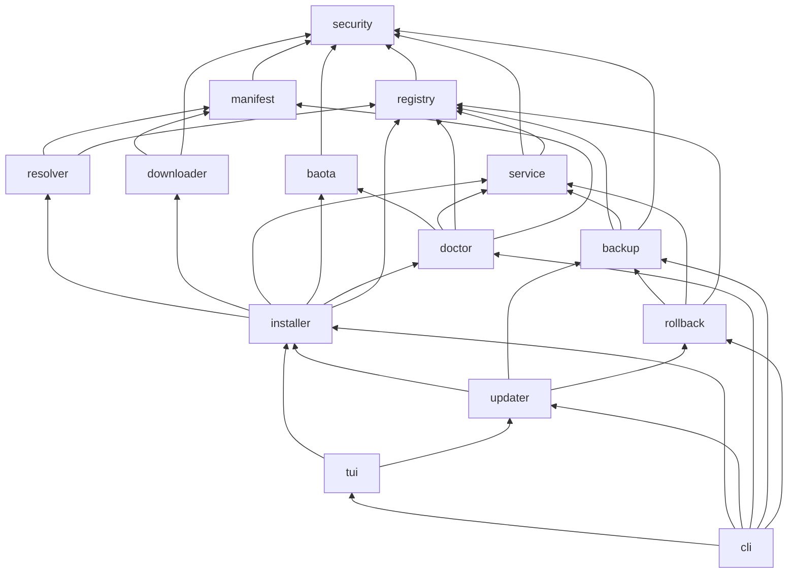
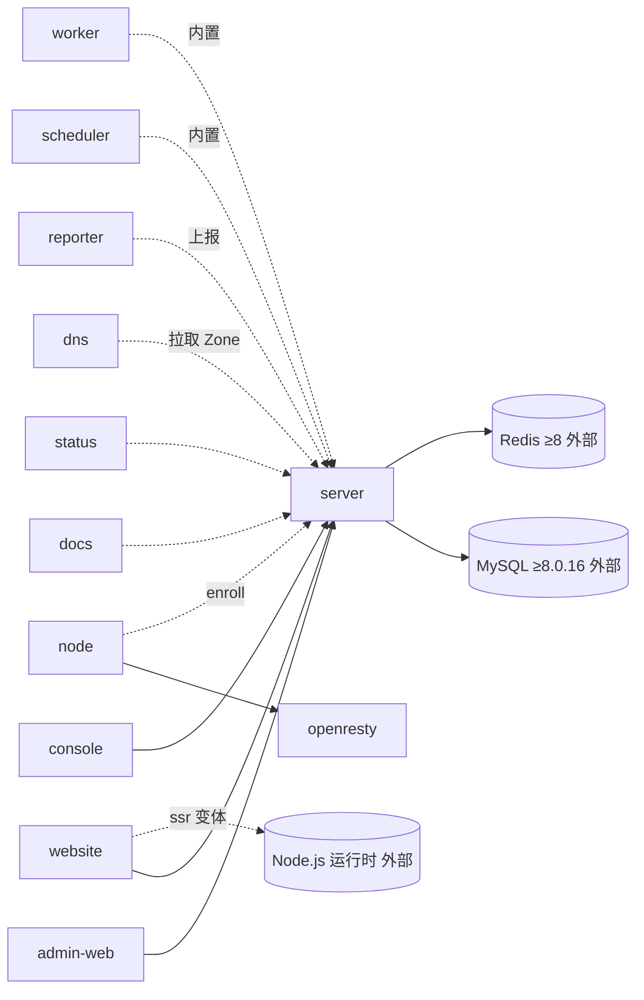
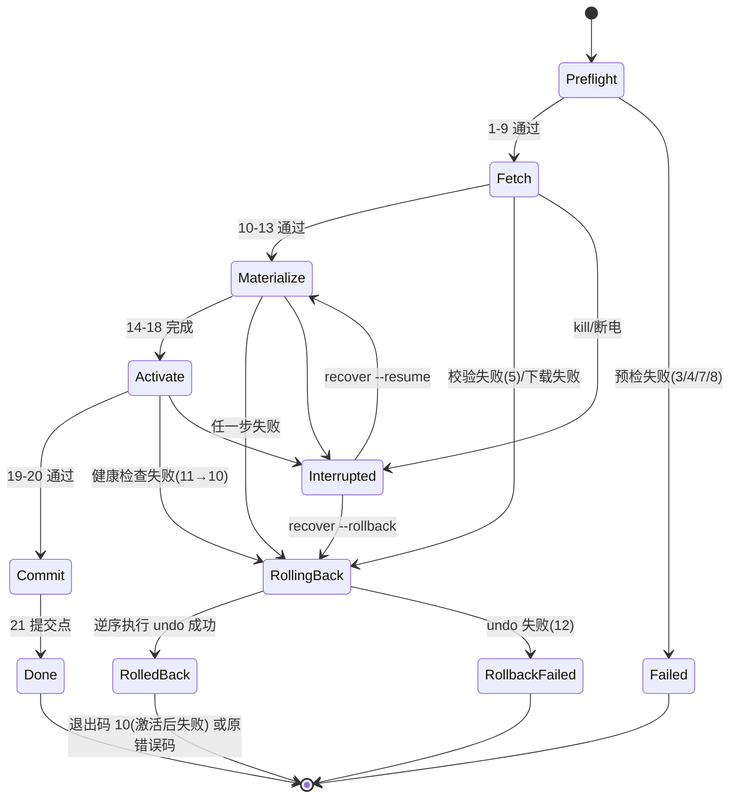

# LingEdge Tools 技术设计

> 本文是 `lingedge`（LingEdge Tools）的实现级设计。凡「数值」（内存/磁盘最低要求、超时窗口、保留份数等）由发行清单（manifest）或配置给出，本文只给出**默认机制**，不虚构门槛；需要基线测试的值标「待基线测试后确定」。
> 凡与现网 Linux/宝塔环境相关、本机（macOS）无法验证的细节，标「实现时在验收机核对」，对应 Story 标「等待环境验证」（NFR-3、ADR-023）。

## 1. 定位与边界

**是什么**：单一静态 Go 二进制 `lingedge`（入口 `cmd/lingedge/`），平台全部组件的**安装、升级、回滚、备份、诊断、服务管理、节点注册**入口（基线 §4.1）。同时提供交互 TUI 与可脚本化的非交互 CLI。

**不做什么**：

| 不做 | 理由 / 替代 |
|---|---|
| 不存在独立 `lingedge-updater` 程序或构建目标（FR-1） | 升级由 `lingedge update …` 完成；Node 的远程升级走 systemd `.path` 触发**同一个** `lingedge` 的受限入口（§15.3、ADR-024） |
| 不提供任意 Shell/命令执行（FR-35） | 所有外部命令（`systemctl`、`useradd`、`mysqldump`、`openresty -t` …）由 Go 以**参数数组**调用，白名单固定（§17.2） |
| 不安装 MySQL / Redis `[ASSUMPTION]` | 基线 §4.5 只要求「检测」；Tools 检测并引导用户使用宝塔/系统已有或自备实例；Server 向导负责连接与初始化。可被推翻：若要代装，需新增 `deps` 组件与包管理器适配，影响 §10、§12 |
| 不修改宝塔面板自身配置与站点（FR-7） | 只识别；Nginx 站点片段只生成到 `/etc/lingedge/nginx/`，由用户确认 include（§11.3） |
| 不依赖 Docker/Compose/K8s（NFR-7） | — |
| 不自动停用占用端口的服务（D-9） | 报告冲突并给出选项 |
| 不静默覆盖已有网站/数据库/证书/Nginx 配置（FR-6） | 所有写入走「创建专属路径 + 已存在即停」策略；已存在文件写 `.new` 并提示 |
| Windows 上的 Tools `[ASSUMPTION]` | Tools 以 Linux（systemd）为目标。Reporter 的 Windows AMD64 版自带 `lingedge-reporter service install|uninstall`（P3 设计），不经过 `lingedge` — 见文末反馈 T-1 |

**权限模型**：只读命令（`version`、`list`、`status`、`config validate`、`doctor` 的无特权部分）可由普通用户运行；`install/update/rollback/uninstall/service start|stop|restart/backup/node enroll` 需要 root（Tools 不自提权，检测到非 root 时输出 `sudo lingedge …` 提示并以退出码 3 退出）。

## 2. 包结构与依赖方向

```
cmd/lingedge/main.go          # 仅 wiring：构造依赖、运行 cli.Root
internal/tools/
  security/    # 叶子：安全解压 pathsafe、safeexec（参数数组执行）、redact（日志脱敏）、权限检查、随机数
  manifest/    # 清单与密钥：schema、keys.json（go:embed）、Ed25519 验签、sequence/valid_until、吊销、semver 约束类型
  registry/    # 本机安装状态：state.json 读写、journal（事务日志）、锁（flock）、目录布局常量
  downloader/  # HTTPS 下载（TLS 校验、禁止降级重定向、大小上限、断点续传、代理）、离线 bundle 读取
  resolver/    # 纯函数：依赖/版本/资源/端口求解，输出 Plan
  baota/       # 宝塔与已有 Nginx/MySQL/Redis/PHP/WAF/防火墙 的只读探测
  service/     # systemd unit 渲染与安装、systemctl 封装、运行用户创建、目录/权限创建
  backup/      # 备份与恢复（配置、DB dump、数据目录、清单、加密）
  rollback/    # 回滚策略执行（按迁移分级选择路径）
  installer/   # 22 步安装编排 + journal 驱动的恢复
  updater/     # 升级编排（含 --apply-staged 受限入口）
  doctor/      # 检查项注册表与执行
  tui/         # Bubble Tea 视图（菜单、多选、计划确认、进度、不可逆确认）
  cli/         # Cobra 命令树、输出（人类/JSON）、退出码映射
```

依赖规则（可由 depguard 强制）：



- `security` 是叶子，**所有**子进程调用、归档解压、日志输出必须经它；CI 禁止在其他包里 `os/exec` 直接使用或调用 `sh -c`、`bash -c`。
- `tui` 与 `cli` 只是消费者；业务包通过 `installer.Event` 通道输出进度（步骤开始/完成/警告），不依赖 UI。
- Tools **不 import** `internal/` 下任何 Server 业务模块（architecture §5.3 规则 5）；与 Server 的协作仅通过：发行清单、`state.json`、`lingedge-server migrate|healthz|setup` 子命令、本机 HTTP `/healthz`。

## 3. 命令树

全局标志（所有命令）：`--json`（§6）、`--yes/-y`（对所有「可确认」提示回答是；**不**含不可逆迁移，见下）、`--non-interactive`（禁止任何提示与 TUI；需要确认而未提供对应显式标志则以退出码 9/3 失败）、`--dry-run`（只做预检与计划，不写任何持久状态；输出 Plan，退出码 0 或预检失败码）、`--log-level debug|info|warn|error`、`--log-file`（默认 `/var/log/lingedge/tools.log`，0640）、`--no-color`、`--config /etc/lingedge/tools/tools.yaml`。

无 TTY 或 `TERM=dumb` 时自动等价于 `--non-interactive`，并在首行输出一次提示。

```
lingedge                              # 交互菜单（§7）；非 TTY 时打印 help 并退出码 0
lingedge --help | -h
lingedge version [--check]            # Tools 与各已装组件版本；--check 同时联网比对清单
lingedge list [--available]           # 已装组件（版本/状态/端口/目录/用户）；--available 列出清单中可装版本
lingedge status                       # 汇总：每个已装组件的 systemd 状态 + 健康探测结果

lingedge install <component> [flags]  # component: server|admin-web|console|website|node|dns|reporter|docs|status
                                      #           scheduler|worker → 退出码 8（已内置于 Server，D-16）
    --version <semver>                #   默认：通道内满足约束的最高稳定版
    --channel stable|beta             #   默认 stable
    --offline <bundle.tar>            #   从离线可信发行包安装（同样验签，§9.4）
    --set key=value (可重复)          #   组件初始配置项（经 schema 校验，非任意文本注入）
    --mode static|ssr                 #   仅 website（变体）
    --skip-start                      #   仅物化，不启动（调试）
    --setup-listen <addr>             #   仅 server：向导监听地址，默认 127.0.0.1:8080（§13）
lingedge install                      # 无组件名 + TTY → 进入多选安装界面（§7.2）

lingedge update check [--channel …]   # 获取签名清单，列出可升级组件与迁移级别预告
lingedge update <component>           # 例：update node、update server
lingedge update --all
lingedge update self                  # 升级 lingedge 自身（原子替换 /usr/local/bin/lingedge，保留 .prev）
    通用标志：--version、--offline <bundle>、--accept-irreversible（§17.3）、--no-backup（仅非 server 组件且需 --yes）、--plan-only（等价 --dry-run）
lingedge update node --apply-staged
                                      # 【内部入口】仅 root；供 lingedge-node-upgrade.service 调用（§15.3），固定读取 staging 目录中的 upgrade.request

lingedge service status [--all|<component>]
lingedge service start|stop|restart <component>
lingedge logs <component> [-f] [--since <dur>] [-n <lines>]   # 封装 journalctl（参数数组），输出经脱敏过滤

lingedge doctor [--all|<component>] [--strict] [--fix-perms]
lingedge config validate [<component>] [--file <path>]
lingedge config show <component>      # 脱敏输出（密码/Token/私钥路径内容不展示）
lingedge config edit <component>      # 编辑副本 → 校验 → 原子替换（保留 .bak）→ 可选重启

lingedge node enroll [--token-file <f> | 交互输入 | stdin] [--token <t>（不推荐：进 ps/shell 历史）] [--server <url>] [--force-reenroll]

lingedge backup create [--component server|node] [--output <dir>] [--encrypt] [--include-logs] [--include-master-key]
lingedge backup list | verify <file>
lingedge backup restore <file> [--component …] [--replace]

lingedge rollback <component> [--to <version>] [--from-backup <file>]
lingedge uninstall <component> [--purge --confirm-name <hostname>]

lingedge recover [--resume|--rollback]   # 处理被中断的事务（§12.3）
```

要点：
- `install dns` 在 MVP 清单中 `status: unreleased` → 退出码 7，输出「组件尚未发布」，**不**伪造成功（FR-3）。
- `uninstall` 默认保留 `/etc/lingedge/<c>`、`/var/lib/lingedge/<c>` 与备份；`--purge` 需交互输入主机名，或 `--yes --confirm-name <hostname>`（FR-9「不默认删除用户数据」）。
- `rollback node` 默认回到上一 release；若上一次升级含不可逆迁移（Node 无 DB 迁移，此项仅对 server 有意义）要求 `--from-backup`（§17.4）。
- `config edit` 不是基线必须项，作为菜单「7 配置管理」的落点。

## 4. 退出码

退出码为公开契约（FR-4），随 Docs（P5，FR-120）发布，同时由 `lingedge --help exit-codes` 输出；变更须走 ADR。

| 码 | 常量 | 含义 | 典型场景 |
|---|---|---|---|
| 0 | `OK` | 成功（含 `--dry-run` 计划成功、`doctor` 无失败项） | — |
| 1 | `GENERAL` | 通用/未分类失败 | 未预期错误；详见日志 |
| 2 | `USAGE` | 参数/用法错误 | 未知标志、非法 `--set`、组件名错误 |
| 3 | `PRECONDITION` | 前置条件/预检失败 | 非 root、内存/磁盘不足、OS/架构不支持、依赖缺失、`doctor` 存在失败项 |
| 4 | `PORT_CONFLICT` | 端口冲突 | 80/443/53/9443 被占用（§10.4） |
| 5 | `VERIFY_FAILED` | 校验/签名失败 | 清单验签失败、SHA256 不符、包内签名失败、sequence 回退、清单过期 |
| 6 | `LOCKED` | 任务锁被占用 | 同目标已有安装/升级任务 |
| 7 | `NOT_RELEASED` | 组件尚未发布 | `install dns`（MVP） |
| 8 | `BUILTIN` | 组件已内置于 Server | `install scheduler|worker`（D-16） |
| 9 | `CONFIRM_REQUIRED` | 需要显式确认但处于非交互 | 含不可逆迁移而未传 `--accept-irreversible`；`--purge` 未带 `--confirm-name` |
| 10 | `ROLLED_BACK` | 升级/安装失败，**已自动回滚**且服务恢复 | 健康检查失败后回滚成功 |
| 11 | `HEALTH_FAILED` | 健康检查失败（且**未**回滚或无需回滚） | `service status`/`status` 发现组件不健康；安装后检查失败且 `--no-rollback` |
| 12 | `ROLLBACK_FAILED` | 回滚本身失败，需人工恢复 | journal 保留，输出恢复指引 |
| 13 | `INTERRUPTED` | 存在未完成事务，需要 `recover` | 新命令启动时发现未完成 journal |
| 14 | `NOT_INSTALLED` | 目标组件未安装 | `service start node` 而未装 |
| 130 | `SIGINT` | 用户中断（SIGINT），已按 journal 处理 | Ctrl-C |

约定：10 与 12 互斥；10 表示**状态已恢复为操作前**，脚本可据此继续；人类输出同时给出原因与下一步。

## 5. 输出与日志

- 人类输出写 stdout（结果）与 stderr（进度/警告）；`--json` 时 stdout **仅**输出一个 JSON 对象（§6），进度改走 stderr 的 NDJSON（`--progress=json`，默认在 `--json` 下开启，可 `--progress=none` 关闭）。
- 日志：详细日志写 `--log-file`（JSON Lines，`ts/level/run_id/step/msg/fields`）；**所有**字段经 `security/redact`：Token（`lenr1.`、`le_*_` 前缀）、`password`/`secret`/`key` 命名字段、PEM 块、DSN 中的口令 一律替换为 `***`（NFR-12、FR-9）。参数中的敏感值不回显（如 `--token` 在日志中记为 `--token ***`）。

## 6. JSON 输出 Schema（统一 envelope）

```json
{
  "schema": "lingedge.cli/v1",
  "ok": false,
  "command": "install node",
  "run_id": "01JD5Y3C8Q5G7M0V1N2P3R4S5T",
  "exit_code": 4,
  "exit_name": "PORT_CONFLICT",
  "started_at": "2026-11-16T12:00:00.000Z",
  "duration_ms": 1830,
  "dry_run": false,
  "data": { },
  "warnings": [ { "code": "baota.detected", "message": "检测到宝塔面板 …" } ],
  "errors": [
    {
      "code": "port.conflict",
      "message": "TCP 443 已被进程 nginx(pid 812) 占用",
      "step": 4,
      "hint": "停止占用者、换用主控 Nginx 的其它端口，或把本机仅作为非节点使用",
      "details": { "port": 443, "proto": "tcp", "holder": { "pid": 812, "name": "nginx", "owner": "宝塔?" } }
    }
  ]
}
```

规则：`ok == (exit_code == 0)`；`errors[].code` 为稳定小写点分字符串（与 Docs 退出码表一并公布）；`data` 随命令不同，每个命令的 `data` 有独立 JSON Schema（`internal/tools/cli/schema/*.json`，CI 校验示例输出）。示例：

- `list` → `data.components[]: {name, version, state, unit, run_user, ports[], release_dir, config_dir, data_dir, installed_at, prev_version?}`
- `install --dry-run` → `data.plan: {components[], versions{}, steps[], ports[], units[], files_to_create[], migrations{class,count}, resources{}}`
- `update check` → `data.updates[]: {component, current, available, min_upgrade_from_ok, migrations{classes[], has_irreversible}, notes_url}`
- `doctor` → `data.checks[]: {id, category, level: pass|warn|fail|skip, message, hint}`

## 7. 交互菜单与 TUI

### 7.1 主菜单（FR-2，编号与基线 §4.3 一致）

```
LingEdge Tools  v<version>
 1  安装组件        → 多选安装界面（§7.2）
 2  查看已安装组件  → = lingedge list
 3  升级组件        → 先 update check，再选择组件，展示 Plan 并确认
 4  服务管理        → 选择组件 → status/start/stop/restart
 5  节点注册        → 引导 lingedge node enroll
 6  系统诊断        → lingedge doctor --all（可钻取单项）
 7  配置管理        → show / validate / edit
 8  备份恢复        → create / list / verify / restore
 9  查看运行日志    → 选择组件 → logs（可跟随）
10  卸载组件        → 选择组件 → 确认（默认保留数据；--purge 另起确认页）
11  查看版本        → = lingedge version --check
 0  退出
```

非 TTY 下菜单不可用，输出 help（FR-2「终端无 TUI 能力时给出非交互替代提示」）。

### 7.2 多选安装界面

Bubble Tea 复选框列表：`Server / Admin Web / Console / Website / Node / DNS / Reporter / Docs / Status`。

- 空格切换，回车进入「计划确认」页。选择即时调用 `resolver` 的**只读预估**：自动勾选并标注依赖（如 Admin Web 依赖 Server 的存在于本机或已配置的远端）、显示互斥/端口冲突红字、资源合计。
- 未发布组件（清单 `status: unreleased`）显示灰色「尚未发布」且不可选；`scheduler`/`worker` 不出现在列表。
- 「计划确认」页展示 Plan（版本、端口、目录、用户、systemd 单元、将创建/将不覆盖的文件、迁移级别），确认后进入进度页（22 步，实时来自 `installer.Event`）。失败页展示原因、已回滚内容、日志位置。
- 不可逆迁移确认页（升级）：红色全屏警告，列出「备份点之后的数据会丢失、不能简单回退二进制」，要求**键入固定短语 `confirm-irreversible`** 才继续；非交互对应 `--accept-irreversible`（§17.3）。

## 8. 目录布局与原子切换

| 用途 | 路径 | 属主/权限 |
|---|---|---|
| Tools 二进制 | `/usr/local/bin/lingedge`（升级时保留 `lingedge.prev`） | root 0755 |
| 组件 release | `/opt/lingedge/<component>/releases/<version>/` | root:root 0755（二进制只读） |
| 当前版本 | `/opt/lingedge/<component>/current` → `releases/<version>`（符号链接） | root |
| OpenResty 发行 | `/opt/lingedge/openresty/releases/<ver>/`、`current` | root |
| 配置 | `/etc/lingedge/<component>/` | root:`<run-user>` 0750；文件 0640；`master.key` root 0400 |
| 数据 | `/var/lib/lingedge/<component>/`（Node 为 `/var/lib/lingedge-node/`，**目录总表以 ADR-020 §2 为权威**：`identity/ certs/ generations/g<N>/ current state.json cache/ runtime/ staging/ logs-spool/`） | `<run-user>` 0750 |
| 日志 | `/var/log/lingedge/`（Node 访问日志 `/var/log/lingedge-node/access/`） | `<run-user>` 0750 |
| Tools 状态 | `/var/lib/lingedge/tools/{state.json,journal/,locks/,lock,staging/,trust/,backups-index.json}` | root 0700（`state.json` 0644 以便普通用户 `list/status`，不含密钥） |
| 节点升级结果目录 | `/var/lib/lingedge-node-upgrade/`（Tools 安装 node 时创建；`<task_uid>.result.json` 由 root 升级单元写入） | root:root 0755；文件 root:root 0644（Agent 只读，§15.3） |
| 公开媒体目录（P2，官网 CMS 媒体，MIN-08） | `/var/lib/lingedge/media/`（Nginx `location /media/` 的 `alias`；上传暂存仍在私有的 `/var/lib/lingedge/server/` 下） | 目录 0755、文件 0644，属主 `lingedge`；父目录 `/var/lib/lingedge` 为 root 0755，使 Nginx 运行用户可读 |
| 备份默认目录 | `/var/backups/lingedge/` | root 0700 |
| Nginx 片段 | `/etc/lingedge/nginx/<component>.conf` | root 0644 |
| systemd | `/etc/systemd/system/lingedge-*.service|.path` | root 0644 |

运行用户：`lingedge`（server/scheduler/worker）、`lingedge-node`（node+openresty）、`lingedge-dns`、`lingedge-web`（website SSR）、`lingedge-reporter`；均为 `--system --no-create-home --shell /usr/sbin/nologin`。

**原子切换算法**（所有组件）：
1. 新版本解压到 `releases/<v>.partial/`，校验完成后 `rename` 为 `releases/<v>/`（同文件系统内原子）。
2. 创建临时链接 `current.new -> releases/<v>`，`rename(current.new, current)`（`rename(2)` 覆盖符号链接是原子的）。
3. `fsync` 目录；失败则保留旧 `current`。
4. 保留最近 `retain_releases`（默认 2，不少于 2）个 release；更早的在升级**成功确认后**才清理，永不清理 `current` 与 `prev`。

## 9. 清单与签名格式

信任模型见 ADR-012 与 PRD D-12：**发行清单信任域独立于配置签名与节点 mTLS CA**。

### 9.1 公钥集 `keys.json`（内置于 Tools，`go:embed`）

```json
{
  "schema_version": 1,
  "keys": [
    { "key_id": "rel-2026-a", "alg": "ed25519", "public_key": "<base64, 32 bytes>",
      "not_before": "2026-11-01T00:00:00Z", "not_after": "2028-11-01T00:00:00Z", "status": "active" },
    { "key_id": "rel-2025-z", "alg": "ed25519", "public_key": "<base64>", "status": "retired" }
  ],
  "revoked_key_ids": [ "rel-2024-x" ]
}
```

- 多公钥并存支持轮换：`active` 与 `retired` 在重叠期内都可验证**已有**包；`revoked` 一律拒绝。新增公钥通过**新版 Tools 发行**（Tools 自身用旧 active key 签名）更新；另可在清单内携带 `key_rotation` 段（新公钥 + 由旧 active key 签名的背书），验证通过后落盘到 `/var/lib/lingedge/tools/trust/keys.d/`。私钥离线保管，不在发布流水线可达的机器上。
- 具体 Ed25519 实现：Go 标准库 `crypto/ed25519`（无第三方依赖）。

### 9.2 清单 `manifest.json` 与 `manifest.json.sig`

`manifest.json.sig`（JSON，非二进制）：`{"key_id":"rel-2026-a","alg":"ed25519","sig":"<base64>"}`。签名对象为 `"LINGEDGE-MANIFEST-V1\n" || manifest.json 原始字节`（域分隔；对**文件字节**签名，免去规范化歧义）。

`manifest.json`（下例版本号、哈希、URL 均为**格式示意**，不是真实发行数据）：

```json
{
  "schema_version": 1,
  "channel": "stable",
  "sequence": 42,
  "generated_at": "2026-11-16T00:00:00Z",
  "valid_until": "2027-02-14T00:00:00Z",
  "revoked_versions": [ { "component": "node", "version": "0.0.9", "reason": "示意：已知缺陷" } ],
  "components": {
    "server": {
      "status": "available",
      "description": "LingEdge 中央主控",
      "versions": [
        {
          "version": "0.1.0",
          "released_at": "2026-11-15T00:00:00Z",
          "min_upgrade_from": "0.1.0",
          "notes_url": "https://<release-host>/notes/server-0.1.0",
          "requires": {
            "system": { "os": ["linux"], "arch": ["amd64", "arm64"], "min_memory_mb": 0, "min_disk_mb": 0 },
            "external": { "mysql": ">=8.0.16 <9", "redis": ">=8" },
            "components": { },
            "runtime": { }
          },
          "conflicts": [ ],
          "ports": [
            { "proto": "tcp", "port": 8080, "bind": "127.0.0.1", "purpose": "rest" },
            { "proto": "tcp", "port": 9443, "bind": "0.0.0.0", "purpose": "grpc-mtls" },
            { "proto": "tcp", "port": 9444, "bind": "0.0.0.0", "purpose": "grpc-enroll", "conditional": true },
            { "proto": "tcp", "port": 9180, "bind": "127.0.0.1", "purpose": "metrics" }
          ],
          "migrations": {
            "schema_from": "0000", "schema_to": "0007",
            "classes": ["reversible", "expand"], "irreversible_count": 0, "backup_required": true
          },
          "config_schema_version": 1,
          "variants": {
            "default": {
              "artifacts": {
                "linux-amd64": { "url": "https://<release-host>/server/0.1.0/lingedge-server-0.1.0-linux-amd64.tar.gz",
                                 "sha256": "<hex>", "size": 0 },
                "linux-arm64": { "url": "…", "sha256": "<hex>", "size": 0 }
              }
            }
          }
        }
      ]
    },
    "website": {
      "status": "available",
      "versions": [ { "version": "0.1.0",
        "variants": {
          "static": { "artifacts": { "any": { "url": "…", "sha256": "…", "size": 0 } }, "requires": { "runtime": {} } },
          "ssr":    { "artifacts": { "any": { "url": "…", "sha256": "…", "size": 0 } }, "requires": { "runtime": { "node": "<按 Nuxt 3 引擎要求，发布时填写>" } } }
        } } ]
    },
    "node":      { "status": "available", "versions": [ { "version": "0.1.0", "requires": { "components": { "openresty": ">=1 <2" } } } ] },
    "openresty": { "status": "available", "internal": true,  "versions": [ ] },
    "dns":       { "status": "unreleased" },
    "scheduler": { "status": "builtin", "builtin_in": "server" },
    "worker":    { "status": "builtin", "builtin_in": "server" },
    "tools":     { "status": "available", "versions": [ ] }
  }
}
```

要点：
- `status ∈ available | unreleased | builtin`；`unreleased` → 退出码 7，`builtin` → 退出码 8。
- `sha256` 与签名覆盖关系：清单签名已覆盖所有 `sha256`；因此校验链为「清单验签 → 包 SHA256 → 包内逐文件 SHA256SUMS（及其签名）」。
- `size` 用于下载上限（超出即中止）。`min_*` 数值由发行方填写，Tools 不内置。
- `migrations` 为**预告**；以新二进制的 `lingedge-server migrate plan --json` 实际结果为准，二者冲突取更严格级别（§17.2）。
- **sequence**：清单的单调递增整数。Tools 在 `/var/lib/lingedge/tools/trust/state` 记录已见最大 sequence；新清单 `sequence < 已见` 视为回滚攻击，退出码 5。相等允许（幂等重取）。
- **valid_until**：清单过期时间（冻结攻击防护）。过期默认拒绝并提示；`--offline` 包可经 `--allow-expired-manifest` 显式放行并告警（气隙环境）。**注意：该过期仅作用于 Tools 的安装/升级决策，与节点配置签名（无过期，R-4）无关。**
- 版本吊销 `revoked_versions`：命中则拒绝安装/作为升级目标，已装则 `doctor` 告警。

### 9.3 包格式

`.tar.gz`（标准库 `compress/gzip` + `archive/tar`，避免额外依赖）：

```
META/package.json        { component, version, variant, platform, built_at, config_schema_version, files_count, unpacked_size }
META/SHA256SUMS          每个 payload 文件一行 "<hex>  <relpath>"
META/SHA256SUMS.sig      {"key_id":…, "alg":"ed25519", "sig":…}；签名对象 "LINGEDGE-PKG-V1\n<component>\n<version>\n<platform>\n" || SHA256SUMS 字节
payload/…                实际文件（二进制、模板、迁移、默认配置模板、前端静态产物…）
```

### 9.4 离线 bundle（`--offline <bundle.tar>`）

外层 tar 包含：`manifest.json`、`manifest.json.sig`、以及清单引用的若干包文件（文件名 = URL 末段）。布局：

```
offline-bundle/
  manifest.json
  manifest.json.sig
  packages/<artifact-filename>…
```

验证流程与在线完全一致（9.5），仅「下载」替换为「从 bundle 读取」；同样做 sequence/valid_until/吊销检查。bundle 本身不被信任，只信任其中经签名链验证的内容。

### 9.5 校验顺序（安装与升级共用，任一步失败即退出码 5）

1. 读取内置 `keys.json` 与 `trust/keys.d/`，构建可信公钥集（排除 `revoked_key_ids`）。
2. 取得 `manifest.json` 与 `.sig`；用 `key_id` 选公钥，对 `"LINGEDGE-MANIFEST-V1\n"+bytes` 验签。
3. 解析并校验 schema（未知必需字段拒绝，未知可选字段忽略）；检查 `sequence`、`valid_until`、`channel`。
4. 选版本（§10），检查 `revoked_versions`。
5. 下载/读取包到 `staging/<tx>/`，流式计算 SHA256 与长度，与清单比对。
6. 解压前读取 `META/SHA256SUMS(.sig)`，验证其签名；解压时逐文件边写边校验 SHA256（§18.1 的安全解压）。
7. 校验 `META/package.json` 的 component/version/platform 与清单一致。

**签名对象一览（唯一规范，ADR-012 引用本节）**：清单 = 对 `manifest.json` **文件原始字节**（不做 canonical JSON）加域前缀签名；吊销 = 内置/`trust/keys.d/` 的 `keys.json.revoked_key_ids` ∪ 清单 `revoked_versions`（清单内**不含** `revoked_key_ids`）；包 = `.tar.gz`；包内签名对象见 §9.3。

### 9.6 示例向量（**仅测试，非发行密钥**；供 `manifest`/`downloader` 包的 golden 测试，放入 `internal/tools/manifest/testdata/vectors.json`）

测试种子 `seed = SHA-256("LingEdge golden test vector seed v1 - TEST ONLY")`（32 字节，hex `cd8dc2235741957912a9f476a2b5b9bb9d75ae02bde212b9d8089a92fb895749`）；Ed25519 确定性签名。以下数值已用 Ruby OpenSSL 与 Go `crypto/ed25519` 两种实现各自**实际计算并验签通过**（篡改 1 字节则验签失败）。

| 项 | 值 |
|---|---|
| 公钥（base64，32 字节） | `P3pE/lvUPOLOFWJtF/1sxj4LU923fmJQU9Utz1K5ghc=` |
| 公钥（hex） | `3f7a44fe5bd43ce2ce15626d17fd6cc63e0b53ddb77e625053d52dcf52b98217` |
| `manifest.json` 文件字节（UTF-8，末尾含一个 `\n`） | `{"schema_version":1,"channel":"stable","sequence":1,"generated_at":"2026-01-01T00:00:00Z","valid_until":"2026-04-01T00:00:00Z","revoked_versions":[],"components":{}}` + `\n` |
| `manifest.json` 的 SHA-256 | `a231c5e64c6b3d757cd9ed6ada65eb3997c7afe7726f6910ea9352ed7c014c52` |
| 清单签名输入 | `"LINGEDGE-MANIFEST-V1\n"` ‖ 上行文件字节 |
| `manifest.json.sig` 的 `sig`（base64，64 字节） | `L5VbA6b3kohy34+RRMyB0adDM+SpIMKWU9g6k75onjjlLLv7XKUpq6JJg6h5G8PKaIQrH8S9aFnAjGCh9RKYDQ==` |
| 包内 `META/SHA256SUMS` 字节 | `5891b5b522d5df086d0ff0b110fbd9d21bb4fc7163af34d08286a2e846f6be03  payload/hello.txt` + `\n`（`payload/hello.txt` 内容为 `hello\n`） |
| 包签名输入 | `"LINGEDGE-PKG-V1\nnode\n0.1.0\nlinux-amd64\n"` ‖ `SHA256SUMS` 字节 |
| `META/SHA256SUMS.sig` 的 `sig`（base64） | `YLlLdkS0mzZ4zZYLbph1d34DZ/CjhSEr1CSslVVc5PRjIwHBaJHJwYfsORDZq+X2EKkGCIHGquM08a9sn/VqAA==` |

测试断言：验签通过；任一输入字节翻转 → 失败；`key_id` 不在公钥集或在 `revoked_key_ids` → 失败；`sequence` 小于本地已见值 → 退出码 5。该种子私钥**只允许出现在测试代码与本文**，生产构建扫描不得出现该种子/公钥（G-6/ADR-023 的固定数据检查）。

## 10. 依赖解析

### 10.1 组件依赖图



- 实线 = 安装时硬依赖/就绪检查；虚线 = 运行时依赖（可在远端，不要求同机）。`admin-web/console/website/docs/status` 是静态/SSR 前端，对 Server 是**配置层**依赖（API 基址），安装时可指向远端 Server URL，不要求同机。
- `openresty` 是 `node` 的**内部组件**（独立版本，随 node 自动解析安装到 `/opt/lingedge/openresty`，对用户不可见于安装列表）。
- MySQL/Redis/Node.js 为**外部依赖**：只检测，不安装。

### 10.2 版本约束

semver 范围语法子集：`>=a.b.c <x.y.z`、`^`、`~`、`=`、空格即 AND、`||` 即 OR（解析库实现时选定，需标明版本）。`requires.components` 约束同机已装或本次一并安装的组件；跨机约束（如 node 与 server 的兼容）通过 `requires.peer`（`server: ">=0.1 <0.2"`）声明，在 `node enroll` 时由 Server 返回其版本做比对并警告。`min_upgrade_from` 限制可直接升级的起点（跨度过大须逐级升级，`update` 自动给出升级路径）。

### 10.3 求解算法（`resolver`，纯函数，可单元测试）

输入：`want[]`（用户选择，含可选固定版本）、`installed`（state.json）、`manifest`、`system`（OS/arch/内存/磁盘/已占端口/已探测外部依赖）。

1. **规范化**：`scheduler/worker` → 返回 `BuiltinError(8)`；`status: unreleased` → `NotReleased(7)`；加入内部依赖闭包（node→openresty）。
2. **候选版本**：对每个组件取通道内未吊销版本，按 semver 降序；用户 `--version` 则唯一候选。
3. **约束传播（回溯，规模极小）**：按依赖拓扑序逐组件取最高满足所有 `requires.components` 与已装版本约束的候选；无解 → `PRECONDITION(3)` 并列出冲突链。已装组件默认不被动升级（除非约束要求，此时把它加入 Plan 并标「被动升级」，需确认）。
4. **系统检查**：`os/arch ∈ requires.system`；`min_memory_mb`、`min_disk_mb` 对**合计**需求判断（磁盘按目标挂载点分别统计）。
5. **外部依赖**：对 `requires.external` 做存在性探测（宝塔/系统 MySQL/Redis/Node.js 版本，§11）；版本不满足 → 预检失败（3）；探测不到 → 对 server 允许继续（向导里配置远端实例），对 website ssr 则失败。
6. **端口矩阵**：汇总 Plan 内各组件 `ports`，检测：(a) 组件之间冲突；(b) 与本机监听冲突（§10.4）。
7. **冲突声明**：`conflicts[]`（如两个组件都要独占 80/443）。
8. 输出 `Plan{components[], order[], steps[], ports[], units[], files[], warnings[], blockers[]}`；`blockers` 非空 → 不执行（`--dry-run` 同样展示）。

### 10.4 端口矩阵与冲突检测

| 组件 | 端口 | 绑定 | 独占 | 说明 |
|---|---|---|---|---|
| server | 8080/tcp、9180/tcp | 127.0.0.1 | 是 | REST（由 Nginx 反代）、metrics |
| server | 9443/tcp、9444/tcp | 0.0.0.0 | 是 | 9444 仅有未过期注册 Token 时才监听，但安装时仍预留检测 |
| node | 80/tcp、443/tcp | 0.0.0.0 | 是（R-10） | 与宝塔/系统 Nginx 冲突即停止 |
| website(ssr) | 3000/tcp | 127.0.0.1 | 是 | — |
| dns | 53/udp、53/tcp | 指定 IP | 是（D-9） | systemd-resolved(127.0.0.53)、named 等 |
| admin-web/console/docs/status/website(static) | 无监听端口 | — | — | 需要 Web 服务器（Nginx）托管，Tools 只产出站点片段（§11.3） |

检测方法：优先 `ss -H -lntup` 解析（参数数组调用）；回退 `/proc/net/{tcp,tcp6,udp,udp6}` + `/proc/<pid>/fd` 映射。对每个端口区分「同地址冲突」与「通配冲突」（占用者绑定 0.0.0.0 vs 我方 127.0.0.1 也冲突）。冲突时退出码 4，输出占用进程名/pid/属主与选项（换端口 `--set`、释放、取消），**不自动停用**。

## 11. 宝塔与已有环境检测（只读，FR-7）

以下路径为宝塔常见默认布局，**实现时在真实宝塔机器上核对并以探测结果为准**（标志不唯一时综合判定，输出置信度与证据）：

| 项 | 探测 | 证据 |
|---|---|---|
| 宝塔面板 | 目录 `/www/server/panel` 存在；可执行 `bt` 或 `/etc/init.d/bt`；面板端口文件 `/www/server/panel/data/port.pl`；版本取自面板目录内版本信息（实现时核对来源文件） | 任两项满足 → `baota.detected` |
| Nginx | `/www/server/nginx/sbin/nginx`、`/www/server/nginx/conf/nginx.conf`；站点配置目录 `/www/server/panel/vhost/nginx/`；另检测系统 Nginx（`which nginx`、`/etc/nginx`） | 版本 `nginx -v`（参数数组）；占用 80/443 的进程 |
| OpenResty（既有） | `/usr/local/openresty`、`which openresty` | 仅提示；Node **不复用**，使用独立前缀（FR-58） |
| MySQL | `/www/server/mysql`、`/www/server/data`；系统 `mysqld`；`ss` 监听 3306/socket | 仅识别，凭据由向导获得；不读取宝塔存储的 root 密码 |
| Redis | `/www/server/redis`、系统 `redis-server`；6379 | 同上 |
| PHP | `/www/server/php/<ver>` | **仅识别并记录**，不做任何处理 |
| 站点配置 | 宝塔站点 vhost 目录内 `server_name`/`listen`（只读解析，用于预警同名域名/端口冲突） | 不写入 |
| 防火墙/WAF | 宝塔防火墙（系统 firewalld/ufw/iptables 状态读取）、Nginx 防火墙插件目录（如 `/www/server/btwaf`，实现时核对）、`/www/server/panel/plugin/` 列表 | 提示端口放行需求（9443/9444/80/443），**不修改规则** |
| 系统服务 | `systemctl list-units --type=service`（参数数组）；识别 `named`、`systemd-resolved`、`mysqld`、`redis` 等 | — |

结果记录到 `state.json.host.baota`，供 `doctor` 与 Plan 引用。**宝塔存在不阻止安装**；只有真实冲突（端口/路径/同名）才阻止（FR-7）。

### 11.1 Node 的独立 OpenResty

Node 一律使用 `/opt/lingedge/openresty`（二进制）与 `/var/lib/lingedge-node/current/`（`-p` 前缀，指向当前节点代 `generations/g<N>/`，见 ADR-020 §2）；不使用 `/www/server/nginx` 的任何二进制、配置、日志、pid。`lingedge list`/`doctor` 输出：端口、配置目录、pid 文件、进程归属（FR-58）。

### 11.2 与宝塔同机的 80/443

Node 独占 80/443（R-10）。若宝塔 Nginx 占用：预检在步骤 4/5 停止（退出码 4），列出 (a) 迁移宝塔站点端口、(b) 节点与面板分机、(c) 取消；Tools 不修改宝塔站点。

### 11.3 静态前端的 Nginx 片段

`admin-web/console/website(static)/docs/status` 安装时：
1. 解压到 `/opt/lingedge/<c>/releases/<v>/public/`。
2. 生成 `/etc/lingedge/nginx/<c>.conf`（`server` 块或可 include 的 `location` 集合，变量均来自校验后的 Plan：域名、根目录、API 上游），**不写入**任何既有 Nginx 配置。
3. 原生 Nginx（非宝塔）且存在 `conf.d` include 约定时，**询问**是否创建 `/etc/nginx/conf.d/lingedge-<c>.conf` 软链并 `nginx -t && reload`（reload 前先 `nginx -t`，失败则撤销软链）；宝塔环境一律只打印「请在面板中新建站点并 include 该文件 / 将 `root` 指向 current/public」指引。

**独立主机名（IMP-17，强制）**：Admin、Console、官网必须使用**互不相同的主机名**（如 `admin.example.com` / `console.example.com` / `www.example.com`）。Tools 在 Plan 阶段校验：多个前端的 `--set host=` 取值相同 → 退出码 2 并说明（不提供绕过开关）；会话 Cookie 一律 **host-only**（不设 `Domain` 属性），realm 名称亦不同（ADR-018）；租户数据面自定义域名与控制面主机名不得处于同一可注册域（部署规范，threat-model §5.7）。因此官网公网域不存在 Admin 会话。

**安全头继承规则**：nginx 中只要某个 `location` 内出现任何一条 `add_header`，就**不再继承**上级（`server`/`http`）的 `add_header`。故生成片段时，把全部安全头集中在 `/etc/lingedge/nginx/<c>-security-headers.conf`（每条带 `always`），并在**每一个**含 `add_header` 的 `location` 内显式 `include` 该文件；`server` 级不再依赖继承。CI 对生成片段做静态检查：含 `add_header` 的 `location` 必须同时含该 `include`。

**官网 `/api/` 反代范围**：官网片段只放行 `location ^~ /api/v1/public/ { proxy_pass http://127.0.0.1:8080; … }`；其余 `location ^~ /api/ { return 404; }`，使 `/api/v1/admin/*`、`/api/v1/auth/*`、`/api/v1/public/setup/*` 不在官网公网域可达。反代时 `proxy_set_header X-Forwarded-For $remote_addr`（覆盖，不信任访客值）。SSR 变体另加 `location ^~ /_lingedge/ { return 404; }`（revalidate 仅由 Server 经 `127.0.0.1:3000` 直连，MIN-08）。

**官网 revalidate 共享密钥（SSR，MIN-08/M17）**：`lingedge install website --mode ssr` 由 Tools 生成 32 字节随机密钥 `website.revalidate_secret`：写入 `/etc/lingedge/website/revalidate.secret`（root:lingedge-web 0440）；同时交付 Server——本机 Server 经 `lingedge-server config set-secret website.revalidate_secret --from-file …`（密文入 `system_settings.value_enc`，ADR-011）；远端 Server 由运营者在 Admin「官网设置」粘贴。Tools 不把该密钥写入 `state.json` 或日志。

## 12. 安装状态机与事务日志（journal）

### 12.1 22 步映射（基线 §4.5）

阶段：**预检 P（1–9，只读）→ 取包 F（10–13，写 staging）→ 物化 M（14–18，写系统）→ 激活 A（19–20）→ 提交 C（21–22）**。

| # | 步骤 | 阶段 | 副作用 | 失败/中断时的恢复 | 可回滚 |
|---|---|---|---|---|---|
| 1 | OS 检测 | P | 无 | 直接退出（3） | — |
| 2 | CPU 架构 | P | 无 | 同上 | — |
| 3 | 内存/磁盘 | P | 无 | 同上 | — |
| 4 | 端口冲突 | P | 无 | 退出码 4，给出选项 | — |
| 5 | 宝塔环境 | P | 无（只读探测） | 仅警告或与 4/6 合并阻断 | — |
| 6 | Nginx/OpenResty | P | 无 | 冲突则阻断 | — |
| 7 | MySQL/Redis | P | 无（只连通性探测，不写） | server：不可达仅警告（向导配置）；其余按 requires | — |
| 8 | 组件依赖分析 | P | 无 | 无解 → 3 | — |
| 9 | 版本选择 | P | 无 | 无候选 → 3/7/8 | — |
| 10 | 下载签名版本清单 | F | 写 `staging/<tx>/manifest*` | 删除 staging | 是 |
| 11 | 验证清单签名 | F | 更新 `trust/state` 的 sequence（**验签成功后才写**） | 验签失败 → 5，删除 staging | 是（sequence 不回退，因为清单本身已被验证） |
| 12 | 下载组件包 | F | 写 `staging/<tx>/pkg` | 断点续传；失败删除 | 是 |
| 13 | 校验 SHA256 与签名 | F | 无 | 失败 → 5，删除 staging | 是 |
| 14 | 安全解压 | M | 创建 `releases/<v>.partial` → `releases/<v>` | 删除本事务创建的 release 目录 | 是 |
| 15 | 创建运行用户 | M | `useradd`（若不存在） | 仅当用户**由本事务创建**且其拥有的文件为空时 `userdel`；否则保留并记录 | 是（有条件） |
| 16 | 创建配置/数据/日志目录 | M | `mkdir`+权限 | 删除**本事务创建且为空**的目录；非空保留 | 是（有条件） |
| 17 | 安装 systemd Unit | M | 写 unit 文件、`daemon-reload`；`enable` | `disable`、删除本事务创建的 unit、`daemon-reload` | 是 |
| 18 | 初始化配置 | M | 生成配置文件；server：生成 `master.key`（若不存在）、`setup-token` 哈希 | 删除本事务创建的文件；**已存在配置绝不覆盖**（写 `.new` 并警告，停在 18 前要求确认）；`master.key` 若本事务创建且未被使用则删除 | 是（有条件） |
| 19 | 启动服务 | A | `systemctl start` | `stop`；保留日志 | 是 |
| 20 | 健康检查 | A | 探测 `/healthz`、端口、`openresty -t` 等，超时窗口由配置给出（默认值待基线测试后确定） | 失败 → 依次撤销 19→14（回滚到预检后状态），退出码 10；不可恢复 → 12 | 是 |
| 21 | 保存安装状态 | C | **提交点**：原子写 `state.json`（写临时文件+`fsync`+`rename`） | 提交前崩溃视为未完成，由 journal 回滚/续跑 | — |
| 22 | 输出访问/管理信息 | C | 无（server 打印向导地址与 setup token **一次**） | — | — |

### 12.2 状态机



### 12.3 事务日志与恢复

- 每次 `install/update/rollback/uninstall/restore` 开启事务 `tx`（ULID）：`/var/lib/lingedge/tools/journal/<tx>.jsonl`，追加写、每条 `fsync`。
- 每步先写 `{"op":"begin","step":17,"undo":{…}}`（`undo` 记录**足以撤销**的信息：创建的路径、是否本事务创建、被替换文件的备份位置与哈希），完成后写 `{"op":"done","step":17}`。**先记 undo 再动手**，保证崩溃后也知道该撤销什么。
- 每步幂等：重复执行同一步（已存在且内容一致）视为完成；已存在但内容不同 → 冲突（不覆盖）。
- 启动任何写命令前扫描 `journal/`：存在未 `commit/abort` 的事务 → 退出码 13，提示 `lingedge recover`。`recover --resume` 从第一个非 `done` 步续跑（仅当尚未进入激活阶段且包仍在 staging 并通过重新校验）；`recover --rollback`（默认建议）按 journal 逆序执行 undo。事务结束写 `commit` 或 `abort` 并归档到 `journal/archive/`。
- 退出前（正常或 SIGINT/SIGTERM）捕获信号：完成当前原子步骤后进入回滚或保留为 Interrupted，**不在半步中退出**；`kill -9`/断电依靠 journal 恢复。
- 日志只记路径/哈希/步骤，不记口令/Token（经 redact）。

## 13. Server 安装向导（FR-11、F-8）

Tools 负责**物化与准备**，Web 向导负责**业务初始化**，边界如下：

**Tools（步骤 14–22）**：解压、创建 `lingedge` 用户与目录、生成 `server.yaml`（监听、数据目录；**不含**口令）、在**步骤 18** 生成 `/etc/lingedge/server/master.key`（唯一生成者是 Tools，向导不生成；32 字节 `crypto/rand`，base64，root:root 0400，已存在绝不覆盖；打印其**短指纹**并强提醒与数据库备份**分开保管**，F-7、ADR-011）、生成 setup token、安装/启动服务（setup mode）、健康检查、`state.json`。

**setup mode 与 setup token**：
- 无 `install.lock`（`/var/lib/lingedge/server/install.lock`，且无 `system_installations` 完成记录）时，Server 以 setup mode 启动：**仅**提供 `/setup` 向导 UI（`go:embed` 的轻量 SPA，不依赖 Admin Web）与 `/api/v1/public/setup/*` 接口，其余 API 返回 503。
- Tools 生成 256 位随机 setup token，仅在终端**显示一次**，哈希（SHA-256）写入 `/etc/lingedge/server/setup-token.hash`（lingedge:lingedge 0600）。向导所有写接口要求请求头 `X-Setup-Token`；失败节流（Redis 不可用时本地计数）。**实现（Story 1.24）**：生成与哈希文件创建用共享原语 `pkg/setuptoken`（`Generate`/`Hash`/`WriteHashFile`，Tools 步骤 18 附近调用，Story 1.35 接线；Server 只读取并校验，`complete` 后删除——无权删除 root 属主目录里的文件时清空内容使其失效）；`status` 也要求 token；哈希路径可经 `secrets.setup_token_hash_file` 覆盖（CC-12）。
- 向导默认只监听 `127.0.0.1:8080`；远程访问需 SSH 隧道，或用户显式 `--setup-listen 0.0.0.0:8080`（Tools 打印风险提示，且 token 必须通过 TLS 前置反代传输的建议）。防止「安装完成前被他人抢先初始化」。

**向导步骤（基线 §21.1）**：
1. **环境检查**：Server 版本、系统时间、数据目录可写、`master.key` 可读（不展示内容）。
2. **MySQL 配置**：host/port/库名/账号/口令；可选「用临时管理员凭据创建专用库与**三类**专用账号」——管理员凭据**仅在内存使用，不落盘不入日志**（两种模式：建账号模式/预建账号模式，§13.1）；在宝塔 MySQL 上同样只创建 `lingedge_*` 专用库与账号，不触碰其他库。
   - **版本预检**：`VERSION()` 必须 **≥ 8.0.16**（CHECK 约束自此版本起才强制执行；设计依赖 CHECK，低于此版本拒绝并说明）；另校验 `utf8mb4`、`sql_mode`。
   - **三类账号**（database README §5）：`lingedge_app`（运行期 DML；对 `audit_logs`、`wallet_entries` 仅 `INSERT, SELECT`）；`lingedge_maint`（仅对分区表的表级 `SELECT, ALTER, DROP`，由迁移 SQL 授权，供 Worker 维护分区；不能 DROP 其它表）；`lingedge_migrate`（`ALL ON <db>.* WITH GRANT OPTION` + 全局 `SET_USER_ID`，仅 `migrate`/Tools 使用，不在常规请求路径持有）。**口令落点（AA-7，ADR-026，见下文 §13.1）**：`lingedge_migrate` 向导期只存内存、用后清零、绝不持久化；运行/升级期口令存 `/etc/lingedge/server/migrate.yaml`（root:root 0400，仅 root 运行的 `lingedge-server migrate` 读取，由 root 侧命令 `migrate credential init` 写入，不进入 `server.yaml`，运行用户 `lingedge` 不可读）；`lingedge_app`/`lingedge_maint`（及 Redis）口令经信封加密存 `lingedge` 属主 0600 的 `runtime-credentials.json`。
   - **触发器权限预检**（宝塔 MySQL 常开 binlog）：读取 `@@log_bin` 与 `@@log_bin_trust_function_creators`；若 `log_bin=1` 且 trust=0，用 `lingedge_migrate` 在目标库建/删一个探针触发器；失败（ERROR 1419，已在 MySQL 8.0.46 实测）→ 阻断并给出两种处置：由管理员 `GRANT SET_USER_ID ON *.* TO lingedge_migrate`（推荐），或在 `my.cnf` 设置 `log_bin_trust_function_creators=1`；向导不自行修改 MySQL 全局变量。
   - **目标库必须为空，否则拒绝**（不静默覆盖，FR-6）。
3. **Redis 配置**：地址/口令/DB；`INFO server` 校验主版本 ≥8；不使用 `FLUSHDB`。
4. **数据库初始化**：嵌入式 goose 执行迁移（**进程内**调用与 `lingedge-server migrate up` 同一 runner，使用内存中的 migrate 凭据，按 ADR-016，显示每个迁移的级别；结束即关闭 migrate 池并清零口令，ADR-026 §2）。
5. **创建管理员**：用户名/邮箱/口令由安装者**当场设定**（强度校验；无任何默认口令，NFR-6）；可选立即绑定 TOTP。
6. **系统基础配置**：站点名称、公开 URL、运行模式 `self_hosted`（默认）/`commercial`（D-3）、时区。
7. **内部身份与密钥初始化**：用 `master.key` 作 KEK 生成并加密保存：私有 CA（ECDSA P-256，**有效期默认 10 年**，可配 5–10 年；`doctor` 剩余 <1 年告警）、配置签名 Ed25519 密钥（`signing_keys`）、**Server gRPC 叶证书**（M13：由该私有 CA 签发，`ExtKeyUsage=serverAuth`，SAN = `server_url` 的主机名/IP + 设置项 `grpc.tls.san_extra`，有效期 90 天，私钥信封加密存 `signing_keys(purpose='grpc_server')`，进程热重载，由 Scheduler 任务 `server.cert_rotate` 在 2/3 周期自动轮换，且早于 CA 轮换，ADR-003）；初始化 `system_settings(deploy.lineage)=1`（ADR-002）；记录各信任根公钥指纹与 enroll Token 所用的 `ca_fp`（CA 根证书 DER 的 SHA-256）。**实现（Story 1.23）**：向导/`setup` 调用 Service 函数 `signingkeys.Service.Initialize(ctx, InitOptions{ServerURL, CAValidityYears})`（只用 `lingedge_app`，幂等、并发安全，与审计同一事务）；`doctor` 的 CA 剩余有效期检查使用纯函数 `pkg/signing.CheckCAExpiry(notAfter, now)`（剩余 < 1 年 = warn，已过期 = fail/expired；Tools 离线读取 CA 证书的 `NotAfter` 即可调用，Server 侧为 `signingkeys.Service.CAStatus`）。（预览令牌为不透明随机令牌，库存哈希，不再需要派生密钥。）
8. **完成**：事务提交 → 写 `system_installations` 与 `install.lock`（**最后**写，且之后 setup 接口永久返回 410，setup token 哈希删除）→ 提示进入 Admin。若迁移口令由向导自动生成，`complete` 响应**一次性**返回（`one_time_secrets.migrate_password`）并给出预填的 `sudo lingedge-server migrate credential init …` 命令；响应写出后服务端清零（§13.1）。

向导任一步中断可从 DB 中的 `system_installations.state` 续做（各步幂等）；在 `install.lock` 之前 Server 不接受业务流量。可选无头路径：`lingedge-server setup --from-file <0600 的 YAML>`（供自动化；**读入后由 setup 进程自行清零并删除该文件**，§13.1）。

### 13.1 数据库凭据交接与生命周期（AA-7，ADR-026，UD-31）

| 凭据 | 载体与路径 | 属主/权限 | 写 | 读 | 生命周期 / 轮换 |
|---|---|---|---|---|---|
| 临时 DB 管理员口令 | 仅内存 | — | 安装者（表单/`--from-file`） | setup mode Server | 建库建账号后立即清零；续做需重新提供 |
| `lingedge_migrate` 口令（向导期） | 仅内存 | — | 安装者提供，或向导生成 | setup mode Server（预检 + 步骤 4） | 步骤结束/`complete` 响应后清零；**绝不持久化** |
| `lingedge_migrate` 口令（运行/升级期） | `/etc/lingedge/server/migrate.yaml`（`host/port\|socket/database/user/password/tls`） | root:root **0400** | **root 侧** `lingedge-server migrate credential init\|reset` | root 运行的 `lingedge-server migrate`（升级 §17.3 步骤 7/9、联调、手工） | 长期；`credential reset --admin-user` 轮换；备份默认排除 |
| `lingedge_app`/`lingedge_maint`、DB 连接目标、Redis 地址与口令 | `<data_dir>/secrets/runtime-credentials.json`（口令字段 secretbox 五段密文，AAD=`runtime_credentials\|<路径>\|<账号>`） | `lingedge:lingedge` 0600（目录 0700） | 向导（原子写）；轮换由 root 侧命令写后 `chown` | Server 启动时（`lingedge`）；**root 侧 migrate 不读此文件** | 长期；`lingedge-server db credential rotate --role app\|maint`（`RETAIN CURRENT PASSWORD` → 重写 → 重启 → `DISCARD OLD PASSWORD`）；随 KEK 轮换重包装 |

要点：
- **为何不是 root:lingedge 0440**：向导以 `lingedge` 运行，无权创建 root 属主文件；机密性由信封加密（KEK = `master.key`，仍由 Tools 步骤 18 生成、`LoadCredential` 注入）保证，而非文件属主。
- **migrate 凭据来源优先级**（`lingedge-server migrate`）：`LINGEDGE_MIGRATE_DB_PASSWORD` ＞ `LINGEDGE_MIGRATE_DB_PASSWORD_FILE` ＞ `migrate.yaml` ＞ 交互输入（仅 TTY，无回显；非 TTY 退出码 3）。连接目标只取显式参数、`migrate.yaml`、root 属主 `server.yaml`，**不取** `runtime-credentials.json`（防 `lingedge` 被攻陷后套取口令）。Tools 向直接子进程以环境变量传递交互得到的口令，不进 `state.json`/journal/日志/systemd `Environment=`。
- **中断续做**：口令不落盘 ⇒ 续做时重新提供；app/maint 若已写入 `runtime-credentials.json` 则读回；migrate 口令未知则重新输入或用临时管理员 `ALTER USER` 重置（`migrate.yaml` 已存在时提示随后 `credential init --force`）。
- **`--from-file`**（0600、调用者属主，否则退出码 3）：可含 `database.{host,port,name,tls}`、`database.admin.{user,password}`、`database.migrate.password`、`database.app/maint.password`、`redis.*`、管理员初始口令、站点配置，口令字段可用 `*_file` 间接引用；**首次成功解析后**进程清零并 0 覆盖 `unlink`，失败则醒目警告且结果带 `from_file_residual=true`；自动生成的 migrate 口令只在结果输出一次，**不落盘**（不提供写 root 文件的选项）。
- **完成后清理**：内存口令清零、setup token 哈希删除、`--from-file` 文件已删；仅留 `runtime-credentials.json`（密文）与（操作者执行后的）`migrate.yaml`。向导完成页提示删除临时管理员账号。
- **宝塔（ENV-BT）**：推荐建账号模式（向导内存使用宝塔 MySQL 管理员口令一次）；面板预建账号常缺 `GRANT OPTION`/`SET_USER_ID`，由既有预检阻断并给指引（具体默认权限与 socket 可访问性待 ENV-BT 验证）。
- **脱敏**：口令不得出现在日志、错误、访问日志/请求体、审计（只记「账号已创建」「口令已自动生成：是/否」）、`system_installations.state`、`state.json`、命令行；非回环监听且非 TLS 时携带口令的接口拒绝 `400 setup.insecure_transport`；完整规则与测试见 ADR-026 §10。

## 14. 节点注册 `lingedge node enroll`（FR-12、FR-52）

```
lingedge node enroll
  ① 读取令牌：--token-file / 交互隐藏输入 / stdin / --token（警告：会出现在 shell 历史与 ps，不推荐；Admin 与 `enroll_command` 展示的示例一律使用 --token-file 形式）
  ② 解析 lenr1.<base64url(server_url|ca_fp|secret)> → 显示 Server URL 与 CA 指纹（短形式）供目视核对；--yes 跳过确认
  ③ 通过 stdin 把令牌交给 /opt/lingedge/node/current/lingedge-node enroll（令牌不进 argv）
  ④ Agent：本地生成 ECDSA P-256 密钥+CSR（私钥写 /var/lib/lingedge-node/identity，0600，不出节点）
          → 9444 TLS（按令牌内 CA 指纹钉扎）Enroll → 落盘证书链、CA、配置签名公钥集
  ⑤ Tools：确保 lingedge-node 已启动；等待 Agent 经 agent.sock 报告首次 Heartbeat 成功（超时窗口默认值待基线测试后确定）
  ⑥ 输出：node uid、所属集群（空）、状态在线；提示去 Admin 绑定集群并发布配置
```

- 已有身份且未带 `--force-reenroll` → 退出码 3；`--force-reenroll` 在旧身份**备份**后生成新身份（用于证书过期的节点，F-2）。
- 令牌无效/已用/过期统一由 Server 拒绝为 `enroll.token_invalid`（gRPC `NOT_FOUND` 或 `FAILED_PRECONDITION`，不区分原因以防探测）；Tools 同样只报 `enroll.token_invalid`，退出码 5，**不**输出“已使用/已过期”的区分。
- 不要求 Server 可经节点本机 HTTP 访问：只需 9444/9443 TCP 可达（`doctor` 检测）。

## 15. systemd Unit 模板

模板由 `service` 包用 `text/template` 渲染，**所有变量均由 Tools 内部生成并经 `security.ValidateUnitValue`（仅允许 `[A-Za-z0-9_./:@-]`，路径须绝对且无 `..`/空白/换行/`%`）**，不接受用户自由文本；渲染后以 `systemd-analyze verify`（实现时核对可用性）校验。`<run-user>`、`<cur>` 等为渲染变量。

### 15.1 lingedge-server.service

```ini
[Unit]
Description=LingEdge Server (central control plane)
Documentation=https://<docs-host>/
After=network-online.target
Wants=network-online.target

[Service]
Type=notify
NotifyAccess=main
User=lingedge
Group=lingedge
ExecStart=/opt/lingedge/server/current/lingedge-server --config /etc/lingedge/server/server.yaml --roles=api,grpc,scheduler,worker
# 主密钥经 systemd credentials 注入，进程内通过 $CREDENTIALS_DIRECTORY/master.key 读取，文件本身仅 root 可读
LoadCredential=master.key:/etc/lingedge/server/master.key
Restart=on-failure
RestartSec=3s
TimeoutStopSec=30s
LimitNOFILE=65536
# 禁止 core dump，防止主密钥/私钥明文落盘（ADR-011 §9）
LimitCORE=0

NoNewPrivileges=yes
ProtectSystem=strict
ProtectHome=yes
PrivateTmp=yes
PrivateDevices=yes
ProtectKernelTunables=yes
ProtectKernelModules=yes
ProtectControlGroups=yes
RestrictAddressFamilies=AF_INET AF_INET6 AF_UNIX
RestrictNamespaces=yes
RestrictRealtime=yes
LockPersonality=yes
MemoryDenyWriteExecute=yes
CapabilityBoundingSet=
SystemCallArchitectures=native
ReadWritePaths=/var/lib/lingedge/server /var/log/lingedge

[Install]
WantedBy=multi-user.target
```

（`Type=notify` 需要 Server 实现 `sd_notify READY=1`，仅写 `NOTIFY_SOCKET`，无外部依赖；LimitNOFILE 数值「待基线测试后确定」。`lingedge-scheduler`/`lingedge-worker` 独立单元 P3 起同构，仅 `ExecStart` 与 `--roles` 不同。）

### 15.2 lingedge-node.service 与 lingedge-openresty

```ini
# lingedge-node.service —— Go Agent
[Unit]
Description=LingEdge Node Agent
After=network-online.target
Wants=network-online.target

[Service]
User=lingedge-node
Group=lingedge-node
ExecStart=/opt/lingedge/node/current/lingedge-node --config /etc/lingedge/node/node.yaml
Restart=always
RestartSec=2s
RuntimeDirectory=lingedge-node
RuntimeDirectoryPreserve=yes
LimitNOFILE=65536
NoNewPrivileges=yes
ProtectSystem=strict
ProtectHome=yes
PrivateTmp=yes
PrivateDevices=yes
ProtectKernelTunables=yes
ProtectKernelModules=yes
ProtectControlGroups=yes
# AF_NETLINK：Go net.Interfaces() 枚举本机地址（上报 reported_ips/出口 IP）需要
RestrictAddressFamilies=AF_INET AF_INET6 AF_UNIX AF_NETLINK
RestrictNamespaces=yes
LockPersonality=yes
# 注意：Agent 单元同样**不设** MemoryDenyWriteExecute —— MDWE 是 seccomp 过滤，会被 Agent 的子进程 `openresty -t` 继承，
# 使 LuaJIT/PCRE-JIT 无法分配可执行内存而误报失败，或使“测试通过”所验证的运行模式（无 JIT）异于生产（有 JIT）（IMP-20，ADR-024 §3）
CapabilityBoundingSet=
# /var/lib/lingedge-node 已含 cache/、runtime/、staging/、generations/（目录总表见 ADR-020 §2）
ReadWritePaths=/var/lib/lingedge-node /var/log/lingedge-node /run/lingedge-node

[Install]
WantedBy=multi-user.target
```

```ini
# lingedge-openresty.service —— 独立 OpenResty，非 root，直接绑定 80/443
[Unit]
Description=LingEdge OpenResty (data plane)
After=network-online.target

[Service]
Type=simple
User=lingedge-node
Group=lingedge-node
# 配置来自 Agent 渲染的"当前代"；ExecStartPre 先 -t：配置不合法则拒绝启动（不依赖 Agent 在线，AD-20）
# -p/-c 统一（BLK-04）：前缀 = current/（符号链接 → generations/g<N>/），-c 为相对前缀的 conf/nginx.conf；
# ExecStartPre 与 ExecStart 同一份参数。Agent 预检用同一 -c，仅前缀换为 generations/g<N>/，两者内容相同（ADR-020 §3）
ExecStartPre=/opt/lingedge/openresty/current/bin/openresty -t -p /var/lib/lingedge-node/current/ -c conf/nginx.conf
ExecStart=/opt/lingedge/openresty/current/bin/openresty -g "daemon off;" -p /var/lib/lingedge-node/current/ -c conf/nginx.conf
ExecReload=/bin/kill -HUP $MAINPID
Restart=always
RestartSec=2s
StartLimitIntervalSec=0
RuntimeDirectory=lingedge-node
RuntimeDirectoryPreserve=yes
LimitNOFILE=262144
AmbientCapabilities=CAP_NET_BIND_SERVICE
CapabilityBoundingSet=CAP_NET_BIND_SERVICE

NoNewPrivileges=yes
ProtectSystem=strict
ProtectHome=yes
PrivateTmp=yes
PrivateDevices=yes
ProtectKernelTunables=yes
ProtectKernelModules=yes
ProtectControlGroups=yes
RestrictAddressFamilies=AF_INET AF_INET6 AF_UNIX
RestrictNamespaces=yes
LockPersonality=yes
# 注意：不设 MemoryDenyWriteExecute —— LuaJIT 需要可写可执行内存
ReadWritePaths=/var/lib/lingedge-node /var/log/lingedge-node /run/lingedge-node

[Install]
WantedBy=multi-user.target
```

首次启动问题（尚无任何配置代时 `current` 不存在）：不直接 `enable` 服务，而是用 path 单元在首个配置代出现时触发：

```ini
# lingedge-openresty.path
[Unit]
Description=Start LingEdge OpenResty once a config generation exists

[Path]
PathExists=/var/lib/lingedge-node/current/conf/nginx.conf
Unit=lingedge-openresty.service

[Install]
WantedBy=multi-user.target
```

（`enable lingedge-openresty.path` 而非 `.service`；此后重启/断电由 path 单元 + `Restart=always` 保证自启，满足 FR-57/FR-62。）

**节点目录与前缀的权威定义在 ADR-020 §2/§3**：`nginx.conf` 中凡可写路径（`proxy_cache_path` → `/var/lib/lingedge-node/cache/`、temp 路径 → `/var/lib/lingedge-node/runtime/`、pid、日志）一律绝对路径且不在代目录内；只读引用（`conf/`、`data/`）相对前缀；Lua 引擎在 `/opt/lingedge/node/current/edge/lua`（`lua_package_path` 写绝对路径）。因此 `-t` 通过等价于生产可启动。

### 15.3 节点升级路径：lingedge-node-upgrade.path/.service（ADR-024）

```ini
# lingedge-node-upgrade.path
[Unit]
Description=Trigger privileged LingEdge node upgrade when Agent stages a request

[Path]
PathExists=/var/lib/lingedge-node/staging/upgrade.request
Unit=lingedge-node-upgrade.service
MakeDirectory=no

[Install]
WantedBy=multi-user.target
```

```ini
# lingedge-node-upgrade.service
[Unit]
Description=LingEdge node upgrade (privileged, signature re-verified)

[Service]
Type=oneshot
User=root
ExecStart=/usr/local/bin/lingedge update node --apply-staged --non-interactive --json
TimeoutStartSec=900
ProtectHome=yes
PrivateTmp=yes
NoNewPrivileges=yes
ProtectKernelTunables=yes
ProtectKernelModules=yes
ProtectControlGroups=yes
RestrictNamespaces=yes
LockPersonality=yes
```

**信任边界**：`/var/lib/lingedge-node/staging/` 属 `lingedge-node` 用户（不可信域）；root 升级单元**不向该目录写任何文件**。

**请求文件**（Agent 写 `staging/upgrade.request`，≤ 4 KiB，JSON）：`{"schema":1,"component":"node|openresty","version":"x.y.z","task_uid":"<ULID>"}`——**只有 component、version、task_uid，没有任何路径、没有 `staged_files[]`**。暂存文件名由 root 侧按 `component+version` **固定推导**：`/var/lib/lingedge-node/staging/<component>-<version>/{manifest.json,manifest.json.sig,package.tar.gz}`；`component` 须在 `node|openresty` 白名单、`version` 须为 semver、`task_uid` 须匹配 ULID 正则，否则拒绝。

`--apply-staged` 的 root 侧处理（`ExecStart` 不再携带路径参数，固定使用上述 staging 目录）：
1. 以 `open("/var/lib/lingedge-node/staging", O_DIRECTORY|O_NOFOLLOW)` 取得 dirfd；此后**所有**读取经 `openat(dirfd, …, O_NOFOLLOW)`；对每个文件 `fstat` 须 `S_ISREG` 且 `st_nlink == 1`（拒绝符号链接与硬链接）、大小在上限内；**复制到 root 私有临时目录**后再处理（防 TOCTOU）；请求文件读取后立即 `unlinkat(dirfd, "upgrade.request")`（成败均删，防循环触发）。
2. **完全不信任** Agent 的校验：root 侧使用内置 `keys.json` 重新验证清单签名、sequence、valid_until、吊销、包 SHA256 与包内签名；版本须满足 `min_upgrade_from` 与「严格高于当前或显式回滚标记且存在于 `releases/`」。
3. 然后走标准升级流程（§17）：备份 → 切换 → 健康检查 → 失败回滚。
4. **结果文件**：写入 **root 属主目录** `/var/lib/lingedge-node-upgrade/`（root:root 0755，由 Tools 安装 node 时创建；Agent 无写权限，故无法在其中预置符号链接/硬链接），文件名 `<task_uid>.result.json`（root:root 0644）：先 `unlinkat` 同名旧文件，再以 `O_CREAT|O_EXCL|O_NOFOLLOW` 创建并写入，`fsync`。Agent 只读该文件（亦可经 `lingedge status --json`）并经 `TaskService.ReportTask` 上报。结果内容：`{task_uid, component, from_version, to_version, outcome, exit_code, finished_at}`，不含路径与凭据。
5. 结果文件由 Tools 的 `retention`（升级后 7 天）清理；`doctor` 不依赖其存在。
6. Server 侧对应任务类型为 OpenAPI `TaskType` 的 `node.upgrade`，线上载荷 `NodeUpgrade.component ∈ {node, openresty}`（proto 与 OpenAPI `NodeUpgradeRequest.component` 同步，ADR-024 §7）；Admin 经 `POST /nodes/{id}/upgrade` 发起。

### 15.4 其他单元

- `lingedge-website.service`（SSR，P2 起）：`User=lingedge-web`，`ExecStart=<node 绝对路径> /opt/lingedge/website/current/server/index.mjs`，`Environment=NITRO_HOST=127.0.0.1 NITRO_PORT=3000 NODE_ENV=production`（变量名实现时按 Nitro 版本核对），加固项同 Agent（Node/V8 JIT 需可写可执行内存，**不**设 `MemoryDenyWriteExecute`）；`<node 绝对路径>` 在安装时由检测得到并校验版本，写入 unit，不用 `/usr/bin/env`。
- `lingedge-dns.service`（P3）：`User=lingedge-dns`，`AmbientCapabilities=CAP_NET_BIND_SERVICE`，加固同 Agent；`RestrictAddressFamilies` 含 `AF_INET AF_INET6 AF_UNIX`。
- `lingedge-reporter.service`（P3，Linux）：同 Agent，无需绑定特权端口。

## 16. 任务锁（FR-4）

- **全局状态锁** `/var/lib/lingedge/tools/lock`：仅在读写 `state.json`/`journal` 的短临界区持有（`flock(LOCK_EX)`）。
- **组件锁** `/var/lib/lingedge/tools/locks/<component>.lock`：整个 `install/update/rollback/uninstall/restore` 期间持有；一次操作涉及多个组件时按**字典序**依次获取（避免死锁）。`backup create`、`service restart` 同样取该组件锁；`status/list/doctor` 不取锁。
- 使用 `flock(2)`（`LOCK_EX|LOCK_NB`），进程退出（含 `kill -9`）内核自动释放，因此**不存在传统意义上的陈旧锁**；锁文件内容 `{pid, run_id, command, started_at, host}` 仅用于诊断。获取失败 → 退出码 6，输出持有者信息。
- **陈旧状态检测**：能拿到锁但 `journal/` 有未完成事务 → 退出码 13（`recover`）。锁文件位于网络文件系统（flock 语义不可靠）时 `doctor` 告警（`/var/lib/lingedge` 应为本地磁盘）。
- 不使用「pid 文件 + kill -0」判活。

## 17. 备份、升级与回滚

### 17.1 备份（FR-10、NFR-18）

| 项 | 内容 | 默认 |
|---|---|---|
| 配置 | `/etc/lingedge/<c>/`（**不含** `master.key`，**默认不含** `migrate.yaml`；后者仅 `--include-migrate-credential` 且 `--encrypt` 才含，恢复后重新 `migrate credential init`，ADR-026 §4） | 包含 |
| 数据库 | `mysqldump --single-transaction --routines --triggers`（参数数组；凭据通过临时 `--defaults-extra-file`，0600，用后立即 `shred`/删除；不使用命令行口令） | server 包含 |
| 服务数据 | `/var/lib/lingedge/server/`（setup/锁文件、P2 起的媒体暂存等；**配置修订块内容存于 MySQL（`config_blocks.content`），随数据库逻辑备份，不是文件**，IMP-16）；公开媒体 `/var/lib/lingedge/media/`（P2）；访问日志分片 | 日志默认**不含**（`--include-logs`）；媒体默认包含 |
| Tools 状态 | `state.json`、已装版本清单 | 包含 |
| Node | `/etc/lingedge/node`；identity **默认不含**私钥（身份可重新 enroll），`--include-identity` 才含 | — |
| 主密钥 | `master.key` | **默认不含**；`--include-master-key` 且必须 `--encrypt` |

- **主密钥单独备份提示（F-7）**：`backup create` 成功后、以及安装时，Tools 都输出醒目提示：「数据库与私钥为密文，恢复必须有对应 `master.key`；请将其与数据库备份**分开**保管」。备份清单记录 `master_key_fingerprint` 与 `kek_ids_required`（该备份中全部密文所涉的 `kek_id` 集合），恢复时比对指纹，不匹配则拒绝并说明；`backup list` 展示每个保留备份所需的 `kek_id`，**移除某个 KEK 前**（ADR-011 §3 的 `secrets.rewrap` 完成后）须核对仍被保留备份需要的 KEK——被需要时拒绝移除，除非显式 `--drop-backup-compat`（并提示这些旧备份将不可解密，MIN-05）。
- 格式：`lingedge-backup-<host>-<component>-<UTC时间>.tar.gz`，内含 `BACKUP.json`（组件、版本、`schema_version`、迁移级别历史、`deploy.lineage` 值、文件清单+SHA256、主密钥指纹、`kek_ids_required`、创建时间、Tools 版本）。`--encrypt`：用口令经 argon2id 派生密钥，AES-256-GCM 分块加密（口令交互输入或 `--passphrase-file`）；未加密时文件 0600 且位于 root 0700 目录，并警告。
- `backup verify`：校验结构/哈希（及解密），不改动系统。

### 17.2 升级前计划（plan）与迁移决策表（R-3、ADR-013）

升级前总是先生成并展示 Plan（`update check`、`update --dry-run`、TUI 确认页同源）：版本差异、`min_upgrade_from` 检查、需要重启的服务、**迁移级别汇总**、将创建的备份。迁移级别来自 `lingedge-server migrate plan --json`（新包内的二进制，在 staging 中以只读方式运行；与清单预告取更严格者）。

| 迁移集合（升级所跨越的全部迁移） | 备份 | 是否需确认 | 失败回滚路径 | 对用户的承诺 |
|---|---|---|---|---|
| 无迁移 | 配置+二进制快照（server 仍做 DB 备份） | 否 | 切回旧 release | 二进制回退即恢复 |
| 全部 `reversible` | **强制**（server） | 否 | `migrate down` 到升级前 schema（按序、各有测试）→ 切回旧 release；`down` 失败 → 升级为「恢复备份」路径 | 二进制+库可一起回退 |
| 含 `expand`（无不可逆） | 强制 | 否 | 切回旧 release（旧二进制与新增结构兼容，**不执行 down**）；清理（contract）步骤在**后续版本**单独发布 | **仅限升级失败的即时回滚**（新二进制尚未写入新语义数据）可回退二进制；新版本已运行并写入新列/新枚举值之后的回退不在此承诺内，须依赖 N-1 兼容性测试（ADR-016 §10）并按“恢复备份”路径处理 |
| 含 `irreversible` | **强制且需验证备份可读** | **是**：交互键入 `confirm-irreversible`；非交互 `--accept-irreversible`，否则退出码 9 | **恢复升级前备份 + 旧版本二进制**（DB 恢复到备份点） | **明示**：备份点之后产生的数据将丢失，**不承诺**简单回退二进制即可恢复 |
| 同时含上述多类 | 取最严格 | 取最严格 | 取最严格 | 取最严格 |

### 17.3 升级流程（基线 §4.7，FR-8）

1. 取任务锁、检查未完成 journal；2. 获取并验证签名清单（§9.5）；3. 兼容性检查（`min_upgrade_from`、`requires`、`conflicts`、系统）；4. 解析目标版本并**展示 Plan**；5. 下载并验证包到 staging；6. **备份当前版本**（release 目录保留 + 配置；server 加 DB 备份，§17.1）；7. **检查数据库迁移**（`migrate plan`，决策表；步骤 7、9 需要迁移凭据：按 §13.1 的来源优先级取得——`migrate.yaml` 存在则直接用，否则交互提示并向 `migrate` 子进程以环境变量传递，**不写入 journal/`state.json`**；非交互且无凭据 → 退出码 3 且**尚未改动任何东西**）；不可逆且无确认 → 退出码 9，此时**尚未改动任何东西**；8. 停止服务（server：先拒绝新写请求/优雅停机）；9. 执行迁移（`migrate up`，失败 → 回滚）；10. 原子切换 `current`；11. 启动服务；12. 健康检查（server：`/healthz/ready` 且 schema 版本 = 期望；node：Agent 首次 Heartbeat 成功 + `openresty -t` 通过 + 配置代未受影响；其他：端口/HTTP 探测；窗口待基线测试后确定）；13. 成功 → 写 `state.json`（记录 `prev_version`、迁移级别、备份文件）、清理超出保留数的旧 release、输出结果；失败 → 按 §17.2 的路径**自动回滚**，成功回滚退出码 10；回滚失败退出码 12 并保留 journal 与备份供人工恢复。

回滚后检查：版本号、配置、DB schema 版本与升级前一致（reversible/expand 路径验证 schema 版本；irreversible 路径验证恢复后的 schema 版本等于备份点），并自动运行一次健康检查与 `doctor` 子集（FR-8「回滚后状态一致」）。**凡回滚路径含“恢复数据库备份”（含不可逆迁移的回滚），同样须在启动旧版本 Server 前执行 `lingedge-server lineage bump`（§17.5）**，否则节点已应用的修订序号会高于恢复后的 DB 计数。

### 17.4 手动回滚 `lingedge rollback <component>`

- 默认回到 `prev_version`（要求其 release 目录仍保留）：reversible/expand → 同 §17.2；上一次升级含不可逆迁移 → 拒绝简单回退并提示 `--from-backup <file>`；Node/静态前端无 DB 迁移，等价于切换符号链接 + 重启 + 健康检查。
- 与**配置回滚**区分：站点配置版本回滚由 Server/Agent 的修订机制完成（ADR-002），不是 Tools 的职责。

### 17.5 恢复 `backup restore`

校验备份（哈希、可选解密、`master_key_fingerprint` 比对）；拒绝恢复来自**更新 schema** 的备份到旧二进制（先升级二进制）；先为当前状态自动创建「恢复前安全备份」；停止服务；DB 恢复**默认要求目标库为空**，`--replace` 才允许清空重建（交互二次确认主机名）；恢复配置与数据；**在启动 Server 之前**执行 `lingedge-server lineage bump`（IMP-07/H6）：`deploy.lineage = max(恢复后 DB 中的值 + 1, 当前 UNIX 秒)`，使恢复后产生的修订、站点 epoch、URL 失效标记在节点侧按 `(lineage, seq/epoch/marker)` 字典序**严格大于**已应用值，节点不会因 DB 回到较早状态而永久拒绝新修订或吞掉失效标记（`doctor` 检查系统时钟是否倒退）；随后启动并健康检查；失败则回滚到恢复前安全备份。**验收（AC-J-5 扩展）**：备份 → 发布若干修订推进节点 → 恢复备份 → `lineage bump` → 发布新修订，节点（含已应用更高 seq 者）仍能接受并生效；恢复前下发的 URL 失效标记/站点 epoch 不会使恢复后的新标记被 `max()` 吞掉。rollup `generation` 与日志偏移无需特殊处理（ADR-002 §12）。

## 18. 安全（FR-9、NFR-9/11/12/15）

### 18.1 安全解压算法（`security.SafeExtract`）

输入：已验证的包流、目标根目录 `dst`、限额 `{max_files, max_total_bytes, max_file_bytes, max_path_len, max_depth}`（取自清单 `files_count/unpacked_size` 并设绝对上限）。

1. 目标目录为新建的空目录（`.partial`），以 `openat2`/`O_NOFOLLOW` 风格逐级创建（实现时用 `os.Root`/`filepath` 严格封装；Go 版本支持情况实现时核对）。
2. 对每个 tar 条目：
   - **类型白名单**：仅 `regular file`、`directory`；**拒绝**符号链接、硬链接、设备文件、FIFO、套接字（发行包内不需要）。**OpenResty/LuaJIT 发行目录常含符号链接（如 `lib*.so` 版本软链）：由发布流水线在构建期消除**（以实体副本或重命名替代，构建门禁扫描包内无链接条目），SafeExtract 的拒绝策略**不放宽**。如未来确需符号链接，仅允许目标为包内相对路径且 `Clean` 后仍在根内，并在解压结束后二次校验（此项默认关闭）。
   - **路径**：`path.Clean`；拒绝绝对路径、含 `..` 段、含 NUL/反斜杠/控制字符、过长/过深路径；Windows 风格驱动器前缀拒绝。
   - **落点**：`filepath.Join(dst, name)` 后必须 `strings.HasPrefix(rel, dst+sep)` 且最终文件父目录的 `realpath` 仍在 `dst` 内（防已创建符号链接逃逸，本方案因拒绝链接而天然成立，仍做双重检查）。
   - **模式**：忽略包内 setuid/setgid/sticky 位；权限掩码 `0755/0644`（可执行位仅由 `META` 声明的路径集合授予）；属主统一为 root（由 Tools 之后按需 chown 配置/数据目录，release 目录保持 root 所有，运行用户不可改写二进制）。
   - **限额**：条目数、单文件大小、累计大小任一超限 → 中止；对声明大小与实际流式大小**都**检查（防压缩炸弹）。
   - **哈希**：边写边算 SHA256，与 `META/SHA256SUMS` 比对；缺失条目/多余条目都视为失败。
3. 任何失败 → 删除整个 `.partial`，退出码 5。

### 18.2 防命令注入

- 所有外部命令经 `security.Run(ctx, Cmd{Path, Args []string, Env, Stdin})`：`exec.Command` 直接参数数组；**白名单可执行文件**（`systemctl`、`systemd-analyze`、`journalctl`、`useradd`、`userdel`、`groupadd`、`id`、`ss`、`mysqldump`、`mysql`/连接用 Go 驱动、`nginx`、`openresty`、`nginx -t`、`chown/chmod` 用 Go 系统调用替代）及**绝对路径**解析；禁止 `sh -c`/`bash -c`/`eval`；环境变量清洗（固定 `PATH`、`LC_ALL=C`）。
- 所有进入参数的用户值先经类型化校验（组件名枚举、版本 semver、主机名/端口/路径白名单字符集）；`--set key=value` 的 key 必须是该组件配置 schema 中存在的路径，value 按 schema 类型校验。
- 生成文件（systemd unit、nginx 片段、YAML）一律用模板 + 校验器，不字符串拼接用户输入（NFR-5 精神在 Tools 的延伸）。

### 18.3 其余

- **日志脱敏**：§5。`state.json` 不含密钥。命令行传递敏感值提示风险；优先文件/stdin。
- **最小权限**：运行用户非 root；release 目录 root 所有；服务单元加固（§15）；Tools 仅在需要的步骤使用 root 权限，创建的文件即时设置最终权限（`umask 077` + 显式 chmod）。
- **默认不删数据**：`uninstall` 保留；`--purge` 二次确认。
- **离线安装**：`--offline` 与在线同一验证链（§9.4）；bundle 路径经 `realpath` 校验为普通文件；无网络时不尝试任何外联。
- **更新自身**：`update self` 同样验签；先写 `lingedge.new` 并 `--version` 自检，再 `rename`。
- **供应链**：Tools 构建物纳入发行清单（组件 `tools`）；依赖锁定于 `go.sum`（NFR-15）；发行流水线产出清单签名（私钥离线，ADR-012）。
- **TLS**：下载仅 HTTPS，系统根证书；禁止重定向到非 HTTPS；可选 `release.ca_file` 追加根；不提供 `--insecure`（唯一例外是显式离线 bundle）。

## 19. doctor 检查项（FR-15）

`doctor --all` 输出 `pass|warn|fail|skip`；有 `fail` → 退出码 3；`--strict` 把 `warn` 视同 `fail`。每项含稳定 `id`、`hint`。

| 类别 | id（示例） | 检查 |
|---|---|---|
| 系统 | `sys.os`、`sys.arch`、`sys.mem`、`sys.disk`、`sys.time_sync` | OS/架构受支持；内存/磁盘高于清单要求；时钟偏移（影响清单 `valid_until`、证书）；`ulimit -n` |
| 端口 | `port.<comp>.<port>` | 各组件端口被自己或他人占用；DNS 53 占用者识别（D-9） |
| 宝塔/共存 | `baota.nginx_conflict`、`baota.firewall` | 80/443 冲突；防火墙是否放行 9443/9444/80/443（只读判断） |
| 依赖 | `dep.mysql`、`dep.redis`、`dep.nodejs`、`dep.openresty` | 连通与版本；`openresty -V` 含 lua 模块；MySQL `utf8mb4`/`sql_mode` |
| 服务 | `svc.<comp>.active`、`svc.<comp>.enabled`、`svc.<comp>.restarts` | systemd 状态、近期频繁重启 |
| 健康 | `health.server`、`health.node` | Server `/healthz/ready`；Node Agent 与 Server 连通、最近心跳、当前配置代 `nginx -t` |
| 文件与权限 | `fs.master_key_perm`、`fs.config_perm`、`fs.identity_perm`、`fs.release_owner` | `master.key` 0400 root；配置 0640；node identity 0600；release 目录非运行用户可写 |
| 证书与有效期 | `cert.node_mtls`、`cert.site`、`trust.manifest_valid` | 节点 mTLS 证书剩余有效期与「离线超期需重新注册」告警（F-2；**剩余 < 1/6（约 15 天）告警**——Agent 在剩余 1/3 时即自动续期，续期窗口内不应告警，仅续期持续失败才会触发，L24）；Server 叶证书与私有 CA 剩余有效期（CA < 1 年告警）；站点证书到期；本地清单 `valid_until` |
| 配置 | `cfg.validate` | 等价 `config validate`（schema + 交叉校验） |
| 安装一致性 | `state.drift`、`journal.incomplete` | `state.json` 与磁盘/systemd 实际是否一致；未完成事务 |
| 备份 | `backup.recent`、`backup.master_key_separate` | 最近备份时间（阈值配置化，默认待用户确认）；是否存在主密钥独立备份记录（仅提示） |
| 缓存与日志磁盘 | `disk.cache`、`disk.logs` | 节点缓存/访问日志目录占用 vs 限额（FR-61/80） |
| DNS（P3） | `dns.ns_redundancy` | 权威 NS 数量 <2 告警（D-9、FR-13） |
| 版本 | `ver.revoked`、`ver.update_available` | 已装版本命中吊销；有更新 |

`--fix-perms` 仅修复明确定义的权限偏差（`master.key`、config、identity），逐项输出；不修复其他类别。

## 20. 测试策略（NFR-3、NFR-28、ADR-023）

| 层 | 内容 | 环境 |
|---|---|---|
| 单元（`go test -race`） | manifest 验签/过期/sequence/吊销；SemVer 约束；resolver（含冲突/无解/端口矩阵）；SafeExtract 模糊与向量（`../`、绝对路径、符号链接/硬链接、设备、炸弹、超限）；journal 写入与恢复（故障注入：每步前后 kill）；退出码映射；JSON schema 快照；redact；unit 模板渲染与 `ValidateUnitValue`；flock 并发 | 本机（macOS）即可；Linux 专属文件（`flock`/`/proc`）用 `//go:build linux` 隔离，本机交叉编译通过但不执行 |
| 集成（假清单服务器） | 用**测试内**的 HTTPS 清单服务与测试密钥（置于 `tests/`、`_test.go` 与 build tag `lingedge_testdouble`，生产构建不可达，ADR-023）完成：安装→升级→回滚→篡改拒绝→离线包 | Linux 虚机（验收机） |
| 系统（真实） | 全新 Debian/Ubuntu LTS 与 RHEL 系各一、含宝塔的服务器、ARM64 节点（D-14）：闭环 A、J 全流程；端口冲突与宝塔 Nginx 场景（AC-A-9）；中途 `kill -9` 恢复；故意失败的升级自动回滚（AC-J-4）；含不可逆迁移的升级（AC-J-5）；离线包（AC-J-7）；备份恢复演练（NFR-18） | 环境缺失 → 相应 Story 标「**等待环境验证**」，不得写成完成 |
| 安全 | 篡改清单/包被拒（AC-J-2）；路径穿越包被拒；参数含 shell 元字符不执行；日志扫描无 Token/口令；卸载保留数据 | 单元 + 验收机 |

本机（macOS arm64）限制：无 systemd、无宝塔、无 OpenResty——仅执行单元与 `--dry-run`/渲染类测试；任何依赖 systemd/flock/`ss` 的断言放到验收机。

## 21. 待决与风险

- 官方发行下载地址与 CDN/镜像（清单与包的 `https://<release-host>`）：未定，作为配置项 `release.base_url`；见 OQ（新增）。
- OpenResty 在 Linux amd64/arm64 的**官方包可用性与自编译**方案：实现时核对；若需自行构建，则 `openresty` 组件由发布流水线产出并签名（含所需 Lua 模块）。
- `systemd-analyze verify` 在旧发行版的可用性与 `LoadCredential`（需较新 systemd）的最低版本：实现时核对；不满足时回退为「`master.key` 由 Server 以 root 读取后降权」或 `EnvironmentFile`（权限 0400，降级方案须 ADR 记录）。
- Windows Reporter：见 T-1。

## 22. 对 PRD 的反馈（Tools 相关）

- **T-1 Windows 与 `lingedge`**：FR-3 的 `install reporter` 对 Windows AMD64 无意义（无 systemd）。建议 PRD 注明：Tools 仅支持 Linux；Windows Reporter 为独立安装方式（P3 设计）。
- **T-2 MySQL/Redis 的安装责任**：基线 §4.5 仅要求检测；本设计不代装。若 PRD 期望「一条命令装好 MySQL/Redis」，需新增 FR 与包管理器适配。
- **T-3 官方发行源**：FR-6/FR-8 假设存在签名清单的 HTTPS 发布源，PRD 未定义其归属与可用性要求（开放问题）。
- **T-4 退出码公开契约**：FR-4 要求「退出码表在 Docs 中公布」，该表现为 Docs（P5）交付物；M1 阶段由 `lingedge --help exit-codes` 与本文 §4 暂代。

## 修订记录 2026-11-21（AA-7）

- 新增 §13.1「数据库凭据交接与生命周期」；§13 步骤 2/4/8 与无头路径改写；`lingedge_migrate` 口令的 root 侧文件由「向导写入」改为「root 侧 `migrate credential init` 写入」；运行期口令落点为 `runtime-credentials.json`（决策见 ADR-026，**默认采纳、可推翻 UD-31**）。§17.1 备份默认排除 `migrate.yaml`；§17.3 步骤 7/9 增迁移凭据来源与「不入 journal」。契约加法见 CC-11。

## 修订记录 2026-11-16

依据 `docs/bmad/review-architecture.md` 与 `review-architecture-internal.md` 的修订，变更与原因：

- **BLK-07 / H8（升级特权路径）**：§15.3 重写。请求文件仅含 `component+version+task_uid`，暂存路径由 root 侧固定推导；root 以 dirfd + `O_NOFOLLOW` + `st_nlink==1` 读取；结果文件改写入 root 属主目录 `/var/lib/lingedge-node-upgrade/<task_uid>.result.json`（`O_EXCL`），Agent 只读，消除向 Agent 属主目录写入的符号链接提权面；§8 增该目录。
- **BLK-04 / H4（节点本地布局）**：§15.2 OpenResty 单元的 `-p/-c` 统一为 `current/` + `conf/nginx.conf`（`ExecStartPre`/`ExecStart` 同一份），目录总表引用 ADR-020 §2。§11.1 同步。
- **IMP-20 / L24**：Agent 单元去掉 `MemoryDenyWriteExecute`（会被 `openresty -t` 子进程继承），增 `AF_NETLINK`；Server 单元增 `LimitCORE=0`；Server metrics 端口 9100→9180；发行包构建期消除符号链接（SafeExtract 不放宽）；doctor 节点证书告警阈值改为剩余 <1/6。
- **IMP-17 / MIN-08**：§11.3 强制 Admin/Console/官网独立主机名；官网 `/api/` 仅反代 `/api/v1/public/`；安全头 include 到每个含 `add_header` 的 location；revalidate 共享密钥由 Tools 生成并分发；公开媒体目录 `/var/lib/lingedge/media/`（0755）由 Tools 创建。
- **IMP-18**：§9.2/§9.5 增“签名对象一览”，新增 §9.6 示例向量（固定测试种子，Ruby OpenSSL 与 Go 双实现实算并验签通过，仅测试用）；ADR-012 回写本文。
- **IMP-19 / M12 / M13**：§13 步骤 2 增版本 ≥8.0.16 预检、三类 DB 账号、binlog/`SET_USER_ID` 触发器预检（ERROR 1419 已于 MySQL 8.0.46 实测）；步骤 7 增 Server gRPC 叶证书、CA 有效期（10 年）与 `deploy.lineage` 初始化；`migrate` 账号口令存 root 0400 的 `migrate.yaml`。
- **IMP-07 / H6**：§17.5/§17.3 增恢复后 `lingedge-server lineage bump` 与 AC-J-5 扩展验收。
- **IMP-16**：§17.1 备份清单删除“修订 blob”文件（块内容在 MySQL）；增 `kek_ids_required`、`deploy.lineage`。
- **MIN-05**：§17.2 expand 迁移“回退二进制即可”限定为升级失败的即时回滚；KEK 移除前核对保留备份。
- **MIN-04 / M16**：`node enroll` 令牌推荐 `--token-file`/stdin，`--force-reenroll`；enroll 失败统一 `enroll.token_invalid`（不再有 `enroll.token_used`）；release 保留默认 2、`master.key` 由 Tools 步骤 18 生成（root:root 0400）与 ADR-011 对齐。

## 修订记录 2026-11-21（Story 1.25：Tools 骨架）

- **§4 退出码 130 命名**：常量名由 `—` 定为 `SIGINT`（JSON envelope 的 `exit_name` 必须有稳定名称；`docs/ux/cli-tui.md` §4.2 同步）。码值与其余各项不变；`internal/tools/cli/exitcode_test.go` 解析本表与 cli-tui 表逐项断言与 Go 常量表一致。
- **§3 帮助与全局标志**：`lingedge --help exit-codes` 与 `lingedge help exit-codes` 等价（M1 阶段退出码公开契约的载体，Docs 在 6.13）；全局标志增加 `--progress json|none|text`（§5）；`install`/`update` 增 `--no-rollback`（§4 的 11 号码语义已引用该标志）。`--version` 保留脚手架阶段的单行输出（`lingedge <ver> (commit …)`）。
- **§6 envelope**：`errors[]` 增可选字段 `system_state`（`unchanged|rolled_back|partial|needs_manual`，沿用 cli-tui §4 的「系统状态」语义；只增字段，向前兼容）。`command` 对带组件的命令包含合法组件名（如 `install node`），非法输入不回显进 `command`。
- **未实现命令的约定**：命令树按 §3 全量注册，未交付的命令 Hidden；被调用时先做参数/root/确认校验，最后以退出码 1、错误码 `cli.not_implemented` 失败，绝不假成功。
- **JSON 约定唯一事实源**：`docs/ux/cli-tui.md` §7 已改为引用本文 §5/§6（原 `schema_version`/单个 `error`/`--stream` 写法废止）。
