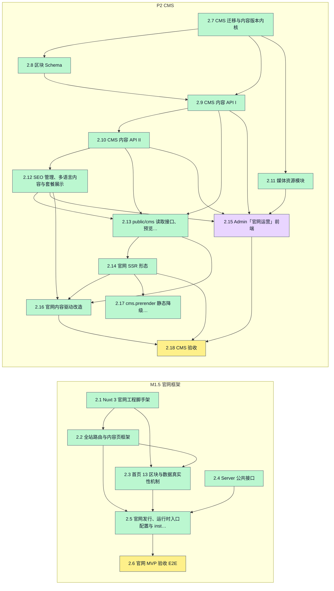
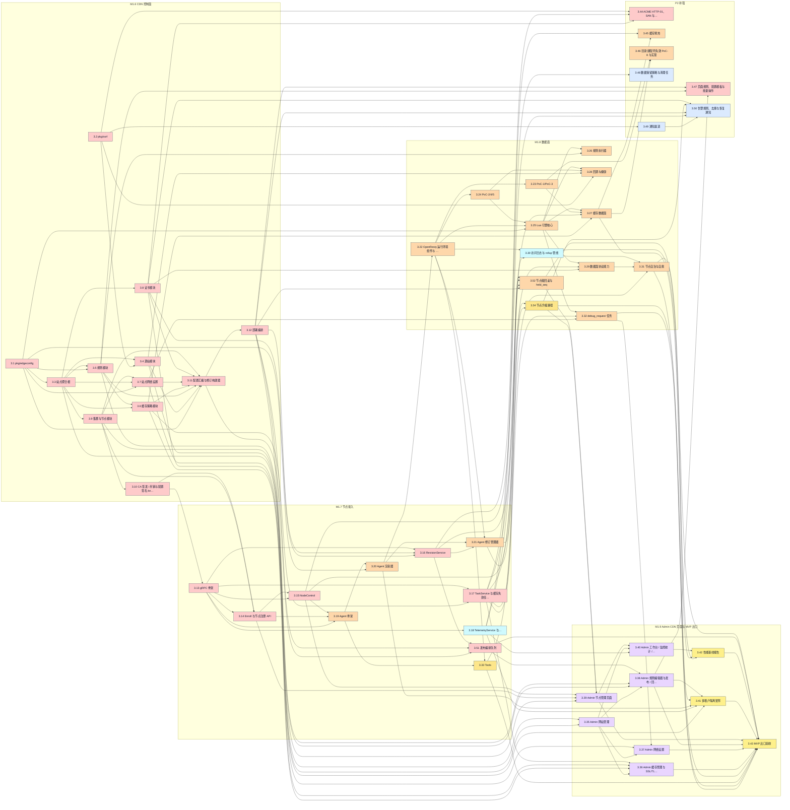
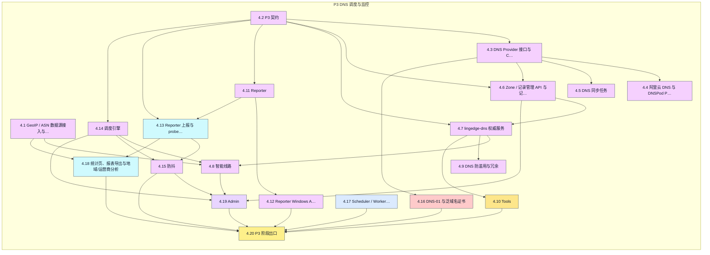
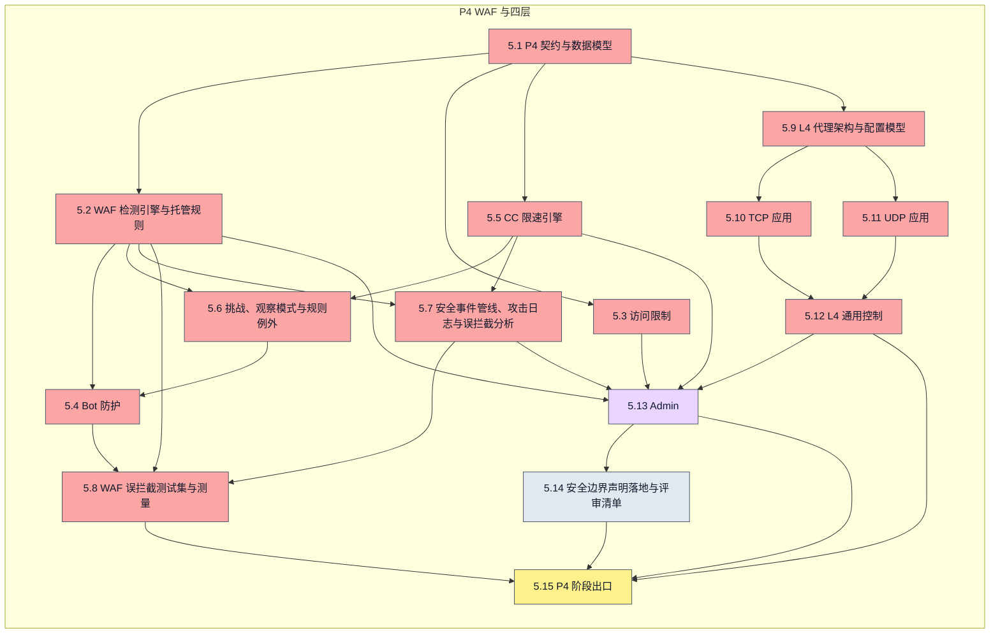
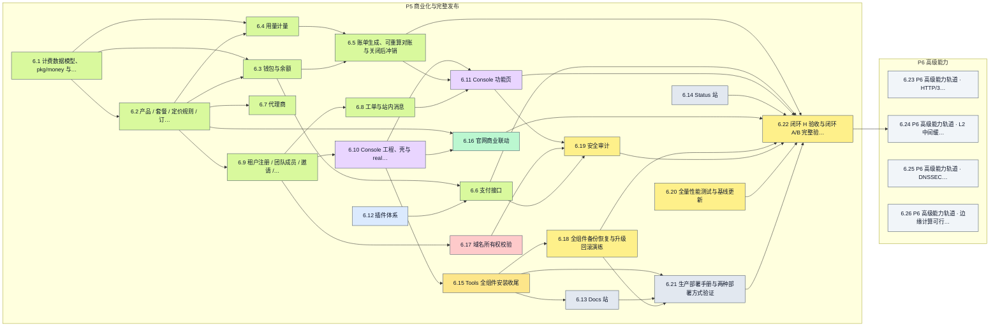

# Story 依赖 DAG、并行泳道与契约冻结点

> 由 `epics.md` 各 Story 的「依赖」字段机械汇总并经环检测（无环）。构建顺序：先满足依赖再开工；同一「波次」内的 Story 互不依赖，可由不同会话并行。**`epics.md` 的依赖字段变更时须同步更新本文件。**

## 1. 契约冻结点与并行边界（D-11、基线 §26）

基线 §26 要求「并行开发不得产生不一致的 API、数据库结构或重复实现」。并行**仅在**对应冻结点达成后开始；冻结后的变更走 ADR-017 §10 的变更流程（向后兼容改动允许；破坏性改动须 ADR/变更说明）。

| 冻结点 | 名称 | 冻结内容 | 达成 Story | 冻结后可并行启动（直接依赖者） | 变更规则 |
|---|---|---|---|---|---|
| CF-1 | 契约冻结 contract-v1 | OpenAPI 3.1 的 M1 operation（修订后 200 个）、`proto/lingedge/node/v1`（含 `NodeRollback`/`held_seq`/`GetCaBundle`/`lineage`）、ERD/迁移结构设计（docs/api、proto、docs/database；13 个迁移文件、61 张 M1 表） | 1.3 | 1.12、1.36、2.1、3.1、3.13、4.2、6.1 | **前置检查（原 AA-6）已关闭**（`architecture-revision-log.md`：67 项已修 66、延后 1），1.3 冻结前复核修订日志验证项；git 标签 `contract-v1`（须在 1.1 完成首个提交之后）；评审记录 `docs/bmad/contract-changes/CF-1.md`；此后破坏性变更须 ADR/变更说明（ADR-017 §10） |
| CF-2 | 迁移冻结 migrations-m1 | `migrations/000001–000013`（按外键拓扑重排后的 13 个文件、M1 全部 61 张表、触发器、种子；顺序见 database/README §8.1） | 1.9 | 1.34、2.7、3.3、3.8、3.9、3.11、3.18 | 标签 `migrations-m1` + `migrations/CHECKSUMS`；此后仅允许 expand 迁移 |
| CF-3 | Node 协议代码冻结 | `proto/lingedge/node/v1` 生成的 Go gRPC 接口与拦截器契约（含 `GetCaBundle`、`NodeRollback`、`held_seq`、`lineage`） | 3.13 | 3.14、3.15、3.16、3.17、3.18、3.19、4.7、4.11 | Agent 泳道与 Server RPC 实现并行 |
| CF-4 | edgeconfig IR 冻结 | `pkg/edgeconfig` 的规则 IR（schema_version=1）、校验器常量、canonical JSON | 3.1 | 3.3、3.5、3.7、3.11、3.20、3.25 | Server 编译器泳道与 Node 渲染器/Lua 泳道并行；Go↔Lua golden 向量 |
| CF-5 | Tools CLI 契约冻结 | 退出码表（0–14,130）+ `lingedge.cli/v1` JSON envelope 与各命令 data schema | 1.25 | 1.26、1.29 | Docs、TUI、验收脚本据此并行 |
| CF-6 | 发行清单/包格式冻结 | `manifest.json`/`keys.json`/包 META 与签名对象格式（tools-design §9） | 1.27 | 1.28、1.30、1.34 | 发行流水线、安装器、离线 bundle 并行 |
| CF-7 | P3 契约冻结 contract-v2 | P3 OpenAPI operation、`dns.v1`/`reporter.v1` proto、P3 迁移 | 4.2 | 4.3、4.6、4.7、4.11、4.13、4.14、5.1 | DNS/Reporter/调度/Admin 并行 |
| CF-8 | P4 契约冻结 contract-v3 | WAF/IP 列表/安全事件/L4 的 OpenAPI、迁移、修订块类型 | 5.1 | 5.2、5.3、5.5、5.9 | 安全与四层并行 |
| CF-9 | P5 契约冻结 contract-v4 | 计费/Console/插件的 OpenAPI 与迁移（含 `money` 约束） | 6.1 | 6.2、6.3、6.4 | 商业、Console、Docs/Status 并行 |

### 官网 / 基础平台 并行边界

- **前提**：CF-1（OpenAPI `public/*` 与 M1 契约冻结）+ Story 1.36（前端 workspace 与 shared tokens）。
- **官网泳道**（Epic 2 的 2.1–2.3、2.5、2.6）只消费 `GET /api/v1/public/{stats,site-info,version}`（Server 侧由 2.4 实现，依赖 1.8/1.12/1.22）；官网不共享 Server 代码、不直连数据库、不引用 Arco；价格/套餐不在官网维护（R-12）。
- **汇合点**：2.4（官网所需 Server 接口，须与平台 1.12/1.22 对齐）、2.5（需 Tools 静态安装器 1.40 与 resolver 1.30）、2.6（需 1.38 Admin 登录与 3.15 真实节点数据）。
- **禁止**：官网泳道为自己新增未冻结的 Server 接口；如需，走变更说明并重新冻结。

### 其他并行边界

| 泳道对 | 边界 | 汇合点 |
|---|---|---|
| Tools（1.25–1.34、1.40–1.44）↔ 平台（1.4–1.24） | Tools 与 Server **无编译依赖**；协作仅经发行清单（CF-6）、`state.json`、`lingedge-server migrate/healthz/setup` 子命令与 `/healthz`；退出码/JSON 以 CF-5 为准 | 1.35（需 1.24 向导后端与 1.33/1.34）、1.43（需 `migrate plan`：1.6） |
| CDN 控制面（3.3–3.18）↔ Node 数据面（3.19–3.32） | 以 CF-3（gRPC 接口）、CF-4（edgeconfig IR）与 Go↔Lua golden 向量隔离；Agent 不 import Server 业务包 | 3.16（RevisionService）↔ 3.21（修订管理器）；3.17（TaskService）↔ 3.27/3.32 |
| 前端（1.36–1.39、3.35–3.40）↔ 后端 | 类型来自 OpenAPI（CF-1）；Admin 页面 Story 依赖对应后端 API 已合并（E2E 需真实 API） | 各 Admin Story 的依赖列 |
| 观测（3.18、3.30）↔ 数据面 | rollup 窗口、幂等键、去重键以 ADR-008/node-protocol §10–11 为准；Server 侧与 Agent 侧各自实现 | 3.30 ↔ 3.18 |
| P3/P4/P5 各 Epic 内部 | 各自先做契约 Story（4.2 / 5.1 / 6.1）并冻结（CF-7/8/9）再并行 | 4.2、5.1、6.1 |

## 2. 里程碑与 Story 分布

| 里程碑 | Story |
|---|---|
| M1.0 工程基线与契约冻结 | 1.1–1.3 |
| M1.1 平台内核 | 1.4–1.15 |
| M1.2 身份·租户·审计 | 1.16–1.23 |
| M1.3 Tools 核心 | 1.25–1.34 |
| M1.4 主控可安装 | 1.24、1.35–1.45 |
| M1.5 官网框架 | 2.1–2.6 |
| M1.6 CDN 控制面 | 3.1–3.12 |
| M1.7 节点接入 | 3.13–3.21、3.33、3.51 |
| M1.8 数据面 | 3.22–3.32、3.34、3.52 |
| M1.9 Admin CDN 页面与 MVP 出口 | 3.35–3.43 |
| P2 CMS | 2.7–2.18 |
| P2 补强 | 3.44–3.50 |
| P3 DNS 调度与监控 | 4.1–4.20 |
| P4 WAF 与四层 | 5.1–5.15 |
| P5 商业化与完整发布 | 6.1–6.22 |
| P6 高级能力 | 6.23–6.26 |

## 3. 泳道

| 泳道 | Story 数 | Story |
|---|---|---|
| 基础平台 | 29 | 1.1–1.24、3.48–3.50、4.17、6.12 |
| Tools | 19 | 1.25–1.33、1.35、1.40–1.44、3.33、3.34、4.10、6.15 |
| 前端 | 7 | 1.36–1.39、2.15、6.10、6.11 |
| Admin | 8 | 3.35–3.40、4.19、5.13 |
| 官网 | 16 | 2.1–2.5、2.7–2.14、2.16、2.17、6.16 |
| CDN 控制面 | 22 | 3.1–3.17、3.44、3.47、3.51、4.16、6.17 |
| Node 数据面 | 16 | 3.19–3.29、3.31、3.32、3.45、3.46、3.52 |
| 观测 | 4 | 3.18、3.30、4.13、4.18 |
| DNS 调度 | 13 | 4.1–4.9、4.11、4.12、4.14、4.15 |
| 安全 | 12 | 5.1–5.12 |
| 商业 | 9 | 6.1–6.9 |
| 文档 | 4 | 5.14、6.13、6.14、6.21 |
| 发布与文档 | 1 | 1.34 |
| 高级能力 | 4 | 6.23–6.26 |
| 验收 | 12 | 1.45、2.6、2.18、3.41–3.43、4.20、5.15、6.18–6.20、6.22 |

## 4. 并行波次（最早可开工顺序；同一波次内可并行）

| 波次 | 可并行的 Story（泳道） |
|---|---|
| W0 | 1.1（基础平台） |
| W1 | 1.2（基础平台）；1.3（基础平台）；1.4（基础平台） |
| W2 | 1.5（基础平台）；1.10（基础平台）；1.11（基础平台）；1.25（Tools）；1.36（前端）；3.1（CDN 控制面）；3.2（CDN 控制面） |
| W3 | 1.6（基础平台）；1.26（Tools）；2.1（官网） |
| W4 | 1.7（基础平台）；1.27（Tools）；1.29（Tools）；2.2（官网） |
| W5 | 1.8（基础平台）；1.12（基础平台）；1.23（基础平台）；1.28（Tools）；1.30（Tools）；1.31（Tools）；1.32（Tools）；2.3（官网） |
| W6 | 1.9（基础平台）；1.13（基础平台）；1.14（基础平台）；1.16（基础平台）；1.33（Tools） |
| W7 | 1.15（基础平台）；1.17（基础平台）；1.18（基础平台）；1.34（发布与文档）；1.42（Tools） |
| W8 | 1.19（基础平台）；1.20（基础平台） |
| W9 | 1.21（基础平台）；3.3（CDN 控制面） |
| W10 | 1.22（基础平台）；2.7（官网）；3.4（CDN 控制面）；3.5（CDN 控制面）；3.8（CDN 控制面）；3.9（CDN 控制面）；3.49（基础平台） |
| W11 | 1.24（基础平台）；1.38（前端）；2.4（官网）；2.8（官网）；2.11（官网）；3.6（CDN 控制面）；3.7（CDN 控制面）；3.10（CDN 控制面） |
| W12 | 1.35（Tools）；1.37（前端）；1.39（前端）；1.40（Tools）；2.9（官网）；3.11（CDN 控制面）；3.13（CDN 控制面）；3.35（Admin） |
| W13 | 1.41（Tools）；2.5（官网）；2.10（官网）；3.12（CDN 控制面）；3.14（CDN 控制面）；3.17（CDN 控制面）；3.18（观测） |
| W14 | 1.43（Tools）；2.12（官网）；3.15（CDN 控制面）；3.16（CDN 控制面）；3.36（Admin）；3.48（基础平台） |
| W15 | 1.44（Tools）；2.6（验收）；2.13（官网）；2.15（前端）；3.19（Node 数据面）；3.44（CDN 控制面）；3.51（CDN 控制面）；4.17（基础平台） |
| W16 | 1.45（验收）；2.14（官网）；3.20（Node 数据面）；3.38（Admin） |
| W17 | 2.16（官网）；2.17（官网）；3.22（Node 数据面）；3.47（CDN 控制面） |
| W18 | 2.18（验收）；3.21（Node 数据面）；3.23（Node 数据面）；3.24（Node 数据面）；3.30（观测）；3.33（Tools） |
| W19 | 3.25（Node 数据面）；3.34（Tools）；3.52（Node 数据面） |
| W20 | 3.26（Node 数据面）；3.27（Node 数据面）；3.28（Node 数据面）；3.29（Node 数据面）；3.32（Node 数据面）；3.39（Admin）；3.50（基础平台） |
| W21 | 3.31（Node 数据面）；3.37（Admin）；3.40（Admin）；3.41（验收）；3.45（Node 数据面）；3.46（Node 数据面） |
| W22 | 3.42（验收） |
| W23 | 3.43（验收） |
| W24 | 4.1（DNS 调度）；4.2（DNS 调度）；6.1（商业） |
| W25 | 4.3（DNS 调度）；4.11（DNS 调度）；4.14（DNS 调度）；5.1（安全）；6.2（商业） |
| W26 | 4.4（DNS 调度）；4.5（DNS 调度）；4.6（DNS 调度）；4.12（DNS 调度）；4.13（观测）；4.16（CDN 控制面）；5.2（安全）；5.3（安全）；5.5（安全）；5.9（安全）；6.3（商业）；6.4（商业）；6.7（商业）；6.9（商业）；6.12（基础平台） |
| W27 | 4.7（DNS 调度）；4.15（DNS 调度）；4.18（观测）；5.6（安全）；5.7（安全）；5.10（安全）；5.11（安全）；6.5（商业）；6.6（商业）；6.8（商业）；6.10（前端）；6.14（文档）；6.17（CDN 控制面） |
| W28 | 4.8（DNS 调度）；4.9（DNS 调度）；4.10（Tools）；5.4（安全）；5.12（安全）；6.16（官网） |
| W29 | 4.19（Admin）；5.8（安全）；5.13（Admin）；6.15（Tools） |
| W30 | 4.20（验收）；5.14（文档）；6.18（验收） |
| W31 | 5.15（验收）；6.11（前端）；6.13（文档）；6.25（高级能力） |
| W32 | 6.19（验收）；6.20（验收）；6.21（文档）；6.23（高级能力）；6.26（高级能力） |
| W33 | 6.22（验收） |
| W34 | 6.24（高级能力） |

最大波次深度：W34（即全 DAG 最长依赖链包含 35 个 Story）。

- **关键路径 → MVP 出口（3.43）**：24 个 Story：1.1 → 1.4 → 1.5 → 1.6 → 1.7 → 1.12 → 1.16 → 1.18 → 1.20 → 3.3 → 3.9 → 3.10 → 3.13 → 3.14 → 3.15 → 3.19 → 3.20 → 3.22 → 3.24 → 3.25 → 3.29 → 3.31 → 3.42 → 3.43
- **关键路径 → Epic 1 验收（1.45）**：17 个 Story：1.1 → 1.4 → 1.5 → 1.6 → 1.7 → 1.12 → 1.16 → 1.18 → 1.20 → 1.21 → 1.22 → 1.24 → 1.35 → 1.41 → 1.43 → 1.44 → 1.45
- **关键路径 → 官网 MVP 验收（2.6）**：16 个 Story：1.1 → 1.4 → 1.5 → 1.6 → 1.7 → 1.12 → 1.16 → 1.18 → 1.20 → 3.3 → 3.9 → 3.10 → 3.13 → 3.14 → 3.15 → 2.6
- **关键路径 → P3 出口（4.20）**：31 个 Story：1.1 → 1.4 → 1.5 → 1.6 → 1.7 → 1.12 → 1.16 → 1.18 → 1.20 → 3.3 → 3.9 → 3.10 → 3.13 → 3.14 → 3.15 → 3.19 → 3.20 → 3.22 → 3.24 → 3.25 → 3.29 → 3.31 → 3.42 → 3.43 → 4.2 → 4.3 → 4.6 → 4.7 → 4.8 → 4.19 → 4.20
- **关键路径 → P4 出口（5.15）**：32 个 Story：1.1 → 1.4 → 1.5 → 1.6 → 1.7 → 1.12 → 1.16 → 1.18 → 1.20 → 3.3 → 3.9 → 3.10 → 3.13 → 3.14 → 3.15 → 3.19 → 3.20 → 3.22 → 3.24 → 3.25 → 3.29 → 3.31 → 3.42 → 3.43 → 4.2 → 5.1 → 5.9 → 5.10 → 5.12 → 5.13 → 5.14 → 5.15
- **关键路径 → Epic 6 验收（6.22）**：34 个 Story：1.1 → 1.4 → 1.5 → 1.6 → 1.7 → 1.12 → 1.16 → 1.18 → 1.20 → 3.3 → 3.9 → 3.10 → 3.13 → 3.14 → 3.15 → 3.19 → 3.20 → 3.22 → 3.24 → 3.25 → 3.29 → 3.31 → 3.42 → 3.43 → 4.2 → 5.1 → 5.9 → 5.10 → 5.12 → 5.13 → 5.14 → 6.11 → 6.19 → 6.22

## 5. 依赖图（Mermaid，按 Epic；节点为 Story）

> 图中实线为依赖（箭头指向被依赖者的**后继**）；跨 Epic 依赖单独列于第 6 节，避免图过密。

### Epic 1：项目基础与 LingEdge Tools

```mermaid
flowchart LR
  subgraph G1_0["M1.0 工程基线与契约冻结"]
    S1_1["1.1 Go monorepo 脚手架与目录…"]
    S1_2["1.2 静态质量门禁集"]
    S1_3["1.3 契约工具链与契约冻结点 CF-1"]
  end
  subgraph G1_1["M1.1 平台内核"]
    S1_4["1.4 platform 基础库"]
    S1_5["1.5 DB 基础设施与租户 Scope 构…"]
    S1_6["1.6 Migration 框架"]
    S1_7["1.7 M1 迁移 A"]
    S1_8["1.8 M1 迁移 B"]
    S1_9["1.9 M1 迁移 C"]
    S1_10["1.10 Redis 边界封装与降级"]
    S1_11["1.11 密钥基础库"]
    S1_12["1.12 HTTP 服务骨架"]
    S1_13["1.13 lingedge-server 进程…"]
    S1_14["1.14 任务运行时"]
    S1_15["1.15 Scheduler 角色与内部周期任…"]
  end
  subgraph G1_2["M1.2 身份·租户·审计"]
    S1_16["1.16 认证 I"]
    S1_17["1.17 认证 II"]
    S1_18["1.18 RBAC"]
    S1_19["1.19 API Token"]
    S1_20["1.20 租户模块、Scope 中间件与隔离测…"]
    S1_21["1.21 审计模块与审计/登录日志 API"]
    S1_22["1.22 系统设置、运行模式开关与能力注册表"]
    S1_23["1.23 签名与 CA 密钥初始化"]
  end
  subgraph G1_3["M1.3 Tools 核心"]
    S1_25["1.25 Tools 骨架"]
    S1_26["1.26 security 叶子包"]
    S1_27["1.27 manifest 与发行信任域①"]
    S1_28["1.28 downloader 与离线 bun…"]
    S1_29["1.29 registry"]
    S1_30["1.30 resolver"]
    S1_31["1.31 系统与宝塔只读探测"]
    S1_32["1.32 service 包"]
    S1_33["1.33 installer 编排"]
    S1_34["1.34 发行流水线与离线签名流程"]
  end
  subgraph G1_4["M1.4 主控可安装"]
    S1_24["1.24 Server setup mode …"]
    S1_35["1.35 lingedge install s…"]
    S1_36["1.36 前端 workspace 基座"]
    S1_37["1.37 安装向导 SPA"]
    S1_38["1.38 Admin 工程与壳"]
    S1_39["1.39 Admin 系统管理页"]
    S1_40["1.40 静态前端安装器"]
    S1_41["1.41 backup / restore /…"]
    S1_42["1.42 doctor / config / …"]
    S1_43["1.43 升级与回滚"]
    S1_44["1.44 TUI"]
    S1_45["1.45 Epic 1 验收"]
  end
  S1_1 --> S1_2
  S1_1 --> S1_3
  S1_1 --> S1_4
  S1_4 --> S1_5
  S1_4 --> S1_6
  S1_5 --> S1_6
  S1_6 --> S1_7
  S1_7 --> S1_8
  S1_8 --> S1_9
  S1_4 --> S1_10
  S1_4 --> S1_11
  S1_3 --> S1_12
  S1_4 --> S1_12
  S1_7 --> S1_12
  S1_10 --> S1_12
  S1_12 --> S1_13
  S1_7 --> S1_14
  S1_12 --> S1_14
  S1_14 --> S1_15
  S1_7 --> S1_16
  S1_10 --> S1_16
  S1_12 --> S1_16
  S1_11 --> S1_17
  S1_16 --> S1_17
  S1_16 --> S1_18
  S1_17 --> S1_19
  S1_18 --> S1_19
  S1_5 --> S1_20
  S1_18 --> S1_20
  S1_12 --> S1_21
  S1_15 --> S1_21
  S1_20 --> S1_21
  S1_18 --> S1_22
  S1_21 --> S1_22
  S1_7 --> S1_23
  S1_11 --> S1_23
  S1_13 --> S1_24
  S1_20 --> S1_24
  S1_22 --> S1_24
  S1_23 --> S1_24
  S1_1 --> S1_25
  S1_2 --> S1_25
  S1_25 --> S1_26
  S1_26 --> S1_27
  S1_26 --> S1_28
  S1_27 --> S1_28
  S1_25 --> S1_29
  S1_26 --> S1_29
  S1_27 --> S1_30
  S1_29 --> S1_30
  S1_26 --> S1_31
  S1_29 --> S1_31
  S1_26 --> S1_32
  S1_29 --> S1_32
  S1_28 --> S1_33
  S1_29 --> S1_33
  S1_30 --> S1_33
  S1_31 --> S1_33
  S1_32 --> S1_33
  S1_9 --> S1_34
  S1_27 --> S1_34
  S1_28 --> S1_34
  S1_24 --> S1_35
  S1_33 --> S1_35
  S1_34 --> S1_35
  S1_1 --> S1_36
  S1_3 --> S1_36
  S1_24 --> S1_37
  S1_36 --> S1_37
  S1_17 --> S1_38
  S1_18 --> S1_38
  S1_22 --> S1_38
  S1_36 --> S1_38
  S1_19 --> S1_39
  S1_21 --> S1_39
  S1_22 --> S1_39
  S1_38 --> S1_39
  S1_33 --> S1_40
  S1_34 --> S1_40
  S1_38 --> S1_40
  S1_33 --> S1_41
  S1_35 --> S1_41
  S1_31 --> S1_42
  S1_32 --> S1_42
  S1_33 --> S1_42
  S1_28 --> S1_43
  S1_35 --> S1_43
  S1_41 --> S1_43
  S1_33 --> S1_44
  S1_42 --> S1_44
  S1_43 --> S1_44
  S1_35 --> S1_45
  S1_37 --> S1_45
  S1_39 --> S1_45
  S1_40 --> S1_45
  S1_41 --> S1_45
  S1_42 --> S1_45
  S1_43 --> S1_45
  S1_44 --> S1_45
  style S1_1 fill:#dbeafe,stroke:#475569,color:#0f172a
  style S1_2 fill:#dbeafe,stroke:#475569,color:#0f172a
  style S1_3 fill:#dbeafe,stroke:#475569,color:#0f172a
  style S1_4 fill:#dbeafe,stroke:#475569,color:#0f172a
  style S1_5 fill:#dbeafe,stroke:#475569,color:#0f172a
  style S1_6 fill:#dbeafe,stroke:#475569,color:#0f172a
  style S1_7 fill:#dbeafe,stroke:#475569,color:#0f172a
  style S1_8 fill:#dbeafe,stroke:#475569,color:#0f172a
  style S1_9 fill:#dbeafe,stroke:#475569,color:#0f172a
  style S1_10 fill:#dbeafe,stroke:#475569,color:#0f172a
  style S1_11 fill:#dbeafe,stroke:#475569,color:#0f172a
  style S1_12 fill:#dbeafe,stroke:#475569,color:#0f172a
  style S1_13 fill:#dbeafe,stroke:#475569,color:#0f172a
  style S1_14 fill:#dbeafe,stroke:#475569,color:#0f172a
  style S1_15 fill:#dbeafe,stroke:#475569,color:#0f172a
  style S1_16 fill:#dbeafe,stroke:#475569,color:#0f172a
  style S1_17 fill:#dbeafe,stroke:#475569,color:#0f172a
  style S1_18 fill:#dbeafe,stroke:#475569,color:#0f172a
  style S1_19 fill:#dbeafe,stroke:#475569,color:#0f172a
  style S1_20 fill:#dbeafe,stroke:#475569,color:#0f172a
  style S1_21 fill:#dbeafe,stroke:#475569,color:#0f172a
  style S1_22 fill:#dbeafe,stroke:#475569,color:#0f172a
  style S1_23 fill:#dbeafe,stroke:#475569,color:#0f172a
  style S1_24 fill:#dbeafe,stroke:#475569,color:#0f172a
  style S1_25 fill:#fde68a,stroke:#475569,color:#0f172a
  style S1_26 fill:#fde68a,stroke:#475569,color:#0f172a
  style S1_27 fill:#fde68a,stroke:#475569,color:#0f172a
  style S1_28 fill:#fde68a,stroke:#475569,color:#0f172a
  style S1_29 fill:#fde68a,stroke:#475569,color:#0f172a
  style S1_30 fill:#fde68a,stroke:#475569,color:#0f172a
  style S1_31 fill:#fde68a,stroke:#475569,color:#0f172a
  style S1_32 fill:#fde68a,stroke:#475569,color:#0f172a
  style S1_33 fill:#fde68a,stroke:#475569,color:#0f172a
  style S1_34 fill:#e2e8f0,stroke:#475569,color:#0f172a
  style S1_35 fill:#fde68a,stroke:#475569,color:#0f172a
  style S1_36 fill:#e9d5ff,stroke:#475569,color:#0f172a
  style S1_37 fill:#e9d5ff,stroke:#475569,color:#0f172a
  style S1_38 fill:#e9d5ff,stroke:#475569,color:#0f172a
  style S1_39 fill:#e9d5ff,stroke:#475569,color:#0f172a
  style S1_40 fill:#fde68a,stroke:#475569,color:#0f172a
  style S1_41 fill:#fde68a,stroke:#475569,color:#0f172a
  style S1_42 fill:#fde68a,stroke:#475569,color:#0f172a
  style S1_43 fill:#fde68a,stroke:#475569,color:#0f172a
  style S1_44 fill:#fde68a,stroke:#475569,color:#0f172a
  style S1_45 fill:#fef08a,stroke:#475569,color:#0f172a
```

### Epic 2：官方网站与 CMS

### Epic 3：CDN 核心与 Node

### Epic 4：DNS、调度与监控

### Epic 5：WAF 与四层代理

### Epic 6：商业化与完整发布

图例（泳道配色）：基础平台；Tools；前端；Admin；官网；CDN 控制面；Node 数据面；观测；DNS 调度；安全；商业；文档；发布与文档；高级能力；验收（配色见各 Story 的泳道字段，图中以填充色区分）。

## 6. 跨 Epic 依赖

| Story | 依赖的其他 Epic Story |
|---|---|
| 2.1 Nuxt 3 官网工程脚手架（Tailwind / i18n / 主题 / SEO 骨架 / CI 检查） | 1.3、1.36 |
| 2.4 Server 公共接口：public/stats、site-info、version | 1.8、1.12、1.22 |
| 2.5 官网发行、运行时入口配置与 `install website`（static 模式 + SSR 预检） | 1.30、1.34、1.40 |
| 2.6 官网 MVP 验收 E2E（闭环 B 的 MVP 子集） | 1.38、3.15 |
| 2.7 CMS 迁移与内容版本内核（website_* 表 / 状态机 / 不可变版本） | 1.9、3.3 |
| 2.9 CMS 内容 API I：页面 / Banner / 草稿 / 发布 / 定时 / 版本 / 回滚 / 预览链接 | 1.15、1.21 |
| 2.14 官网 SSR 形态（Nuxt Nitro node-server / systemd / Node.js 依赖声明） | 1.32、1.40 |
| 2.15 Admin「官网运营」前端（15 个菜单 + 首页装修编辑器） | 1.38 |
| 3.1 pkg/edgeconfig：值校验器 / 规则 IR / canonical JSON / 注入向量集（冻结点 CF-4） | 1.3 |
| 3.2 pkg/ssrf：连接时校验的出站守卫 | 1.4 |
| 3.3 站点聚合根（website 模块）：站点 / 域名 / 分组 / 站点设置 | 1.9、1.20 |
| 3.8 证书模块（手动上传）：解析 / 加密存储 / 站点授权 / 部署记录 | 1.9、1.11、1.20 |
| 3.9 集群与节点模块：节点/集群/成员/站点绑定/维护（含多集群约束） | 1.9、1.20 |
| 3.10 CA 签发 / 吊销与配置签名 keyset 链式轮换 | 1.23 |
| 3.11 配置汇编与修订构建器（ConfigContributor / 内容寻址块 / 签名） | 1.9、1.23 |
| 3.12 部署编排：灰度 / 目标状态机 / 回滚即新修订 / N-M 生效汇总 | 1.14 |
| 3.13 gRPC 骨架：proto 代码生成 / 双监听 / 拦截器（冻结点 CF-3） | 1.3、1.13 |
| 3.15 NodeControl：Heartbeat / 在线状态 / 离线判定 / 节点事件 | 1.15 |
| 3.17 TaskService 与缓存失效任务（URL / 整站） | 1.14 |
| 3.18 TelemetryService 与服务端日志/指标（LogSink / LogQuery / rollup / 对账） | 1.9、1.15 |
| 3.22 OpenResty 运行环境组件与 L3–L5 测试基座（含 `make edge-test` 分级） | 1.34 |
| 3.33 Tools：`install node` 与 `node enroll`（含宝塔冲突） | 1.40 |
| 3.34 节点升级路径：Agent staging → systemd `.path` → Tools 受限入口 → 回滚 | 1.43 |
| 3.35 Admin 网站管理：列表 / 创建向导 / 基本设置 / 域名 / 源站 / 分组 / 批量 | 1.38 |
| 3.39 Admin 节点管理页面 | 1.38 |
| 3.43 MVP 出口验收（闭环 C/D/E/J MVP 子集 + Epic 3 验收） | 1.45、2.6 |
| 3.44 ACME HTTP-01、SAN 与自动续期（lego） | 1.15 |
| 3.48 数据保留策略与清理任务（retention.cleanup） | 1.15、1.21 |
| 3.49 通知渠道：Telegram / SMTP / Webhook（含 SSRF 防护） | 1.11、1.21 |
| 4.1 GeoIP / ASN 数据源接入与规则条件启用 | 3.5、3.25、3.43 |
| 4.2 P3 契约：DNS/调度/探测表、proto（dns.v1 / reporter.v1）与 OpenAPI 冻结（CF-7） | 1.3、3.43 |
| 4.3 DNS Provider 接口与 Cloudflare 实现 | 1.11、3.2 |
| 4.5 DNS 同步任务（dns.sync）：重试 / 审计 / 告警 | 1.14、3.50 |
| 4.7 lingedge-dns 权威服务（miekg/dns、快照拉取、多 NS 一致） | 3.13 |
| 4.9 DNS 防滥用与冗余：响应限速 / ANY 策略 / 单 NS doctor 告警 | 1.42 |
| 4.10 Tools：`install dns`（UDP/TCP 53 冲突检测）与升级 | 1.31、1.40、1.43 |
| 4.11 Reporter：HTTP/HTTPS/TCP/TLS/DNS 探测与失败原因分类（Linux） | 3.13 |
| 4.14 调度引擎：策略 / 节点池 / 选路因子 / 维护 / 备用节点池 | 3.9、3.15 |
| 4.15 防抖：联合判定 / 恢复 hold-down / fail-static / 调度日志与告警 | 3.50 |
| 4.16 DNS-01 与泛域名证书（经 Provider） | 3.44 |
| 4.17 Scheduler / Worker 独立二进制与 Tools 安装 | 1.14、1.15、1.40、1.43 |
| 4.18 统计页、报表导出与地域/运营商分析 | 3.40 |
| 4.19 Admin：DNS 管理、智能调度、地域/线路/IP 池页面 | 1.38 |
| 5.1 P4 契约与数据模型：WAF / IP 列表 / 安全事件 / L4 表、OpenAPI、修订块类型（CF-8） | 3.43、4.2 |
| 5.2 WAF 检测引擎与托管规则（SQLi / XSS / 路径遍历 / 自定义规则 / 动作） | 3.25 |
| 5.3 访问限制：IP 黑白名单 / ASN / 国家地区 / UA / Referer / 防盗链 | 3.26、4.1 |
| 5.5 CC 限速引擎：本地共享内存 / 临时封禁 / 近似全局（Redis 不在请求路径） | 3.25、3.26 |
| 5.7 安全事件管线、攻击日志与误拦截分析（一键例外） | 3.18 |
| 5.9 L4 代理架构与配置模型（先补 ADR，再实现 stream 渲染） | 3.20 |
| 5.12 L4 通用控制：源 IP 访问控制 / PROXY Protocol / 连接日志 / 流量统计 | 3.30 |
| 5.13 Admin：安全中心与四层代理页面 | 1.38 |
| 5.14 安全边界声明落地与评审清单（官网 / Docs / Console 三处） | 2.2 |
| 6.1 计费数据模型、pkg/money 与金额静态规则（CF-9） | 1.3、3.43 |
| 6.2 产品 / 套餐 / 定价规则 / 订阅 / 订单与配额开通 | 1.20、1.22 |
| 6.4 用量计量：rollup → usage_records 幂等派生 | 3.18 |
| 6.7 代理商：归属、隔离与分成接口占位 | 1.20 |
| 6.8 工单与站内消息 | 3.49 |
| 6.9 租户注册 / 团队成员 / 邀请 / 配额强制 | 1.17、1.20 |
| 6.10 Console 工程、壳与 realm 隔离 | 1.36、1.38 |
| 6.11 Console 功能页：站点 / 域名 / 源站 / 缓存 / 规则 / 真实 IP / SSL / WAF / DNS / 四层 / 日志 / 财务 / 工单 / Token | 3.35、4.19、5.13、5.14 |
| 6.12 插件体系：Provider 接口 / 插件配置 / 凭据加密 / 插件中心 | 1.11、3.49、4.3 |
| 6.13 Docs 站：产品文档 / API 文档（OpenAPI 同源）/ 接入指南 / 更新日志 / 退出码表 / 已知限制 + `install docs` | 1.40、5.14 |
| 6.14 Status 站：真实监控驱动的状态页与历史事件 | 1.40、3.18、4.13 |
| 6.15 Tools 全组件安装收尾：console / website(ssr) / dns / reporter / scheduler / worker / docs / status | 1.43、2.14、4.10、4.17 |
| 6.16 官网商业联动：套餐价格读取 plans、注册→Console 入口、商业模式运行时配置 | 2.16 |
| 6.17 域名所有权校验（F-1）：商业模式强制 | 3.3 |
| 6.18 全组件备份恢复与升级回滚演练（NFR-18） | 1.41、1.43 |
| 6.20 全量性能测试与基线更新（P3/P4/P5 增量） | 3.42、4.20、5.15 |
| 6.23 P6 高级能力轨道 · HTTP/3 技术验证（QUIC 实现选型与功能等价测试） | 3.43、5.15 |
| 6.24 P6 高级能力轨道 · L2 中间缓存验证与实现 | 3.46 |
| 6.25 P6 高级能力轨道 · DNSSEC 验证与实现 | 4.20 |
| 6.26 P6 高级能力轨道 · 边缘计算可行性验证（需先新增 FR） | 3.43、5.15 |

## 7. 环境依赖分组（谁在等什么环境）

| 环境 | 说明 | 需要该环境的 Story |
|---|---|---|
| ENV-LNX | 真实 Linux + systemd（Debian/Ubuntu LTS 与 RHEL 系各一，D-14） | 1.26、1.29、1.31、1.32、1.35、1.40、1.41、1.42、1.43、1.44、1.45、2.5、2.6、2.14、2.17、2.18、3.19、3.31、3.33、3.34、4.10、4.11、4.17、6.13、6.14、6.15、6.16、6.18、6.19、6.21、6.22 |
| ENV-BT | 含宝塔面板的 Linux 服务器（Nginx 占用 80/443 的冲突场景） | 1.24、1.31、1.40、1.45、2.5、3.33、3.43、4.10、6.21 |
| ENV-ARM | Linux ARM64 节点 | 1.45、3.22、3.33、3.43、6.21 |
| ENV-OR | Linux + OpenResty（含 resty CLI/busted；用于 L3–L5） | 3.20、3.21、3.22、3.23、3.24、3.25、3.26、3.27、3.28、3.29、3.30、3.31、3.32、3.41、3.43、3.45、3.46、3.47、3.51、3.52、5.2、5.3、5.4、5.5、5.6、5.7、5.8、5.9、5.10、5.11、5.12、5.15、6.4、6.19、6.23、6.24、6.26 |
| ENV-MULTI | ≥2 台 Linux（主控与节点分机，用于 enroll/断网/故障注入） | 3.30、3.31、3.33、3.43、3.51、4.15、4.20、5.5、5.15、6.18、6.19、6.22、6.24 |
| ENV-BROWSER | 浏览器环境（Playwright） | 1.37、1.38、1.39、1.45、2.6、2.15、2.16、2.18、3.35、3.36、3.37、3.38、3.39、3.40、3.43、4.19、5.13、5.15、6.10、6.11、6.16、6.22 |
| ENV-PERF | 参考硬件 + 压测工具（wrk/h2load/k6） | 3.42、3.43、6.20、6.23 |
| ENV-NODEJS | Linux 上的 Node.js 运行时（官网 SSR） | 2.5、2.14、2.18 |
| ENV-PUBDOM | 真实可达公网域名 + 80 端口（ACME HTTP-01） | 3.44、4.16 |
| ENV-DNSACCT | 第三方 DNS Provider 真实测试账户与测试域名 | 4.3、4.4、4.5、4.16、4.20 |
| ENV-WIN | Windows AMD64（Reporter） | 4.12、4.20、6.21 |
| ENV-REGION | 多区域探针主机 | 4.13、4.15、4.20 |
| ENV-NS2 | ≥2 台 DNS 主机（UDP/TCP 53） | 4.7、4.8、4.9、4.10、4.20、6.25 |
| ENV-PAY | 支付渠道 sandbox（UD-9） | 6.6、6.22 |

**规则**：上表中任一环境缺失时，对应 Story（及依赖它的闭环/Epic 验收）只能标「等待环境验证」，不得写成已完成（基线 §25、NFR-3、ADR-023）。建议第一批 Linux 验收机（ENV-LNX/ENV-OR）在 Story 3.22 开工前就位（UD-2）。

## 8. 全部依赖边（Story → 依赖）

| Story | 依赖 | 被依赖（后继） |
|---|---|---|
| 1.1 | — | 1.2、1.3、1.4、1.25、1.36 |
| 1.2 | 1.1 | 1.25 |
| 1.3 | 1.1 | 1.12、1.36、2.1、3.1、3.13、4.2、6.1 |
| 1.4 | 1.1 | 1.5、1.6、1.10、1.11、1.12、3.2 |
| 1.5 | 1.4 | 1.6、1.20 |
| 1.6 | 1.4、1.5 | 1.7 |
| 1.7 | 1.6 | 1.8、1.12、1.14、1.16、1.23 |
| 1.8 | 1.7 | 1.9、2.4 |
| 1.9 | 1.8 | 1.34、2.7、3.3、3.8、3.9、3.11、3.18 |
| 1.10 | 1.4 | 1.12、1.16 |
| 1.11 | 1.4 | 1.17、1.23、3.8、3.49、4.3、6.12 |
| 1.12 | 1.3、1.4、1.7、1.10 | 1.13、1.14、1.16、1.21、2.4 |
| 1.13 | 1.12 | 1.24、3.13 |
| 1.14 | 1.7、1.12 | 1.15、3.12、3.17、4.5、4.17 |
| 1.15 | 1.14 | 1.21、2.9、3.15、3.18、3.44、3.48、4.17 |
| 1.16 | 1.7、1.10、1.12 | 1.17、1.18 |
| 1.17 | 1.11、1.16 | 1.19、1.38、6.9 |
| 1.18 | 1.16 | 1.19、1.20、1.22、1.38 |
| 1.19 | 1.17、1.18 | 1.39 |
| 1.20 | 1.5、1.18 | 1.21、1.24、3.3、3.8、3.9、6.2、6.7、6.9 |
| 1.21 | 1.12、1.15、1.20 | 1.22、1.39、2.9、3.48、3.49 |
| 1.22 | 1.18、1.21 | 1.24、1.38、1.39、2.4、6.2 |
| 1.23 | 1.7、1.11 | 1.24、3.10、3.11 |
| 1.24 | 1.13、1.20、1.22、1.23 | 1.35、1.37 |
| 1.25 | 1.1、1.2 | 1.26、1.29 |
| 1.26 | 1.25 | 1.27、1.28、1.29、1.31、1.32 |
| 1.27 | 1.26 | 1.28、1.30、1.34 |
| 1.28 | 1.26、1.27 | 1.33、1.34、1.43 |
| 1.29 | 1.25、1.26 | 1.30、1.31、1.32、1.33 |
| 1.30 | 1.27、1.29 | 1.33、2.5 |
| 1.31 | 1.26、1.29 | 1.33、1.42、4.10 |
| 1.32 | 1.26、1.29 | 1.33、1.42、2.14 |
| 1.33 | 1.28、1.29、1.30、1.31、1.32 | 1.35、1.40、1.41、1.42、1.44 |
| 1.34 | 1.9、1.27、1.28 | 1.35、1.40、2.5、3.22 |
| 1.35 | 1.24、1.33、1.34 | 1.41、1.43、1.45 |
| 1.36 | 1.1、1.3 | 1.37、1.38、2.1、6.10 |
| 1.37 | 1.24、1.36 | 1.45 |
| 1.38 | 1.17、1.18、1.22、1.36 | 1.39、1.40、2.6、2.15、3.35、3.39、4.19、5.13、6.10 |
| 1.39 | 1.19、1.21、1.22、1.38 | 1.45 |
| 1.40 | 1.33、1.34、1.38 | 1.45、2.5、2.14、3.33、4.10、4.17、6.13、6.14 |
| 1.41 | 1.33、1.35 | 1.43、1.45、6.18 |
| 1.42 | 1.31、1.32、1.33 | 1.44、1.45、4.9 |
| 1.43 | 1.28、1.35、1.41 | 1.44、1.45、3.34、4.10、4.17、6.15、6.18 |
| 1.44 | 1.33、1.42、1.43 | 1.45 |
| 1.45 | 1.35、1.37、1.39、1.40、1.41、1.42、1.43、1.44 | 3.43 |
| 2.1 | 1.3、1.36 | 2.2、2.3 |
| 2.2 | 2.1 | 2.3、2.5、5.14 |
| 2.3 | 2.1、2.2 | 2.5 |
| 2.4 | 1.8、1.12、1.22 | 2.5 |
| 2.5 | 1.30、1.34、1.40、2.2、2.3、2.4 | 2.6 |
| 2.6 | 1.38、2.5、3.15 | 3.43 |
| 2.7 | 1.9、3.3 | 2.8、2.9、2.11 |
| 2.8 | 2.7 | 2.9 |
| 2.9 | 1.15、1.21、2.7、2.8 | 2.10、2.13、2.15 |
| 2.10 | 2.9 | 2.12、2.13、2.15 |
| 2.11 | 2.7 | 2.15 |
| 2.12 | 2.10 | 2.13、2.15、2.16 |
| 2.13 | 2.9、2.10、2.12 | 2.14、2.16 |
| 2.14 | 1.32、1.40、2.13 | 2.16、2.17、2.18、6.15 |
| 2.15 | 1.38、2.9、2.10、2.11、2.12 | 2.18 |
| 2.16 | 2.12、2.13、2.14 | 2.18、6.16 |
| 2.17 | 2.14 | — |
| 2.18 | 2.14、2.15、2.16 | — |
| 3.1 | 1.3 | 3.3、3.5、3.7、3.11、3.20、3.25 |
| 3.2 | 1.4 | 3.4、3.28、3.44、3.49、4.3 |
| 3.3 | 1.9、1.20、3.1 | 2.7、3.4、3.5、3.6、3.7、3.8、3.9、3.35、6.17 |
| 3.4 | 3.2、3.3 | 3.11、3.28、3.35 |
| 3.5 | 3.1、3.3 | 3.6、3.11、3.26、3.38、3.47、4.1 |
| 3.6 | 3.3、3.5 | 3.11、3.17、3.27、3.36 |
| 3.7 | 3.1、3.3、3.9 | 3.11、3.32、3.37 |
| 3.8 | 1.9、1.11、1.20、3.3 | 3.11、3.16、3.29、3.36、3.44、3.50 |
| 3.9 | 1.9、1.20、3.3 | 3.7、3.10、3.11、3.14、3.39、4.14 |
| 3.10 | 1.23、3.9 | 3.13、3.14 |
| 3.11 | 1.9、1.23、3.1、3.4、3.5、3.6、3.7、3.8、3.9 | 3.12、3.51 |
| 3.12 | 1.14、3.11 | 3.16、3.38、3.41、3.47、3.50、3.51、3.52 |
| 3.13 | 1.3、1.13、3.10 | 3.14、3.15、3.16、3.17、3.18、3.19、4.7、4.11 |
| 3.14 | 3.9、3.10、3.13 | 3.15、3.19、3.39 |
| 3.15 | 1.15、3.13、3.14 | 2.6、3.19、3.39、3.50、3.52、4.14 |
| 3.16 | 3.8、3.12、3.13 | 3.21、3.29、3.44、3.51 |
| 3.17 | 1.14、3.6、3.13 | 3.27、3.32、3.34、3.36、3.45、3.52 |
| 3.18 | 1.9、1.15、3.13 | 3.30、3.40、3.41、3.48、5.7、6.4、6.14 |
| 3.19 | 3.13、3.14、3.15 | 3.20、3.33 |
| 3.20 | 3.1、3.19 | 3.21、3.22、3.41、5.9 |
| 3.21 | 3.16、3.20、3.22 | 3.31、3.52 |
| 3.22 | 1.34、3.20 | 3.21、3.23、3.24、3.25、3.30、3.33 |
| 3.23 | 3.22 | 3.27、3.46 |
| 3.24 | 3.22 | 3.25、3.28 |
| 3.25 | 3.1、3.22、3.24 | 3.26、3.27、3.28、3.29、3.32、4.1、5.2、5.5 |
| 3.26 | 3.5、3.25 | 5.3、5.5 |
| 3.27 | 3.6、3.17、3.23、3.25 | 3.41、3.45、3.46 |
| 3.28 | 3.2、3.4、3.24、3.25 | — |
| 3.29 | 3.8、3.16、3.25 | 3.31 |
| 3.30 | 3.18、3.22 | 3.31、3.42、5.12 |
| 3.31 | 3.21、3.29、3.30 | 3.42、3.43 |
| 3.32 | 3.7、3.17、3.25 | 3.37、3.43 |
| 3.33 | 1.40、3.19、3.22 | 3.34、3.43 |
| 3.34 | 1.43、3.17、3.33 | 3.39、3.43、3.50 |
| 3.35 | 1.38、3.3、3.4 | 3.36、3.37、3.38、3.40、6.11 |
| 3.36 | 3.6、3.8、3.17、3.35 | 3.43 |
| 3.37 | 3.7、3.32、3.35 | 3.43 |
| 3.38 | 3.5、3.12、3.35、3.51 | 3.41、3.43、3.47 |
| 3.39 | 1.38、3.9、3.14、3.15、3.34、3.52 | 3.40、3.43 |
| 3.40 | 3.18、3.35、3.39 | 3.42、4.18 |
| 3.41 | 3.12、3.18、3.20、3.27、3.38 | 3.43 |
| 3.42 | 3.30、3.31、3.40 | 3.43、6.20 |
| 3.43 | 1.45、2.6、3.31、3.32、3.33、3.34、3.36、3.37、3.38、3.39、3.41、3.42、3.51、3.52 | 4.1、4.2、5.1、6.1、6.23、6.26 |
| 3.44 | 1.15、3.2、3.8、3.16 | 4.16 |
| 3.45 | 3.17、3.27 | — |
| 3.46 | 3.23、3.27 | 6.24 |
| 3.47 | 3.5、3.12、3.38 | — |
| 3.48 | 1.15、1.21、3.18 | — |
| 3.49 | 1.11、1.21、3.2 | 3.50、6.8、6.12 |
| 3.50 | 3.8、3.12、3.15、3.34、3.49 | 4.5、4.15 |
| 3.51 | 3.11、3.12、3.16 | 3.38、3.43 |
| 3.52 | 3.12、3.15、3.17、3.21 | 3.39、3.43 |
| 4.1 | 3.5、3.25、3.43 | 4.8、4.18、5.3 |
| 4.2 | 1.3、3.43 | 4.3、4.6、4.7、4.11、4.13、4.14、5.1 |
| 4.3 | 1.11、3.2、4.2 | 4.4、4.5、4.6、4.16、6.12 |
| 4.4 | 4.3 | — |
| 4.5 | 1.14、3.50、4.3 | — |
| 4.6 | 4.2、4.3 | 4.7、4.19 |
| 4.7 | 3.13、4.2、4.6 | 4.8、4.9、4.10 |
| 4.8 | 4.1、4.7、4.14 | 4.19 |
| 4.9 | 1.42、4.7 | — |
| 4.10 | 1.31、1.40、1.43、4.7 | 4.20、6.15 |
| 4.11 | 3.13、4.2 | 4.12、4.13 |
| 4.12 | 4.11 | 4.20 |
| 4.13 | 4.2、4.11 | 4.15、4.18、6.14 |
| 4.14 | 3.9、3.15、4.2 | 4.8、4.15、4.19 |
| 4.15 | 3.50、4.13、4.14 | 4.19、4.20 |
| 4.16 | 3.44、4.3 | 4.20 |
| 4.17 | 1.14、1.15、1.40、1.43 | 4.20、6.15 |
| 4.18 | 3.40、4.1、4.13 | 4.20 |
| 4.19 | 1.38、4.6、4.8、4.14、4.15 | 4.20、6.11 |
| 4.20 | 4.10、4.12、4.15、4.16、4.17、4.18、4.19 | 6.20、6.25 |
| 5.1 | 3.43、4.2 | 5.2、5.3、5.5、5.9 |
| 5.2 | 3.25、5.1 | 5.4、5.6、5.7、5.8、5.13 |
| 5.3 | 3.26、4.1、5.1 | 5.13 |
| 5.4 | 5.2、5.6 | 5.8 |
| 5.5 | 3.25、3.26、5.1 | 5.6、5.7、5.13 |
| 5.6 | 5.2、5.5 | 5.4 |
| 5.7 | 3.18、5.2、5.5 | 5.8、5.13 |
| 5.8 | 5.2、5.4、5.7 | 5.15 |
| 5.9 | 3.20、5.1 | 5.10、5.11 |
| 5.10 | 5.9 | 5.12 |
| 5.11 | 5.9 | 5.12 |
| 5.12 | 3.30、5.10、5.11 | 5.13、5.15 |
| 5.13 | 1.38、5.2、5.3、5.5、5.7、5.12 | 5.14、5.15、6.11 |
| 5.14 | 2.2、5.13 | 5.15、6.11、6.13 |
| 5.15 | 5.8、5.12、5.13、5.14 | 6.20、6.23、6.26 |
| 6.1 | 1.3、3.43 | 6.2、6.3、6.4 |
| 6.2 | 1.20、1.22、6.1 | 6.3、6.4、6.7、6.9、6.16 |
| 6.3 | 6.1、6.2 | 6.5、6.6 |
| 6.4 | 3.18、6.1、6.2 | 6.5 |
| 6.5 | 6.3、6.4 | 6.11、6.22 |
| 6.6 | 6.3、6.12 | 6.19、6.22 |
| 6.7 | 1.20、6.2 | — |
| 6.8 | 3.49、6.9 | 6.11 |
| 6.9 | 1.17、1.20、6.2 | 6.8、6.10、6.17 |
| 6.10 | 1.36、1.38、6.9 | 6.11、6.15、6.16 |
| 6.11 | 3.35、4.19、5.13、5.14、6.5、6.8、6.10 | 6.19、6.22 |
| 6.12 | 1.11、3.49、4.3 | 6.6 |
| 6.13 | 1.40、5.14、6.15 | 6.21 |
| 6.14 | 1.40、3.18、4.13 | 6.22 |
| 6.15 | 1.43、2.14、4.10、4.17、6.10 | 6.13、6.18、6.21 |
| 6.16 | 2.16、6.2、6.10 | 6.22 |
| 6.17 | 3.3、6.9 | 6.19 |
| 6.18 | 1.41、1.43、6.15 | 6.21、6.22 |
| 6.19 | 6.6、6.11、6.17 | 6.22 |
| 6.20 | 3.42、4.20、5.15 | 6.22 |
| 6.21 | 6.13、6.15、6.18 | 6.22 |
| 6.22 | 6.5、6.6、6.11、6.14、6.16、6.18、6.19、6.20、6.21 | 6.24 |
| 6.23 | 3.43、5.15 | — |
| 6.24 | 3.46、6.22 | — |
| 6.25 | 4.20 | — |
| 6.26 | 3.43、5.15 | — |
