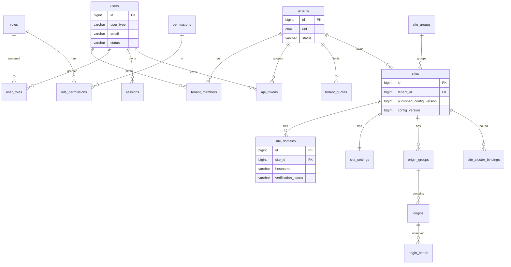
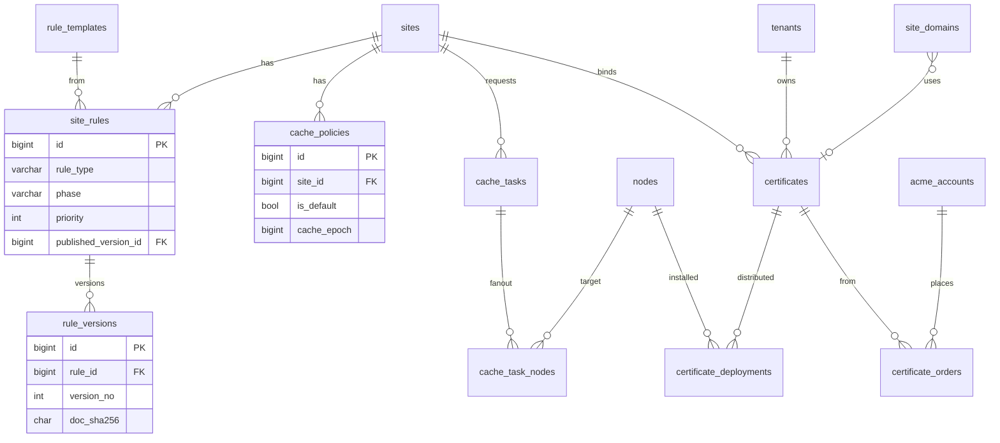
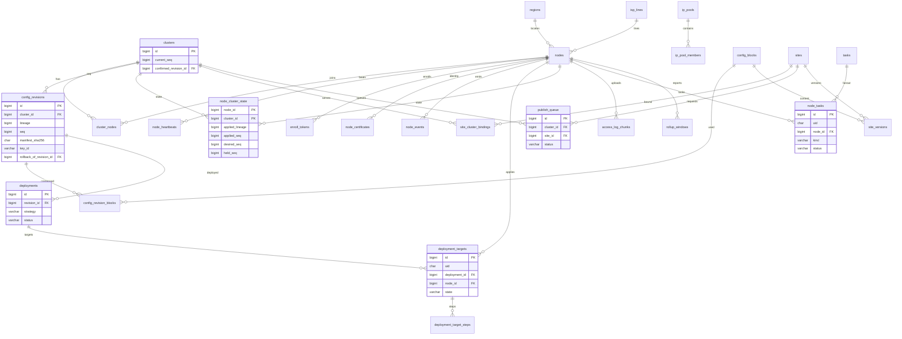
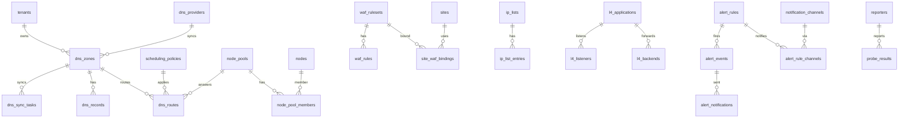
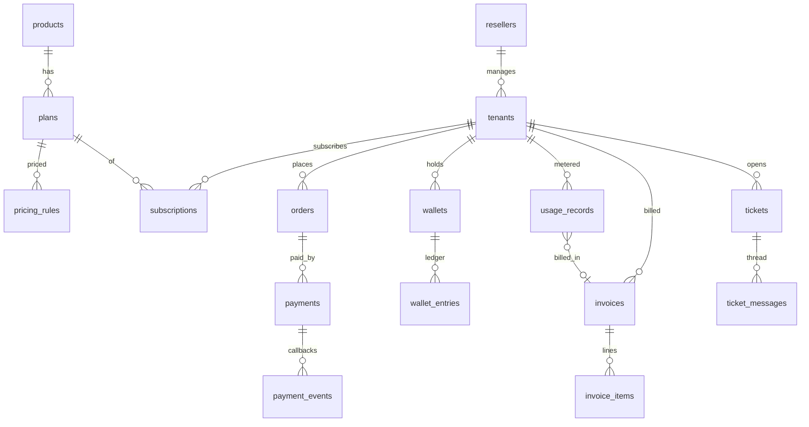
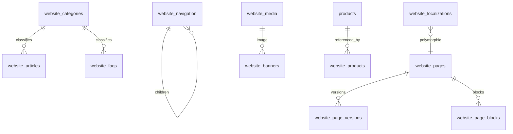

# LingEdge 数据库设计（MySQL 8.0）

> 上级：[architecture.md](../architecture/architecture.md)（§9 为跨文档契约，本文只细化不改写）。相关 ADR：[ADR-002 配置修订](../architecture/adr/README.md)、009 租户隔离、010 金额与计量、011 密钥、016 Migration。
> 基线：`docs/prd/LINGEDGE_V2_REQUIREMENTS.md` 第 18 章全部 80 张核心表均已覆盖（§4 总索引，脚本核对），另有标注「补充」的基线外表。2026-11-16 依据架构评审修订：DDL 已在 MySQL 8.0.46 实测（§9）。阶段标签：**M1**=MVP，P2…P6 同 PRD §10。

## 1. 文件索引

| 文件 | 内容 |
|---|---|
| [platform-identity.md](platform-identity.md) | 系统设置/安装、用户/角色/权限/会话/Token、登录日志、审计、任务/租约/幂等/outbox、签名密钥、凭据与插件 |
| [tenant-site.md](tenant-site.md) | 租户/成员/配额、站点/域名/分组/设置、源站组/源站/源站健康、站点-集群绑定 |
| [rules-cache-cert.md](rules-cache-cert.md) | 统一规则/模板/版本、缓存策略/刷新任务、证书/ACME/部署 |
| [node-deploy.md](node-deploy.md) | 节点/集群/心跳、配置修订/块、部署/目标、节点生效状态、注册 Token/证书、区域/线路/IP 池、访问日志 chunk |
| [dns-scheduling-security.md](dns-scheduling-security.md) | DNS/调度/健康检查、WAF/IP 列表/安全事件、四层代理、rollup/探测、告警/通知 |
| [billing-support.md](billing-support.md) | 产品/套餐/订阅/订单/钱包/计量/账单/支付/代理商、工单 |
| [cms.md](cms.md) | 官网 CMS（`website_*`） |
| [verification/](verification/) | DDL 规则实测脚本：`m1-fk-skeleton.sql`（M1 迁移顺序骨架）、`ddl-rules.sql` + `run_ddl_rules.py`（规则回归，§9） |

## 2. 全局约定

### 2.1 通用列简写（各文件字段表沿用）

| 简写 | 展开 |
|---|---|
| **C1**（对外资源） | `id BIGINT UNSIGNED NOT NULL AUTO_INCREMENT PK`；`uid CHAR(26) NOT NULL UNIQUE`（ULID，API/gRPC 一律用 uid）；`created_at DATETIME(3) NOT NULL DEFAULT CURRENT_TIMESTAMP(3)`；`updated_at DATETIME(3) NOT NULL DEFAULT CURRENT_TIMESTAMP(3) ON UPDATE CURRENT_TIMESTAMP(3)` |
| **C2**（内部/高频表） | `id BIGINT UNSIGNED NOT NULL AUTO_INCREMENT PK`；`created_at DATETIME(3) NOT NULL DEFAULT CURRENT_TIMESTAMP(3)`；无 `uid` |
| **C2u**（高频但对外暴露标识） | C2 + `uid CHAR(26) NOT NULL UNIQUE`（ULID）。用于必须出现在 gRPC/REST 中的高频表：`node_tasks`、`deployment_targets`、`node_events`、`login_logs`、`task_events`、`wallet_entries`、`ticket_messages`。**对外只暴露 `uid`，从不暴露 bigint `id`** |
| **T**（租户范围） | `tenant_id BIGINT UNSIGNED NOT NULL`，FK → `tenants(id)` `ON DELETE RESTRICT`；**所有索引以 `tenant_id` 打头**（见 §6） |
| **T?**（可空租户） | `tenant_id BIGINT UNSIGNED NULL`，`NULL` = 平台级/内置数据；FK 同上（RESTRICT）。凡声明「唯一键含 `tenant_key`」的 T? 表同时带生成列 `tenant_key BIGINT UNSIGNED AS (COALESCE(tenant_id,0)) VIRTUAL`（MySQL 唯一索引把 NULL 视为互不相等，故用 0 代表平台级；`VIRTUAL` 的原因见 §2.4 与 §9 实测） |
| **SD**（软删除） | `deleted_at DATETIME(3) NULL`；见 §2.5 |

### 2.2 类型与命名规则

- **MySQL 最低版本 ≥ 8.0.16**（CHECK 约束自该版本起才被强制执行；更早版本会静默忽略 CHECK，使本设计的大量约束失效）。`lingedge-server migrate` 启动与安装向导均校验 `VERSION()`，低于 8.0.16 拒绝（ADR-016）。已在本机 8.0.46 实测全部 DDL 规则（§9）。
- 引擎 InnoDB，字符集 `utf8mb4`，默认排序 `utf8mb4_0900_ai_ci`；需区分大小写/口音处显式 `COLLATE utf8mb4_0900_as_cs` 或用 `VARBINARY`。
- 表名小写复数下划线（沿用基线 §18 名称）；列名小写下划线；索引 `idx_<表>_<列…>`，唯一 `uk_<表>_<列…>`，外键 `fk_<表>_<引用表>`，检查约束 `ck_<表>_<含义>`。
- 时间一律 `DATETIME(3)` UTC（连接设置 `time_zone='+00:00'`，DSN `loc=UTC&parseTime=true`）；不用 `TIMESTAMP`（2038、时区）。
- **金额** `BIGINT`（整数最小货币单位）+ `currency CHAR(3)`；**数量/字节** `BIGINT UNSIGNED`；比率用整数（千分比 `*_permille`、万分比 `*_bp`），**数据库内无 FLOAT/DOUBLE/DECIMAL 金额列**。
- IP 地址：`VARBINARY(16)`（IPv4 4 字节/IPv6 16 字节，`INET6_ATON`）用于高频表；低频展示用 `VARCHAR(45)`。CIDR 列表用 JSON 数组（应用层校验）。
- **枚举**：不使用 `ENUM`；用 `VARCHAR(n)` + `CHECK (col IN (...))`，新增取值走 expand 迁移（先放宽 CHECK 再发布代码）。文档中“枚举取值”均指该 CHECK 集合，**小写蛇形**，与 OpenAPI/proto 对齐。
- **TEXT/JSON/BLOB 列不得带 DEFAULT 字面量**（MySQL 限制，实测 `TEXT DEFAULT 'x'` 报 ERROR 1101；`JSON DEFAULT ('[]')` 的表达式默认虽可建，但团队规范仍不采用，避免与旧版本/镜像行为分歧）；应用层必须显式赋值；需要“默认空数组”时在 Repository 构造函数中填入。表中此类列的“默认”一栏写 `—`（无）。
- **密文列**（`*_enc`）统一为 5 段信封格式 `v1:<kek_id>:<b64url(wrapped_dek)>:<b64url(nonce)>:<b64url(ciphertext+tag)>`（ADR-011）；各表保留 `enc_key_id VARCHAR(32)`（= 当前包裹 DEK 的 `kek_id`，供 `secrets.rewrap` 按旧 KEK 扫描）。
- 布尔 `TINYINT(1) NOT NULL DEFAULT 0/1`。
- JSON 列仅用于“结构化但不参与关联/筛选”的配置载荷；需要过滤/唯一/关联的字段必须是独立列。JSON 载荷的 Schema 由 `pkg/edgeconfig` 与 OpenAPI 定义并在 Service 层校验。
- 需要对大小写不敏感唯一的字符串（主机名、邮箱）：入库前**应用层小写化** + 唯一索引（`ai_ci` 排序规则使重复判定不分大小写）+ `CHECK (BINARY col = BINARY LOWER(col))` 作为库层兜底（已实测大写写入被 ERROR 3819 拒绝）。architecture §9.1 同此口径。
- 可空唯一性（“活动记录唯一”）统一用**生成列 + 唯一索引**，例如 `active_hostname = IF(deleted_at IS NULL, hostname, NULL)`（MySQL 唯一索引允许多个 NULL）。
- **生成列规则（实测，§9）**：① 用于唯一性的生成列默认 **VIRTUAL**（InnoDB 支持其上的二级/唯一索引）；② `STORED` 生成列的**基列**上的外键不得使用 `CASCADE/SET NULL/SET DEFAULT`（ERROR 1215），只有基列 FK 为 `RESTRICT/NO ACTION` 时才可 `STORED`（本库的 `default_flag/open_key/active_*` 满足）；③ 生成列不得被外键引用。
- **CHECK × 外键规则（实测，§9）**：被 CHECK 引用的列若同时是外键列，该外键的引用动作只能是 `RESTRICT/NO ACTION/ON DELETE CASCADE`；`ON DELETE SET NULL`、`ON UPDATE CASCADE/SET NULL` 会报 ERROR 3823。故凡被 CHECK 引用的 FK 列（如 `cache_policies.risk_ack_by`）一律 `RESTRICT`。

### 2.3 标识符

- 外键与内部关联一律用 `BIGINT id`；对外使用 `uid`（ULID，时间可排序，防枚举）。仅有 `id` 的内部表不对外暴露。
- 外部提交的 `uid` 在 Repository 层先解析为 `(tenant_id, id)` 再查询，禁止用 uid 绕过租户条件。

### 2.4 外键策略

- **关系库内强外键**：业务实体间一律声明外键；默认 `ON DELETE RESTRICT`；子表随父表生命周期的纯从属表用 `ON DELETE CASCADE`（如 `site_domains`→`sites` **不用** CASCADE，因站点软删除；`cache_task_nodes`→`cache_tasks` 用 CASCADE）。**所有指向 `tenants(id)` 的外键一律 `RESTRICT`**（含 roles/user_roles/sessions/api_tokens；租户与用户均软删除，物理清理由 Worker 按依赖顺序执行）；审计型列（`created_by`、`updated_by`…→`users`）可用 `SET NULL`，但被 CHECK 或生成列引用者必须 `RESTRICT`（§2.2）。
- **分区表无外键**（实测 ERROR 1506：分区表既不能作父也不能作子）：`audit_logs`、`node_heartbeats`、`probe_results`、`security_events` 均按此规则无 FK。
- **例外（无外键，需说明）**：高频/大体量/需分区/需独立清理的表——`node_heartbeats`、`metric_rollups`、`usage_records`、`access_log_chunks`、`probe_results`、`security_events`、`audit_logs`、`event_outbox`、`login_logs`。这些表仅保留索引列，引用完整性由写入路径与清理任务保证。
- **多态引用**（`website_localizations`、`website_seo`、`audit_logs.resource_*`）无外键，由 Service 校验。
- **前向引用与循环外键**：MySQL 不允许 FK 指向尚未创建的表（实测 ERROR 1824）。迁移文件须按依赖拓扑排序（§8.1）；确有环或必须晚于目标表建立的外键，先建无 FK 的普通列，再在目标表所在迁移之后以 `ALTER TABLE … ADD CONSTRAINT` 追加（expand）。完整清单：`sites.last_deployment_id → deployments`、`publish_queue.deployment_id → deployments`、`clusters.confirmed_revision_id → config_revisions`、`site_rules.current_version_id / published_version_id → rule_versions`、`website_pages.current_version_id / published_version_id → website_page_versions`（P2）、`provider_credentials.plugin_id → plugins`（P5 建表时追加）、`tenants.reseller_id → resellers`（P5）、`tenant_quotas.subscription_id → subscriptions`（P5）、`website_products.ref_product_id → products`（P5）。
- **复合外键（租户纵深防御，可选但 M1 对高风险表启用）**：`sites` 声明 `UNIQUE(tenant_id, id)`；站点子表声明 `FOREIGN KEY (tenant_id, site_id) REFERENCES sites(tenant_id, id)`，使“子行 tenant 与父行 tenant 不一致”在数据库层不可能（实测跨租户写入报 ERROR 1452）。文档中记作 `FK→sites(tenant_id,id)`。复合 FK 只用 `RESTRICT/CASCADE`（`SET NULL` 与 `tenant_id NOT NULL` 冲突，ERROR 1830）。站点内二级归属同理：`origins` 声明 `FOREIGN KEY (site_id, origin_group_id) REFERENCES origin_groups(site_id, id)`（`origin_groups` 含 `UNIQUE(site_id, id)`），使跨站点/跨租户绑定源站组在库层不可能。

### 2.5 软删除

- 采用软删除（`deleted_at`）的表：`users`、`tenants`、`sites`、`site_domains`、`certificates`、`website_pages`、`website_media`、`nodes`、`site_rules`。原因：被历史记录（审计、修订、账单、部署）引用。
- 软删除行默认被所有 Repository 查询过滤（`deleted_at IS NULL`）；唯一性以生成列体现“仅活动记录唯一”。
- 物理清理由 Worker 的 `retention.cleanup` 任务在保留期后执行，清理顺序遵循外键依赖，且对不可变表使用 `@lingedge_purge=1`（见 §5）。

### 2.6 索引原则

- 租户范围表的所有索引以 `tenant_id` 打头（`(tenant_id, site_id, …)`），保证租户级列表与隔离测试走索引。
- 列表分页（page/page_size）排序列放索引尾部；游标分页集合（审计、事件）使用 `(…, id)` 单调游标。
- 高频写表只建查询必需的最少索引。
- 全文/高基数检索不在 MySQL 承担（访问日志走文件分片，ADR-008）。

## 3. ERD

> 为可读性分图；仅列主键、外键与关键列。`||--o{` 为 1:N。

### 3.1 身份、租户、站点



### 3.2 规则、缓存、证书



### 3.3 节点、集群、修订、部署



### 3.4 DNS、调度、安全、四层、观测



### 3.5 计费与工单



### 3.6 官网 CMS



## 4. 基线第 18 章核心表 → 文件/阶段 总索引

| 表 | 文件 | 阶段 | 表 | 文件 | 阶段 |
|---|---|---|---|---|---|
| system_settings | platform-identity | M1 | cache_policies | rules-cache-cert | M1 |
| system_installations | platform-identity | M1 | cache_tasks | rules-cache-cert | M1 |
| users | platform-identity | M1 | cache_task_nodes | rules-cache-cert | M1 |
| roles | platform-identity | M1 | nodes | node-deploy | M1 |
| permissions | platform-identity | M1 | clusters | node-deploy | M1 |
| user_roles | platform-identity | M1 | cluster_nodes | node-deploy | M1 |
| sessions | platform-identity | M1 | node_heartbeats | node-deploy | M1 |
| api_tokens | platform-identity | M1 | config_revisions | node-deploy | M1 |
| tenants | tenant-site | M1 | deployments | node-deploy | M1 |
| tenant_members | tenant-site | M1 | deployment_targets | node-deploy | M1 |
| tenant_quotas | tenant-site | M1（强制 P5） | dns_zones | dns-scheduling-security | P3 |
| sites | tenant-site | M1 | dns_records | dns-scheduling-security | P3 |
| site_domains | tenant-site | M1 | dns_providers | dns-scheduling-security | P3 |
| site_groups | tenant-site | M1 | dns_routes | dns-scheduling-security | P3 |
| site_settings | tenant-site | M1 | scheduling_policies | dns-scheduling-security | P3 |
| origin_groups | tenant-site | M1 | node_pools | dns-scheduling-security | P3 |
| origins | tenant-site | M1 | health_checks | dns-scheduling-security | P3 |
| origin_health | tenant-site | M1 | certificates | rules-cache-cert | M1 |
| site_rules | rules-cache-cert | M1 | acme_accounts | rules-cache-cert | P2 |
| rule_templates | rules-cache-cert | M1（用于 P2 模板） | certificate_orders | rules-cache-cert | P2 |
| rule_versions | rules-cache-cert | M1 | certificate_deployments | rules-cache-cert | M1 |
| waf_rulesets | dns-scheduling-security | P4 | l4_applications | dns-scheduling-security | P4 |
| waf_rules | dns-scheduling-security | P4 | l4_listeners | dns-scheduling-security | P4 |
| ip_lists | dns-scheduling-security | P4 | l4_backends | dns-scheduling-security | P4 |
| security_events | dns-scheduling-security | P4 | metric_rollups | dns-scheduling-security | M1 |
| probe_results | dns-scheduling-security | P3 | alert_rules | dns-scheduling-security | P2 |
| alert_events | dns-scheduling-security | P2 | products | billing-support | P5 |
| plans | billing-support | P5 | subscriptions | billing-support | P5 |
| orders | billing-support | P5 | wallets | billing-support | P5 |
| wallet_entries | billing-support | P5 | usage_records | billing-support | P5（M1 起可写入，见该表） |
| tickets | billing-support | P5 | ticket_messages | billing-support | P5 |
| website_pages | cms | P2 | website_page_versions | cms | P2 |
| website_page_blocks | cms | P2 | website_navigation | cms | P2 |
| website_banners | cms | P2 | website_products | cms | P2 |
| website_solutions | cms | P2 | website_articles | cms | P2 |
| website_categories | cms | P2 | website_faqs | cms | P2 |
| website_media | cms | P2 | website_seo | cms | P2 |
| website_settings | cms | P2 | website_localizations | cms | P2 |
| provider_credentials | platform-identity | P2（ACME/通知首批使用；DNS Provider P3） | plugins | platform-identity | P5 |
| plugin_configs | platform-identity | P5 | audit_logs | platform-identity | M1 |

> 说明：`usage_records` 表 P5 才有读取方，但 M1 的 rollup 管线已按其幂等键设计；迁移在 P5 创建。`metric_rollups` 于 M1 创建。官网 M1 为纯静态（SSG），不依赖 `website_*`，故 CMS 表整体 P2。

### 4.1 补充表（基线外）清单

`role_permissions`、`user_recovery_codes`、`login_logs`、`tasks`、`task_events`、`job_locks`、`idempotency_keys`、`event_outbox`、`signing_keys`、`user_verification_tokens`（P2）、`site_cluster_bindings`、`config_blocks`、`config_revision_blocks`、`node_cluster_state`、**`node_tasks`**、**`deployment_target_steps`**、**`publish_queue`**、**`site_versions`**、**`rollup_windows`**、`enroll_tokens`、`node_certificates`、`node_events`、`regions`、`isp_lines`、`ip_pools`、`ip_pool_members`、`access_log_chunks`、`node_pool_members`（P3）、`dns_nodes`（P3）、`dns_sync_tasks`（P3）、`reporters`（P3）、`site_waf_bindings`（P4）、`ip_list_entries`（P4）、`alert_rule_channels`（P2）、`notification_channels`（P2）、`notification_templates`（P2）、`alert_notifications`（P2）、`pricing_rules`（P5）、`invoices`（P5）、`invoice_items`（P5）、`payments`（P5）、`payment_events`（P5）、`resellers`（P5）、`website_content_versions`（P2）、**`website_preview_links`**（P2）。

> 2026-11-16 修订新增 6 张补充表（加粗），基线 §18 的 80 张核心表覆盖不变（见 §4 总索引）。

## 5. 不可变表与触发器设计

不可变性三道防线：① Repository 不提供 UPDATE/DELETE 方法；② 数据库触发器拒绝违规写；③ 应用账号权限（见下）。

| 表 | 规则 |
|---|---|
| `config_revisions` | 全列不可 UPDATE；DELETE 仅清理任务（`@lingedge_purge=1`）且修订未被 `node_cluster_state`/`deployments` 引用并早于保留下限 |
| `config_blocks` | 全列不可 UPDATE（内容寻址，sha256 即身份）；DELETE 同上，且无 `config_revision_blocks` 引用 |
| `config_revision_blocks` | 不可 UPDATE；DELETE 随修订清理 |
| `rule_versions` | 不可 UPDATE；DELETE 仅清理任务 |
| `wallet_entries` | 追加只写：禁止 UPDATE/DELETE（更正用反向分录） |
| `usage_records` | 窗口修订规则：同键（node_id, site_id, window_start, window_seconds, metric）允许在 `billed_invoice_id IS NULL` 时由 `generation` 更大的派生覆盖 `quantity/generation/revision`（同代异值 = 冲突事件，不覆盖，见 ADR-010/ADR-008）；一旦 `billed_invoice_id` 非空则任何 UPDATE 拒绝；DELETE 禁止；更正通过账单调整项（`invoice_items.item_type='adjustment'`） |
| `audit_logs` | 禁止 UPDATE/DELETE；保留期通过**分区 DROP**（`ALTER TABLE … DROP PARTITION`）由维护账号执行 |

触发器模板（goose 中以 `-- +goose StatementBegin/End` 包裹，因为含 `BEGIN…END`）：

```sql
-- 全表不可变（UPDATE）
CREATE TRIGGER trg_config_revisions_bu BEFORE UPDATE ON config_revisions
FOR EACH ROW SIGNAL SQLSTATE '45000' SET MESSAGE_TEXT = 'config_revisions is immutable';

-- 仅清理任务可删（DELETE）
-- +goose StatementBegin
CREATE TRIGGER trg_config_revisions_bd BEFORE DELETE ON config_revisions
FOR EACH ROW
BEGIN
  IF COALESCE(@lingedge_purge, 0) <> 1 THEN
    SIGNAL SQLSTATE '45000' SET MESSAGE_TEXT = 'config_revisions delete forbidden outside purge';
  END IF;
END;
-- +goose StatementEnd

-- usage_records：已出账后冻结
-- +goose StatementBegin
CREATE TRIGGER trg_usage_records_bu BEFORE UPDATE ON usage_records
FOR EACH ROW
BEGIN
  IF OLD.billed_invoice_id IS NOT NULL THEN
    SIGNAL SQLSTATE '45000' SET MESSAGE_TEXT = 'usage_records frozen after billing';
  END IF;
  IF NEW.node_id <> OLD.node_id OR NEW.site_id <> OLD.site_id
     OR NEW.window_start <> OLD.window_start OR NEW.window_seconds <> OLD.window_seconds
     OR NEW.metric <> OLD.metric OR NEW.tenant_id <> OLD.tenant_id THEN
    SIGNAL SQLSTATE '45000' SET MESSAGE_TEXT = 'usage_records identity immutable';
  END IF;
END;
-- +goose StatementEnd
```

> 出账时 `billed_invoice_id` 由 NULL 写入非空值（该 UPDATE 的 `OLD.billed_invoice_id IS NULL`，放行）；此后冻结。触发器模板为设计示意，实现时以迁移测试验证（`SIGNAL`/BEFORE UPDATE/DELETE 触发器在分区表上已实测可用，`DROP PARTITION` 不触发行级 DELETE 触发器，故审计保留期清理不受 `trg_audit_logs_bd` 影响）。`@lingedge_purge` 为会话变量，仅 Worker 清理连接在事务内设置。

### 5.1 数据库账号三分与触发器前置条件（IMP-19 / M12，已实测）

| 账号 | 权限 | 使用者 |
|---|---|---|
| `lingedge_app` | `SELECT, INSERT, UPDATE, DELETE ON db.*`；对 `audit_logs`、`wallet_entries` **仅** `SELECT, INSERT`（表级授权） | Server 常规请求路径、Worker |
| `lingedge_maint` | **表级** `SELECT, ALTER, DROP` 仅授予分区表（`audit_logs`、`node_heartbeats`、`probe_results`、`security_events`） | Worker 的 `retention.cleanup` / `partition.maintain` 任务（独立连接池）；执行 `REORGANIZE PARTITION`（滚动预建）与 `DROP PARTITION`（保留期） |
| `lingedge_migrate` | `ALL ON db.* WITH GRANT OPTION` + 全局 `SET_USER_ID` | 仅 `lingedge-server migrate` / Tools；**在迁移 SQL 内**为 `lingedge_maint` 做表级授权（每个新分区表所在迁移末尾 `GRANT SELECT, ALTER, DROP ON db.<表> TO lingedge_maint`）；不在常规请求路径持有 |

- 实测（MySQL 8.0.46，`log_bin=ON`、`log_bin_trust_function_creators=0`）：仅 `ALL ON db.*` 的账号建触发器报 **ERROR 1419**（需要 SUPER）；同账号另被授予全局 `SET_USER_ID`，或 `log_bin_trust_function_creators=1`，即可建成。宝塔 MySQL 常默认开启 binlog，故**安装向导预检**：读取 `@@log_bin`、`@@log_bin_trust_function_creators`，并用迁移账号在临时表上建/删一个探针触发器；失败则提示两种处置（授予 `SET_USER_ID`，或在 `my.cnf` 设 `log_bin_trust_function_creators=1` 后重启）。
- 表级授权的 `lingedge_maint` 不能 `DROP` 其它表（实测 ERROR 1142）；`lingedge_app` 对 `audit_logs` 的 UPDATE/DROP 被拒。
- **审计写入与业务变更同事务**；分区表一律含 `pmax VALUES LESS THAN (MAXVALUE)` 兜底分区，写入永远不会因“缺下月分区”报 ERROR 1526（实测无 `pmax` 时越界 INSERT 报该错误）；`partition.maintain` 每日把 `pmax` `REORGANIZE` 出未来 N 个月的新分区，失败告警（不影响写入）。

## 6. 租户隔离在数据库层的落点（ADR-009）

1. **列**：所有租户范围表含 `tenant_id NOT NULL`（平台级表无此列并在文档中标注“平台级”）。
2. **索引**：所有索引、唯一键以 `tenant_id` 打头，使“漏写 tenant 条件”的全表扫描在测试中可被 `EXPLAIN` 断言发现。
3. **复合外键**：站点子表 `FOREIGN KEY (tenant_id, site_id) REFERENCES sites(tenant_id, id)`（§2.4），租户相关链路（`cache_tasks`→`sites`，`certificates`→`sites` 等）同理。
4. **应用层**：Repository 的 `Scope` 强制注入（ADR-009）；本库不使用 MySQL 行级安全（无此特性）。
5. **平台级表**（`nodes`、`clusters`、`config_*`、`signing_keys`、`regions`…）不带 `tenant_id`；租户永不直接访问，仅通过站点抽象；`deployments.tenant_id` 记录发起租户上下文（可空），租户可见的“部署记录”以 `trigger_site_id` 过滤。
6. **隔离测试矩阵**（资源×操作×身份）覆盖：sites、site_domains、origins、site_rules、rule_versions、cache_tasks、certificates（含私钥）、api_tokens、audit_logs、usage_records、invoices、tickets。

## 7. 数据保留策略总表

> 保留期默认值基线与 PRD 均未给出（OQ-7/OQ-10），下表“建议起始值”为 `[ASSUMPTION]`，可在 `system_settings`（`retention.*`）覆盖；清理动作由 Worker `retention.cleanup` 任务执行并写审计（FR-28，P2 起可配置，M1 使用内置建议值或不清理并告警磁盘）。

| 数据 | 存放 | 建议起始值 `[ASSUMPTION]` | 清理方式 |
|---|---|---|---|
| 访问日志原始分片 | 文件（`access_log_chunks` 元数据） | 待用户确认（OQ-10） | 按 `log_date` 删除文件 + 删 chunk 行 |
| `metric_rollups` 1m / 5m / 1h / 1d | MySQL | 7 天 / 30 天 / 180 天 / 730 天 | 按 `window_start` 批量删除（小批次） |
| `node_heartbeats` | MySQL（建议按日分区） | 7 天 | DROP PARTITION 或批量删 |
| `audit_logs` | MySQL 按月分区 | 365 天（审计合规待确认 OQ-6） | DROP PARTITION |
| `login_logs` | MySQL | 180 天 | 批量删 |
| `tasks` / `task_events`（终态） | MySQL | 90 天 | 批量删（保留未终态） |
| `node_events` | MySQL | 90 天 | 批量删 |
| `probe_results` | MySQL（建议分区） | 14 天 | DROP PARTITION |
| `security_events` | MySQL（建议分区，采样/聚合） | 30 天 | DROP PARTITION |
| `cache_tasks` / `cache_task_nodes` / `node_tasks`（终态） | MySQL | 90 天 | 批量删 |
| `publish_queue`（终态）/ `deployment_target_steps` | MySQL | 90 天 / 随 `deployment_targets` | 批量删 |
| `rollup_windows` | MySQL | 与对应 `metric_rollups` 1m 保留期一致（7 天） | 按 `window_start` 批量删 |
| `site_versions` | MySQL | 每站点最近 200 个及 `live` 版本 | 清理任务 |
| `website_preview_links`（P2） | MySQL | 过期后 7 天 | 批量删 |
| `idempotency_keys` | MySQL | 24 小时（契约 §9.2） | 批量删 |
| `event_outbox`（已发送） | MySQL | 7 天 | 批量删 |
| `sessions` | MySQL | 过期/吊销后 30 天 | 批量删 |
| `certificate_orders` | MySQL | 180 天（终态） | 批量删 |
| `config_revisions` / `config_blocks` | MySQL（块内容为 MEDIUMBLOB，随 mysqldump 备份；不再有“修订 blob 文件”） | 每集群至少保留最近 50 个修订及一切被 `node_cluster_state`/`deployments`/`clusters.confirmed_revision_id`/`site_versions` 引用者 | 清理任务（`@lingedge_purge`） |
| `deployments` / `deployment_targets` | MySQL | 随引用修订；终态 365 天 | 批量删 |
| `rule_versions` | MySQL | 每规则保留最近 100 个及已发布者 | 清理任务 |
| `usage_records`、`wallet_entries`、`invoices`、`payments`、`payment_events` | MySQL | 永久保存（财务/对账），法定保存期待用户确认（OQ-6） | 不自动清理 |
| `website_page_versions` / `website_content_versions` | MySQL | 每实体保留最近 50 个及已发布者 | 清理任务 |
| 备份 | 文件（Tools） | 待用户确认 | Tools 备份管理 |

## 8. Migration 分级与命名

- 工具：goose v3（ADR-016），文件位于 `migrations/`，嵌入 `lingedge-server` 二进制，表名 `schema_migrations`。
- 命名：`NNNNNN_<snake_name>.sql`（六位递增，如 `000007_nodes_clusters.sql`），头两行：
  ```sql
  -- lingedge:class=expand            -- reversible | expand | irreversible（必填，CI lint）
  -- lingedge:summary=创建节点、集群与注册相关表
  -- +goose Up
  ...
  -- +goose Down
  ...
  ```
- 分类准则（PRD R-3/NFR-23）：
  - `expand`：只增不破（建表、加可空列/带默认列、加索引、放宽 CHECK、加外键于新表）。旧二进制仍可运行，回退二进制即可；清理在后续版本 `contract` 阶段（该阶段迁移属 `irreversible`，需单独发布）。**新建表迁移均为 expand。**
  - `reversible`：附经测试的 Down 且 Down 不丢数据（如加/删索引、重命名列并保留兼容视图）。
  - `irreversible`：删列/删表/收窄类型/数据改写/回填后删除旧列等；升级前强制备份并要求确认（ADR-013）。
- MySQL DDL 隐式提交、无事务回滚：每个迁移文件职责单一，语句带 `IF NOT EXISTS` 等幂等守卫；一个文件内含多条 DDL 时按“可重放”编写。
- 种子数据（内置权限、内置角色、默认租户）放入单独的 `seed` 迁移，且不含任何口令（NFR-6）；管理员账号只由安装向导创建。

### 8.1 M1 迁移拆分顺序（按外键依赖拓扑排序；2026-11-16 修订）

> 旧顺序存在前向外键（000001 的 `tasks.created_by_user_id`/`tenant_id` 引用 000002/000004 才创建的 `users`/`tenants` 等），首次 `migrate up` 即失败（ERROR 1824）。下表已重排并经 `verification/m1-fk-skeleton.sql` 在 MySQL 8.0.46 空库上**实测通过**（§9）。

| 序号 | 文件 | 内容 | 分类 |
|---|---|---|---|
| 000001 | `identity_core` | users、tenants（含 `owner_user_id`→users）、user_recovery_codes、tenant_members、tenant_quotas、permissions、roles、role_permissions、user_roles、sessions、api_tokens、login_logs | expand |
| 000002 | `platform_core` | system_settings、system_installations、tasks、task_events、job_locks、idempotency_keys、event_outbox | expand |
| 000003 | `audit_logs` | audit_logs（月 RANGE 分区 + `pmax`）+ 触发器 + `GRANT … TO lingedge_maint` | expand |
| 000004 | `seed_builtin` | 内置权限/角色、默认租户（`is_default=1`） | expand |
| 000005 | `keys_credentials` | signing_keys（provider_credentials 随 P2；其 `plugin_id` 为无 FK 普通列，P5 建 `plugins` 时追加 FK） | expand |
| 000006 | `nodes_clusters` | regions、isp_lines、ip_pools、nodes、ip_pool_members、clusters（`confirmed_revision_id` 先建为无 FK 列）、cluster_nodes、enroll_tokens、node_certificates、node_events、node_heartbeats（分区，无 FK） | expand |
| 000007 | `sites_core` | site_groups、sites（`last_deployment_id` 先建为无 FK 列） | expand |
| 000008 | `certificates` | certificates、certificate_deployments | expand |
| 000009 | `site_config` | site_domains（`certificate_id`→certificates）、site_settings（`default_certificate_id`→certificates）、origin_groups、origins、origin_health、site_cluster_bindings、node_tasks（逐节点任务队列，依赖 nodes/tasks/sites） | expand |
| 000010 | `rules` | rule_templates、site_rules、rule_versions；随后 `ALTER site_rules ADD FK current/published_version_id` + 不可变触发器 | expand |
| 000011 | `cache` | cache_policies、cache_tasks、cache_task_nodes（含 `node_task_id`→node_tasks） | expand |
| 000012 | `config_revisions` | config_blocks、config_revisions、config_revision_blocks、site_versions、publish_queue、deployments（`queue_id`→publish_queue）、deployment_targets、deployment_target_steps、node_cluster_state + 触发器；随后 `ALTER publish_queue ADD FK deployment_id`、`ALTER clusters ADD FK confirmed_revision_id`、`ALTER sites ADD FK last_deployment_id` | expand |
| 000013 | `observability` | metric_rollups、rollup_windows、access_log_chunks | expand |

> P2 起：`provider_credentials`、`acme_*`、`alert_*`、`notification_*`、`website_*`（含 `website_preview_links`）、`user_verification_tokens`；P3：DNS/调度/探测；P4：WAF/L4；P5：billing/plugins（`plugins` 建表迁移末尾追加 `provider_credentials.plugin_id` FK）。

### 8.2 迁移 lint 与门禁（`make migrate-test`）

在 §8 既有“分类标注”检查之外增加 **DDL 预检门禁**（dev-environment §3、ADR-016）：
1. 在**最低支持版本（8.0.16）**与**当前 8.0.x** 的空库上全量 `migrate up` 必须成功（本机仅有 8.0.46，8.0.16 由 CI/验收机执行，标「等待环境验证」）；
2. 静态规则：STORED 生成列的基列 FK 不得为 CASCADE/SET NULL；被 CHECK 引用的 FK 列不得为 SET NULL/ON UPDATE CASCADE；分区表不得出现在任何 FK 的任一端；FK 目标表须出现在更早的迁移中（或同一迁移内更早）；
3. 以 `verification/ddl-rules.sql` 作为回归断言（期望的成功/失败项在文件内逐条注明）。

## 9. DDL 实测记录（MySQL 8.0.46）

> 实测日期 2026-11-16；环境：Homebrew `mysql@8.0` 的 `mysqld 8.0.46`（arm64/macOS），**独立临时 datadir、独立端口 33399、`--log-bin` 开启、`log_bin_trust_function_creators=0`、默认 `sql_mode`**；测试完成后实例已关闭、临时数据目录已删除，未触碰本机其它 MySQL 实例或数据。可复现脚本在 [`verification/`](verification/)。

| # | 项 | 结果 | 结论/落点 |
|---|---|---|---|
| 1 | STORED 生成列 + 基列 FK `ON DELETE CASCADE`（原 `roles.uniq_key`、`user_roles.tenant_key`） | **失败** ERROR 1215 | 改 VIRTUAL（§2.2） |
| 2 | VIRTUAL 生成列 + 唯一索引 + 基列 FK CASCADE / SET NULL / RESTRICT | 通过；唯一性与 NULL→0 语义正确（重复平台角色被 ERROR 1062 拒绝，跨租户同名通过） | `roles`、`user_roles` 等 T? 表采用 |
| 3 | STORED 生成列 + 基列 FK RESTRICT（含复合 FK `(tenant_id, site_id)`） | 通过 | `default_flag`、`open_key`、`active_*` 保持 STORED |
| 4 | CHECK 引用 FK 列：`ON DELETE CASCADE`/RESTRICT/NO ACTION | **通过** | 评审 BLK-01(c) 对 `roles`、`node_certificates` **不成立**，保留 CHECK |
| 5 | CHECK 引用 FK 列：`ON DELETE SET NULL`、`ON UPDATE CASCADE` | **失败** ERROR 3823 | `ck_cache_policies_dangerous` 的 `risk_ack_by` 改 RESTRICT（§2.2） |
| 6 | 前向 FK（子表先于父表创建） | **失败** ERROR 1824 | 重排迁移 §8.1 |
| 7 | 先建表后 `ALTER … ADD CONSTRAINT`；自引用 FK | 通过 | 循环 FK 清单 §2.4 |
| 8 | 复合 FK `(tenant_id, site_id)→sites(tenant_id,id)`：跨租户插入 | 被拒 ERROR 1452；同租户通过；复合 FK `ON DELETE SET NULL`+`tenant_id NOT NULL` ERROR 1830 | 复合 FK 只用 RESTRICT/CASCADE |
| 9 | `(site_id, origin_group_id)→origin_groups(site_id,id)` 复合 FK | 通过 | `origins`（MIN-13） |
| 10 | 分区表（`RANGE COLUMNS(created_at)`，DATETIME(3)）+ `pmax` + `REORGANIZE PARTITION` | 通过；无 `pmax` 时越界 INSERT **ERROR 1526** | 全部分区表加 `pmax`（§5.1） |
| 11 | 分区表作为 FK 父/子 | **失败** ERROR 1506 | 分区表无 FK（§2.4） |
| 12 | 分区表上 BEFORE UPDATE/DELETE 触发器（SIGNAL） | 通过；`DROP PARTITION` 不触发行级 DELETE 触发器 | audit_logs 不可变 + 分区 DROP 保留 |
| 13 | binlog=ON、trust=0：仅 `ALL ON db.*` 建触发器 | **失败** ERROR 1419；加全局 `SET_USER_ID` 或 trust=1 → 通过 | 向导预检（§5.1） |
| 14 | `lingedge_maint` 表级 `SELECT,ALTER,DROP` 执行 REORGANIZE/DROP PARTITION；DROP 其它表 | 前者通过，后者 ERROR 1142 | 采用表级授权 |
| 15 | `GRANT OPTION` 迁移账号在迁移内为 maint 表级授权 | 通过 | §5.1 |
| 16 | `lingedge_app` 仅 `SELECT,INSERT` 的表上 UPDATE / ALTER | 被拒 ERROR 1142 | 账号分离有效 |
| 17 | TEXT 列 `DEFAULT` 字面量 | **失败** ERROR 1101；`JSON DEFAULT ('[]')` 表达式默认可建 | 规范不变（§2.2） |
| 18 | `CHECK (BINARY col = BINARY LOWER(col))`、`REGEXP_LIKE` 主机名 CHECK | 通过，大写被 ERROR 3819 拒绝 | 小写化口径（§2.2） |
| 19 | `alert_events.open_key` `VARCHAR(255)` 生成列唯一 | 通过；重复 firing 被拒，resolved 后可再 firing | 长度 190→255 |
| 20 | `INSERT … ON DUPLICATE KEY UPDATE value=IF(VALUES(generation)>generation, …)` | 通过 | rollup 幂等 upsert（ADR-008/010） |
| 21 | 全部 M1 迁移骨架（§8.1 顺序，含全部 FK/循环 FK/分区/触发器骨架） | 见 `verification/m1-fk-skeleton.sql` 的执行记录（本节末尾） | 迁移顺序成立 |
| 22 | `SELECT … FOR UPDATE SKIP LOCKED` | 通过 | ADR-019 任务领取 |
| 23 | 版本门槛 | CHECK 自 8.0.16 起强制 | 最低版本 ≥ 8.0.16 |

### 9.1 M1 迁移骨架与规则回归的执行记录

| 脚本 | 内容 | 结果（MySQL 8.0.46，临时实例，binlog=ON） |
|---|---|---|
| [`verification/m1-fk-skeleton.sql`](verification/m1-fk-skeleton.sql) | 按 §8.1 的顺序在**空库**整体执行 13 个迁移的骨架：全部 M1 表（61 张）的主键/外键（含复合 FK、自引用、循环 FK 的 `ALTER ADD CONSTRAINT`）、VIRTUAL/STORED 生成列、CHECK、分区表 + `pmax`、不可变触发器；另含 P2/P5 样例 6 张（`alert_events`、`provider_credentials`↔`plugins`、`website_pages`↔`website_page_versions`、`usage_records` 触发器）验证后续阶段规则 | **0 错误，共 67 张表**（旧顺序在 000001 即 ERROR 1824） |
| [`verification/ddl-rules.sql`](verification/ddl-rules.sql) + [`run_ddl_rules.py`](verification/run_ddl_rules.py) | 26 个断言用例（生成列×FK、CHECK×FK、前向 FK、复合 FK、分区/pmax/REORGANIZE、分区无 FK、触发器、TEXT 默认、小写 CHECK、软删除唯一复用、rollup upsert、SKIP LOCKED），逐例新建空库比对期望错误码 | **26/26 通过** |
| 账号/权限（手工，§5.1） | `lingedge_app/maint/migrate` 三类账号、SET_USER_ID 与 `log_bin_trust_function_creators`、表级授权、GRANT OPTION 迁移内授权 | 通过（见 §9 表第 13–16 行）；**因脚本需要创建全局账号，不放入 CI 回归，由安装向导预检覆盖** |
| 最低版本 8.0.16 | 本机仅有 8.0.46，无法在 8.0.16 上执行 | **等待环境验证**（`make migrate-test` 在 CI/验收机用 8.0.16 与当前 8.0.x 各跑一遍，§8.2） |

`m1-fk-skeleton.sql` 是**规则验证用骨架**，不是真实迁移：真实迁移以各表文档的完整列为准，并须在 CI 中通过同样的“空库全量 up”门禁；骨架中的列只保留与约束相关者。
