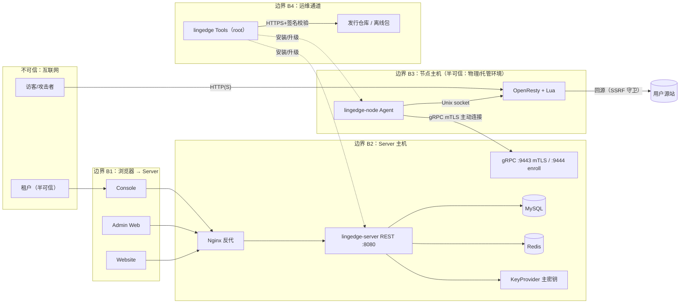

# LingEdge 安全风险清单与威胁模型

> 权威顺序：基线 > PRD > 架构 > 本文。本文对应基线 **第 24 章**的 20 项要求，并补充架构层额外威胁。缓解措施引用 ADR 编号（索引见 [`../architecture/adr/README.md`](../architecture/adr/README.md)），总入口见 [`../architecture/architecture.md`](../architecture/architecture.md)。
> 约定：可能性/影响仅用 **低/中/高** 定性，**不估算数值**（PRD D-2、NFR-30 的数值纪律）。"验证方式"使用基线 §23 的测试类别名。"阶段"为该缓解措施的交付阶段（M1=MVP，P2…P6 同 PRD §10）。**所有"已缓解"指设计层缓解；在对应测试通过并如实记录前，不得宣称已验证（NFR-3、NFR-28）。**

## 1. 范围与资产清单

| 资产 | 位置 | 机密性 | 完整性 | 可用性 | 说明 |
|---|---|---|---|---|---|
| 主密钥（KEK） | Server 主机 `KeyProvider`（默认 root 只读文件，经 systemd credential 注入） | 极高 | 高 | 高 | 丢失=所有信封加密数据不可解密（ADR-011，F-7） |
| 节点 mTLS 私有 CA 私钥 | Server（经 KeyProvider 加密存储） | 极高 | 极高 | 中 | 泄露=可伪造任意节点身份（ADR-003） |
| 配置签名私钥（Ed25519） | Server | 极高 | 极高 | 中 | 泄露=可向所有节点下发恶意配置（ADR-002） |
| 发行清单签名私钥 | **离线保管**，不在任何运行主机上 | 极高 | 极高 | 低 | 泄露=可向所有 Tools 投毒（ADR-012） |
| 证书私钥（租户 TLS） | DB 密文 `certificates.private_key_enc`；节点 0600 文件 | 高 | 高 | 中 | 租户隔离的核心资产（FR-85、NFR-13） |
| Provider/SMTP/Telegram 等凭据 | DB 密文 | 高 | 中 | 中 | `provider_credentials`、`notification_channels` |
| 会话令牌、API Token | DB 仅存 SHA-256；明文仅创建时显示一次 | 高 | 高 | 中 | ADR-018 |
| 密码、TOTP 密钥 | argon2id 哈希；TOTP 密钥信封加密 | 高 | 高 | 中 | NFR-6 |
| 租户配置（站点/规则/回源地址） | MySQL；配置修订块 | 中 | 高 | 高 | 影响数据面行为 |
| 配置修订 | `config_blocks` 内容寻址 + 签名 | 中 | 极高 | 高 | 不可变（ADR-002） |
| 访问日志 | 节点 JSONL → Server 分片文件 | 中（含客户端 IP、URL） | 中 | 中 | 含个人数据，D-10 说明合规不内置 |
| 计费记录 | `usage_records`、`wallet_entries`、`orders`（P5） | 中 | 极高 | 高 | 幂等、可对账（ADR-010） |
| 审计日志 | `audit_logs` | 中 | 极高 | 中 | 不可由租户修改 |
| 数据库备份 | Tools 备份目录 | 高 | 高 | 高 | 须加密或严格权限（NFR-18） |
| 访客流量（数据面） | 节点 | 中 | 高 | 高 | 节点是 TLS 终止点，持有租户私钥 |

范围内：12 个模块（Website/Admin/Console/Server/Node/DNS/Scheduler/Reporter/Worker/Tools/Docs/Status）及其通信。范围外：用户源站自身安全、第三方 DNS/支付/证书机构的内部安全、上游网络的 L3/L4 DDoS 清洗（见 §8）。

## 2. 信任边界与数据流

信任边界要点：
- **B1**：浏览器与 Server 之间是不可信输入边界（XSS/CSRF/认证）。Admin 与 Console 是两个 realm（ADR-014、ADR-018）。
- **B2**：Server 主机内 MySQL/Redis 视为可信；Redis 不可用只降级（ADR-025）。
- **B3**：节点持有租户证书私钥与 mTLS 私钥，**被攻破的节点只应影响其所属集群**（授权按集群，ADR-003/009）。节点不开放控制面入站端口，只主动外连。
- **B4**：Tools 以 root 运行，是**供应链信任根**所在；任何下载物先验签后解压（ADR-012）。
- 数据流方向规则：Server **从不**向节点推送文件/命令（拉取模型，ADR-002/020）；租户**从不**直接触达节点（AD-9、NFR-14）。

## 3. 攻击者模型

| 编号 | 攻击者 | 能力 | 动机 |
|---|---|---|---|
| A1 | 匿名互联网攻击者 | 向官网、API 登录口、数据面、enroll 端口发起请求；扫描 | 入侵、拖库、滥用资源 |
| A2 | 恶意/被盗号租户 | 合法 Console 凭据；可创建站点、域名、规则、证书、回源地址、Webhook | 越权读他租户数据；配置注入；SSRF 打内网；抢占他人域名 |
| A3 | 恶意访客（针对被加速站点） | 构造任意 HTTP 请求、Header、Cookie | 伪造真实 IP、缓存投毒/泄漏、绕过 WAF/CC |
| A4 | 被攻破的节点 | 控制一台节点主机（含其 mTLS 私钥与已下发租户证书私钥） | 横向影响其他节点/集群、窃取证书、反向攻击 Server |
| A5 | 网络中间人 | 位于节点↔Server、Tools↔发行仓库、Server↔源站链路上 | 重放、降级、劫持下载、冒充 Server |
| A6 | 恶意/失误的内部运维 | 持有 Admin 部分权限或主机 shell | 越权操作、泄露密钥、绕过审计 |
| A7 | 供应链攻击者 | 污染依赖、构建产物、发行包 | 在平台各组件植入后门 |
| A8 | 被攻破的 Server | 控制 Server 进程/主机 | 最坏情形，见 §6.5 爆炸半径 |

不在模型内：物理接触 Server 主机并取得 root 且持续在线的攻击者（此时主密钥可被读取，见残余风险）。

## 4. STRIDE 概览

| 类别 | 主要场景 | 主要缓解 | 详见 |
|---|---|---|---|
| Spoofing（假冒） | 假冒节点/Server；伪造 `X-Forwarded-For`；盗用 Token | mTLS+一次性 enroll；可信代理 CIDR；Token 哈希+作用域 | §5.1、5.2、5.3、5.11 |
| Tampering（篡改） | 篡改配置修订/发行包/日志批次 | Ed25519 签名+SHA256；内容寻址+触发器不可变；批次去重键 | §5.16、5.18 |
| Repudiation（抵赖） | 管理操作无记录 | `audit_logs`（含 Request ID、操作者与目标租户双记录） | §5.4、6.x |
| Information disclosure（信息泄露） | 跨租户读取、私钥/凭据泄露、缓存泄漏、日志含秘密 | Scope 强制、信封加密、缓存保守语义、日志脱敏 | §5.4、5.14、6.2 |
| Denial of service（拒绝服务） | 登录/API 暴力、DNS 放大、规则 ReDoS、磁盘写满 | 限流、响应限速、RE2 子集+匹配上限、磁盘限额 | §5.13、5.9 |
| Elevation of privilege（提权） | 租户操作节点；Agent 提权；任意命令执行 | 节点 API 仅平台权限；非 root + 受限升级通道；无任意命令任务类型 | §5.1、5.9、6.8 |

## 5. 基线第 24 章 20 项逐项

### 5.1 节点身份认证
- **威胁场景**：假冒节点获取配置/租户证书；窃取注册 Token 抢先注册；已退役节点继续接入。
- **影响**：高（配置与证书私钥泄露、日志污染）。
- **缓解**：节点身份=私有 CA 签发的证书，SAN `urn:lingedge:node:<uid>`；注册仅一次性 Token（哈希存储、TTL 默认 24h、原子消费、绑定节点 uid），Token 内含 CA 指纹用于钉扎（ADR-003）；每个 RPC 拦截器校验"该资源属于该节点所属集群"（ADR-009）；吊销序列号表 + 90 天短期证书（ADR-003）；Enroll 监听仅在存在未过期 Token 时开启并限速（architecture §7）。
- **残余风险**：Token 在管理员与节点之间的传递渠道由运维负责（泄露窗口受 TTL 与一次性限制）；吊销依赖 Server 侧检查而非 CRL 分发（节点之间不互验证书，影响有限）。
- **验证方式**：API 集成测试（重放已用 Token 被拒、过期 Token 被拒、吊销证书被拒）；安全测试；节点故障测试。
- **阶段**：M1。

### 5.2 mTLS
- **威胁场景**：弱密码套件/降级；节点私钥落盘被读取；证书过期导致失联；中间人伪造 Server。
- **影响**：高。
- **缓解**：gRPC :9443 `RequireAndVerifyClientCert`，**TLS 1.3**（与 ADR-003/node-protocol 一致，不再保留 1.2 回退）；私钥在节点本地生成、不出节点、文件 0600、用户 `lingedge-node`（ADR-003/024）；节点按 enroll 时钉扎的 CA 验证 Server 叶证书（同一私有 CA 签发、serverAuth、SAN 含 `server_url` 主机、私钥存 `signing_keys(purpose=grpc_server)`、90 天并由 `server.cert_rotate` 早于 CA 轮换自动轮换）；节点证书 90 天，1/3 剩余期（≈第 60 天）两阶段续期（新证书 `pending`，首次成功握手后才使旧证书 `superseded`，响应丢失不致失联）；CA 轮换按 S1–S5 分阶段并由 Server 门禁（所有未过期节点追平新 CA bundle 后才改签 Server 叶证书），CA 有效期默认 10 年并由 `doctor` 告警；mTLS CA 与配置签名密钥分属不同信任域（ADR-012，D-12）。
- **残余风险**：离线超过证书有效期的节点需重新 enroll（反馈 F-2），期间数据面继续服务但失去控制面；CA 轮换期间长期离线且证书未过期的节点若未追平新 bundle 会被锁在 S2（需 doctor 告警与人工决策）；CA 私钥位于 Server（§6.5）。
- **验证方式**：API 集成测试（无证书/错误 CA/过期证书拒绝）；节点故障测试；`doctor` 对即将过期证书告警（CLI 安装与升级测试）。
- **阶段**：M1。

### 5.3 API Token 安全
- **威胁场景**：Token 泄露到日志/URL/仓库；Token 越权访问；吊销不及时；暴力猜测。
- **影响**：中-高。
- **缓解**：格式 `le_<8位前缀>_<随机>`，仅创建时显示一次，库内仅存 SHA-256（高熵随机，哈希足够），日志与审计脱敏；作用域（权限串）+ 租户绑定；吊销立即生效（Redis 缓存按 key 失效，ADR-018/025）；只经 `Authorization: Bearer` 头，不接受 query 参数；创建/吊销写审计；使用速率限制。
- **残余风险**：持有者自身泄露无法由平台感知（可提供最近使用 IP/时间便于发现）。
- **验证方式**：安全测试（日志扫描脱敏）；API 集成测试（吊销后失效、越作用域被拒）；多租户隔离测试。
- **阶段**：M1。

### 5.4 租户隔离
- **威胁场景**：IDOR（改 `uid`）；Admin 代租户操作混淆；列表接口漏过滤；后台任务/插件绕过；缓存键、证书、日志、计费的跨租户串用。
- **影响**：极高（核心商业信任）。
- **缓解**：Repository 方法签名强制 `scope.Scope`，tenantdb 构建器统一追加 `tenant_id`，Repository 之外禁止使用 `*sqlx.DB`（自定义 lint）；跨租户一律 `404 resource.not_found`；Admin 代租户必须带 `X-Tenant-ID`，审计双记；路由元数据 CI 检查（每条路由声明 auth/perm/tenant）；gRPC 侧按节点所属集群授权；可选复合外键含 `tenant_id` 作纵深防御（ADR-009）；缓存键含 `site_id`（ADR-005）。
- **残余风险**：平台级（PlatformAll）方法是特权入口，需人工评审与权限串门禁；新增模块忘记使用 Scope 的风险由 lint 与矩阵测试兜底。
- **验证方式**：**多租户隔离测试**（资源×操作×身份矩阵：站点、规则、证书/私钥、日志、Token、账单、工单、缓存任务）；API 集成测试；缓存失效测试。
- **阶段**：M1（模型与强制从 MVP 起，D-13）。

### 5.5 SSRF
- **威胁场景**：租户把回源地址、健康检查目标、Webhook、预热 URL、ACME/Provider 回调指向 `127.0.0.1`、`169.254.169.254`、内网服务；DNS 重绑定；重定向跳转到内网。
- **影响**：高（打穿内网、元数据凭据泄露）。
- **缓解**：`pkg/ssrf` 在**连接时**校验解析结果（`net.Dialer.Control` 钩子，Server 与 Agent 共用），默认拒绝回环、链路本地、私有、组播、元数据地址；节点上由 **Agent** 解析源站域名并校验后写入共享字典，OpenResty 不自行解析（ADR-004）；禁止回源跟随重定向到内网；预热由 Agent 经受控任务拉取并走同一守卫；显式白名单例外：`system_settings.ssrf.allow_cidrs`（平台管理员配置，需 `setting:write` + 再认证，写审计），随签名修订 `global` 块（`ssrf_allow_cidrs`）下发 Agent，Server 保存源站与 Agent 连接时使用同一份；同一源站组内 `protocol/tls_verify/sni` 必须一致（`origin.group_inconsistent`）。真实 IP 调试（FR-73）改为 ctl 纯函数模拟，不开回环调试源站、不需要 SSRF 豁免。
- **残余风险**：自用模式下运维者可能为内网源站配置白名单，错误白名单是配置风险；IPv6 映射/八进制/十六进制 IP 写法需穷举向量（见 §9）。
- **验证方式**：安全测试（内网/元数据/重绑定/十进制 IP/IPv6 映射向量）；API 集成测试；Node 配置下发测试。
- **阶段**：M1（回源/健康检查）、P2（Webhook、ACME）、P3（Provider）。

### 5.6 SQL 注入
- **威胁场景**：排序/过滤字段拼接；动态 `IN` 列表；搜索关键字。
- **影响**：极高。
- **缓解**：全部 SQL 经 sqlx 命名/位置参数；动态排序字段仅允许白名单映射；禁止字符串拼接 SQL 的静态检查（golangci-lint 规则，实现时核对）；Repository 为唯一 SQL 所在层（ADR-001/009）；MySQL 账号最小权限（Server 账号无 `FILE`/`SUPER`，迁移账号与运行账号分离，实现时由 Tools 创建）。
- **残余风险**：低；原生拼接只可能出现在 Repository 内部审阅点。
- **验证方式**：安全测试（注入样本）；Go 单元测试；静态检查。
- **阶段**：M1。

### 5.7 XSS
- **威胁场景**：租户可控字段（站点名、规则备注、工单内容、CMS 内容、错误页内容）在 Admin/Console/官网渲染；自定义错误页 HTML 在数据面访客浏览器执行。
- **影响**：中-高（Admin 会话被盗即平台沦陷）。
- **缓解**：Vue 默认转义，禁用 `v-html`（lint 规则，例外需评审）；CMS 富文本经服务端白名单清洗（实现时选库，核对）；严格 CSP（Admin/Console 无内联脚本、`frame-ancestors 'none'`）；Cookie `HttpOnly; Secure; SameSite=Lax`；自定义错误页作为**静态内容在租户域名下返回**，不得带平台域名 Cookie、不可访问控制面源；该隔离已落为 **Tools 强制**：Admin / Console / 官网必须使用互不相同的主机名（Tools 在 Nginx 片段与安装预检中校验，Cookie 为 host-only），租户数据面域名与控制面域名不同注册域（部署规范）；官网 Nginx 仅反代 `/api/v1/public/`，其余 `/api/` 返回 404。
- **残余风险**：自定义错误页本质允许租户在其自有域名注入脚本，属租户自身范围。
- **验证方式**：前端组件测试；E2E；安全测试（XSS 向量库）。
- **阶段**：M1（Admin）、P2（CMS）、P5（Console）。

### 5.8 CSRF
- **威胁场景**：恶意页面借登录态向 `/api/v1` 发起写操作；登录 CSRF。
- **影响**：中-高。
- **缓解**：Cookie 会话写操作需 `X-CSRF-Token`（双提交，ADR-018）；SameSite=Lax；Bearer Token 调用不受 CSRF 影响；CORS 白名单仅限配置的 Admin/Console 源；状态变更禁用 GET；Admin 与 Console 使用不同 Cookie 名与 realm。
- **残余风险**：低。
- **验证方式**：API 集成测试（缺/错 Token 被拒）；E2E；安全测试。
- **阶段**：M1。

### 5.9 命令注入
- **威胁场景**：Tools 参数、节点任务、备份路径、证书文件名拼接进 shell；开放"任意命令"类运维入口。
- **影响**：极高（节点/Server root 或服务用户权限）。
- **缓解**：**不存在任意命令任务类型**（任务类型为白名单枚举，FR-35、architecture §9.2）；调用外部程序一律参数数组（`exec.Command(name, args...)`），禁止 `sh -c` 拼接（静态检查）；Tools 对所有路径/组件名/版本号严格校验正则；systemd unit 由模板渲染且值经白名单；Agent 非 root（ADR-024）。
- **残余风险**：被调用程序自身的参数解析（如 `openresty -t -p <prefix>`）——前缀目录由 Agent 自行生成，不含用户输入。
- **验证方式**：安全测试（shell 元字符参数向量）；CLI 安装与升级测试；静态检查。
- **阶段**：M1。

### 5.10 Nginx 配置注入
- **威胁场景**：域名/路径/Header 名值/正则/源站地址/错误页内容含换行、`;`、`}`、`$var`、`include`/`lua_` 字样，污染 `nginx.conf` 或 Lua 代码。
- **影响**：极高（节点任意文件读取/代码执行）。
- **缓解**：`nginx.conf` 仅由随 Agent 发行的固定模板渲染；渲染面为白名单类型化值（`Hostname/IP/CIDR/Port/SafeName/Int`），经 `pkg` 校验器；**用户规则为 JSON 数据，由固定 Lua 解释器执行，值不进入指令或 Lua 源码**；动态 Header 名用 `ngx.req.set_header`；Lua 代码随发行包签名，不可由修订下发（ADR-004/005）；Server 校验 + 节点二次校验 + `openresty -t -p` 前缀隔离。
- **残余风险**：渲染面类型校验器自身缺陷；Lua 解释器逻辑缺陷（如变量插值）；需持续扩充向量集。入站可信代理判定已移入 Lua 引擎（数据驱动，不再渲染 `set_real_ip_from`），渲染面进一步缩小；规则变量插值统一按编码形式输出并校验结果（重定向目标须以单个 `/` 或字面量 `http(s)://主机/` 开头，禁 `//`、`/\`、控制字符），关闭开放重定向与 CRLF 面。
- **验证方式**：**OpenResty 配置测试**（注入向量集纳入 CI，要求 `nginx -t` 通过且产物不含注入指令）；规则引擎测试；渲染器 golden 测试。
- **阶段**：M1。

### 5.11 Header 伪造
- **威胁场景**：访客伪造 `X-Forwarded-For`/`X-Real-IP`/`Ling-Client-IP` 欺骗源站或 WAF；租户设置保留 Header 名走私（`Transfer-Encoding`、`Host`）；Header 值含 CRLF。
- **影响**：高（源站按伪造 IP 放行/限速失效）。
- **缓解**：出站 Header 由 Lua 先清除访客同名头再以 `$le_client_ip` 写入（ADR-006）；入站仅在连接来自可信代理 CIDR 时采信转发头（nginx realip + `real_ip_recursive on`）；自定义 Header 名 `^[A-Za-z][A-Za-z0-9-]{0,63}$` + 保留名/前缀拒绝清单；Header 值由 nginx/OpenResty 保证不含 CRLF，用户配置的静态值经 `HeaderValue` 校验器；`Via/Forwarded` 纳入保留名。
- **残余风险**：源站自身若未配置 `set_real_ip_from` 仅信任 LingEdge 出口 IP，仍可被直连绕过（见 5.15，NFR-17 提供出口 IP 清单）。
- **验证方式**：规则引擎测试；Node 集成测试；安全测试（伪造向量，AC-E-4/E-5/E-6）。
- **阶段**：M1。

### 5.12 路径穿越
- **威胁场景**：Tools 解压 `../`、绝对路径、符号链接；日志下载/静态资源/媒体上传路径；`FetchRevision` 解包到 generations 目录越界；URL 规范化绕过（`%2e%2e`、`//`）。
- **影响**：高（任意文件写/读）。
- **缓解**：Tools/Agent 解压使用安全解包器（逐条目校验：拒绝 `..`、绝对路径、符号链接/硬链接目标越界、设备文件；限制总大小与文件数）；文件名一律由服务端生成（ULID），不使用用户输入拼路径；日志分片路径由 `site_uid`/日期/节点 uid 组成：**Server 写前强校验**——`site_uid` 须匹配 ULID 正则，非法则整批 `REJECTED_INVALID`；合法但不属于该节点所在集群当前绑定站点的行归入 `_unattributed/<node_uid>/`（仅平台可见、不计租户日志/计量）并告警；最终 `realpath` 断言在日志根内（不再假设节点自报字段是受控字符集）；URL 规范化在缓存键与规则匹配前统一进行（ADR-005）。
- **残余风险**：低。
- **验证方式**：安全测试（恶意压缩包、符号链接向量）；CLI 安装与升级测试；Go 单元测试。
- **阶段**：M1。

### 5.13 DNS 接口滥用
- **威胁场景**：DNS 管理 API 被暴力调用/越权改 Zone；权威 DNS 被用于放大攻击、`ANY` 查询；Zone 数据被租户篡改他人 Zone；DNS 同步任务 SSRF。
- **影响**：中-高。
- **缓解**：DNS 管理 API 同样走认证、租户 Scope、速率限制（ADR-018/025）；`lingedge-dns` 响应限速（RRL）、对 `ANY` 的最小响应策略、不开放递归；Zone 归属校验（租户只能操作自己 Zone）；DNS 节点拉取 Zone 使用 mTLS 角色 `dns`，不接受外部写入（ADR-003）；DNS 冗余告警（D-9）。
- **残余风险**：权威 DNS 自身被 L3/L4 流量压垮不在平台能力内（见 §8）。
- **验证方式**：DNS 查询测试；安全测试；性能测试（P3 基线）；多租户隔离测试（Zone）。
- **阶段**：P3。

### 5.14 证书私钥保护
- **威胁场景**：私钥明文落库/出现在日志/API 回显；跨租户读取；节点文件权限宽松；备份泄露。
- **影响**：极高（可冒充租户域名）。
- **缓解**：私钥信封加密（AES-256-GCM，DEK/KEK，ADR-011）；API 创建后永不回显；仅在"分发到授权节点"的 `FetchCertificate` RPC 中解密传输（mTLS 通道，按站点所属集群授权）；节点上 0600、用户 `lingedge-node`；私钥**不入配置修订**（ADR-002）；日志脱敏字段类型；备份中私钥保持密文，主密钥独立保管（F-7）。
- **残余风险**：被攻破节点可读取其所服务站点的私钥（固有风险：TLS 终止在节点）；减轻措施是按集群最小化分发、吊销与重签。
- **验证方式**：多租户隔离测试；安全测试（数据库转储中无明文、日志扫描）；证书续期测试；备份恢复测试。
- **阶段**：M1。

### 5.15 源站安全
- **威胁场景**：源站真实地址经响应头/错误页泄露，攻击者绕过 CDN 直攻；源站信任伪造 IP；回源 TLS 不校验被中间人。
- **影响**：中-高。
- **缓解**：不泄露源站地址（错误页由节点生成，剥离 `Server`/`X-Powered-By` 之外的上游敏感头策略，实现时定清单）；提供节点出口 IP 清单（NFR-17）供源站白名单与 `set_real_ip_from`；回源默认校验源站证书（可显式关闭并在 UI/审计中告警）；Host/SNI 回源可配。
- **残余风险**：源站 IP 可能经历史 DNS、邮件头等渠道泄露，超出平台控制；平台只能提供建议。
- **验证方式**：Node 集成测试（构造源站错误，客户端响应无源站地址）；安全测试。
- **阶段**：M1。

### 5.16 安装包签名
- **威胁场景**：篡改清单/包；降级攻击（回放旧清单）；冻结攻击；镜像被替换；离线包伪造。
- **影响**：极高（安装到所有主机的后门）。
- **缓解**：`manifest.json` + `manifest.json.sig`（Ed25519），公钥集内置于 Tools（多公钥、吊销列表、key_id）；清单带单调 `sequence` 与 `valid_until`；包 SHA256 + 包内签名双重校验；先验签后解压；离线包同一格式、同一校验；签名私钥**离线保管**（ADR-012）；节点升级由 root 侧 Tools **重新验签**，不信任 Agent（ADR-024）。
- **残余风险**：公钥内置于 Tools，首次获取 Tools 本身的渠道需 HTTPS 与独立校验和公布（引导信任问题，文档说明）。
- **验证方式**：CLI 安装与升级测试（篡改清单/包被拒，AC-J-2；离线包，AC-J-7）；安全测试。
- **阶段**：M1。

### 5.17 软件供应链
- **威胁场景**：依赖被投毒/拼写劫持；构建环境被污染；`npm` 安装脚本；浮动版本；第三方 Lua 库/OpenResty 二进制来源不明。
- **影响**：高。
- **缓解**：依赖锁定（`go.sum`、`pnpm-lock.yaml`、`go.mod` `toolchain` 行）；禁止浮动版本；校验和数据库保持开启（`GONOSUMCHECK` 等不得放宽，实现时配置）；依赖漏洞扫描工具与 SBOM 生成工具**实现时选型**（NFR-15）；OpenResty 与 Lua 第三方库作为发行包的一部分，随清单签名与哈希；CI 构建可复现性目标；pnpm 安装限制生命周期脚本（实现时配置）。
- **残余风险**：上游已被投毒且未被发现的零日；仅能通过扫描与最小依赖原则降低。
- **验证方式**：安全测试（依赖扫描门禁）；CLI 安装与升级测试；CI 产物签名校验。
- **阶段**：M1（锁定与签名）、P5（SBOM/审计完整化）。

### 5.18 配置版本与回滚
- **威胁场景**：恶意/错误配置下发；重放旧修订使节点回退到有漏洞配置；回滚丢失；节点不知道自己运行哪个版本。
- **影响**：高。
- **缓解**：修订不可变、内容寻址、Ed25519 签名（无过期，R-4）；DB 触发器禁止修改不可变列；回滚=**以旧内容生成新修订**，`seq` 单调递增，节点拒绝 `seq` 小于已应用值的修订（防重放）；节点本地保留最近 N 代并在失败时自动回退；逐节点逐集群记录实际生效版本；配置签名密钥链式轮换（ADR-002/020）。
- **残余风险**：被盗的配置签名私钥可签发恶意修订（见 §6.5 与事件响应）；Server 被攻破时签名无防御意义。
- **验证方式**：Node 配置下发测试（签名不符被拒、nginx -t 失败保持旧版）；规则引擎测试（回滚）；节点故障测试。
- **阶段**：M1。

### 5.19 备份恢复
- **威胁场景**：备份文件泄露；备份缺主密钥导致无法恢复；恢复覆盖正确数据；备份被篡改；备份点之后数据丢失未被告知（不可逆 Migration）。
- **影响**：高。
- **缓解**：Tools `backup create` 备份配置+数据库，权限 0600 并可加密（NFR-18）；**主密钥备份为独立流程**，不与 DB 备份同处（F-7）；升级前强制备份；不可逆 Migration 明示"回滚=恢复备份+旧二进制，备份点后数据丢失"（ADR-013）；备份附 SHA256 清单；恢复演练纳入测试。
- **残余风险**：主密钥与备份同时丢失=加密数据永久不可恢复（必须在安装向导完成时提示并要求确认已备份主密钥）。
- **验证方式**：**备份恢复测试**（备份→清库→恢复→数据一致；记录步骤与耗时）；CLI 安装与升级测试。
- **阶段**：M1。

### 5.20 节点故障切换
- **威胁场景**：节点故障导致站点不可用；单探针误判引发抖动或全量摘除；恶意制造故障诱发错误调度；主控离线时节点行为。
- **影响**：中-高。
- **缓解**：主控离线节点继续服务（ADR-020、FR-57）；P3 前为手工摘除/DNS 调整（NFR-19），P3 起自动调度——多探针联合 + 迟滞，不因单探针一次失败摘除（ADR-021）；维护状态节点不再被调度；源站主备自动切换（Agent 主动健康检查，ADR-004）；防"全员摘除"：保底保留至少一个备用节点池（P3 设计细化）。
- **残余风险**：探针被攻击者针对性干扰可诱发误摘除；DNS TTL 导致切换延迟。
- **验证方式**：**节点故障测试**（手工与自动两路径）；DNS 查询测试；性能测试。
- **阶段**：M1（节点自治+手工）、P3（自动调度）。

## 6. 额外的架构相关威胁

### 6.1 域名接管 / 域名所有权（反馈 F-1）
- **场景**：租户 A 在 FR-48 的"全局唯一"下抢先绑定 `victim.com`，并通过 CDN 为其提供内容/收集流量，或阻止真实所有者接入。
- **缓解**：`site_domains.verification_status` 预留（DB 默认 `pending`，自用模式由 Service 创建时显式置 `exempt`，避免漏写校验分支时未验证域名被默认豁免）；验证方式 DNS TXT / HTTP 文件 / 管理员豁免；M1 自用模式默认"管理员豁免"，**商业模式（P5）必须启用验证**；通配符与子域重叠语义待 PRD 明确。
- **残余**：未启用验证的部署存在接管风险（须在 Docs 明示）。
- **验证**：多租户隔离测试；安全测试。**阶段**：M1（模型）/P5（强制）。

### 6.2 缓存投毒与跨用户泄漏
- **场景**：缓存带 `Set-Cookie`/个性化响应被其他访客获取；`Vary` 处理错误；未纳入缓存键的 Header 导致投毒（如 `X-Forwarded-Host` 反射）；URL 规范化差异造成键碰撞。
- **缓解**：RFC 9111 保守语义——默认不缓存 `Set-Cookie` 响应、带 `Authorization` 的请求（除非 `Cache-Control: public`）、`Vary: *` 与不在键维度内的 `Vary`；Cookie 策略 `ignore|include_named|bypass_on_named`；覆盖默认须站点级显式开关+审计+风险提示；缓存键含 `site_id`、`site_epoch`、规范化 URI；反射型 Header 不参与上游请求（ADR-005）；**缓存键封闭规则（KCR，ADR-005 §3.7）**：凡处于 rewrite/origin_rule/origin_headers/upstream_response 阶段、会影响源站响应的规则，其条件字段与动作插值变量必须 ⊆ 生效缓存策略的键维度，否则发布失败 `rule.cache_key_dimension_conflict`，或规则显式声明 `cache_interaction: "bypass"`（命中请求既不读也不写缓存）——杜绝"Cookie/UA/client_ip 决定回源却共享同一缓存对象"的跨用户泄漏。
- **残余**：错误配置的"全部缓存"规则由租户自行承担，但须有风险提示；`ignore_origin_cache_control` 仅忽略 TTL 类指令，`private/no-store/Set-Cookie/Authorization/Vary:*` 保护始终有效，绕过只能经危险开关（risk_ack + 审计）；KCR 对 `reads(规则)` 的分析为语法保守（`any/not` 内叶子全部计入），可能拒绝实际安全的规则（以明确报错换安全）。
- **验证**：缓存失效测试、规则引擎测试（泄漏测试 AC-C-7a/b/c，纳入 CI；KCR 的 V-1..V-3 见 §9 G-10）。**阶段**：M1。

### 6.3 日志注入与日志泄露
- **场景**：URL/UA/Referer 含换行或控制字符污染 JSONL 或审计日志；日志含 Token/密码/私钥；访客个人数据保留过久。
- **缓解**：nginx `escape=json` + Server 端按 JSON 解析并仅以结构化字段入库；Zap 结构化字段，敏感类型 `Redact`；URL 查询串中的已知敏感参数名（可配）脱敏；保留期任务（FR-28，P2）。
- **残余**：高基数个人数据合规不内置（D-10）。
- **验证**：安全测试（日志扫描脱敏）；API 集成测试。**阶段**：M1。

### 6.4 CC/WAF 绕过
- **场景**：编码绕过、分块、大小写、Header 欺骗；限流以多 IP 分散；观察模式长期不转阻断；Redis/主控不可用时限流失效。
- **缓解**：WAF/CC 位于固定阶段 `waf_cc`（ADR-005），先于重定向/缓存；输入统一规范化后再匹配；限流节点本地为主、Redis 不在请求路径（ADR-022）；跨节点汇总为近似值，已在文案声明（R-9）。
- **残余**：WAF 为规则型，不保证覆盖全部攻击；误拦截率须测量并如实记录（FR-96）。
- **验证**：WAF 误拦截测试；性能测试（开关前后）；安全测试。**阶段**：P4。

### 6.5 Server 被攻破的爆炸半径（CA 私钥/主密钥）
- **场景**：Server 进程或主机被攻破（A8）。
- **影响**：攻击者可读取主密钥→解密所有信封数据（含证书私钥、凭据）；使用 CA 私钥签发任意节点证书；使用配置签名私钥签发恶意修订并下发全网节点。
- **缓解/限制爆炸半径**：发行清单签名私钥**不在 Server**（离线），攻击者无法经 Tools 升级通道投毒；Server 运行用户 `lingedge` 非 root、systemd 硬化（`NoNewPrivileges`、`ProtectSystem=strict`、`CapabilityBoundingSet` 空）；MySQL 账号最小权限；主密钥经 systemd credential 仅进程内存持有，不入库；审计外送（P2 通知渠道/日志外发，实现时定）；三个信任域密钥分离，使一个域泄露不自动等价于全部（ADR-011/012）。
- **残余（必须诚实声明）**：Server 的完整 root 失陷=平台失陷；MVP 无外部 KMS/HSM，主密钥可被同主机 root 读取；配置签名与 CA 同在 Server，**无法防御 Server 自身失陷**。缓解依赖主机加固、最小暴露面、监控与备份；`KeyProvider` 接口为日后接入外部 KMS 预留。
- **验证**：安全测试；备份恢复测试（密钥轮换演练）。**阶段**：M1（分离）/P5（演练与审计）。

### 6.6 Redis 不可用 / 被污染
- **场景**：Redis 宕机或被写入伪造键（权限缓存、限流计数、任务唤醒）。
- **缓解**：Redis 非唯一真相（ADR-025）；会话/权限以 MySQL 为准，Redis 仅缓存并设短 TTL；登录节流在 Redis 不可用时降级为进程内计数（严格模式可选 fail-closed，仅对登录）；任务以 MySQL 为准，Redis 仅唤醒；Redis 要求密码、监听内网/回环、禁用危险命令（Tools 配置模板）。
- **残余**：Redis 不可用期间限流精度下降。**验证**：API 集成测试（故障注入）；性能测试。**阶段**：M1。

### 6.7 租户通过规则/回源 SSRF 打内网
- 与 5.5 同源，补充**规则引擎特有路径**：`origin_rule` 的回源地址/Host 改写、`redirect` 目标（开放重定向与内网跳转）、`error_page` 上游。缓解：规则校验阶段对回源目标走 SSRF 校验；重定向目标限定 scheme/长度并禁止包含 CRLF；回源地址仅来自已校验的 `origins`，规则只能选择/覆盖受限字段（ADR-005）。验证：规则引擎测试；安全测试。阶段：M1。

### 6.8 Agent 升级特权路径
- **场景**：Agent 被攻破后借升级通道提权为 root；staging 目录被替换/预置符号链接或硬链接；诱使 root 进程写结果文件时覆盖任意文件；`.path` 单元触发被滥用。
- **缓解**：Agent 仅下载并预验证到 staging，写 `upgrade.request`；该请求**仅含 `component`（`node|openresty`）+ `version` + `task_uid`，不含任何路径或命令**；`lingedge-node-upgrade.path` 触发 root 单元 `lingedge update node --apply-staged`，root 侧对 `staging` 目录以 `O_NOFOLLOW|O_DIRECTORY` 取 dirfd，全部经 `openat(dirfd, …, O_NOFOLLOW)` 读取，要求 `S_ISREG` 且 `st_nlink==1`，暂存文件名由 `component+version` 固定推导，复制到 root 私有目录后**重新验签与校验 SHA256**，只接受清单中的版本且禁止降级（ADR-024）；**结果文件写入 root 属主目录** `/var/lib/lingedge-node-upgrade/<task_uid>.result.json`（root:root，`O_EXCL|O_NOFOLLOW`），Agent 只读，root 进程**从不向 Agent 属主目录写入任何文件**（消除符号链接/硬链接覆盖提权面）；`NodeUpgrade.component` 在 proto、ADR-024、OpenAPI 三处统一为 `node|openresty`。
- **残余**：Tools 自身缺陷；root 侧入口须最小化参数面并纳入模糊测试；`/var/lib/lingedge-node` 属 Agent，Agent 可在 staging 内放任意内容，故 root 侧一切读取均视为不可信输入。
- **验证**：CLI 安装与升级测试；安全测试（staging 内符号链接/硬链接/`../`/非白名单 component/篡改签名的请求，root 侧一律拒绝且无越界写入）。**阶段**：M1。

### 6.9 重放与回滚攻击
- **场景**：重放旧配置修订使节点回到存在漏洞的配置；重放旧发行清单降级；重放已用 enroll Token；重放计量上报；重放支付回调。
- **缓解**：修订 `(lineage, seq)` 字典序严格递增（节点拒绝不严格大于本地的修订）；数据库恢复后由 `lingedge-server lineage bump` 提升 lineage（= max(恢复值+1, 当前 UNIX 秒)），使恢复后的低 seq 新修订、失效标记与 epoch 仍被节点接受，同时不放宽重放防护；清单 `sequence` 本地记忆；Token 一次性；日志/rollup/usage 幂等键；支付回调验签+幂等入账（ADR-002/010/012）。
- **残余**：节点首次启动无本地记忆时依赖 Server 提供的 `seq`（受 mTLS 保护）；备份恢复时钟回拨会使 lineage 不单调（`doctor` 检查时钟）；节点级回滚（`node_rollback`）靠 `held_seq` 防止立刻被重新应用，平台发布更高 seq 修订才解除。
- **验证**：Node 配置下发测试；计费对账测试；CLI 安装与升级测试。**阶段**：M1（修订/清单/Token）、P5（支付）。

### 6.10 安装向导抢占（反馈 F-8）
- **场景**：`install.lock` 出现前，向导对网络可达，抢先访问者创建管理员。
- **缓解**：Tools 生成一次性 setup token，仅在终端显示；向导所有写接口需该 token；默认仅绑定 127.0.0.1，远程访问时 Tools 明确提示风险；完成后写 `install.lock` 并永久关闭向导路由；管理员密码由安装者设定，无固定默认口令（NFR-6）。
- **残余**：操作者主动暴露向导并泄露 token。
- **验证**：CLI 安装与升级测试（`install.lock` 后向导不可访问）；安全测试（固定密码扫描）。**阶段**：M1。

## 7. 风险登记表

| ID | 风险 | 可能性 | 影响 | 负责阶段 | 状态 |
|---|---|---|---|---|---|
| TR-01 | 跨租户数据泄露（Scope 遗漏） | 中 | 高 | M1 | 设计缓解，待隔离矩阵验证 |
| TR-02 | Nginx 配置/Lua 注入 | 中 | 高 | M1 | 设计缓解，待注入向量验证 |
| TR-03 | 节点 mTLS 身份被盗用（私钥泄露） | 低 | 高 | M1 | 设计缓解（吊销+短期证书） |
| TR-04 | 配置签名私钥/CA 私钥随 Server 失陷 | 低 | 高 | M1 | 已接受并声明（§6.5） |
| TR-05 | 主密钥泄露或丢失（含备份缺失） | 低 | 高 | M1 | 设计缓解；备份流程待实现 |
| TR-06 | SSRF（回源、Webhook、预热） | 中 | 高 | M1/P2/P3 | 设计缓解，待向量验证 |
| TR-07 | 域名接管（无所有权校验） | 中 | 高 | M1 模型 / P5 强制 | 待 PRD 采纳 F-1 |
| TR-08 | 缓存跨用户泄漏/投毒 | 中 | 高 | M1 | 设计缓解，待泄漏测试 |
| TR-09 | 供应链污染（依赖/构建/发行包） | 低 | 高 | M1 | 设计缓解；扫描选型待定 |
| TR-10 | 发行签名私钥泄露 | 低 | 高 | M1 | 离线保管；吊销流程待演练 |
| TR-11 | 节点离线超过证书有效期失联（F-2） | 中 | 中 | M1 | 已知限制；doctor 告警 |
| TR-12 | Agent 升级特权路径被滥用 | 低 | 高 | M1 | 设计缓解（重新验签） |
| TR-13 | 安装向导被抢占 | 低 | 高 | M1 | 设计缓解（setup token） |
| TR-14 | ReDoS（规则正则） | 中 | 中 | M1 | RE2 子集+匹配上限，待差分测试（PoC-5） |
| TR-15 | 日志含敏感信息 | 中 | 中 | M1 | 脱敏设计，待扫描 |
| TR-16 | Redis 故障/污染导致降级 | 中 | 低 | M1 | 设计缓解 |
| TR-17 | DNS 放大/滥用 | 中 | 中 | P3 | 待实现 |
| TR-18 | WAF 误拦截/绕过 | 高 | 中 | P4 | 待测量 |
| TR-19 | 单探针误摘除/全员摘除 | 中 | 高 | P3 | 设计缓解（ADR-021） |
| TR-20 | 源站 IP 泄露、绕过 CDN 直连 | 高 | 中 | M1 | 提供出口 IP 清单；平台无法完全防止 |
| TR-21 | 计费重复/篡改 | 低 | 高 | P5 | 设计缓解（幂等键） |
| TR-22 | 支付回调伪造/重复 | 中 | 高 | P5 | 验签+幂等 |
| TR-23 | 被攻破节点窃取其所服务站点私钥 | 中 | 高 | M1 | 固有风险；按集群最小分发，吊销重签 |
| TR-24 | HTTP/3、L2、DNSSEC 未验证即宣称 | 低 | 中 | P6 | 流程门禁（NFR-27） |
| TR-25 | 条件化回源/改写规则绕过缓存键造成跨用户缓存泄漏 | 中 | 高 | M1 | 设计缓解（KCR，ADR-005 §3.7）；待 V-1..V-3 验证 |
| TR-26 | 备份恢复使 seq/epoch 回退，节点永久拒绝新修订或吞掉失效标记 | 中 | 高 | M1 | 设计缓解（lineage + `lineage bump`）；待 AC-J-5 扩展验证 |
| TR-27 | 节点级回滚后被重新应用被回退的修订 | 低 | 中 | M1 | 设计缓解（`held_seq` + `ACTION_HOLD`） |
| TR-28 | 集群发布队列被暂停/卡死的部署长期阻塞（拒绝服务/运维疏忽） | 中 | 中 | M1 | 设计缓解：仅平台可暂停；暂停超时告警；`retry/cancel` 入口（ADR-002 发布编排） |
| TR-29 | root 升级进程被 Agent 属主目录中的链接诱导覆盖任意文件 | 低 | 高 | M1 | 设计缓解（请求仅 component+version+task_uid、dirfd/O_NOFOLLOW、结果写 root 属主目录） |
| TR-30 | 被攻破节点伪造 `site_uid` 污染他租户日志/计量 | 中 | 高 | M1 | 设计缓解（ULID 强校验 + 集群归属 + `_unattributed`） |

## 8. 安全边界声明（FR-101、基线 §13.3）

**CDN 的 WAF/CC 不等于具备独立的大规模 L3/L4 DDoS 清洗能力。** LingEdge 的 WAF/CC 工作在应用层（HTTP/HTTPS），无法替代运营商/高防网络对网络层/传输层大流量攻击的清洗。若运营者需要"高防"，必须接入实际具备该能力的网络或高防服务（OQ-11）。该声明须出现在：官网安全产品页、Docs、Console 安全防护页；文案不得出现未经证实的防护量级承诺。

## 9. 安全测试清单与 CI 门禁

| 门禁 | 内容 | 测试类别（§23） | 阶段 |
|---|---|---|---|
| G-1 注入向量集 | 域名/路径/Header 名值/正则/源站/错误页内容含换行、`;`、`{}`、`$var`、`include`、`lua_`、`'''`、`%0d%0a`；另含**默认站点/未匹配 Host·SNI**（HTTP 未匹配 Host→444，HTTPS 未匹配 SNI→`ssl_reject_handshake`，HTTP/2 连接复用 SNI≠Host→421）与重定向目标 `//evil.com`、`/%2f%2fevil.com`、`\\` 形态；断言被拒或被无害转义，`nginx -t` 通过，产物不含注入指令 | OpenResty 配置测试、规则引擎测试 | M1 |
| G-2 租户隔离矩阵 | 资源×操作×身份（含 Admin 代租户、API Token、gRPC 节点）全部越权用例失败即阻断发布；路由元数据检查 | 多租户隔离测试、API 集成测试 | M1 |
| G-3 SSRF 向量 | 回环/私有/链路本地/元数据；十进制/八进制/十六进制 IP；IPv6 映射；DNS 重绑定；重定向到内网；Webhook | 安全测试 | M1（回源）/P2 |
| G-4 路径穿越向量 | `../`、绝对路径、符号链接、硬链接、`%2e%2e`、超大条目数；Tools 与 Agent 解包器、日志下载、媒体上传 | 安全测试、CLI 安装与升级测试 | M1 |
| G-5 日志脱敏扫描 | 在集成测试输出与日志样本中扫描 Token/密码/私钥/`Authorization` 模式 | 安全测试 | M1 |
| G-6 固定密码扫描 | 代码、配置模板、迁移与文档中检索默认口令模式（NFR-6） | 安全测试 | M1 |
| G-7 依赖与供应链扫描 | Go 与 npm 依赖漏洞扫描、许可证扫描、SBOM 生成；**工具实现时选型** | 安全测试 | M1 |
| G-8 签名/篡改测试 | 篡改清单/包体/配置修订/重放旧 seq 均被拒 | CLI 安装与升级测试、Node 配置下发测试 | M1 |
| G-9 伪造 Header 测试 | 访客伪造三类 IP Header、非可信代理伪造 XFF（AC-E-4、E-6） | Node 配置下发测试、规则引擎测试 | M1 |
| G-10 缓存泄漏测试 | **V-1（Go 单元，本机可跑）**：KCR 矩阵——条件字段/插值变量（cookie/UA/header/query/client_ip/method）× 缓存策略键维度（含内联 `cache_key` 覆盖、`any/not` 嵌套、`cache_interaction=bypass` 放行）；**V-2（OpenResty 集成）**：`origin_rule when cookie beta=1` + `cookie_policy=ignore` → 发布被拒 `rule.cache_key_dimension_conflict`；改 `include_named:[beta]` → 通过且有/无 beta 请求命中不同缓存对象、互不串；`cache_interaction=bypass` → beta=1 请求 `BYPASS` 且不产生缓存对象；`UA contains Mobile → rewrite`、回源头 `X-Client: ${client_ip}` 同理；**V-3（泄漏测试 AC-C-7a/b/c）**：两用户不同会话 Cookie 请求同一动态 URL 不得互串，条件化回源规则场景同样不得串 | 缓存失效测试、规则引擎测试 | M1 |
| G-11 Mock 隔离检查 | 生产构建不得引用测试替身（NFR-1、ADR-023） | — | M1 |
| G-12 任意命令检查 | 静态检查禁止 `sh -c`/字符串拼接 `exec`；API/任务类型无命令执行入口 | 安全测试 | M1 |
| G-13 WAF 误拦截 | 合法业务样本集误拦截率测量并如实记录 | WAF 误拦截测试 | P4 |

门禁失败即阻断合并/发布；未通过项与已知问题如实记录（NFR-28）。环境缺失导致无法运行的门禁标「等待环境验证」，不得写成通过（NFR-3）。

## 10. 密钥与信任域

| 信任域/密钥 | 保护对象 | 算法/形式 | 保管 | 分发/信任锚 | 轮换 | 吊销 |
|---|---|---|---|---|---|---|
| ① 发行清单签名 | 组件包、版本清单 | Ed25519（ADR-012） | **离线**（不在运行主机） | 公钥集内置 Tools（key_id） | 新旧并存重叠期，经新版 Tools 发布新公钥 | 清单内吊销列表 + 新版 Tools 内置 |
| ② 配置版本签名 | 配置修订 | Ed25519 | Server（KeyProvider 加密） | enroll 时下发公钥集；轮换用链式 keyset（新 keyset 由旧有效 key 签名） | 重叠期内新旧均可验证；签名无过期 | 在新 keyset 中移除旧 key；已应用修订仍有效 |
| ③ 节点 mTLS CA | 节点/DNS/Reporter 身份 | ECDSA P-256，叶证书 90 天 | Server（KeyProvider 加密） | enroll 下发 CA 根（指纹钉扎于 Token） | CA 轮换：S1–S5 分阶段（新 CA 入 bundle → 等所有未过期节点追平 → Server 叶证书与新签发证书改由新 CA → 节点续期 → 撤旧 CA）；Server 叶证书（`grpc_server`，90 天）早于 CA 轮换自动轮换 | `node_certificates.status='revoked'` + 拦截器拒绝（内存缓存，Redis 失效广播）；节点重新 enroll |
| 主密钥（KEK） | 所有信封加密数据 | AES-256-GCM 的 KEK，`key_id` 版本化 | KeyProvider（默认 root 0400 文件，systemd LoadCredential） | 仅 Server 进程内存 | 新 key_id → 后台重加密任务 → 旧 key 保留至完成 | 重新生成 + 全量重加密 |
| 会话令牌 | Admin/Console 登录态 | 32B 随机，库存 SHA-256 | 浏览器 Cookie / DB | 按 realm 分 Cookie | 过期/登出/改密即失效 | 删除行 + Redis 缓存失效 |
| API Token | 机器调用 | `le_<前缀>_<随机>`，库存 SHA-256 | 持有者 | — | 用户自助轮换 | 立即吊销 |
| 注册 Token | 节点 enroll | 随机 + CA 指纹，库存哈希 | 管理员一次性传递 | — | 单次使用、TTL 默认 24h | 过期或删除 |

## 11. 事件响应要点

> 以下为设计层步骤，需在备份恢复/节点故障演练中验证（实现时补充为运维 Runbook，放入 `docs/operations/`）。

### 11.1 节点证书/私钥泄露或节点被攻破
1. Admin 将节点置为维护并摘出调度（P3 前手工调整 DNS）；2. 将节点证书置 `node_certificates.status='revoked'`（含 `pending`/宽限期内的 `superseded` 证书），Server 拦截器立即拒绝其所有 RPC；3. 评估该节点所属集群所服务站点的证书私钥已泄露 → 对相关证书**重签/重新签发**并重新分发；4. 重装节点后重新 enroll（新密钥、新 Token）；5. 审计该节点期间的日志上传批次是否异常；6. 记录事件与范围。

### 11.2 配置签名私钥泄露（尚未确认 Server 整体失陷）
1. 生成新 Ed25519 密钥，发布**由旧 key 签名的新 keyset**（链式轮换），使节点信任新 key；2. 以新 key 重新签发各集群当前修订（新 `seq`）；3. 从 keyset 中移除旧 key，节点拒绝旧 key 签名的新修订；4. 审查泄露窗口内产生的修订与部署记录；5. 若无法确认 Server 未失陷，按 11.4 处理。

### 11.3 主密钥泄露
1. 视为所有信封加密数据暴露：生成新主密钥（新 `key_id`）；2. 触发后台**重加密任务**（证书私钥、凭据、TOTP 密钥）；3. **对所有租户证书重签并分发**，轮换所有 Provider/SMTP/Telegram 凭据（通知相关方）；4. 使所有会话失效、强制重设 API Token；5. 新旧备份中的密文按旧密钥视为已暴露，处置备份保管；6. 调查泄露渠道。

### 11.4 Server 整体失陷（最坏情形）
1. 隔离 Server 主机；2. 在干净主机恢复（Tools 备份 + 独立保管的主密钥）；3. **重建 mTLS CA 与配置签名密钥**，全部节点重新 enroll（CA 变更）；4. 重签全部租户证书、轮换全部凭据；5. 强制重置管理员与会话；6. 发行签名私钥因离线保管不受影响，但需检查 Tools 是否被污染；7. 公告与审计复盘。

### 11.5 发行签名私钥泄露
1. 从离线备份生成新密钥对；2. 发布新版 Tools（内置新公钥、旧 key 加入吊销列表）并通过**独立可信渠道**公告；3. 全部主机以带外方式更新 Tools；4. 吊销旧 key 签名的所有清单；5. 复核已发布版本的哈希。

## 12. 与 PRD 的关系

本文所引安全假设与 `docs/architecture/architecture.md` §13 的反馈 F-1、F-2、F-7、F-8、F-9 一致；其中 **F-1（域名所有权校验）为安全相关的建议新增 FR**，其余为澄清。

## 修订记录 2026-11-16

依据 `docs/bmad/review-architecture.md` / `review-architecture-internal.md`：
- §5.2、§10、§11.1：TLS 1.3；Server 叶证书（`grpc_server`）与自动轮换；CA 分阶段轮换与有效期告警；`revoked_serials` 改指 `node_certificates.status='revoked'`（MIN-07、IMP-05、M13、L23）。
- §5.5、§5.7：SSRF 白名单落到 `system_settings.ssrf.allow_cidrs` + `global` 块；调试不再需要 SSRF 豁免；数据面/控制面隔离落为 Tools 强制的独立主机名（IMP-10、IMP-11、IMP-17、MIN-07）。
- §5.10、§6.2、§9 G-1/G-10：缓存键封闭规则（KCR）与验收 V-1..V-3；默认站点/421 测试（BLK-03、MIN-12）。
- §5.12：`site_uid` 写前强校验与 `_unattributed`（IMP-08、H7）。
- §6.1：`verification_status` 默认 `pending`（MIN-11）。
- §6.8：升级特权路径（BLK-07、H8）。
- §6.9：lineage 与备份恢复、节点级回滚 `held_seq`（IMP-07、H6）。
- §7：新增 TR-25..TR-30。

